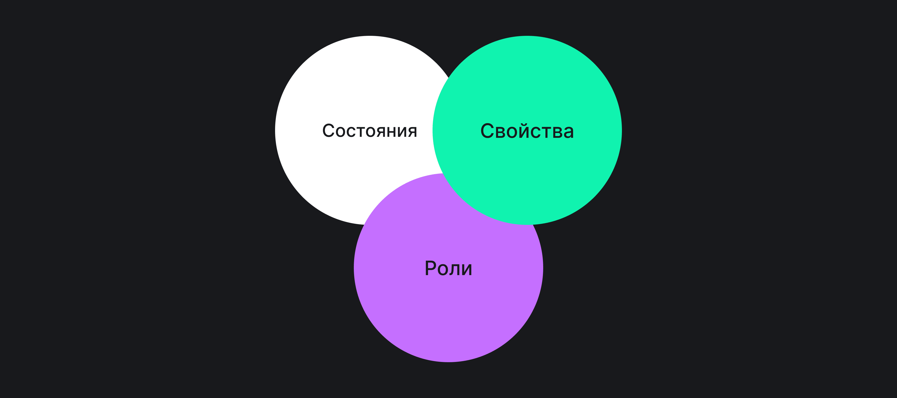

## Кратко

_ARIA (Accessible Rich Internet Applications)_ — это набор дополнительных атрибутов, которые расширяют возможности HTML, SVG и других языков, чтобы [интерфейсы стали доступнее](/a11y/chto-takoe-a11y/).

<aside>

💰 _RIA (Rich Internet Application, насыщенное интернет-приложение)_ — веб-приложение, которое по удобству работы похоже на десктопное, но открывается в браузере.

</aside>

ARIA помогает рассказать вспомогательным технологиям то, что HTML описать не может. С помощью ARIA-разметки можно задать роль кастомному элементу, связать элементы друг с другом, указать их состояние, отметить изменения на странице или описать структуру документа.

ARIA не влияет на внешний вид элементов и их поведение, а также не изменяет [DOM](/js/dom/). ARIA-атрибуты изменяют только то, как с элементами и страницами взаимодействуют браузеры, [Accessibility API](/a11y/screenreaders/#accessibility-api) и вспомогательные технологии.

## Кому помогает

ARIA помогает людям с визуальными, моторными и когнитивными особенностями. Они пользуются вспомогательными технологиями и настройками доступности в операционных системах или браузерах. Например:

- [скринридеры](/a11y/screenreaders/);
- дисплеи Брайля;
- экранные лупы;
- альтернативные устройства ввода и манипуляторы: выносные компьютерные кнопки, головные указатели, виртуальные клавиатуры;
- [голосовое управление](/a11y/speech-recognition/) и программы для преобразования текста в речь.

Многие из этих пользователей не работают с мышью. Они управляют компьютером с клавиатуры, жестами на сенсорном экране или голосом.

## Как это понять

Внешний вид элементов не всегда совпадает с их функциями. К примеру, элемент в демке выглядит как кнопка с текстом «Очистить форму».

<iframe title="Ненастоящая кнопка" src="demos/fake-button/" height="250"></iframe>

Кнопку сверстали на семантически нейтральном теге [`<div>`](/html/div/). Скринридер прочитает его как обычный текст, без роли кнопки. А перейти на него клавишей <kbd>Tab</kbd> нельзя вообще: ни со скринридером, ни без него.

```html
<div class="button button-aqua">Очистить форму</div>
```

В этой ситуации ARIA поможет превратить `<div>` в кнопку. Добавим ARIA-роль [`button`](/a11y/role-button/), а ещё поместим элемент в порядок фокуса с помощью HTML-атрибута [`tabindex="0"`](/html/tabindex/).

```html
<div
  class="button button-aqua"
  role="button"
  tabindex="0"
>
  Очистить форму
</div>
```

Теперь элемент доступен для скринридеров. Пользователи могут установить на нём фокус и узнать, что это кнопка с названием «Очистить форму». Но нажать её с клавиатуры пока нельзя: `<div>` не реагирует на <kbd>Enter</kbd> и пробел. Обработчики этих клавиш придётся написать на JavaScript.

Самое лучшее решение проблемы с доступностью этой кнопки — HTML-тег [`<button>`](/html/button/). Тогда не нужны лишние атрибуты и обработчики клавиш. Кнопка сама получает фокус, а <kbd>Enter</kbd> и пробел вызывают на ней то же событие [`click`](/js/element-click/), что и мышь. Звучит странно, но одно из главных правил использования ARIA — стараться не использовать ARIA.

```html
<button class="button button-aqua">Очистить форму</button>
```

Более сложный пример — сообщение о том, удалось ли действие. Как рассказать пользователям вспомогательных технологий, что на странице что-то произошло? Например, что форма успешно очищена.

Добавим для сообщения об успешной очистке формы [`role="status"`](/a11y/role-status/). Элемент с этой ролью должен быть в разметке заранее, пустым. Когда скрипт запишет в него текст, скринридер объявит его, после того как дочитает текущую фразу. Если вставить такой элемент на страницу сразу с текстом, скринридер скорее всего промолчит.

```html
<button class="button button-aqua">
  Очистить форму
</button>

<div class="status-message" role="status"></div>
```

<iframe title="Кнопка с сообщением об успешной очистке формы" src="demos/status-message/" height="300"></iframe>

## Когда не нужно использовать

> Мастерство владения ARIA заключается не столько в том, как её использовать, сколько в том, когда её не стоит использовать.
[ARIA Spec for the Uninitiated: Part 3](https://www.deque.com/blog/aria-spec-for-the-uninitiated-part-3/), Джерард Коэн.

ARIA не нужна, когда хватает возможностей HTML, SVG и других языков. Поэтому вместо `<div role="button">` лучше использовать `<button>`, а вместо [`<div role="main">`](/a11y/role-main/) — [`<main>`](/html/main/). В семантические HTML-элементы уже встроены роли. В интерактивные элементы встроено ещё и поведение: фокус и реакция на клавиши.

<aside>

🎭 Роли бывают встроенными и явно заданными. Встроенные роли есть у большинства семантических HTML-тегов по умолчанию, а явно задать роль элементу можно как раз с помощью ARIA.

</aside>

Есть несколько ресурсов, которые помогут быстро узнать о встроенных ролях HTML-тегов:

- [HTML-элементы и доступные имена](https://russmaxdesign.github.io/html-elements-names/);
- [периодическая таблица семантики](https://gerardkcohen.github.io/periodic-table-of-semantics.html);
- [таблица с HTML-элементами, встроенными ролями и возможными атрибутами](https://www.w3.org/TR/html-aria/#docconformance) из спецификации [ARIA in HTML](https://www.w3.org/TR/html-aria/).

## Когда пригодится

ARIA пригодится во всех случаях, когда возможностей HTML недостаточно. То есть когда нет элементов с нужными ролями, свойствами и состояниями. Дополнительные атрибуты понадобятся в нескольких ситуациях:

- Динамическое обновление контента. Например, таймеры, оповещения, подгружающиеся не сразу части страниц.
- Кастомные интерактивные элементы и улучшение навигации с клавиатуры, особенно если их пишут на JavaScript. Примеры — выпадающий список, вкладки, тултип или всплывающее окно.
- Добавление ориентиров на страницу, если подходящего тега нет. Ориентиры — это части страницы, между которыми пользователи вспомогательных технологий быстро переходят. Примеры — основное содержимое, навигация, поиск.
- Исправление проблем с доступностью в браузерах и для вспомогательных технологий из-за разной поддержки возможностей HTML, CSS и других языков.

## Как устроено

ARIA состоит из трёх частей: ролей, состояний и свойств.



_Роли_ — основные цели и функции элемента. Их задают атрибутом `role`.

Роли бывают разных типов. Одни могут отвечать за интерактивные элементы, к примеру, `button` и [`tab`](/a11y/role-tab/). Какие-то роли нужны для создания ориентиров на странице. Например, [`search`](/a11y/role-search/) и [`banner`](/a11y/role-banner/).

Некоторым ролям нужны дочерние элементы определённых ролей. Например, внутри элемента с ролью [`list`](/a11y/role-list/) могут быть только элементы с ролью [`listitem`](/a11y/role-listitem/). Это логично, ведь список делают списком пункты в нём.

_Состояния (states)_ — текущее состояние элемента. Например, отмечен ли чекбокс или раскрыт ли список.

_Свойства (properties)_ — дополнительные функции элемента.

Состояния и свойства задают атрибутами `aria-*`. Их часто объединяют и называют _ARIA-атрибутами_. Разница в том, как часто меняется значение. Состояние меняется, пока человек работает с элементом: [`aria-checked`](/a11y/aria-checked/) переключается при каждом клике. Свойство обычно задают один раз, как [`aria-label`](/a11y/aria-label/).

ARIA-атрибуты тоже бывают разными:

- Глобальные подходят почти для всех ролей. Например, [`aria-live`](/a11y/aria-live/), [`aria-hidden`](/a11y/aria-hidden/) и `aria-label`.
- Некоторые подходят только для определённых ролей. Например, [`aria-pressed`](/a11y/aria-pressed/) — только для кнопок.
- Некоторые обязательны для определённых ролей. Например, у элемента с ролью [`combobox`](/a11y/role-combobox/) обязательно должно быть состояние [`aria-expanded`](/a11y/aria-expanded/).

Но даже глобальный `aria-label` нельзя ставить на `<div>` и [`<span>`](/html/span/) без роли: спецификация запрещает так задавать им имя. Одни скринридеры такое имя прочитают, другие пропустят.

Полный [список ролей](https://www.w3.org/TR/wai-aria-1.2/#role_definitions) и [список атрибутов](https://www.w3.org/TR/wai-aria-1.2/#state_prop_def) есть в спецификации ARIA 1.2.

## Правила использования

Есть пять основных правил использования ARIA.

### Не используйте ARIA

Не используйте ARIA, если можно использовать HTML-теги и атрибуты.

```html
<!-- Неправильно ⛔ -->
<div role="banner">
  <div role="navigation"></div>
</div>

<!-- Правильно ✅ -->
<header>
  <nav></nav>
</header>
```

<aside>

📊 [Отчёт о доступности миллиона домашних страниц за 2026 год](https://webaim.org/projects/million/#aria) показывает, что ARIA есть на 82,7% страниц. На страницах с ARIA в среднем 59,1 ошибки, а без ARIA — 42. Это примерно на 41% больше. ARIA не обязательно вызывает эти ошибки: страницы с ней обычно сложнее. Но неправильная ARIA доступность не улучшает.

</aside>

### Не изменяйте семантику

Не изменяйте встроенную семантику элементов без серьёзной причины.

ARIA-роль перезаписывает встроенную роль HTML-тега. Поэтому для кастомных элементов лучше использовать семантически нейтральные `<div>` и `<span>`, если это не исключительный случай.

```html
<!-- Неправильно ⛔ -->
<h2 role="button">Показать подробности</h2>

<!-- Правильно ✅ -->
<h2>
  <button aria-expanded="false">
    Показать подробности
  </button>
</h2>
```

Скрипт переключает `aria-expanded` на `true`, когда блок раскрывается.

### Все интерактивные элементы доступны для клавиатуры

Роль — это обещание, что элемент будет вести себя в соответствии с ней. Если это интерактивный элемент, то он должен получать фокус с клавиатуры. К примеру, между вкладками принято перемещаться стрелками вправо и влево, а раскрывать нажатием на <kbd>Enter</kbd> или пробел.

Чтобы кастомный элемент получал фокус с клавиатуры, добавьте `tabindex="0"`. Не используйте положительные значения: они ломают естественный порядок фокуса, и пользователь прыгает по странице в неожиданном порядке.

Добавляйте `tabindex` только там, где это действительно нужно. К примеру, зрячим пользователям клавиатуры не нужен фокус на параграфах, заголовках и похожем текстовом содержимом страницы.

```html
<!-- Неправильно ⛔ -->
<span role="button" tabindex="1">
  Загрузить фото
</span>

<!-- Правильно ✅ -->
<span role="button" tabindex="0">
  Загрузить фото
</span>
```

Такой `<span>` получит фокус, но реакцию на <kbd>Enter</kbd> и пробел придётся написать на JavaScript. Проще взять `<button>`.

Навигацию с клавиатуры для разных интерактивных элементов подробно описывает [раздел про паттерны APG](https://www.w3.org/WAI/ARIA/apg/patterns/) (ARIA Authoring Practices Guide, Руководства по авторским ARIA-практикам).

### Будьте осторожны с `role="presentation"` и `aria-hidden="true"`

Не используйте [`role="presentation"`](/a11y/role-presentation-none/) и `aria-hidden="true"` на видимых элементах, которые находятся в порядке фокуса.

Роль `presentation` удаляет семантику элемента. Но если элемент может получить фокус, браузер игнорирует эту роль и оставляет встроенную. Поэтому на кнопке или ссылке `role="presentation"` ничего не делает и только запутывает тех, кто читает код.

Атрибут `aria-hidden` скрывает элемент от скринридеров и других вспомогательных технологий, но не скрывает его визуально. Атрибут прячет и всё содержимое элемента, в том числе вложенные кнопки и ссылки. Вернуть их через `aria-hidden="false"` нельзя.

При этом вложенные кнопки и ссылки остаются в порядке фокуса. Браузеры обрабатывают это по-разному. Одни оставляют пользователя скринридера на элементе, о котором нечего сказать. Другие, например Chrome, при фокусе снова показывают скрытое содержимое.

Чтобы спрятать блок вместе с кнопками и ссылками, используйте атрибут [`inert`](/html/inert/). Он убирает элементы и из [дерева доступности](/a11y/a11y-tree/), и из порядка фокуса.

```html
<!-- Неправильно ⛔ -->
<button role="presentation">
  Передать привет
</button>

<button aria-hidden="true">
  Передать привет
</button>

<div aria-hidden="true">
  <button>
    Передать привет
  </button>
</div>

<!-- Правильно ✅ -->
<!-- Скринридер прочитает только текст ячеек -->
<table role="presentation">
  <tr>
    <td>Логотип</td>
    <td>Меню</td>
  </tr>
</table>

<button>
  <span class="emoji" aria-hidden="true">👊</span>
  <span class="text">Передать привет</span>
</button>
```

### Интерактивным элементам нужны имена

У всех интерактивных элементов должны быть [доступные имена](/a11y/accessible-names-and-descs/). Они подробнее раскрывают цель элемента. Скринридеры объявляют имя вместе с ролью, например «Передать привет, кнопка».

Имя можно задать двумя способами:

- с помощью HTML: текстовое содержимое тегов, атрибут [`alt`](/html/img/#alt), тег [`<label>`](/html/label/) для полей, а в крайнем случае атрибут [`title`](/html/global-attrs/#title);
- с помощью ARIA-атрибутов `aria-label` и [`aria-labelledby`](/a11y/aria-labelledby/).

```html
<!-- Неправильно ⛔ -->
<button>
  
</button>

<!-- Правильно ✅ -->
<button>
  
</button>

<button aria-label="Твиттер">
  
</button>
```

### Дополнительные правила

- Не засоряйте разметку лишними ARIA-ролями и атрибутами.
- Всегда тестируйте элементы с ARIA в разных браузерах и с разными скринридерами.

## Спецификация

WAI-ARIA (Web Accessibility Initiative — Accessible Rich Internet Applications) — техническая спецификация, которая описывает, как устроена и должна работать ARIA-разметка. Она описывает, как реализовывать ARIA в браузерах и в хостовых языках. Хостовые языки — это языки, в которые встраивают ARIA. В вебе это HTML и SVG.

У WAI-ARIA есть несколько версий:

- [WAI-ARIA 1.0](https://www.w3.org/TR/wai-aria-1.0/), 20 марта 2014.
- [WAI-ARIA 1.1](https://www.w3.org/TR/wai-aria-1.1/), 14 декабря 2017. Предыдущая рекомендация.
- [WAI-ARIA 1.2](https://www.w3.org/TR/wai-aria-1.2/), 6 июня 2023. Актуальная рекомендация, на неё и ориентируйтесь.
- [WAI-ARIA 1.3](https://www.w3.org/TR/wai-aria-1.3/), 4 июня 2026. Рабочий черновик, который продолжает обновляться.

За обновлениями WAI-ARIA можно следить на [странице с новостями W3C](https://www.w3.org/WAI/news/).

### Связанные руководства

- [APG](https://www.w3.org/WAI/ARIA/apg/) — руководство на простом языке о том, как правильно использовать ARIA.
- [Using ARIA](https://www.w3.org/TR/using-aria/) — советы, как делать HTML-элементы доступнее с помощью ARIA. С февраля 2026 года W3C больше не обновляет этот документ и отправляет читателей в APG.

### Связанные спецификации

- [ARIA in HTML](https://www.w3.org/TR/html-aria/) — рекомендация W3C о том, какие ARIA-роли и атрибуты можно добавлять HTML-элементам.
- [Core Accessibility API Mappings 1.2](https://www.w3.org/TR/core-aam-1.2/) (CORE-AAM) — как браузеры взаимодействуют с Accessibility API.
- [Accessible Name and Description Computation 1.2](https://www.w3.org/TR/accname-1.2/) (AccName) — как браузеры определяют имена и описания элементов и передают их в Accessibility API.
- [HTML Accessibility API Mappings 1.0](https://www.w3.org/TR/html-aam-1.0/) (HTML-AAM) — как браузеры передают HTML-элементы в Accessibility API.
- [SVG Accessibility API Mappings 1.0](https://www.w3.org/TR/svg-aam-1.0/) (SVG-AAM) — как браузеры передают SVG-элементы в Accessibility API.

## Поддержка и тестирование

С поддержкой ARIA непросто. Она зависит сразу от нескольких сторон: браузеров, Accessibility API, операционных систем и вспомогательных технологий. У них могут быть разные версии, ошибки и реализации ARIA.

Все современные браузеры поддерживают ARIA, но [Can I Use](https://caniuse.com/wai-aria) отмечает эту поддержку как частичную: браузеры реализуют не все роли и атрибуты.

Другая проблема — поддержка ARIA на мобильных устройствах. Она зависит от мобильных скринридеров: VoiceOver на iOS и TalkBack на Android. Они поддерживают не все роли и атрибуты, с которыми работают скринридеры на компьютере.

Поэтому проверяйте ARIA сами и с реальными пользователями вспомогательных технологий.

Есть несколько сайтов, которые помогут заранее прикинуть уровень поддержки атрибутов ARIA:

- [Accessibility Support](https://a11ysupport.io/);
- [база WAI-ARIA от PowerMapper Software](https://www.powermapper.com/tests/screen-readers/aria/) с результатами тестирования со вспомогательными технологиями.

За ошибками в реализации ARIA в скринридерах и браузерах удобно следить по багтрекерам:

- [NVDA Bugs](https://github.com/nvaccess/nvda/issues?q=is%3Aissue+is%3Aopen) — скринридер NVDA.
- [JAWS Bugs](https://github.com/FreedomScientific/standards-support/issues?q=is%3Aissue+is%3Aopen) — скринридер JAWS.
- [WebKit Bugzilla](https://bugs.webkit.org/) — Safari.
- [iOS & macOS Bug Tracker](https://www.applevis.com/bugs/) — iOS, macOS и скринридер VoiceOver.
- [Open Radar](http://www.openradar.me/page/1) — macOS, iOS и VoiceOver.
- [Chromium Issue Tracker](https://issues.chromium.org/) — Chrome, Edge и другие браузеры на Chromium.
- [IssueTracker](https://issuetracker.google.com/) — Android и скринридер TalkBack.
- [Bugzilla](https://bugzilla.mozilla.org/) — Firefox.

Есть отдельный инструмент для поиска по GitHub-репозиториям — [Find accessibility stats by github repository](https://github-a11y-stats.netlify.app/).

Автоматические инструменты хорошо находят основные и очевидные проблемы с ARIA и кодом в целом. Вот некоторые из них:

- [W3C HTML validator](https://validator.w3.org/nu/).
- [axe DevTools](https://www.deque.com/axe/) — расширение для браузера.
- [Lighthouse](https://developer.chrome.com/docs/lighthouse/overview/) — встроен в инструменты разработчика Chrome.
- [IBM Equal Access Accessibility Checker](https://github.com/IBMa/equal-access/) — расширение, плагин и модуль для [Node.js](/tools/nodejs/).
- [WAI-ARIA usage bookmarklet](https://thepaciellogroup.github.io/WAI-ARIA-Usage/WAI-ARIA_usage.html) — букмарклет, то есть закладка в браузере, которая запускает скрипт на открытой странице.
- [Accessible Name & Description Inspector](https://www.ssa.gov/accessibility/andi/help/install.html) — ещё один букмарклет. Содержимое [`<iframe>`](/html/iframe/) он проверяет, если открыть фрейм в новом окне.

На сайте W3C найдёте [полный список инструментов для оценки доступности](https://www.w3.org/WAI/test-evaluate/tools/list/).

## Ссылки

- [WAI-ARIA Overview](https://www.w3.org/WAI/standards-guidelines/aria/), W3C.
- [WAI-ARIA basics](https://developer.mozilla.org/en-US/docs/Learn_web_development/Core/Accessibility/WAI-ARIA_basics), MDN.
- ARIA Spec for the Uninitiated — [часть 1](https://www.deque.com/blog/aria-spec-for-the-uninitiated-part-1/) ([перевод на русский язык](https://web-standards.ru/articles/five-rules-of-aria/)), [часть 2](https://www.deque.com/blog/aria-spec-for-the-uninitiated-part-2/) и [часть 3](https://www.deque.com/blog/aria-spec-for-the-uninitiated-part-3/), Джерард Коэн.
