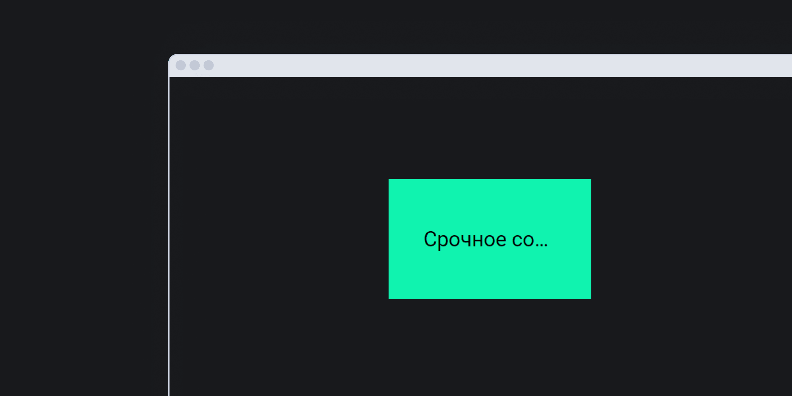

## Кратко

Мы привыкли, что в структуре сайта [CSS](/css/) отвечает только за визуальное представление, а всё касающееся контента задаётся в [HTML](/html/). Однако это не совсем так. В CSS есть свойства, способные как улучшить восприятие вашего сайта для пользователя вспомогательных технологий, так и сильно усложнить ему жизнь.

В статье разберёмся, что это за свойства и почему так происходит.

## Важные уточнения

Большая часть материала в статье посвящена влиянию CSS на скринридеры.

В Доке есть отдельная статья «[Скринридеры](/a11y/screenreaders/)». Здесь я только кратко процитирую, что такое скринридер.

> _Скринридер (screen reader)_ — программа, которая превращает контент интерфейсов в речь или шрифт Брайля.
>
> Скринридеры нужны людям со слепотой и слабовидящим, а также пользователям с когнитивными особенностями, которым легче воспринимать информацию на слух. Например, людям с дислексией.

Также в тексте статьи много демок. Протестируйте их сами. Установите или включите скринридер — в статье про скринридеры есть [список существующих программ](/a11y/screenreaders/#vidy-skrinriderov) для каждой операционной системы. Инструкции по скачиванию и подключению обычно есть на сайтах скринридеров.

Наконец, все демки я протестировала со скринридером NVDA в Windows в Google Chrome. Если тестируете с другим скринридером, его поведение может немного отличаться от описанного в статье.

Об основном договорились, теперь можно двигаться дальше 🙂

## Списки

Чтобы не рассматривать скучные абстрактные примеры, давайте представим, что нам нужно пойти в магазин, купить кучу всего и ничего не забыть.

В этом нам поможет приложение для покупок — именно его мы увидим во всех демках.

Первое, что нужно сделать, — составить список покупок.

Допустим, в этом случае нам не важно, сколько пунктов в списке, поэтому мы используем ненумерованный список [`<ul>`](/html/ul/).

<iframe title="Списки с маркерами и без них" src="demos/list-style-none/" height="600"></iframe>

### Свойство `list-style: none`

Первое, что мы обычно делаем с ненумерованным списком, — убираем стандартные маркеры-точки с помощью свойства [`list-style: none`](/css/list-style/#ispolzovanie-znacheniya-none). Кажется, что на скринридер такое изменение влиять не должно, ведь оно касается только визуального представления списка. Однако на практике это не так.

У обычного списка с маркерами NVDA сначала озвучивает количество элементов в списке, а затем перед каждым элементом произносит слово «маркер». Это даёт пользователю понять, что он перешёл к следующему пункту списка. Например:

> Список из четырёх элементов. Маркер. Апельсины. Маркер. Хлеб…

У списка с `list-style: none` количество элементов произносится, но слово «маркер» опускается. Элементы списка просто зачитываются подряд:

> Список из четырёх элементов. Апельсины. Хлеб…

Chrome и Firefox оставляют у такого `<ul>` роль `list` в [дереве доступности](#pochemu-stili-vliyayut-na-dostupnost), поэтому список остаётся списком.

Safari ведёт себя иначе. Он убирает роль у списка, если у пунктов нет маркеров: ни точек, ни номеров, ни содержимого в `::before`. Скринридер VoiceOver не озвучит ни количество элементов, ни слово «маркер».

<aside>

🐛 В Safari это не ошибка, а [намеренное поведение WebKit](https://bugs.webkit.org/show_bug.cgi?id=134187). Так движок отличает списки для раскладки от настоящих. Исключение — списки внутри [`<nav>`](/html/nav/), у них роль остаётся.

</aside>

Если список нумерованный ([`<ol>`](/html/ol/)), то для каждого пункта списка скринридер зачитывает порядковый номер, например:

> Один. Апельсины. Два. Хлеб.

В случае с `list-style: none` этот номер игнорируется.

### Кастомные маркеры

Получается, что совсем без маркера оставлять список как-то нехорошо. Чаще всего для списков верстают кастомные маркеры. Рассмотрим два распространённых способа это сделать.

#### Псевдоэлемент `::before`

Сделаем список повеселее, вместо стандартного маркера вставим эмодзи канцелярской кнопки «📌».

Это можно сделать с помощью [псевдоэлемента `::before`](/css/before/) у элемента списка [`<li>`](/html/li/):

```css
.list_emoji li::before {
  content: '📌';
  display: block;
  position: absolute;
  top: -3px;
  left: -22px;
}
```

В свойстве [`content`](/css/content/) у псевдоэлемента указано его содержимое (эмодзи кнопки), а остальные свойства помогают спозиционировать `::before` относительно элемента списка.

Посмотрим на получившийся «нарядный» список. В демке он под заголовком «`::before`».

<iframe title="Списки с кастомными маркерами" src="demos/lists-with-custom-markers/" height="640"></iframe>

А как это звучит?

Скринридер озвучивает содержимое свойства `content`, поэтому перед каждым пунктом списка мы слышим название эмодзи:

> Канцелярская кнопка. Апельсины. Канцелярская кнопка. Хлеб…

Скринридер зачитает в `content` почти всё читабельное: текст, цифры или эмодзи.

К счастью, громоздкую конструкцию вроде адреса картинки NVDA не зачитает 🙂 Здесь он пропустит значение `content`:

```css
.local-link::before {
  content: url("/media/examples/firefox-logo.svg");
}
```

#### Псевдоэлемент `::marker`

Ещё один вариант создания кастомных маркеров — [псевдоэлемент `::marker`](/css/marker/).

Снова глянем на демку — теперь нас интересует список с маркерами-галочками.

<iframe title="Списки с кастомными маркерами" src="demos/lists-with-custom-markers/" height="640"></iframe>

Chrome передаёт содержимое `::marker` в дерево доступности как маркер пункта. Скринридер может зачитать его перед каждым пунктом, как эмодзи из `::before`. Сам список остаётся списком: роль `list` у `<ul>` сохраняется.

### Как вернуть списку роль и спрятать маркер

Если у списка нет маркеров, добавьте ему роль явно. Тогда Safari тоже озвучит его как список:

```html
<ul class="list" role="list">
  <li>Апельсины</li>
  <li>Хлеб</li>
</ul>
```

Декоративный маркер можно спрятать от скринридера. Для этого в `content` после символа `/` укажите пустой альтернативный текст:

```css
.list_emoji li::before {
  content: '📌';
  content: '📌' / '';
}
```

Первое объявление — запасное. Браузер, который не знает альтернативный текст в `content`, отбросит второе объявление и покажет маркер из первого.

Спрятанный маркер Safari уже не считает маркером. Поэтому такому списку тоже нужен `role="list"`.

Если маркер несёт смысл, напишите в альтернативном тексте, что он значит: `content: '✅' / 'Куплено'`.

### Бонусный фан-факт

В этой демке есть ещё один интересный элемент — кнопка. Она выглядит совершенно обычно, но нам важно, что все буквы здесь заглавные благодаря свойству [`text-transform: uppercase`](/css/text-transform/).

Оказывается, раньше VoiceOver читал капитализированный текст по буквам. Из нашей кнопки получилось бы «<!-- yaspeller ignore:start -->Д.О.Б.А.В.И.Т.Ь.П.У.Н.К.Т.<!-- yaspeller ignore:end -->» 😱

Проблема не ушла до конца. Браузер передаёт скринридеру уже преобразованный текст: в дереве доступности Chrome кнопка называется «ДОБАВИТЬ ПУНКТ». Короткое слово из заглавных букв скринридер может принять за аббревиатуру и прочитать по буквам. Ошибки WebKit об этом ([165088](https://bugs.webkit.org/show_bug.cgi?id=165088) и [175525](https://bugs.webkit.org/show_bug.cgi?id=175525)) до сих пор открыты.

## Свойство `order`

Список собрали и теперь самое время отправляться за покупками. Допустим, в нашем магазине карточки товаров выглядят как кнопки с эмодзи и текстами.

<iframe title="Изменение порядка элементов с помощью свойства order" src="demos/flex-order-property/" height="630"></iframe>

В демке обычный блок с [`display: flex`](/css/display/#kak-pishetsya). Попробуем озвучить весь список товаров скринридером.

**Ожидание:**

> Апельсины. Молоко. Воздушный змей. Сок. Брецель. Яблоки.

**Реальность:**

> Апельсины. Яблоки. Молоко. Сок. Брецель. Воздушный змей.

Кажется, что скринридер хаотично изменил порядок товаров. Даже без озвучки при прохождении списка с помощью клавиатуры видно, что фокус как будто прыгает по случайным элементам. На самом деле это не так.

Если заглянуть в код демки, мы увидим, что элементы в HTML стоят ровно в том порядке, в каком их читает скринридер. При этом каждому из них задано свойство [`order`](/css/order/). Как раз оно и определяет их визуальный порядок.

<aside>

🔢 Свойство `order` меняет позицию элемента только в визуальном отображении. Скринридер в этом случае продолжает проходить элементы ровно в том порядке, в котором они размечены в HTML.

</aside>

## `reading-flow`

Проблему с `order` решает свойство `reading-flow` из [спецификации CSS Display Module Level 4](https://drafts.csswg.org/css-display-4/#reading-flow). Оно меняет порядок, в котором скринридер читает дочерние элементы и фокус переходит по ним с клавиатуры. Браузер берёт этот порядок из раскладки, а не из HTML. Свойство задают флекс- или грид-контейнеру.

В этом примере ссылки на экране идут в обратном порядке, а `reading-flow: flex-visual` заставляет фокус и скринридер идти по ним слева направо, как видит пользователь:

```html
<div class="wrapper">
  <a href="#">Первый элемент</a>
  <a href="#">Второй элемент</a>
  <a href="#">Третий элемент</a>
</div>
```

```css
.wrapper {
  display: flex;
  flex-direction: row-reverse;
  reading-flow: flex-visual;
}
```

Значения `reading-flow`:

- `normal` — порядок как в HTML. Это значение по умолчанию.
- `flex-visual` — визуальный порядок флекс-элементов с учётом направления письма.
- `flex-flow` — порядок по направлению, которое задаёт [`flex-flow`](/css/flex-flow/).
- `grid-rows` — визуальный порядок грид-элементов по строкам.
- `grid-columns` — визуальный порядок грид-элементов по колонкам.
- `grid-order` — порядок как в HTML, но с учётом свойства `order`.
- `source-order` — порядок как в HTML, но с учётом свойства `reading-order` у дочерних элементов. Это значение работает и в блочном контейнере.

Свойство `reading-order` задают дочернему элементу. Его значение — целое число, как у `order`: элементы с меньшим числом идут раньше в порядке чтения и фокуса. Свойство работает, только если у родителя значение `reading-flow` отличается от `normal`.

<aside>

⚠️ `reading-flow` и `reading-order` поддерживают Chrome и Edge с версии 137. В Firefox и Safari их пока нет. Поэтому не стройте смысл интерфейса только на визуальном порядке.

</aside>

## `text-overflow`

Свойство [`text-overflow`](/css/text-overflow/) визуально обрезает часть текста, когда он полностью не помещается в доступную область.

Это свойство никак не влияет на скринридеры, и они прочтут текст целиком. Однако зрячие пользователи столкнутся с проблемами при увеличении интерфейса или на небольших экранах. Из-за этого им будет трудно ориентироваться в интерфейсе и понять, что скрывается за многоточием. Возможно, одна строчка текста не нанесёт большого ущерба, чего не скажешь про большие тексты.

Представим, что хотим показать срочное сообщение и при этом сохранить ещё пару пикселей в интерфейсе.

```html
<p>
  Срочное сообщение, от которого зависит всё.
  С вашего счёта списан 1 000 000 000 галактических
  кредитов.
</p>
```

```css
p {
  padding: 55px 40px;
  inline-size: 65%;
  white-space: nowrap;
  overflow: hidden;
  text-overflow: ellipsis;
  background-color: #10F3AF;
  color: #000000;
}
```

<iframe title="Обрезанный текст с text-overflow" src="demos/text-overflow/" height="340"></iframe>

Скорее всего, если только у вас не огромный экран, такое сообщение заинтригует, но не даст нужной информации. На мобильных экранах интрига нарастает ещё больше.



## `display: table` и `display: grid`

Итак, мы закупились в магазине согласно нашего списка и получили чек с перечнем купленного.

<iframe title="Таблицы и гриды" src="demos/table-and-grid-layout/" height="850"></iframe>

Первый вариант чека — стандартная таблица, свёрстанная с помощью тега [`<table>`](/html/tables/). Она выглядит как таблица и ~~крякает~~ читается скринридером как таблица.

При чтении этой таблицы скринридер честно расскажет нам, сколько в ней строк и столбцов:

> Таблица из 4 строк и 3 столбцов.

Также для каждой ячейки будет уточнять название и номер столбца, в котором она находится:

> Продукт. Столбец 1. Апельсины. Количество. Столбец 2. 1 килограмм.

А ещё при переходе на новую строку озвучит номер строки:

> Строка 3. Продукт. Столбец 1. Молоко.

Скринридеры прекрасно работают с таблицами, поэтому здесь никаких вопросов — всё читается так, как мы ожидали. Но верстать таблицы мало кто любит. А что, если сверстать то же самое, но с помощью [`display: grid`](/css/grid-guide/)?

Посмотрим на второй вариант чека. Визуально всё выглядит почти в точности так же, как и обычная таблица. Но внутри теперь не семантический тег `<table>`, а обычные [`<div>`](/html/div/) и [`<p>`](/html/p/). Ожидаемо такой компонент не будет читаться как таблица. В итоге мы услышим простое озвучивание контента блоков:

> Продукт. Количество. Цена. Апельсины. 1 килограмм.

Окей, у таблицы есть свойство `display: table`. Может, всё дело в нём? Попробуем сверстать псевдотаблицу с помощью обычных `<div>`, но зададим блоку-обёртке `display: table`. В демке это первый вариант с заголовком «Контейнеры и `display: table`».

<iframe title="Таблицы и гриды" src="demos/table-with-grid-layout/" height="890"></iframe>

Увы, скринридер всё ещё не считает это таблицей и снова читает только контент внутри блоков в ожидаемом нами порядке:

> Продукт. Количество. Цена. Апельсины. 1 килограмм.

Не поможет и `display: table-row` с `display: table-cell` у вложенных блоков. Chrome сочтёт такую конструкцию таблицей для раскладки, а не для данных, а NVDA по умолчанию такие таблицы не озвучивает. Для настоящей таблицы нужен `<table>`.

Теперь зададим `display: grid` настоящей семантической таблице. В нескольких статьях мне встречалось утверждение, что это сломает семантику таблицы. Проверим: вторая таблица в демке, «Таблица и `display: grid`», свёрстана как `<table>` с `display: grid`.

На удивление, NVDA справился с такой путаницей отлично. Он прочитал элемент как настоящую таблицу и озвучил все строки и столбцы. Ломал семантику не скринридер, а браузер: старые версии Chrome, Safari и Firefox переставали считать такой элемент таблицей. Современные браузеры роли сохраняют, но такие сюжетные повороты в вёрстке всё равно стоит проверять скринридером 🙂

## `display: contents`

`contents` — это значение свойства `display`, которое убирает [бокс](/css/box-model/) самого элемента. Его дочерние элементы встают в раскладку так, будто родителя нет. На них напрямую действуют правила родительского флекс- или грид-контейнера.

Звучит как магия, но есть одно «но». Долгое время элемент с `display: contents` терял свою семантику: скринридер не узнавал в нём список, таблицу или кнопку.

Код, который видим мы:

```html
<ul style="display: contents;">
  <li>Яблоки</li>
  <li>Груши</li>
</ul>
```

Код, который видели скринридеры:

```html
<li>Яблоки</li>
<li>Груши</li>
```

<aside>

🐛 В Chrome потерю семантики исправили в [версии 89](https://issues.chromium.org/issues/41384724). В Safari ошибку чинили по частям ([ошибка 185679](https://bugs.webkit.org/show_bug.cgi?id=185679)), но VoiceOver до сих пор может не озвучить список с `display: contents` как список. Поэтому не задавайте это значение спискам, таблицам, кнопкам и другим элементам с важной семантикой.

</aside>

Другая особенность поведения `display: contents` связана с интерактивными элементами. Если это значение задать ссылкам, кнопкам и похожим элементам, они выпадают из порядка перехода по <kbd>Tab</kbd> и не получают фокус. Так ведут себя все браузеры.

```css
a {
  display: contents;
  font-size: 34px;
  color: inherit;
}

a:hover {
  color: #10F3AF;
}
```

<iframe title="Ссылка со значением contents у display" src="demos/display-contents/" height="400"></iframe>

Фокус браузеры привязывают к боксу, а у элемента с `contents` нет бокса. Скринридер в режиме обзора, когда страницу читают стрелками, такую ссылку найдёт, а с клавиатуры до неё не добраться. С 2024 года [стандарт HTML](https://github.com/whatwg/html/pull/9425) требует, чтобы такие элементы получали фокус, но ни один браузер это пока не поддерживает.

## Спрятанное содержимое

Есть много способов скрыть содержимое страницы, но не все из них скрывают его одновременно и для зрячих пользователей, и для пользователей скринридеров.

Все способы скрыть содержимое описаны в статье «[Как скрыть содержимое от скринридеров](/a11y/content-hidden/)». Там есть скрытие только визуально, только от скринридеров или от всех сразу. Здесь кратко опишем CSS-свойства, которые _заставят скринридер замолчать_ 😈

- `display: none` убирает элемент из отрисовки и из дерева доступности. Элемент остаётся в DOM, но не занимает места.
- [`visibility: hidden`](/css/visibility/) скрывает элемент и его содержимое, но оставляет его в обычном потоке страницы, поэтому элемент по-прежнему занимает место.
- `content-visibility: hidden` пропускает отрисовку содержимого элемента и скрывает его от вспомогательных технологий.
- [`width: 0px`](/css/width/) и [`height: 0px`](/css/height/) не убирают элемент из потока, а только сжимают его. Без [`overflow: hidden`](/css/overflow/) содержимое даже останется видно. Убрать ли такой элемент из дерева доступности, каждый браузер решает сам. Chrome его оставляет, поэтому NVDA в Chrome читает такие элементы.

Если хотите, чтобы содержимое читалось скринридером, лучше не использовать эти CSS-стили. Стремитесь к тому, чтобы опыт незрячего пользователя не отличался от опыта зрячего. Это важно для пользователей с частичными нарушениями зрения, которые используют скринридер не всё время, а только в некоторых ситуациях.

## Анимации и `prefers-reduced-motion`

Ура, кажется, мы всё купили и теперь можем посмотреть на красивый экран с анимацией 🎉

<iframe title="Управление анимацией с помощью prefers-reduced-motion" src="demos/prefers-reduced-motion/" height="300"></iframe>

Однако хорошо, если на сайте можно отключить анимацию.

У [CSS-директивы `@media`](/css/media/) есть значение `prefers-reduced-motion`. Если в операционной системе пользователя отключена анимация, браузер применит CSS-код внутри директивы.

Например, в этом коде анимация в `prefers-reduced-motion` выключена совсем:

```css
.animated-element {
  animation: rotation 1.6s infinite;
}

@media (prefers-reduced-motion) {
  .animated-element {
    animation: none;
  }
}
```

В демке уже написаны стили, отключающие анимацию при `prefers-reduced-motion`. Это можно проверить, отключив отображение анимации у себя на компьютере или смартфоне в настройках системы.

- Для Windows 11: Параметры → Специальные возможности → Визуальные эффекты → Эффекты анимации.
- Для macOS: Системные настройки → Универсальный доступ → Монитор → Уменьшить движение.
- Для Linux: Настройки → Специальные возможности → Разрешить анимацию.
- Для iOS: Настройки → Универсальный доступ → Движение → Уменьшение движения.
- Для Android: Настройки → Специальные возможности → Экран → Удалить анимации.

В Google Chrome эту настройку можно имитировать в инструментах разработчика. Откройте «Другие инструменты» (More tools) → вкладку «Отрисовка» (Rendering). Там выберите «Эмулировать медиафункцию CSS prefers-reduced-motion» (Emulate CSS media feature prefers-reduced-motion).

При активированном режиме «уменьшенной анимации» хлопушка в демке не должна двигаться. При отключении этого режима она начнёт двигаться снова.

Стили для `prefers-reduced-motion` не заменяют способ остановить анимацию. Пользователю нужно дать возможность остановить или скрыть анимацию, если она:

- запускается сама;
- длится дольше 5 секунд;
- идёт рядом с другим контентом.

Это требование уровня A [2.2.2. Пауза, остановка, скрытие](https://www.w3.org/WAI/WCAG22/Understanding/pause-stop-hide.html) из [WCAG 2 (Руководства по доступности веб-контента)](https://www.w3.org/WAI/standards-guidelines/wcag/).

Кстати, в Доке уже есть [материал о `prefers-reduced-motion`](/a11y/prefers-reduced-motion/).

## Почему стили влияют на доступность?

Как скринридер решает, какие элементы он будет читать, а какие пропустит?

Дело в том, что скринридер читает не просто контент страницы или её разметку, а общается с браузером при помощи _Accessibility API (Accessibility Application Programming Interface)_.

Accessibility API передаёт скринридеру данные о странице в виде _дерева доступности (accessibility tree)_. Оно похоже на [DOM-дерево](/js/dom/#iz-chego-sostoit-dom), но состоит из _доступных объектов (accessible object)_.

Это дерево строит браузер. Он берёт DOM и вычисленные стили: раскладку, маркеры, содержимое `content`, значения `display` и `visibility`. Поэтому CSS и влияет на то, что услышит пользователь.

<aside>

🌳 Дерево доступности не полностью копирует DOM-дерево. Например, в него не попадают скрытые элементы с `display: none`, `visibility: hidden`, [атрибутом `hidden`](/html/hidden/) или декоративные `<div>`.

</aside>

## Выводы

CSS тоже может влиять на то, как контент страницы будет прочитан скринридером.

- Свойство `list-style: none` убирает маркеры, и скринридер перестаёт произносить «маркер» или номер пункта. Safari к тому же убирает у такого списка роль, и VoiceOver не озвучивает его как список. Вернуть роль поможет `role="list"`.
- Содержимое псевдоэлементов `::before` и `::after` зачитывается скринридером. Картинку из `url()` он не прочитает, если не дать ей альтернативный текст. Спрятать декоративное содержимое поможет пустой альтернативный текст: `content: '📌' / ''`.
- Содержимое псевдоэлемента `::marker` попадает в дерево доступности как маркер пункта, а сам список остаётся списком.
- Свойство `order` меняет порядок элементов только визуально. Скринридер будет читать элементы в том порядке, в котором они расположены в разметке.
- Свойства `reading-flow` и `reading-order` согласуют порядок чтения и фокуса с визуальным порядком. Пока их поддерживают только Chrome и Edge.
- `text-overflow` не создаёт проблемы для вспомогательных технологий, но создаёт проблемы для всех остальных.
- `display: table` не сделает для скринридера таблицу из обычных `<div>`-контейнеров. `display: grid` у `<table>` ломал семантику в старых версиях браузеров.
- `display: contents` может сломать семантику списка в Safari и убирает интерактивные элементы из порядка фокуса во всех браузерах.
- `display: none` и `visibility: hidden` позволяют скрыть контент как визуально, так и от скринридеров. `width: 0px` и `height: 0px` не всегда скрывают контент от скринридеров. Например, NVDA в Chrome прочитает блок, спрятанный таким образом.
- Директива `@media` со значением `prefers-reduced-motion` задаёт стили для тех, у кого в системе выключена анимация. Бесконечной декоративной анимации всё равно нужен способ её остановить.

Сложно заранее представить, как скринридер озвучит интерфейс, даже если прочитали кучу статей о вспомогательных технологиях и, кажется, знаете уже все подводные камни. Единственный способ проверить, как _действительно_ звучит содержимое — сесть и протестировать его с любым скринридером вручную. Это всегда полезно, а часто ещё и довольно весело.

Узнать больше об особенностях влияния CSS на скринридеры можно в этих статьях:

- [CSS Can Influence Screenreaders](https://benmyers.dev/blog/css-can-influence-screenreaders/).
- [The effect of CSS on screen readers](https://uselessdivs.com/blog/the-effect-of-css-on-screen-readers/).
- [Super short note on CSS text (again)](https://html5accessibility.com/stuff/2021/11/04/super-short-note-on-css-text-again/).
- [Modern CSS Upgrades To Improve Accessibility](https://moderncss.dev/modern-css-upgrades-to-improve-accessibility/).
