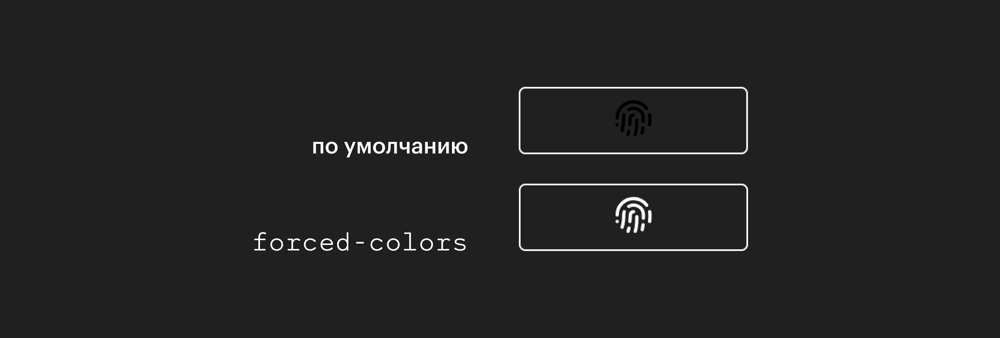

## Кратко

Одно из значений директивы [`@media`](/css/media/) для проверки пользовательских настроек. Отслеживает режим принудительных цветов. Одна из его реализаций — режим высокой контрастности в Windows.

<aside>

👴 [В старых версиях браузеров](https://caniuse.com/mdn-css_at-rules_media_forced-colors) у `forced-colors` не очень высокая поддержка.

</aside>

## Пример

```html
<button class="button button-aqua">
  <svg
    xmlns="http://www.w3.org/2000/svg"
    width="36"
    height="36"
    viewBox="0 0 24 24"
    fill="none"
    stroke="#000000"
    stroke-width="2"
    stroke-linecap="round"
    stroke-linejoin="round"
    class="button-icon"
  >
    <path d="M2 12C2 6.5 6.5 2 12 2a10 10 0 0 1 8 4"/>
    <path d="M5 19.5C5.5 18 6 15 6 12c0-.7.12-1.37.34-2"/>
    <path d="M17.29 21.02c.12-.6.43-2.3.5-3.02"/>
    <path d="M12 10a2 2 0 0 0-2 2c0 1.02-.1 2.51-.26 4"/>
    <path d="M8.65 22c.21-.66.45-1.32.57-2"/>
    <path d="M14 13.12c0 2.38 0 6.38-1 8.88"/>
    <path d="M2 16h.01"/>
    <path d="M21.8 16c.2-2 .131-5.354 0-6"/>
    <path d="M9 6.8a6 6 0 0 1 9 5.2c0 .47 0 1.17-.02 2"/>
  </svg>
  <span class="visually-hidden">
    Зайти по отпечатку пальца
  </span>
</button>
```

```css
@media (forced-colors: active) {
  .button-icon {
    stroke: buttonText;
  }
}
```

<iframe title="Кнопка с SVG-иконкой" src="demos/button-w-icon/" height="210"></iframe>

Если посмотрите демку в режиме принудительных цветов без директивы и с ней, в первом случае иконка с отпечатком пальца останется чёрной (`#000000`), а во втором — перекрасится в белый цвет как у кнопки.



<aside>

🎨 Для SVG можете просто использовать значение `currentColor` вместо конкретного цвета в `forced-colors`.

</aside>

## Как пишется

Есть два значения:

- `none` — режим принудительных цветов не выбран, цветовая палитра не ограничена.
- `active` — включён режим принудительных цветов.

Обычно браузеры сами перезаписывают цвета в режиме высокой контрастности, так что `forced-colors` пригодится в редких случаях:

- Для кастомных элементов, у которых не заменяются автоматически цвета. Например, `<div>` [с ролью `button`](/a11y/role-button/).
- Для SVG и других векторных иконок.
- Когда цвет важен для понимания контекста. К примеру, цветовые палитры в магазинах одежды.

<aside>

⚠️ Используйте `forced-colors` только когда это **действительно** нужно. Не перезаписывайте таким образом цвета и другие стили в режиме принудительных цветов, чтобы интерфейс сайта всегда выглядел одинаково.

</aside>

Список CSS-свойств, значения которых автоматически перезаписываются на системные:

- [`color`](/css/color/);
- [`background-color`](/css/background-color/);
- [`border-color`](/css/border-color/);
- [`outline-color`](/css/outline-color/);
- [`scrollbar-color`](/css/scrollbar-color/);
- [`caret-color`](/css/caret-color/);
- `lighting-color`;
- `flood-color`;
- `stop-color`;
- `-webkit-tap-highlight-color`;
- [`column-rule-color`](/css/column-rule-color/);
- [`text-decoration-color`](/css/text-decoration-color/);
- `text-emphasis-color`;
- [`fill`](/css/fill/);
- [`stroke`](/css/stroke/).

Также есть свойства, значения которых сбрасываются в режиме принудительных цветов: [`accent-color`](/css/accent-color/) заменяется на `auto`, [`box-shadow`](/css/box-shadow/) и [`text-shadow`](/css/text-shadow/) — на `none`, [`background-image`](/css/background-image/) — на `none`, если в качестве значения не указана функция `url()`, `color-scheme` — на `light dark`.

Браузеры не заменяют цвета на системные, когда используете свойство `forced-color-adjust` со значением `none`. К примеру, этим свойством удобно запрещать заменять важные для понимания цвета в режиме ограниченных цветов.

```css
.important-specific-element {
  forced-color-adjust: none;
}
```

Когда цвет по какой-то причине не заменился на нужный, используйте [системные (динамические) цвета](https://developer.mozilla.org/en-US/docs/Web/CSS/color_value#system_colors). Например, `ButtonText` у кнопок, `CanvasText` у обычного текста, `LinkText` у кнопок или `HighlightText` у выделенного текста.

`forced-colors` можно совмещать с другим значением директивы `@media` — [`prefers-contrast`](/a11y/prefers-contrast/). Она отслеживает настройки уровня контрастности в системе, который может быть понижен или повышен. В этом случае браузеры могут определить, какой именно режим принудительных цветов выбрал пользователь — высококонтрастный или низкоконтрастный.

```css
@media (forced-colors: active) and (prefers-contrast: less) {
  /* Нужные стили */
}
```

Также можно использовать `forced-colors` вместе с `prefers-color-scheme`. В этом случае можно точечно настроить стили для светлого или тёмного режима принудительных цветов.

Пример с тёмным режимом принудительных цветов:

```css
@media (forced-colors: active) and (prefers-color-scheme: dark) {
  /* Нужные стили */
}
```

Пример со светлым режимом принудительных цветов:

```css
@media (forced-colors: active) and (prefers-color-scheme: light) {
  /* Нужные стили */
}
```

### Тестирование и отладка

Тестировать интерфейс в режиме принудительных цветов можно в браузере или включив его в системе.

В Chrome эмуляция `forced-colors` находится в дополнительной вкладке «Отрисовка» (Rendering) в инструменте разработчика. Чтобы добраться до неё, откройте список с дополнительными настройками (кнопка с тремя точками рядом с кнопкой закрытия), а потом разверните список «Другие инструменты» (More tools) и найдите выпадающий список «Эмулировать медиафункцию `forced-colors`» (Emulate media feature `forced-colors`).

В операционных системах режим принудительных цветов расположен в разделе доступности и специальных возможностей.

<details>
  <summary>Windows 10</summary>

  Настройки (Settings) > Специальные возможности (Ease of Access) > Высокая контрастность (High Contrast) > Включить режим высокой контрастности (Turn on high contrast). После выбрать одну из уже готовых тем с чёрным режимом высокой контрастности (High Contrast Black), белым режимом высокой контрастности (High Contrast White), комбинацией двух предыдущих тем или настроить свою.

</details>

<details>
  <summary>Windows 11</summary>

  Настройки (Settings) > Специальные возможности (Accessibility) > Контрастные темы (Contrast themes). После выбрать одну из уже готовых тем: «Водная» (Aquatic), «Пустыня» (Desert), «Сумерки» (Dusk), «Ночное небо» (Night sky) или настроить свою.

</details>

## Как понять

_Режим принудительных цветов (forced colors mode)_ ограничивает количество цветов, чтобы повысить читаемость текста за счёт изменения контраста текста и фона. В основном используются цвета с высоким контрастом. Этот режим автоматически изменяет цвета и в системе, и на сайтах.

Когда браузер узнаёт о выборе режима принудительных цветов, он ограничивает цветовую палитру до небольшого набора цветов. С помощью `forced-colors` можно гибче настраивать поддержку этого режима на сайте.

Подробнее про то, как работает режим принудительных цветов, рассказано в [CSS Color Adjustment Module Level 1](https://drafts.csswg.org/css-color-adjust-1/#forced).

## Подсказки

💡 На `forced-colors` похоже другое значение директивы `@media` — `ms-high-contrast`. Оно устарело и пригодится только для поддержки режима высокой контрастности в Internet Explorer.
