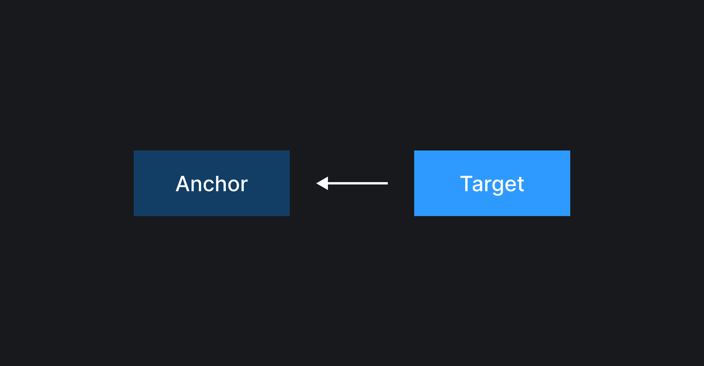
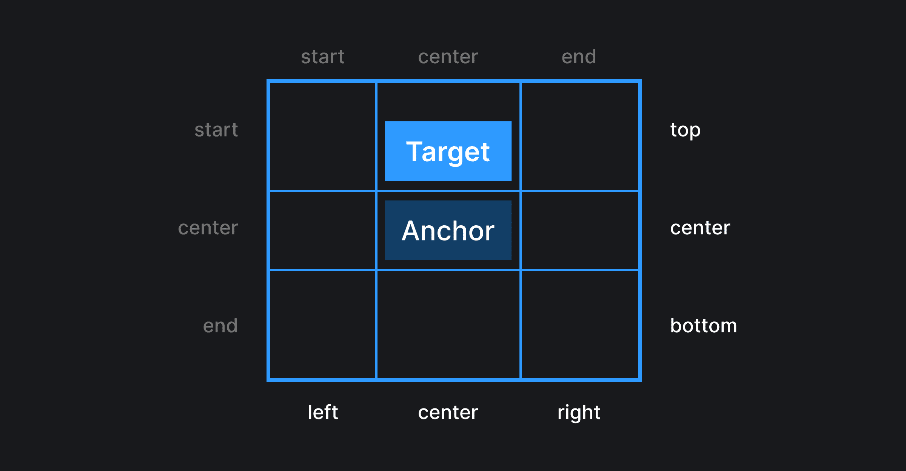

## Что такое Anchor Positioning?

При разработке интерфейсов нам требуется уметь создавать элементы, которые будут связаны друг с другом. Например, иконка и текст тултипа или селектбокс и выпадающий список. При этом нам важно, чтобы связанность и видимость элементов сохранялась при изменении вьюпорта, скролла или других взаимодействиях пользователя с интерфейсом.

Ранее не было особого выбора для реализации подобных компонентов. Статично связать два элемента мы могли с помощью относительного и абсолютного видов [позиционирования](/css/position/), а для реализации адаптивности компонента к изменению окружающей его среды нужно было использовать JavaScript.

И это было жутко неудобно. Требовалось вкладывать один элемент в другой, что не всегда возможно по семантике. А реализация адаптивности на JavaScript была не самой тривиальной задачей и могла негативно влиять на отзывчивость страницы, если это всё неправильно приготовить.

Чтобы решить эту проблему был придуман Anchor Positioning, который позволяет один элемент привязать к другому, как к якорю (*anchor — англ. якорь*), а также декларативно описать его поведение: в каких местах относительно якоря может располагаться элемент, в какие моменты он должен быть виден или скрыт, а также, как размер элемента зависит от размера якоря.

Anchor Positioning работает во всех основных браузерах: в Chrome и Edge с 125 версии (`position-try-fallbacks` — со 128, `position-area` — со 129), в Safari с 26, в Firefox со 147. Спецификация при этом ещё дорабатывается: часть значений недавно переименовали, и старые версии браузеров понимают только прежние имена. Если не нашли чего-то в этом гайде, загляните в [спецификацию](https://drafts.csswg.org/css-anchor-position-1/).

## Основные термины

- **Якорный элемент (якорь / anchor):** элемент, к которому должен быть привязан и относительно которого позиционироваться другой элемент.
- **Таргет элемент (таргет / target):** элемент, который должен быть привязан к якорю.



## Свойства якорного элемента

### `anchor-name`

```css
.anchor {
  anchor-name: --anchor;
}
```

Свойство `anchor-name` объявляет элемент якорным. Оно задаёт имя, с помощью которого другие элементы могут сослаться на текущий, чтобы спозиционироваться относительно него.

Возможные значения:

- `none` — значение по умолчанию, якорное имя не задаётся;
- `<anchor-name>` — якорное имя, должно начинаться с двух тире. Можно указать несколько имён через запятую.

Более подробно про свойство `anchor-name` читайте в отдельной [доке](/css/anchor-name/).

## Свойства, функции и директивы для таргет элемента

### `position-anchor`

```css
.target {
  position: absolute;
  position-anchor: --anchor;
}
```

Свойство `position-anchor` определяет якорный элемент, к которому по умолчанию должен быть привязан текущий таргет элемент.

Возможные значения `position-anchor`:

- `normal` — значение по умолчанию. Если задано свойство [`position-area`](#position-area), работает как `auto`, если нет — как `none`. Поэтому без `position-area` якорь лучше указывать явно.
- `none` — у таргета нет якоря по умолчанию.
- `auto` — якорем становится неявный якорь, если он есть. Например, кнопка, которая открыла [поповер](/html/popover/).
- `<anchor-name>` — имя, заданное в свойстве [`anchor-name`](#anchor-name) якорного элемента, должно начинаться с двух тире.

Значение `normal` появилось в Chrome, Edge и Firefox 151 и в Safari 27. В более старых версиях значением по умолчанию было `auto`, а в Chrome и Edge с 144 по 150 версию — `none`.

Кстати, не забудьте указать для таргет элемента `position: absolute` или `position: fixed`, так как Anchor Positioning работает только с этими видами позиционирования.

Более подробно про свойство `position-anchor` читайте в отдельной [доке](/css/position-anchor/).

### `anchor()`

```css
.target {
  position: absolute;
  position-anchor: --anchor;
  top: anchor(bottom);
  left: anchor(right);
}
```

Функция `anchor()` помогает привязать таргет элемент к одной из сторон якорного элемента. Она ссылается на параметры позиционирования якорного элемента и может быть применена только в свойствах [`inset`](/css/inset/).

<iframe title="Позиционируем элемент с помощью функции anchor()" src="demos/anchor-function-top-left/" height="490"></iframe>

Более подробно про функцию `anchor()` читайте в отдельной [доке](/css/anchor-function/).

### `anchor-center`

```css
.target {
  position: absolute;
  position-anchor: --anchor;
  justify-self: anchor-center;
}
```

`anchor-center` — новое значение для `justify` и `align` свойств, при котором таргет элемент центруется относительно якоря по соответствующей оси.

<iframe title="Позиционируем элемент с помощью значения anchor-center" src="demos/anchor-center/" height="490"></iframe>

`anchor-center` может быть применимо для свойств:

- [`justify-self`](/css/justify-self/);
- [`align-self`](/css/align-self/);
- [`justify-items`](/css/justify-items/);
- [`align-items`](/css/align-items/);
- [`place-self`](/css/place-self/);
- [`place-items`](/css/place-items/).

### `position-area`

Позволяет расположить таргет элемент относительно якоря используя концепцию сетки.

Если обвести бордером границы блока, относительно которого позиционируется таргет (обычно это вьюпорт), а затем провести визуальные линии сверху, снизу, справа и слева относительно якоря, то получится девять ячеек, к которым можно обращаться с помощью ключевых слов `top`, `center`, `bottom`, `left`, `right` или с помощью их логических эквивалентов.



Лучше понять, какое значение прописать для свойства `position-area`, чтобы расположить его в нужном месте поможет интерактивная демка ниже. В ней можно кликать на любую из ячеек, чтобы выбрать одну ячейку. Также можно зажать и тянуть, чтобы выбрать несколько ячеек.

<iframe title="Позиционируем элемент с помощью свойства position-area" src="demos/position-area/" height="500"></iframe>

Более подробно про свойство `position-area` читайте в отдельной [доке](/css/position-area/).

### `position-try-fallbacks`

```css
.target {
  position-area: top center;
  position-try-fallbacks: flip-block;
}
```

Свойство `position-try-fallbacks` задаёт альтернативные варианты расположения таргет элемента, которые браузер может попробовать применить, если таргет элемент перестал целиком помещаться в своём начальном положении. Начальное положение можно задать через [`position-area`](#position-area) или через функцию [`anchor()`](#anchor) в свойствах `inset`.

Есть несколько вариантов значений и подходов для работы с `position-try-fallbacks`:

- `none` — список альтернативных расположений остаётся пустым. Значение по умолчанию;
- `<try-tactic>` — применяет заранее определённые стратегии альтернативного расположения элемента. Стратегий пять:
  - `flip-block` — элемент отражается в блочном направлении: например, сверху от якоря переезжает вниз;
  - `flip-inline` — элемент отражается в строчном направлении: например, слева от якоря переезжает вправо;
  - `flip-x` — физический вариант стратегии: элемент отражается по горизонтали независимо от направления письма;
  - `flip-y` — элемент отражается по вертикали независимо от направления письма;
  - `flip-start` — элемент меняет ось расположения: если он находился в начале одной оси, то он переместится в начало другой оси; если элемент находился в конце одной оси, то он переместится в конец другой оси;
- `<position-area>` — альтернативное расположение, заданное с помощью значения для свойства [`position-area`](#position-area);
- `<position-try-option>` — имя альтернативного расположения, заданного с помощью директивы [`@position-try`](#position-try).

`flip-x` и `flip-y` появились позже остальных стратегий: в Chrome и Edge 144, в Safari 26.2. Если браузер не знает хотя бы одно значение, он отбросит всё объявление `position-try-fallbacks`.

Несколько вариантов указывают через запятую. Внутри одного варианта можно сочетать имя из `@position-try` и стратегии, например `--bottom flip-inline`. А значение `position-area` всегда идёт отдельным вариантом:

```css
.target {
  position-area: top;
  position-try-fallbacks: flip-block, left, right;
}
```

Попробуйте в демке ниже перетащить якорь к разным границам экрана.

<iframe title="Добавляем альтернативное расположение элемента с помощью position-try-fallbacks" src="demos/position-try-fallbacks/" height="400"></iframe>

Более подробно про свойство `position-try-fallbacks` читайте в отдельной [доке](/css/position-try-fallbacks/).

### `@position-try`

```css
@position-try --try-option-name {
  property: value;
}
```

Директива `@position-try` объединяет набор стилей для альтернативного расположения таргет элемента под именем, которое можно использовать в качестве значения для свойства [`position-try-fallbacks`](#position-try-fallbacks).

Например, можем для фолбэк-значения добавить отступ и увеличить ширину таргет элемента:

```css
.target {
  position-area: top;
  position-try-fallbacks: --bottom;
  width: 300px;
}

@position-try --bottom {
  position-area: bottom;
  margin-top: 20px;
  width: 600px;
}
```

Попробуйте в демке ниже переместить якорный элемент сверху вниз и обратно. Увидите, что в нижней позиции ширина таргета увеличивается и появляется отступ, которого не было в начальной позиции.

<iframe title="Добавляем кастомные стили для позиционирования с помощью директивы @position-try" src="demos/position-try-rule/" height="400"></iframe>

Более подробно про директиву `@position-try` читайте в отдельной [доке](/css/position-try-rule/).

### `position-try-order`

```css
.target {
  position-area: top;
  position-try-fallbacks: flip-block, left, right;
  position-try-order: most-width;
}
```

Свойство `position-try-order` определяет порядок применения возможных вариантов расположения таргет элемента. Оно указывает на что браузер должен обращать внимание в первую очередь, когда выбирает, какой из фолбэков применить.

Имеет несколько значений:

- `normal` — фолбэки будут пробовать примениться в том порядке, в котором они указаны внутри свойства [`position-try-fallbacks`](#position-try-fallbacks). Значение по умолчанию;
- `most-width` — фолбэки начнут применяться, начиная с самого широкого (самой широкой ячейки);
- `most-height` — фолбэки начнут применяться, начиная с самого высокого (самой высокой ячейки).

Также для `most-width` и `most-height` существуют логические эквиваленты `most-inline-size` и `most-block-size`.

Посмотреть на работу свойства `position-try-order` можно в демке ниже.

<iframe title="Влияем на порядок применения фолбэков расположения с помощью свойства position-try-order" src="demos/position-try-order/" height="450"></iframe>

Более подробно про свойство `position-try-order` читайте в отдельной [доке](/css/position-try-order/).

### `position-try`

```css
.target {
  position-try: most-width flip-inline, bottom;
}
```

Свойство `position-try` — шорткат для свойств [`position-try-order`](#position-try-order) и [`position-try-fallbacks`](#position-try-fallbacks). Сначала идёт порядок применения, его можно опустить. Затем через запятую перечисляют фолбэки.

Более подробно про свойство `position-try` читайте в отдельной [доке](/css/position-try/).

### `position-visibility`

```css
.target {
  position-visibility: anchor-visible no-overflow;
}
```

Свойство `position-visibility` определяет, в каких случаях таргет элемент должен быть виден.

По умолчанию таргет элемент скрывается вместе с якорем, если якорь целиком обрезан контейнером со скроллом. В демке ниже у таргета стоит значение `always`, а переключатель возвращает `anchor-visible`. Включите его и пролистайте текст туда-сюда.

<iframe title="Показываем работу значения anchor-visible свойства position-visibility" src="demos/position-visibility-anchors-visible/" height="480"></iframe>

Свойство `position-visibility` принимает несколько значений:

- `always` — таргет элемент будет виден всегда, пока полностью или частично помещается на экран. Видимость таргета не зависит от видимости якоря.
- `no-overflow` — таргет элемент будет скрываться, если не помещается целиком ни в одну из позиций: ни в [начальную](#position-area), ни в [фолбэчную](#position-try-fallbacks).
- `anchor-visible` — таргет элемент будет виден, пока виден якорный элемент. Если якорь скрылся, таргет тоже перестанет быть видимым. Учитывается только якорь из `position-anchor`, а не якоря из `anchor(--name …)`. Это значение по умолчанию.
- `anchor-valid` — таргет элемент будет скрыт, если ссылается на якорь из `position-anchor`, но браузер не нашёл такой якорь. Например, имя в `position-anchor` указано с опечаткой.

Значения `anchor-visible`, `anchor-valid` и `no-overflow` можно комбинировать через пробел.

⚠️ Раньше значения назывались `anchors-visible` и `anchors-valid`. Новые имена понимают Chrome и Edge со 157 версии и Safari с 27, а Firefox пока знает только старые. Чтобы свойство работало везде, укажите оба варианта. Браузер применит последний, который поймёт:

```css
.target {
  position-visibility: anchors-visible;
  position-visibility: anchor-visible;
}
```

Более подробно про свойство `position-visibility` читайте в отдельной [доке](/css/position-visibility/).

### `anchor-size()`

```css
.target {
  width: anchor-size(width);
}
```

С помощью `anchor-size()` можно получить значения ширины и высоты якорного элемента. Функция пригодится, если размеры таргет элемента должны зависеть от размеров якоря.

<iframe title="Задаём размер таргет элемента с помощью anchor-size()" src="demos/anchor-size-function/" height="480"></iframe>

Более подробно про функцию `anchor-size()` читайте в отдельной [доке](/css/anchor-size-function/).

## Свойства контейнера якорного элемента

### `anchor-scope`

```css
.container {
  anchor-scope: all;
}
```

Свойство `anchor-scope` ограничивает область применения указанных якорных имён поддеревом текущего элемента. За счёт этого можно использовать одно и то же якорное имя на разных элементах, например, в списках.

<iframe title="Ограничиваем область видимости якорей с помощью anchor-scope" src="demos/anchor-scope/" height="500"></iframe>

В демке выше три раза используется одно и то же якорное имя: в каждом элементе списка оно повторяется. Без использования `anchor-scope` все таргет элементы будут ссылаться на последний якорь в DOM-дереве. `anchor-scope` помогает это всё разрулить, ограничивая область видимости якорного имени поддеревом элемента списка.

Свойство `anchor-scope` принимает в себя три типа значений:

- `none` — ни одно якорное имя не будет ограничено поддеревом текущего элемента. Значение по умолчанию;
- `<anchor-name>` — список якорных имён через запятую, видимость которых должна быть ограничена поддеревом текущего элемента. Например, `--a, --b`;
- `all` — все якорные имена в поддереве текущего элемента должны быть доступны только внутри этого элемента.

Более подробно про свойство `anchor-scope` читайте в отдельной [доке](/css/anchor-scope/).

## Использование нескольких якорей одновременно

```css
.anchor-1 {
  anchor-name: --anchor-1;
}

.anchor-2 {
  anchor-name: --anchor-2;
}

.target {
  position: absolute;
  top: anchor(--anchor-1 bottom);
  left: anchor(--anchor-1 right);
  right: anchor(--anchor-2 left);
  bottom: anchor(--anchor-2 top);
}
```

Anchor Positioning позволяет привязывать один и тот же таргет элемент сразу к нескольким якорям одновременно. И это можно очень классно использовать на практике. Например, как в демке ниже, меняя местоположение якорей, мы можем влиять на размер таргет элемента: делать его больше, меньше, или совсем сделать невидимым.

<iframe title="Использование нескольких якорей позволяет влиять на размер таргета" src="demos/multiple-anchors/" height="450"></iframe>

Использовать эту механику можно и при реализации UI-компонентов. Например, используя несколько якорей одновременно, можно сверстать тултип, который умеет показываться с каждой из четырёх сторон, при этом его хвостик всегда будет направлен в нужную сторону. Попробуйте в демке ниже перетащить кнопку к разным границам экрана — тултип будет адаптироваться.

<iframe title="Тултип на базе Anchor Positioning" src="demos/tooltip/" height="400"></iframe>

Разбор такого тултипа — в рецепте «[Тултип](/recipes/tooltip/#adaptivnyy-na-osnove-popover-api-i-css-anchor-positioning)».

## Где применять?

Anchor Positioning открывает перед разработчиками очень крутые возможности. То, что раньше было возможно только при помощи JavaScript, теперь можно описать декларативно на CSS. Всё зависит только от полёта вашей фантазии.

Где Anchor Positioning точно может пригодиться.

### UI-компоненты

Anchor Positioning может быть полезен при проектировании тултипа. Также можно реализовать и другие компоненты, части которых должны быть привязаны друг к другу. Например, меню. Попробуйте открыть несколько вложенных уровней меню и проскроллить к разным частям экрана — выпадающие списки смогут адаптироваться.

<iframe title="Меню на базе Anchor Positioning" src="demos/menu/" height="450"></iframe>

### Переходы

Также можно использовать Anchor Positioning для реализации классных переходов. Например, для ховера элементов навигации. Попробуйте навести последовательно на несколько ссылок в демке ниже — задний фон будет перетекать от одного элемента к другому.

<iframe title="Переходы по ховеру на элементы навигации, реализованный с помощью Anchor Positioning" src="demos/nav-with-transition/" height="320"></iframe>

### Визуальные подсказки

Можно реализовать различные визуальные подсказки в интерфейсе. Например, подсказки, указывающие на максимальное и минимальное значения в графике.

<iframe title="Подсказки для графика, реализованные на Anchor Positioning" src="demos/help-in-chart/" height="400"></iframe>

### Графы

На базе Anchor Positioning можно построить граф. Если добавить поверх драг-н-дроп, то вершины можно двигать в разные стороны и ничего не будет отваливаться.

<iframe title="Граф, реализованный на Anchor Positioning" src="demos/graph/" height="420"></iframe>

### Анимации

И какой же фронтенд без крутилок и свистелок? Anchor Positioning можно использовать и для построения классных анимацией.

<iframe title="Анимация на базе Anchor Positioning" src="demos/animation/" height="400"></iframe>

## Доступность

Используя Anchor Positioning, важно не забывать про доступность. Якорь связывает элементы только визуально. Семантическую связь описывает разработчик.

Для меню и раскрывающихся блоков подойдёт Popover API: кнопка с атрибутом `popovertarget` передаёт скринридеру, открыт поповер или нет. Тултип описывает якорь, поэтому свяжите их атрибутом [`aria-describedby`](/a11y/aria-describedby/). Для более подробных пояснений подойдёт [`aria-details`](/a11y/aria-details/).

Следите и за порядком элементов в DOM. На экране таргет стоит рядом с якорем, а в разметке может оказаться в другом конце страницы. Тогда пользователь клавиатуры или скринридера доберётся до него совсем не там, где ждёт.

## Шпаргалка

Чтобы лучше сориентироваться в дальнейшем, какое из CSS-свойств отвечает за какую фичу Anchor Positioning, собрали для вас таблицу-шпаргалку.

| Фича                         | CSS-свойство |
|------------------------------|--------------|
| якорь и таргет              | [`anchor-name`](#anchor-name), [`position-anchor`](#position-anchor) |
| местоположение               | [`anchor()`](#anchor), [`position-area`](#position-area), [`anchor-center`](#anchor-center) |
| размер                       | [`anchor-size()`](#anchor-size) |
| адаптивность местоположения  | [`position-try`](#position-try-1), [`position-try-fallbacks`](#position-try-fallbacks), [`position-try-order`](#position-try-order), [`@position-try`](#position-try) |
| видимость                    | [`position-visibility`](#position-visibility) |
| область применения           | [`anchor-scope`](#anchor-scope) |

## Полезные ссылки

1. [Спецификация](https://drafts.csswg.org/css-anchor-position-1/)
1. [Роман Комаров — Future CSS: Anchor Positioning](https://kizu.dev/anchor-positioning-experiments/)
1. [Anchoreum: игра для изучения Anchor Positioning](https://anchoreum.com/)
