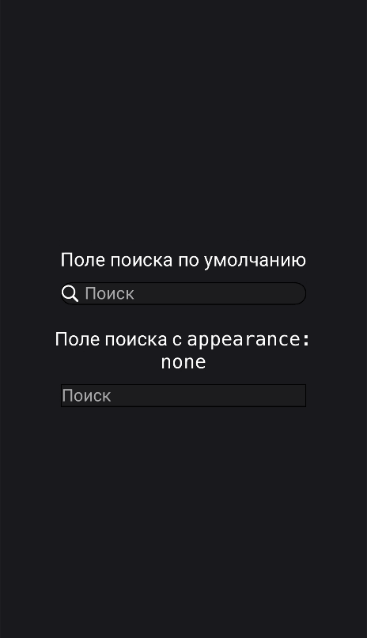

## Кратко

Свойство `appearance` управляет тем, как браузер рисует элементы форм: с системным видом или без него.

## Пример

Уберём системный вид у поля поиска:

```css
input[type="search"] {
  appearance: none;
}
```

## Как понять

Некоторые элементы форм выглядят по-своему в каждой операционной системе. Например, выпадающий список в macOS выглядит совсем не так, как такой же список в Windows.

Такой системный вид трудно перекрасить: часть стилей браузер просто игнорирует. Свойство `appearance` решает, рисовать элемент по-системному или отдать его оформление разработчику.

### Сбрасываем системный вид

Если задать `appearance: none`, браузер убирает системный вид элемента. Элемент становится простым блоком, и его можно оформить с нуля. Отступы, шрифт и размеры из стандартных стилей браузера при этом остаются, так что их всё равно стоит задать самим.

Например, Safari на iOS рисует поле [`<input>`](/html/input/) с атрибутом `type="search"` в виде скруглённой «таблетки» с иконкой лупы. Чтобы не перебивать каждое свойство по отдельности, зададим такому полю `appearance: none`. В демке два поля поиска: первое со стандартными стилями браузера, второе — со сброшенными:

<iframe title="Стандартное поле поиска и поле с appearance" src="demos/search-fields/" height="300"></iframe>



Если открыть демку _не в мобильном браузере_, разница почти не заметна. В десктопных браузерах поля ввода выглядят более или менее одинаково.

Обратите внимание: Safari сам убирает системный вид, если задать полю свою рамку или фон. Поэтому в демке у полей нет рамки.

### Настраиваем выпадающий список

[`<select>`](/html/select/) долго удавалось оформить только частично. Даже с `appearance: none` меняется только сама кнопка списка. Выпадающую часть списка рисует операционная система, и стили на него не действуют.

Значение `base-select` снимает это ограничение. Его задают и самому `<select>`, и псевдоэлементу `::picker(select)` — выпадающей части списка:

```css
select,
::picker(select) {
  appearance: base-select;
}
```

После этого можно оформить варианты [`<option>`](/html/option/), стрелку `::picker-icon` и галочку у выбранного варианта `::checkmark`. В демке слева обычный список, а справа — список с `base-select`:

<iframe title="Настраиваемый выпадающий список" src="demos/base-select/" height="350"></iframe>

Пока `base-select` поддерживают Chrome, Edge и Safari. В Firefox оно включается только в экспериментальных настройках браузера. Браузеры без поддержки покажут обычный системный список, поэтому значение можно добавлять уже сейчас.

## Как пишется

Значения:

- `none` — убирает системный вид.
- `auto` — браузер показывает системный вид элемента. Если у элемента нет системного вида, работает как `none`.
- `base-select` — включает настраиваемый вид у `<select>` и `::picker(select)`. На остальных элементах работает как `auto`.

Ещё два значения остались ради совместимости со старыми сайтами, но кое-где работают по-особому. На других элементах они ведут себя как `auto`:

- `textfield` — рисует поле с `type="search"` как обычное текстовое поле.
- `menulist-button` — рисует выпадающий `<select>` так, что браузер учитывает фон, рамку и цвет текста. Стрелка списка при этом остаётся.

Значение по умолчанию — `none`. Но элементам форм браузер задаёт `appearance: auto` в своих стандартных стилях. Поэтому кнопки, поля и списки сразу выглядят по-системному. Свойство не наследуется.

<aside>

⚠️ Раньше `appearance` умел «переодевать» одни элементы в другие. Например, `appearance: searchfield` делал обычное текстовое поле похожим на поле поиска. Сейчас значения `searchfield`, `textarea`, `checkbox`, `radio`, `menulist`, `listbox`, `meter`, `progress-bar` и `button` работают как `auto`. Они остались в спецификации только ради старых сайтов.

</aside>

<aside>

💡 Раньше свойство писали с [вендорными префиксами](/css/vendor-prefixes/) `-webkit-` и `-moz-`. С 2022 года все браузеры поддерживают `appearance` без префикса, поэтому префиксы больше не нужны.

</aside>
