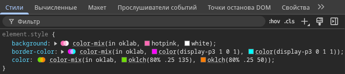

## Кратко

CSS-функция `color-mix()` смешивает цвета в выбранном цветовом пространстве. С ней удобно получать светлые и тёмные вариации цвета, оттенки для наведения и нажатия и согласованные темы без препроцессоров.

## Пример

Светлая и тёмная версии брендового цвета для разных состояний кнопки:

```css
:root {
  --brand: #2E9AFF;
}

.button {
  background: var(--brand);
  color: #18191C;
}

.button:hover {
  /* Светлее: добавляем белый */
  background: color-mix(in oklab, var(--brand) 80%, white);
}

.button:active {
  /* Темнее: добавляем чёрный */
  background: color-mix(in oklab, var(--brand) 90%, black);
}
```

## Как пишется

Чаще всего функции передают три аргумента через запятую.

Первый аргумент — метод интерполяции цвета. Он состоит из ключевого слова `in`, названия цветового пространства и необязательного метода интерполяции оттенка (для полярных пространств).

Второй и третий аргументы — два цвета для смешивания. Для каждого можно указать долю в итоговой смеси в процентах. Это необязательно.

Свежая версия спецификации делает запись свободнее. Метод интерполяции можно не указывать — тогда браузер смешивает цвета в `oklab`. А цветов может быть сколько угодно, хоть один:

```css
.swatch {
  /* То же, что color-mix(in oklab, red, blue) */
  background: color-mix(red, blue);
}

.swatch--triple {
  /* Каждый цвет получит по трети */
  background: color-mix(in oklch, red, yellow, blue);
}
```

Обе возможности появились в спецификации недавно. Запись с одним цветом или больше чем с двумя пока понимают только Firefox и Safari, Chrome её не поддерживает. Поэтому в рабочем коде смешивайте цвета попарно и указывайте пространство явно: так код сработает и в браузерах, которые давно не обновлялись.

Дальше разбираем классическую запись с двумя цветами.

<iframe title="Визуализация смешивания цветов" src="demos/mix-colors/" height="700"></iframe>

## Как понять

### Метод интерполяции цвета

Интерполяция цвета — это способ найти промежуточный цвет между двумя заданными цветами по определённому правилу. Например, при смешивании красного и синего получится нечто среднее между ними. Итог зависит от того, как именно считать этот «средний» цвет, то есть от выбранного цветового пространства.

Первый аргумент функции состоит из трёх частей:

1. ключевое слово `in` (обязательно);
1. название цветового пространства (обязательно) — система координат для описания цвета;
1. метод интерполяции оттенка (необязательно, только для полярных пространств) — определяет путь перехода от одного оттенка к другому.

#### Цветовые пространства

Цветовые пространства — это разные системы для описания цвета. Они делятся на два типа:

**Прямоугольные цветовые пространства**

Цвет задаётся тремя числовыми значениями, каждое из которых отвечает за свою характеристику цвета.

- `srgb`
- `srgb-linear`
- `display-p3`
- `display-p3-linear`
- `a98-rgb`
- `prophoto-rgb`
- `rec2020`
- `lab`
- `oklab`
- `xyz`
- `xyz-d50`
- `xyz-d65`

**Полярные (цилиндрические) цветовые пространства**

Цвет описывается через оттенок (`hue`) — угол на цветовом круге от 0° до 360° — и два дополнительных параметра, которые меняются в зависимости от пространства. Эта система удобна, потому что оттенок легко представить как точку на круге.

- [`hsl`](/css/web-colors/#hsl)
- [`hwb`](/css/web-colors/#hwb)
- [`lch`](/css/web-colors/#lab-i-lch)
- [`oklch`](/css/web-colors/#oklab-i-oklch)

Подробнее про некоторые цветовые пространства можно прочитать в статье «[Цвета в вебе](/css/web-colors/)».

#### Метод интерполяции оттенка

Определяет направление перехода от одного оттенка к другому на цветовом круге. Применяется только к полярным цветовым пространствам: `hsl`, `hwb`, `lch`, `oklch`. Указывать его не обязательно.

Принимает значения: `shorter hue`, `longer hue`, `increasing hue`, `decreasing hue`, ключевое слово `hue` — обязательно.

**`shorter`** — браузер выбирает кратчайший путь между двумя цветами. Браузер берёт его по умолчанию, если метод интерполяции оттенка не указан.

```css
/* Красный (0°) и синий (240°) */
color-mix(in hsl shorter hue, red, blue);
```

Здесь два пути:

- короткий через пурпурный: 0° → 300° → 240°, дуга 120°;
- длинный через жёлтый, зелёный и голубой: 0° → 60° → 120° → 180° → 240°, дуга 240°.

`shorter hue` выберет первый.

<iframe title="Визуализация метода shorter hue" src="demos/shorter-hue/" height="700"></iframe>

**`longer`** — браузер выбирает длинный путь между двумя цветами. Всегда берёт дугу, которая больше или равна 180°.

<iframe title="Визуализация метода longer hue" src="demos/longer-hue/" height="700"></iframe>

**`increasing`** — браузер всегда идёт в сторону увеличения угла, независимо от того, какой путь короче.

```css
/* Красный (0°) и синий (240°) */
color-mix(in hsl increasing hue, red, blue);
```

С `increasing hue` браузер пойдёт от 0° → 60° → 120° → 180° → 240° (через жёлтый, зелёный, голубой).

<iframe title="Визуализация метода increasing hue" src="demos/increasing-hue/" height="700"></iframe>

**`decreasing`** — идёт в сторону уменьшения угла. В примере выше это был бы путь от 0° через 360° → 300° → 240° (через пурпурный).

<iframe title="Визуализация метода decreasing hue" src="demos/decreasing-hue/" height="700"></iframe>

**Разница между `increasing`/`decreasing` и `shorter`/`longer`:**

В примере с красным и синим `shorter` совпадает с `decreasing`, а `longer` — с `increasing`. Но совпадение случайное. `shorter` и `longer` выбирают путь по длине дуги, а `increasing` и `decreasing` — по направлению изменения угла, не глядя на длину. Поменяйте цвета местами — `color-mix(in hsl shorter hue, blue, red)` — и `shorter` совпадёт уже с `increasing`: от 240° к 360° угол растёт.

### Цвет

Каждому цвету можно задать процент от 0 до 100%. Он определяет долю цвета в результате. Как браузер пересчитывает проценты, разберём ниже.

#### Допустимые значения

Согласно спецификации [CSS Color Module Level 5](https://drafts.csswg.org/css-color-5/#color-mix), в `color-mix()` можно передать любое значение типа `<color>`:

- [HEX-коды](/css/web-colors/#hex);
- [именованные цвета (например, `red`, `blue`)](/css/web-colors/#nazvaniya-cvetov);
- функции [`rgb()`](/css/web-colors/#rgb), `rgba()`, `hsl()`, `hsla()`, `hwb()`, `lab()`, `lch()`, `oklab()`, `oklch()`;
- функцию [`color()`](/css/color-function/);
- [`transparent`](/css/web-colors/#transparent);
- [`currentColor`](/css/currentcolor/);
- системные цвета, например, `Canvas` и `CanvasText`;
- [`light-dark()`](/css/light-dark/);
- [относительные цвета](/css/web-colors/#otnositelnyy-sintaksis-cvetov), например, `oklch(from var(--brand) l c h / 50%)`;
- другую функцию `color-mix()`.

Формально в спецификации есть и `device-cmyk()`, но ни один браузер её пока не поддерживает.

С `currentColor` и `light-dark()` итоговый цвет нельзя посчитать заранее. Браузер вычисляет его для каждого элемента, по текущему цвету текста или цветовой схеме. Так удобно делать полупрозрачные фон и рамку в тон тексту:

```css
.note {
  border: 2px solid color-mix(in oklab, currentColor 50%, transparent);
  background-color: color-mix(in oklab, currentColor 15%, transparent);
}
```

В демке у всех плашек один класс. Меняется только цвет текста, а фон и рамка подстраиваются под него сами:

<iframe title="Смешивание с currentColor" src="demos/current-color/" height="550"></iframe>

#### Проценты

Для смешивания браузеру нужны доли, которые в сумме дают 100%. Если указанные проценты дают другую сумму, браузер пересчитывает их сам:

**Если сумма больше 100%**

Оба процента пропорционально уменьшаются, чтобы в сумме получилось 100%. Например, 75% и 50% (всего 125%) пересчитываются до 60% и 40%:

```css
color-mix(in oklab, blue 75%, red 50%);
/* Эквивалентно */
color-mix(in oklab, blue 60%, red 40%);
```

**Если сумма меньше 100%**

Проценты тоже пропорционально растягиваются до 100%, а их сумма становится множителем непрозрачности. При 20% и 40% (всего 60%) цвета смешаются в долях ⅓ и ⅔, а непрозрачность результата будет 60%:

```css
color-mix(in lch, blue 20%, red 40%);
/* Цвет как у blue 33.3%, red 66.7%, но с непрозрачностью 0.6 */
```

**Если процент указан для одного цвета**

Второй цвет получает оставшуюся долю до 100%:

```css
color-mix(in lab, blue 30%, red);
/* Эквивалентно blue 30%, red 70% */
```

**Особые случаи:**

- Если оба процента опущены, каждый цвет получит по 50%.
- Если оба процента равны 0%, по актуальной спецификации получится полностью прозрачный цвет. Раньше такая запись считалась невалидной, и браузеры могут обрабатывать её по-разному.
- Проценты должны быть в диапазоне 0–100%. Если указать значение больше 100% или меньше 0%, значение будет невалидным и функция не будет работать.
- Процент можно посчитать через [`calc()`](/css/calc/), например, `calc(var(--strength) * 10%)`. Если результат выйдет за пределы 0–100%, браузер прижмёт его к ближайшей границе.

## Как использовать

### Создание цветовой шкалы

Шкала оттенков из одного базового цвета:

```css
:root {
  --brand: #2E9AFF;

  /* Светлые варианты */
  --brand-95: color-mix(in oklab, var(--brand) 5%, white);
  --brand-90: color-mix(in oklab, var(--brand) 10%, white);
  --brand-80: color-mix(in oklab, var(--brand) 20%, white);
  --brand-60: color-mix(in oklab, var(--brand) 40%, white);
  --brand-40: color-mix(in oklab, var(--brand) 60%, white);
  --brand-20: color-mix(in oklab, var(--brand) 80%, white);

  /* Тёмные варианты */
  --brand-dark-20: color-mix(in oklab, var(--brand) 80%, black);
  --brand-dark-40: color-mix(in oklab, var(--brand) 60%, black);
}
```

### Работа с широким охватом

Некоторые экраны показывают больше цветов, чем входит в обычный sRGB. Говорят, что у них широкий цветовой охват, например, P3. Для таких экранов можно подмешать более насыщенный цвет:

```css
.card {
  /* Цвет для обычных экранов */
  background: color-mix(in oklab, #2E9AFF 85%, white);
}

/* Экран умеет показывать цвета P3 — берём более насыщенный цвет */
@media (color-gamut: p3) {
  .card {
    background: color-mix(in oklab, color(display-p3 0.1 0.5 1) 85%, white);
  }
}
```

### Работа с прозрачностью

Если подмешать `transparent`, получится полупрозрачная версия цвета. Так удобно делать приглушённый вариант плашки:

```css
.badge {
  --bg: color-mix(in oklab, #2E9AFF 70%, white);
  background: var(--bg);
  color: #18191C;
}

.badge--muted {
  /* Подмешиваем прозрачный цвет — результат тоже будет полупрозрачным */
  background: color-mix(in oklab, var(--bg) 60%, transparent 40%);
}
```

### Контраст и доступность

Текст должен контрастировать с фоном. Руководство по доступности WCAG 2.2 требует для обычного текста контраст не меньше 4.5:1. `color-mix()` осветлит или затемнит базовый цвет, а результат проверьте в инструменте для контраста.

## Подсказки

### Проверка поддержки

Все современные браузеры поддерживают `color-mix()` с 2023 года. Если нужно поддержать браузеры старше, добавьте фолбэк:

```css
.card {
  background: #2E9AFF; /* Фолбэк */
}

@supports (color: color-mix(in oklab, black, white)) {
  .card {
    background: color-mix(in oklab, #2E9AFF 85%, white);
  }
}
```

### Невалидные аргументы

Если аргументы `color-mix()` невалидны, например, указано неизвестное пространство, браузер проигнорирует всё объявление. Поэтому в важных местах указывайте фолбэк-цвет перед функцией.

Но если [`var()`](/css/var/) подставит в функцию невалидный цвет, фолбэк не поможет. Браузер узнает об ошибке только при вычислении значения и сработает так, будто свойству задали `unset`.

### Смешивание в широком охвате

Если смешивать цвета в `display-p3` или `rec2020`, на экране с обычным sRGB результат сожмётся до доступных цветов. В важных местах сравните результат на разных экранах и добавьте фолбэк в sRGB.

## Как дебажить

Для отладки `color-mix()` лучше всего подходит Chrome DevTools. На панели «Стили» можно изменить цвета с помощью колорпикера. Рядом с функцией видна миниатюра смешанных цветов, а при наведении курсора видно, какой цвет получился.


