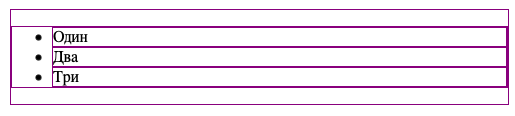

## Кратко

Для всех свойств CSS, помимо их стандартных значений, можно задать значения в виде ключевых слов:

- `initial`;
- `inherit`;
- `unset`;
- `revert`.

Каждое из этих слов выполняет свою функцию, но всех их объединяет то, что любые заданные до этого значения конкретного свойства будут сброшены.

## `initial`

У каждого из свойств в CSS есть значение по умолчанию. Оно применяется ещё до того, как вы написали что-либо в вашем файле стилей.

Ключевое слово `initial` сбрасывает все указанные значения свойства для конкретного блока до этих самых значений по умолчанию.

Например, у свойства [`font-style`](/css/font-style/) значение по умолчанию `normal`. Предположим, у нас есть текст, завёрнутый в [`<em>`](/html/em/). Браузер отображает текст внутри этого тега курсивом. Обернём последнее предложение в [`<span>`](/html/span/). По правилам текст последнего предложения тоже будет отображаться курсивом, поскольку свойство `font-style` является наследуемым. Но мы изменим это, задав для селектора `span` значение `font-style: initial`.

```html
<em>Lorem ipsum dolor sit amet, consectetur adipisicing elit. Accusantium quis quos soluta officia quod ipsum, molestias tempore blanditiis, earum obcaecati quas nostrum sint explicabo maiores eos in? <span>Unde, dignissimos veniam.</span></em>
```

```css
span {
  font-style: initial;
}
```

В итоге конкретно для последнего предложения текста, завёрнутого в `<span>`, будет действовать значение `normal`, и текст будет отображён в нормальном начертании.

<iframe title="initial" src="demos/initial/" height="150"></iframe>

Будьте бдительны! Браузерные стили и значения свойств по умолчанию — не одно и тоже.

Браузерные стили можно увидеть, открыв инструменты разработчика. Блоки кода, подписанные как «Таблица стилей агента пользователя» (Safari) или «user agent stylesheet» (Google Chrome) — как раз те самые браузерные стили.

Значения свойств по умолчанию вы можете найти в нашем справочнике, открыв статью про конкретное свойство.

## `inherit`

CSS-свойства делятся на **наследуемые** и **ненаследуемые**.

Значения наследуемых свойств применяются не только к элементу, для которого прописаны, но и для всех вложенных дочерних элементов. Это очень удобно, чтобы не писать много одинаковых свойств для разных селекторов, перечисляя всех потомков.

Самым простым примером наследуемого свойства является [`color`](/css/color/).

Значения ненаследуемых свойств применяются исключительно для того элемента, которому прописаны. И на детей не распространяются. Чаще всего ненаследуемыми являются те свойства, чьё дублирование на потомках приведёт к необходимости сбрасывать его дополнительно.

Представьте, что вы задаёте [`border`](/css/border/) для родителя, а он отнаследуется всеми потомками. Получится очень полосатый интерфейс 🦓



Вам придётся писать дополнительные правила, чтобы сбросить рамки у вложенных элементов. Поэтому хорошо, что `border`, как и некоторые другие свойства, не наследуются.

Ключевое слово `inherit` позволяет явно задать наследуемость какого-то из свойств, неважно, является ли оно наследуемым или нет.

Для примера возьмём абзац текста с вложенным `<span>`. Зададим для [`<p>`](/html/p/) свойство `border`. Само по себе оно является ненаследуемым, а значит, вокруг вложенного в абзац `<span>` своей рамки не будет.

Укажем для селектора `span` свойство `border` со значением `inherit`. И получим обведённое в рамочку слово, хотя явно рамку мы не прописывали — её значение было унаследовано от родителя `<p>`.

<iframe title="inherit" src="demos/inherit/" height="150"></iframe>

Ключевое слово `inherit` прекрасно работает и для наследуемых свойств. Все указанные для селектора значения свойства сбрасываются, и наследуется то значение, которое задано родителю этого элемента.

## `unset`

Это ключевое слово ведёт себя по-разному с наследуемыми и ненаследуемыми свойствами:

- С наследуемыми свойствами ключевое слово `unset` ведёт себя как `inherit`.
- С ненаследуемыми свойствами оно ведёт себя как `initial`.

Ключевое слово `unset` очень удобно использовать в качестве значения свойства [`all`](/css/all/). В этому случае оно само определит тип свойства и _притворится_ нужным значением.

## `revert`

Это ключевое слово сбрасывает значение свойства до указанного в стилях браузера.

Например, если указать для [`<h1>`](/html/h1-h6/) свойство [`font-size`](/css/font-size/) со значением `revert`, то фактическим значением будет `2em` — ровно такой размер устанавливает браузер для заголовка первого уровня.

<iframe title="revert" src="demos/revert/" height="150"></iframe>
