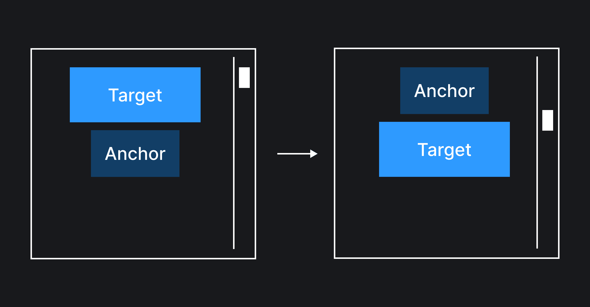
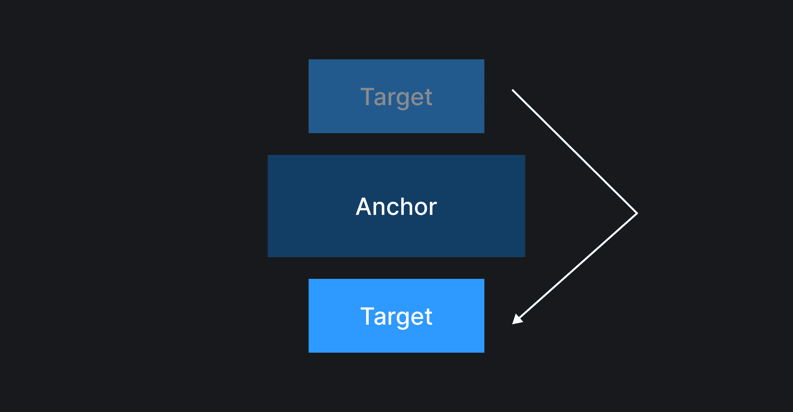
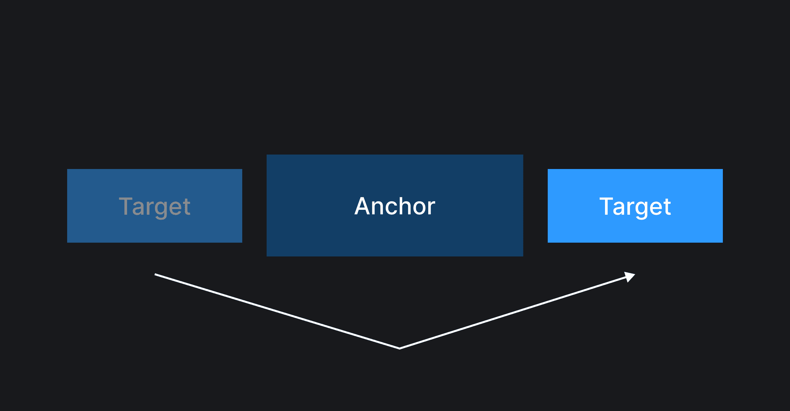
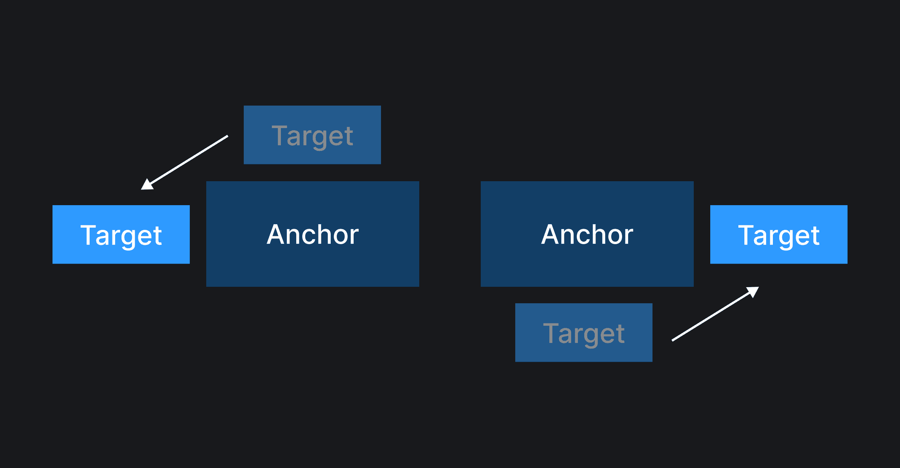

## Кратко

Свойство `position-try-fallbacks` перечисляет альтернативные варианты расположения таргет элемента.

## Пример

```css
.target {
  position-try-fallbacks: flip-block;
}
```

## Как пишется

Есть несколько вариантов значений и подходов для работы с `position-try-fallbacks`:

- `none` — список альтернативных расположений остаётся пустым. Значение по умолчанию;
- `<try-tactic>` — применяет заранее определённые стратегии альтернативного расположения элемента. Стратегий пять:
  - `flip-block` — элемент отражается в блочном направлении: например, сверху от якоря переезжает вниз;
  - `flip-inline` — элемент отражается в строчном направлении: например, слева от якоря переезжает вправо;
  - `flip-x` — элемент отражается по горизонтали независимо от направления письма;
  - `flip-y` — элемент отражается по вертикали независимо от направления письма;
  - `flip-start` — элемент меняет ось расположения: если он находился в начале одной оси, то он переместится в начало другой оси; если элемент находился в конце одной оси, то он переместится в конец другой оси;
- `<position-area>` — альтернативное расположение, заданное с помощью значения для свойства [`position-area`](/css/position-area/);
- `<position-try-option>` — имя альтернативного расположения, заданного с помощью директивы [`@position-try`](/css/position-try-rule/).

Несколько вариантов указывают через запятую. Внутри одного варианта можно сочетать имя из `@position-try` и стратегии, например `--left flip-block`. А значение `position-area` всегда идёт отдельным вариантом:

```css
.target {
  position-try-fallbacks: flip-block, bottom span-right, --left, --left flip-block;
}
```

`flip-x` и `flip-y` появились позже остальных стратегий: в Chrome и Edge 144, в Firefox 147, в Safari 26.2. Если браузер не знает хотя бы одно значение, он отбросит всё объявление `position-try-fallbacks`.

## Как понять

Допустим, с помощью свойства `position-area` мы расположили таргет элемент сверху по центру относительно якоря.

<iframe title="Показываем отсутствие адаптивности расположения" src="demos/without-fallback/" height="400"></iframe>

В большинстве случаев этого будет достаточно, чтобы вёрстка выглядела хорошо, однако, не всегда. Например, если начать перемещать якорный элемент к верху экрана, то в какой-то момент таргет элемент скроется за пределами вьюпорта. А хотелось бы, чтобы он мог адаптироваться и переместиться вниз, как на картинке ниже.



Как раз в этом нам и может помочь свойство `position-try-fallbacks`. Оно предоставляет список альтернативных вариантов расположения таргет элемента, которые браузер может попробовать применить, если таргет элемент перестал помещаться целиком в своём начальном положении.

### `<try-tactic>`

Рассмотрим на примерах работу `<try-tactic>` значений.

Начнём с `flip-block`.

```css
.target {
  position-area: top center;
  position-try-fallbacks: flip-block;
}
```

Попробуйте переместить якорный элемент сверху вниз, потом снизу вверх.

<iframe title="Показываем работу значения flip-block" src="demos/flip-block/" height="400"></iframe>

Со значением `flip-block` таргет элемент меняет своё местоположение в блочном направлении (то есть по вертикали при горизонтальном письме).



Далее идёт `flip-inline`.

```css
.target {
  position-area: right center;
  position-try-fallbacks: flip-inline;
}
```

<iframe title="Показываем работу значения flip-inline" src="demos/flip-inline/" height="400"></iframe>

Со значением `flip-inline` таргет элемент меняет своё местоположение в строчном направлении (то есть по горизонтали при горизонтальном письме).



Следующая стратегия — `flip-start`.

```css
.target {
  position-area: top center;
  position-try-fallbacks: flip-start;
}
```

<iframe title="Показываем работу значения flip-start" src="demos/flip-start-1/" height="400"></iframe>

```css
.target {
  position-area: bottom center;
  position-try-fallbacks: flip-start;
}
```

<iframe title="Показываем работу значения flip-start" src="demos/flip-start-2/" height="400"></iframe>

В первой демке таргет стоит сверху и, когда места не хватает, переезжает влево от якоря. Во второй он стоит снизу и переезжает вправо. Начало блочной оси меняется на начало строчной, конец — на конец.



Осталось две стратегии: `flip-x` и `flip-y`. Они работают как `flip-inline` и `flip-block`, но всегда отражают элемент по физическим осям: по горизонтали и по вертикали. Разница видна только при вертикальном письме, например с [`writing-mode: vertical-rl`](/css/writing-mode/). Тогда блочная ось становится горизонтальной, и `flip-block` отражает элемент слева направо, а `flip-y` — всё так же сверху вниз.

### `<position-area>`

Если `<try-tactic>` подход не устраивает, можно явно указать значения `position-area` в качестве альтернативных вариантов расположения.

```css
.target {
  position-area: top span-left;
  position-try-fallbacks: bottom span-right;
}
```

<iframe title="Показываем работу значения типа position-area" src="demos/position-area/" height="400"></iframe>
