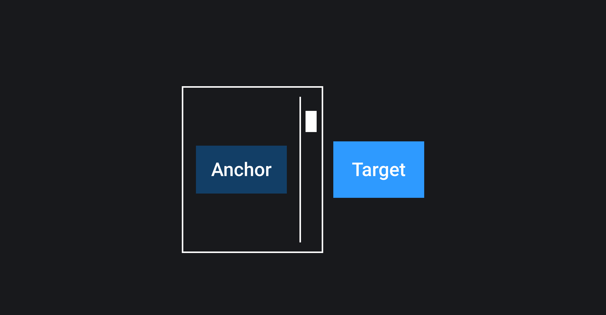
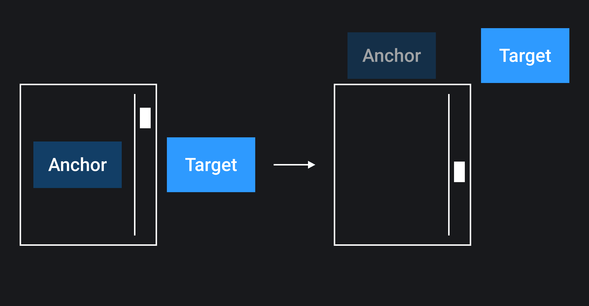
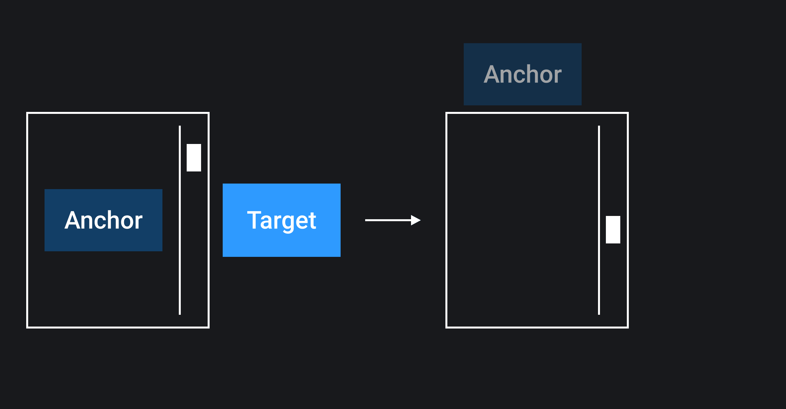

## Кратко

Свойство `position-visibility` определяет, в каких случаях таргет элемент должен быть виден.

## Пример

```css
.target {
  position-area: top center;
  position-try-fallbacks: flip-block;
  position-visibility: no-overflow;
}
```

## Как пишется

Свойство `position-visibility` принимает несколько значений:

- `always` — таргет элемент будет виден всегда, пока полностью или частично помещается на экран. Видимость таргета не зависит от видимости якоря.
- `no-overflow` — таргет элемент будет скрываться при переполнении (`overflow`), то есть если не помещается целиком ни в одну из позиций: ни в [начальную](/css/position-area/), ни в [фолбэчную](/css/position-try-fallbacks/).
- `anchor-visible` — таргет элемент будет виден, пока виден якорный элемент. Если якорь стал невидимым или целиком обрезан контейнером, внутри которого лежит якорь, но не таргет, таргет тоже скроется. Браузер учитывает только якорь из [`position-anchor`](/css/position-anchor/), а не якоря из `anchor(--name …)`. Это значение по умолчанию.
- `anchor-valid` — таргет элемент будет скрыт, если использует якорь по умолчанию через `position-area`, [`anchor()`](/css/anchor-function/), [`anchor-size()`](/css/anchor-size-function/) или `anchor-center`, но браузер не нашёл этот якорь. Например, имя в `position-anchor` указано с опечаткой.

Значения `anchor-visible`, `anchor-valid` и `no-overflow` можно комбинировать через пробел.

⚠️ Раньше значения назывались `anchors-visible` и `anchors-valid`. Новые имена понимают Chrome и Edge со 157 версии и Safari с 27, а Firefox пока знает только старые. Чтобы свойство работало везде, укажите оба варианта. Браузер применит последний, который поймёт:

```css
.target {
  position-visibility: anchors-visible;
  position-visibility: anchor-visible;
}
```

## Как понять

Допустим, что на странице есть таргет элемент, привязанный к якорю, как на картинке ниже.



Затем представим, что пользователь прокрутил контейнер с якорем так, что якорь целиком скрылся за его границей. А таргет элемент лежит вне этого контейнера и остался на экране.



В такой ситуации может быть не очень очевидно, почему какой-то элемент болтается на экране, ведь элемента, к которому он привязан, не видно. Логичнее скрыть и таргет элемент.



Именно так браузер и поступает по умолчанию. А свойство `position-visibility` позволяет указать, в какие моменты таргет элемент должен быть скрыт или виден.

Рассмотрим на примерах работу каждого из значений.

### `always`

```css
.target {
  position-visibility: always;
}
```

Таргет элемент будет оставаться видимым независимо от видимости якорного элемента. Попробуйте проскроллить вверх и вниз демку ниже: таргет элемент будет отображаться до тех пор, пока сам хоть сколько влезает во вьюпорт, при этом не важно, виден или скрыт якорный элемент.

<iframe title="Показываем работу значения always" src="demos/position-visibility-always/" height="400"></iframe>

### `no-overflow`

Допустим, таргет элемент имеет начальную позицию `top center`, а в качестве фолбэка применяется стратегия `flip-block`.

```css
.target {
  position-area: top center;
  position-try: flip-block;
}
```

<iframe title="Показываем работу значения no-overflow" src="demos/position-visibility-no-overflow/" height="500"></iframe>

Если попробуем проскроллить демку выше, то таргет элемент будет менять своё положение сверху вниз и обратно при приближении к одной из границ вьюпорта. Всё работает как должно, так как таргет элемент целиком помещается как в верхнюю ячейку, так и в нижнюю.

Если же кликнуть на чекбокс `height: 300px;`, то высота таргет элемента увеличится и он перестанет сразу же менять свою позицию при пересечении границ вьюпорта, так как в фолбэк-позицию он тоже целиком не помещается. Если продолжить скроллить, то в момент, когда в фолбэк-позиции наберётся достаточно места для размещения таргета целиком, то тогда и только тогда он сменит своё местоположение. В остальные моменты времени будет происходить `overflow`.

Если же требуется, чтобы в момент `overflow` таргет элемент скрывался, то нужно выставить `position-visibility: no-overflow;`. Теперь таргет элемент будет отображаться только тогда, когда он целиком может поместиться в начальной позиции или в одном из фолбэков. Попробуйте кликнуть в демке на второй чекбокс, чтобы убедиться в этом.

### `anchor-visible`

Иногда нужно, чтобы таргет элемент отображался на экране, только если якорный элемент тоже виден. Если якорь скрылся, то таргет тоже должен скрыться. Подобная механика пригодится, если нужно сверстать боковые сноски с пояснением, что значит какой-то из терминов в тексте. Например, как в демке ниже: якорь — термин, а таргет элемент — сноска с определением.

<iframe title="Показываем работу значения anchor-visible" src="demos/position-visibility-anchors-visible/" height="480"></iframe>

В демке у таргета задано `position-visibility: always`, поэтому он остаётся видимым, даже если якорь скрылся при скролле текста. И становится не очень понятным, почему какой-то элемент движется вместе со скроллом текста, так как не видно якорь, к которому он привязан.

Если включить чекбокс, вернётся значение по умолчанию `anchor-visible`. Таргет элемент начнёт скрываться вместе с якорем и снова появится, когда якорь покажется в контейнере.
