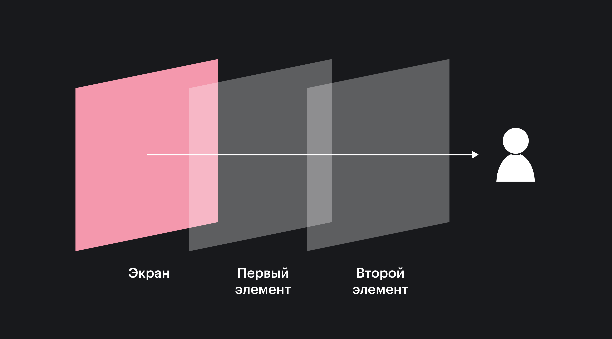

## Кратко

Контекст наложения — группа элементов, которую браузер укладывает по оси _z_ как одно целое. От контекстов наложения зависит, какой элемент на странице окажется выше или ниже других. Если представлять элементы как карты, то контекст наложения собирает элемент и его потомков в отдельную колоду.



## Всё по порядку

Браузер при отрисовке страницы идёт сверху вниз по HTML-разметке и рисует блоки один за другим в том же порядке, в котором они расположены. Мы видим это как плоский лист, на котором один за другим выстраиваются элементы. Но на самом деле браузер располагает элементы не только по осям _x_ и _y_, но ещё и по оси _z_. По глубине, так сказать.

Вы можете резонно заметить: «Монитор же плоский! Какая ещё глубина?» Ваша правда. Но браузеру важно учитывать глубину элементов, чтобы правильно наложить их друг на друга, когда нужно.

По умолчанию элемент, который стоит ниже в разметке, будет ближе к пользователю. Пусть в нашей разметке будет два блока:

```html
<div class="block first"></div>
<div class="block second"></div>
```

Для наглядности сдвинем второй блок чуть вверх и вправо:

```css
.second {
  margin-top: -50px;
  margin-left: 50px;
}
```

<iframe title="Стандартное поведение блоков" src="demos/default/" height="380"></iframe>

## `z-index`

Но порядок наложения можно задать самим. Для этого понадобится свойство [`z-index`](/css/z-index/).

Перемешаем элементы в нашем примере. Для наглядности добавим третий блок:

```html
<div class="block first"></div>
<div class="block second"></div>
<div class="block third"></div>
```

Пусть первый и третий блоки перекрывают второй. Третий и так выше: он стоит ниже в разметке. Значит, поднять нужно только первый.

`z-index` работает у позиционированных элементов, то есть с [`position`](/css/position/) не `static`. Зададим блокам `position: relative`, а первому — `z-index: 1`:

```css
.block {
  position: relative;
}

.first {
  z-index: 1;
}
```

<iframe title="Меняем порядок блоков при помощи z-index" src="demos/z-index/" height="480"></iframe>

Для большинства обычных задач этих знаний достаточно. Но случаются ситуации посложнее. Пойдём глубже и поговорим про контекст наложения.

## Контекст наложения

На самом деле в предыдущих примерах мы уже работали с контекстом наложения. Просто не знали об этом 😅

Самый базовый контекст наложения, который есть на любой странице, создаёт корневой элемент [`<html>`](/html/html/). Браузер укладывает все элементы этого контекста относительно друг друга.

Контекст наложения может создать и отдельный элемент. Тогда браузер укладывает его потомков по правилам этого нового контекста.

Новый контекст наложения создаёт:

1. корневой элемент `<html>`;
1. элемент с `position: absolute` или `position: relative` и `z-index` не `auto`;
1. элемент с `position: fixed` или `position: sticky`;
1. флекс- или грид-элемент с `z-index` не `auto`, то есть дочерний элемент блока с [`display: flex`](/css/flexbox-guide/), [`display: grid`](/css/grid-guide/) или их строчными вариантами `inline-flex` и `inline-grid`, при этом сам контейнер из-за `display` контекст не создаёт;
1. элемент с [`opacity`](/css/opacity/) меньше 1;
1. элемент с [`transform`](/css/transform/), `scale`, [`rotate`](/css/rotate/), `translate`, `offset-path`, [`filter`](/css/filter/), [`backdrop-filter`](/css/backdrop-filter/), [`perspective`](/css/perspective/), [`clip-path`](/css/clip-path/), `mask`, `mask-image` или `mask-border` не `none`;
1. элемент с [`transform-style: preserve-3d`](/css/transform-style/);
1. элемент с [`mix-blend-mode`](/css/mix-blend-mode/) не `normal`;
1. элемент с `isolation: isolate`;
1. элемент с [`will-change`](/css/will-change/), в котором перечислено свойство из этого списка, например `will-change: transform`;
1. элемент с `contain: layout`, `contain: paint` или с сокращениями `strict` и `content`, которые их включают, а также элемент с `content-visibility: auto` или `content-visibility: hidden`;
1. элемент с [`view-transition-name`](/css/view-transition/) не `none`;
1. элемент в верхнем слое (_top layer_), который браузер рисует поверх всей страницы, и его псевдоэлемент [`::backdrop`](/css/backdrop/): модальный [`<dialog>`](/html/dialog/), открытый [поповер](/html/popover/) или элемент в [полноэкранном режиме](/css/fullscreen/);
1. элемент, у которого [анимация](/css/animation/) или [переход](/css/transition/) меняет свойство из этого списка, например `opacity` или `transform`: контекст есть, пока анимация ждёт старта или идёт, а с [`animation-fill-mode`](/css/animation-fill-mode/) `forwards` или `both` остаётся и после неё.

Остальные элементы своего контекста наложения не создают и используют контекст ближайшего предка, у которого он есть.

Обычно достаточно запомнить первые четыре сценария и держать в голове `opacity` и `transform`. Если браузер рисует что-то, чего вы не ожидали, загляните в список ещё раз.

Чтобы просто создать контекст наложения, задайте элементу `isolation: isolate`. Свойство не влияет на позиционирование потомков и почти не меняет вид элемента. Единственный побочный эффект: `mix-blend-mode` потомков перестаёт смешиваться с тем, что лежит под элементом.

Контейнер для [контейнерных запросов](/css/container/) с `container-type` по спецификации контекст не создаёт: это правило убрали в 2024 году. Браузеры перешли на новое поведение не одновременно. Поэтому не полагайтесь на контекст у контейнера: если он нужен, задайте `isolation: isolate`.

## Разные колоды карт

`z-index` сравнивает элементы только внутри одного контекста наложения. Если родитель создаёт свой контекст, его потомки ложатся в одну колоду с ним. Поднять потомка над соседом родителя или опустить под него нельзя.

Пусть у нас будет два блока: синий `.parent` и розовый `.no-parent`. Внутри первого будут три дочерних блока: коричневый, красный и жёлтый.

```html
<div class="block parent">
  <div class="child brown"></div>
  <div class="child red"></div>
  <div class="child yellow"></div>
</div>
<div class="block no-parent"></div>
```

Зададим обоим блокам `position: relative` и `z-index: 1`, чтобы каждый создал свой контекст наложения:

```css
.block {
  position: relative;
  z-index: 1;
}
```

А теперь попробуем сделать так, чтобы жёлтый блок был поверх розового:

```css
.yellow {
  position: relative;
  z-index: 9999999;
}
```

<iframe title="Жёлтый блок остаётся под розовым" src="demos/parent/" height="380"></iframe>

Результат огорчает: жёлтый блок по-прежнему под розовым. Потому что `z-index: 9999999` влияет на порядок наложения только внутри блока `.parent` и его контекста наложения.

## Порядок наложения

У каждого контекста наложения свой порядок наложения элементов и их частей. Список идёт от самого дальнего от пользователя до самого ближнего:

1. фон ([`background`](/css/background/)) и рамки элемента ([`border`](/css/border/));
1. элементы (включая потомков) с `z-index` меньше 0: позиционированные, флекс- и грид-элементы;
1. фоны и рамки обычных блочных элементов: без позиционирования и без `float`;
1. элементы со свойством [`float`](/css/float/) без позиционирования;
1. текст и строчные элементы без позиционирования, например с [`display: inline`](/css/display/);
1. позиционированные элементы с `z-index: auto`, элементы (включая потомков) с `z-index: 0`, а также элементы, которые создают контекст наложения другими свойствами, например `opacity` меньше 1;
1. элементы (включая потомков) с `z-index` больше 0: позиционированные, флекс- и грид-элементы.

Из-за шагов 3 и 5 текст блока окажется поверх фона соседнего блока, даже если сосед стоит ниже в разметке и наезжает на него.

Элемент с отрицательным `z-index` не уйдёт ниже фона и рамки элемента, который создал контекст наложения.

Оставим только один блок с потомками из примера выше и попробуем спрятать жёлтый блок под синий фон родителя или под его рамку. Чуть сместим его вбок для наглядности:

```css
.yellow {
  position: relative;
  z-index: -9999999;
  margin-left: 60px;
}
```

<iframe title="Жёлтый блок с отрицательным z-index и контекст наложения родителя" src="demos/under-bkg/" height="350"></iframe>

Снимите галочку: у родителя пропадёт `z-index: 1`, а с ним и контекст наложения. Тогда потомок с отрицательным `z-index` уходит под фоны всех предков вплоть до элемента, который создал контекст наложения. Часто это `<html>`, и элемент может целиком спрятаться под фоном какой-нибудь обёртки. В демке жёлтый блок спрячется под фоном и рамкой родителя. Виден останется только край за пределами родителя.
