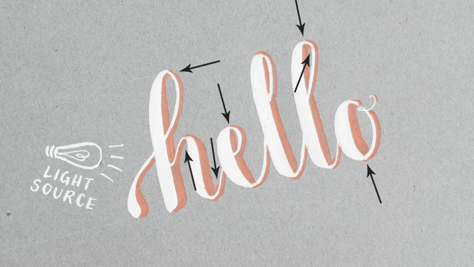

## Кратко

Свойство `text-shadow` даёт возможность добавить тень буквам в тексте.

## Пример

Добавим нашему заголовку голубую тень!

```html
<h1>Улыбнись!</h1>
```

```css
h1 {
  text-shadow: 5px 5px #2e9aff;
}
```

<iframe title="Тень для текста" src="demos/shadow/" height="286"></iframe>

## Как пишется

У тени для текста много общего с тенью для блока — [`box-shadow`](/css/box-shadow/).

Каждая тень состоит из следующих значений:

- Два или три значения размера с единицами измерения.
  - Если задано только два значения, то они интерпретируются как смещение по осям _x_ и _y_.
  - Если задано и третье значение тоже, то оно отвечает за размытие тени.
- Цвет тени в любом доступном формате. Может быть указан до числовых значений размеров, так и после. Но не между значениями. А то браузер запутается.

Посмотрим на каждую из составляющих тени внимательнее:

Смещения по осям _x_ и _y_ — обязательные значения для тени. Могут принимать любые числовые значения, в том числе отрицательные. Значение по умолчанию равно 0 для обеих осей. Если первое значение положительное, то тень будет справа от буквы, если отрицательное — слева. Если второе значение положительное, то тень будет снизу, если отрицательное — сверху.

Радиус размытия — опциональное значение, **положительное** числовое значение с единицами измерения. По умолчанию значение 0, что делает его указание необязательным. Если не указываете его или пишете 0, то край тени будет резким, без размытия. Чем больше значение, тем шире область размытия и тем светлее сама тень.

Цвет — вроде бы опциональное, но на самом деле обязательное значение цвета тени. Почему? Если не указывать цвет, то решение остаётся за браузером. Как правило, браузер возьмёт значение свойства [`color`](/css/color/) текста, которому прописываете тень. Но Safari (sic!) отрисует прозрачную тень. Если вам действительно нужен цвет тени, совпадающий с цветом текста, то это можно указать явно при помощи ключевого слова `currentColor`.

Можно задавать несколько теней для одного элемента, перечисляя их через запятую.

## Как понять

«Объёмный» текст, созданный при помощи тени — старая уловка типографов и шрифтовиков.



Очень простой приём, чтобы сделать скучный текст более броским и весёлым используется также и в вебе.

## Подсказки

💡 Свойство можно анимировать 🪄
