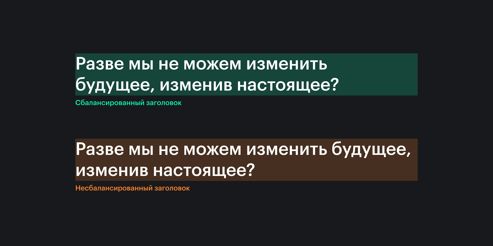

## Кратко

Свойство `text-wrap` управляет тем, как текст переносится на новые строки. Например, оно помогает сделать строки заголовка одинаковой длины или убрать одинокое короткое слово в конце абзаца.



## Пример

```css
h1 {
  text-wrap: balance;
}
```

Переключайте значения и меняйте ширину блока:

<iframe title="Значения text-wrap" src="demos/basic/" height="530"></iframe>

## Как пишется

Возможные значения:

- `wrap` — значение по умолчанию. Текст переносится на новую строку по пробелам и другим разделителям, чтобы не выходить за пределы блока.
- `nowrap` — текст не переносится и выходит за пределы блока.
- `balance` — браузер подбирает переносы так, чтобы строки были примерно одной длины.
- `pretty` — переносы как у `wrap`, но браузер использует более медленный алгоритм, который ставит на первое место внешний вид. Что именно улучшать, решает браузер. Chrome следит, чтобы в последней строке абзаца не осталось одно короткое слово. Safari ещё делает правый край текста ровнее и реже переносит слова по слогам.
- `stable` — переносы как у `wrap`, но при редактировании текста строки выше места правки не перестраиваются. Это полезно для полей с [`contenteditable`](/html/global-attrs/#contenteditable).

`text-wrap` — сокращённая запись двух свойств:

- `text-wrap-mode` — переносится ли текст: `wrap` или `nowrap`;
- `text-wrap-style` — как именно: `auto`, `balance`, `pretty` или `stable`.

`wrap`, `nowrap`, `balance` и `stable` работают во всех современных браузерах. `pretty` поддерживают Chrome и Edge с версии 117 и Safari с версии 26.

Firefox пока не знает `pretty` и пропускает такое объявление. Тогда действует значение из других правил или от предка, обычно это `wrap`.

## Производительность

Балансировка требует больших вычислений. Поэтому Chrome и Edge применяют `balance` только к блокам до шести строк, а Firefox — до десяти. В более длинном тексте значение не сработает. Safari число строк не ограничивает.

Применяйте `balance` к заголовкам, подписям и цитатам.

Значение `pretty` рассчитано на обычные абзацы, но тоже работает медленнее, чем `wrap`. Safari пересчитывает переносы во всём абзаце. По словам разработчиков WebKit, заметно замедлить страницу это может только на сотнях и тысячах строк текста.

## `balance` + `white-space`

Свойство [`white-space`](/css/white-space/) тоже управляет переносами: оно задаёт `text-wrap-mode`. Если задать `nowrap` или `pre` после `text-wrap: balance`, переносы выключатся, и балансировать будет нечего:

```css
h2 {
  text-wrap: balance;
  white-space: nowrap;
}
```

Уберите такое значение `white-space` или поставьте `text-wrap` после него.

`text-wrap-mode` наследуется. Если у элемента задан только `text-wrap-style: balance`, а у предка стоит `white-space: nowrap`, текст тоже не перенесётся.

Если поставить `text-wrap` после `white-space: pre`, текст начнёт переноситься, но пробелы и переводы строк сохранятся, как при `pre-wrap`.
