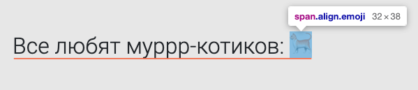
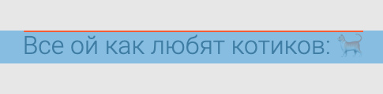

## Кратко

Свойство `vertical-align` выравнивает текстовые элементы по вертикали относительно друг друга.

🤖 Для простого текста это не особо актуально, то вот для строчно-блочных (`inline-block`) элементов это свойство может быть очень полезным.

## Пример

Пусть у нас на странице есть три строчно-блочных элемента. Для объяснения работы свойства `vertical-align` они будут разной высоты:

```html
<div class="parent">
  <div class="element small"></div>
  <div class="element medium"></div>
  <div class="element big"></div>
</div>
```

```css
.element {
  display: inline-block;
  width: 50px;
  height: 50px;
  background-color: white;
}

.medium {
  height: 100px;
}

.big {
  height: 150px;
}
```

<iframe title="Вертикальное выравнивание по умолчанию" src="demos/blocks-baseline/" height="400"></iframe>

Все три блока по умолчанию выровнялись по нижней границе. Это стандартное поведение. Изменим его и выровняем элементы по верхней границе:

```css
.element {
  vertical-align: top;
}
```

<iframe title="Вертикальное выравнивание по верху" src="demos/blocks-top/" height="400"></iframe>

## Как понять

С английского языка словосочетание **vertical align** дословно переводится как вертикальное выравнивание. Что в точности совпадает с ожидаемым результатом от использования этого свойства.

## Как пишется

Значение свойства `vertical-align` чаще всего задаётся при помощи ключевого слова. Единовременно можно указать лишь одно значение.

Рассмотрим доступные значения на примере с котиком 😍:

- `baseline` — значение по умолчанию. Выравниваемый элемент выстраивается по нижней линии текста. Если в родительском элементе нет текста, то элемент выравнивается по нижней границе.

<iframe title="Вертикальное выравнивание по умолчанию" src="demos/baseline/" height="150"></iframe>

- `top` — верхняя граница элемента находится на уровне верхней границы строки.

<iframe title="Вертикальное выравнивание по верху" src="demos/top/" height="150"></iframe>

- `middle` — мысленно проведи две горизонтальные линии: одну через центр текста, а вторую через центр котика. Текущее значение свойства сопоставляет эти линии. Таким образом элемент выравнивается по центру.

<iframe title="Вертикальное выравнивание по центру" src="demos/middle/" height="150"></iframe>

- `bottom` — выравнивает нижнюю границу элемента по уровню нижней границы строки.

<iframe title="Вертикальное выравнивание по низу" src="demos/bottom/" height="150"></iframe>

- `sub` — удобное значение, если нужно создать нижний индекс. Например, в химических формулах: **H₂O**. Опускает базовую линию так, чтобы элемент опустился до уровня нижнего индекса:

<iframe title="Нижний индекс при помощи vertical-align" src="demos/sub/" height="150"></iframe>

- `super` — работает почти как `sub`, только поднимает базовую линию вверх.

<iframe title="Верхний индекс при помощи vertical-align" src="demos/super/" height="150"></iframe>

- `text-bottom` — выравнивает элемент по нижней точке текста с учётом выносных элементов.

  

<iframe title="Вертикальное выравнивание по нижней линии текста" src="demos/text-bottom/" height="150"></iframe>

- `text-top` — верхняя часть элемента выравнивается по верхнему краю родителя:

  

<iframe title="Вертикальное выравнивание по верхней линии текста" src="demos/text-top/" height="150"></iframe>

Помимо ключевых слов можно использовать числовые значения.

Если указать значение в любых доступных единицах измерения, то положительное значение сдвинет элемент вверх относительно базовой линии, а отрицательно — вниз.

Если указать числовое значение в процентах, то за 0% берётся нижняя граница текста без выносных элементов. То есть аналогично `baseline`. Процент рассчитывается от [`line-height`](/css/line-height/) родительского элемента.

## Подсказки

💡 Свойство `vertical-align` применяется к элементам, которые нужно выровнять, а не к родительскому элементу.

💡 На всякий случай: вертикально — это сверху вниз. Слева направо — это горизонтально 😉

💡 Свойство очень пригождается когда нужно выровнять картинку или эмодзи относительно текста.
