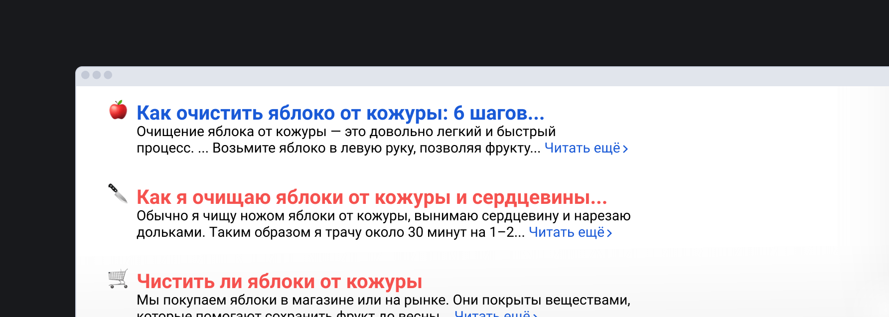

## Кратко

Псевдокласс `:visited` добавляется ссылкам, по которым уже переходил пользователь.



На скриншоте выше посещённым ссылкам задан красный цвет. Ссылки окрасились в него автоматически, как только по ним перешли. По первой ссылке ещё не кликали, поэтому она стандартного цвета.

У этого свойства есть [ряд ограничений](#limits). Из-за этого его не часто используют в реальной практике.

## Пример

Цвет посещённой ссылки будет фиолетовым, а непосещённой — зелёным.

```css
a {
  color: green;
}

a:visited {
  color: purple;
}
```

## Как пишется

К селектору, выбирающему ссылки на странице, добавляем двоеточие и ключевое слово `visited`.

Селектор ссылки по тегу в состоянии `:visited`

```css
a:visited {
  /* Стили */
}
```

Селектор ссылки по классу + `:visited`

```css
.link:visited {
  /* Стили */
}
```

Составной селектор ссылки, вложенной в пункт списка, в состоянии `:visited`

```css
li .link:visited {
  /* Стили */
}
```

Селектор ссылки по идентификатору в состоянии `:visited`

```css
#id:visited {
  /* Стили */
}
```

Селектор ссылки по классу в состоянии `:visited` и её псевдоэлемент

```css
.link:visited::before {
  /* Стили */
}
```

## Как понять

Браузер отслеживает, по каким ссылкам на странице кликнул пользователь, и подставляет фантомный класс `:visited` тем из них, по которым был совершён переход на другую страницу. При этом весь механизм присвоения этого класса скрыт под капотом браузера.

<a name="limits"></a>

## Ограничения

С самого начала интернета браузеры могли присваивать псевдокласс `:visited` ссылкам. В какой-то момент истории злоумышленники научились собирать информацию о тех сайтах, на которые ходит пользователь, и использовать это для собственной выгоды. Подобный «шпионаж» осуществлялся довольно просто: на странице со ссылками запускался скрипт, который проверял стили ссылок и собирал все посещённые в свою базу.

Для предотвращения злодеяний браузеры приняли решение, что ограничат стили, которые будут срабатывать для псевдокласса `:visited`. Вот список доступных свойств:

- [`color`](/css/color/),
- [`background-color`](/css/background-color/),
- [`border-color`](/css/border-color/),
- `border-bottom-color` или `border-block-end-color`,
- `border-left-color` или `border-inline-start-color`,
- `border-right-color` или `border-inline-end-color`,
- `border-top-color` или `border-block-start-color`,
- [`outline-color`](/css/outline-color/),
- [`column-rule-color`](/css/column-rule-color/),
- [`fill`](/css/fill/),
- [`stroke`](/css/stroke/).

Любые другие стили будут игнорироваться. Так что не удивляйтесь, если что-то из написанного вами кода не будет работать.

Кроме того, браузер проигнорирует цвета с альфа-каналом (прозрачностью, проще говоря) и прозрачность [`opacity`](/css/opacity/).

## Подсказки

💡 Смену стилей между состояниями можно анимировать при помощи [`transition`](/css/transition/) 🎉

💡 Если дизайнер хочет применить для посещённой ссылки стили, которые не входят в перечень разрешённых — не стесняйтесь ему на это указать и пояснить, что его задумка технически не реализуема.
