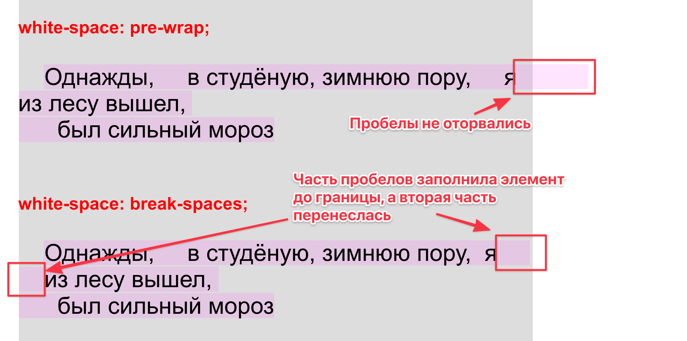

## Кратко

Свойство `white-space` указывает браузеру, как обрабатывать пробелы в тексте.

## Пример

```html
<nav>
  <ul>
    <li><a href="/about">О команде</a></li>
    <li><a href="/projects">Наши проекты</a></li>
    <li><a href="/contact-us">Связаться с нами</a></li>
    <li><a href="/help">Помощь</a></li>
  </ul>
</nav>
```

```css
a {
  white-space: nowrap;
}
```

## Как пишется

Ключевые слова:

```css
.element {
  white-space: normal;
  white-space: nowrap;
  white-space: pre;
  white-space: pre-wrap;
  white-space: pre-line;
  white-space: break-spaces;
}
```

## Как понять

Если текста в элементе много (больше, чем может вместить ширина элемента), то по умолчанию браузер пытается переносить слова на новую строку. Перенос в общем случае выполняется по символам пробела либо по символам переноса строк. Разговор сейчас идёт именно про форматирование текста прямо внутри HTML. Ведь мы можем в HTML длинный абзац оставить одной строкой, а можем разбить на несколько строк, используя клавишу Enter. По умолчанию браузер игнорирует форматирование в HTML. Он ориентируется только на теги, и выводит текст на экран, опираясь на текущий способ обработки пробельных символов. Но мы можем изменить этот способ, используя различные значения свойства `white-space`.

### `normal`

Если в строке есть несколько подряд идущих пробелов, то браузер схлопывает их в один пробел. `Я  из    лесу    вышел` = `Я из лесу вышел`. Все переносы строк в HTML внутри тега также заменяются на пробел:

```html
<p>
  Однажды,    <!-- Перенос строки -->
  в студёную    <!-- Перенос строки -->
  зимнюю    <!-- Перенос строки -->
  пору
</p>
<p>Я     из     лесу    вышел;</p>
```

<iframe title="Пробелы внутри абзаца схлопываются в один" src="demos/no-white-space/" height="300"></iframe>

В итоге текст на странице переносится по пробелам, учитывая границы элемента.

### `nowrap`

Подряд идущие пробелы и переносы строк обрабатываются так же, как и с `normal`, но браузер перестаёт учитывать границы элемента и выводит весь текст в одну строку.

### `pre`

Сохраняется всё форматирование из HTML, включая переносы строк и последовательности пробелов. Границы элемента игнорируются, и текст может выходить за них.

### `pre-wrap`

Сохраняется всё форматирование из HTML, включая переносы строк и последовательности пробелов. В отличие от `pre` текст переносится автоматически при достижении границы элемента.

### `pre-line`

Подряд идущие пробелы схлопываются, но остальное форматирование из HTML сохраняется, текст переносится в местах переноса строк в HTML. Текст переносится автоматически при достижении границ элемента.

### `break-spaces`

Поведение аналогично `pre-wrap`, за исключением одного отличия. Мы помним, что при значении `pre-wrap` слова переносятся, учитывая границы элемента, но если за крайним словом у границы следуют несколько пробелов, то они сохраняются в той же строке. В варианте с `break-spaces` эти пробелы поведут себя сложнее. Какая-то их часть останется на той же строке, дополняя ширину элемента до максимально допустимой, а вторая часть пробелов перенесётся на новую строку.



```HTML
<p>Однажды,    в    студёную зимнюю     пору
    Я из лесу       вышел;        был сильный мороз.</p>
```

<iframe title="Сравнение разных значений" src="demos/every/" height="1030"></iframe>

## Подсказки

💡 Принудительно организовать перенос текста вне зависимости от форматирования можно с использованием тега [`<br>`](/html/br/). Поведение текста при использовании этого тега одинаково при любых значениях свойства `white-space`. Даже при значении `nowrap` текст будет переноситься в том месте, где используется `<br>`.
