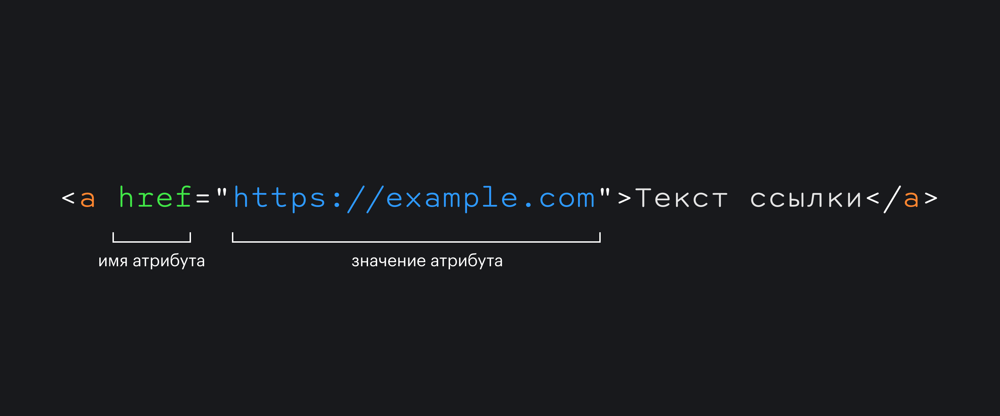

## Кратко

Тег `<a>` превращает текст, картинку или другой неинтерактивный элемент в ссылку.

## Пример

```html
<a href="https://www.yandex.ru/">Яндекс</a>
```

<iframe title="Обычная ссылка" src="demos/basic/" height="140"></iframe>

## Как понять

Разместите текст, картинку или другой элемент внутри тега `<a>`, чтобы сделать его ссылкой. Ссылка может вести на любую страницу, файл, электронную почту или телефон. Для этого пропишите атрибут `href="URL"`, где URL — любой адрес.



Бывает, что ссылка ведёт не на другую страницу, а на раздел внутри текущей страницы. Такая ссылка называется якорной, а элемент, к которому она ведёт, — якорем. Например, `<a href="#chapter1">Глава 1</a>` ведёт к элементу с `id="chapter1"`. Атрибут `id` можно задать любому тегу, то есть «бросить якорь» в любую часть страницы.

## Как пишется

```html
<a href="URL">...</a>
```

## Атрибуты

`download` — браузер скачает то, что находится по ссылке, вместо того чтобы открыть. Значение атрибута задаёт название файла. Например, `<a href="/photos/archive.zip" download="фотки.zip">` скачает файл с названием _фотки.zip_, если сервер не указал другое имя в заголовке `Content-Disposition`.

Атрибут `download` работает только для таких адресов:

- с того же источника (схема, домен и порт), что и страница со ссылкой;
- `data:` — в них лежит само содержимое файла;
- `blob:` с того же источника — такой адрес браузер выдаёт файлу, который создал скрипт на странице.

Для ссылок на другой источник, даже на поддомен того же сайта, браузер игнорирует атрибут. Файл откроется как по обычной ссылке. Если браузер не умеет его показать, файл скачается с именем, которое дал сервер. Чтобы такой файл всегда скачивался, его сервер должен отдать заголовок `Content-Disposition: attachment`.

`href` — адрес, по которому перейдёт пользователь: URL или якорь вида `#chapter1`. Чтобы ссылка вела на почту или телефон, начните адрес со схемы `mailto:` или `tel:`, например `href="mailto:name@example.com"` или `href="tel:+70001234567"`.

`hreflang` — указывает язык документа, на который ведёт ссылка, например `hreflang="en"`. Браузер с ним ничего не делает, но такие ссылки можно выбрать в CSS [селектором по атрибуту](/css/attribute-selector/) `a[hreflang="en"]`. Поисковики узнают о языковых версиях страницы не из ссылок, а из [`<link rel="alternate" hreflang="…">`](/html/link/) в [`<head>`](/html/head/). Google читает ещё HTTP-заголовки и карту сайта.

`ping` — один или несколько адресов через пробел. Когда пользователь переходит по ссылке, браузер отправляет на эти адреса POST-запрос. Так сайты считают переходы. Firefox по умолчанию такие запросы не отправляет.

`referrerpolicy` — определяет, что браузер сообщит сайту по ссылке о текущей странице: полный адрес, только источник (схему, домен и порт) или ничего. Например, `referrerpolicy="no-referrer"` не передаёт ничего.

`rel` — определяет отношение между страницей, где находится ссылка, и страницей или файлом, куда она ведёт. Его значения читают браузеры (например, `noopener` и `noreferrer`) и поисковики (`nofollow`, `sponsored`, `ugc`). Подробнее — в статье «[Атрибут `rel`](/html/rel/)».

`target` — определяет, где откроется ссылка: в том же окне, в новой вкладке или в новом окне браузера. Значения:

- `_self`: там же, где стоит ссылка, то есть в текущей вкладке или во [фрейме](/html/iframe/). Это значение по умолчанию: если нужно оно, атрибут можно не писать. Исключение — страница с [`<base target="…">`](/html/base/), тогда браузер возьмёт значение оттуда.
- `_blank`: в новой вкладке или в новом окне браузера — это зависит от настроек браузера, но чаще всего это именно вкладка.
- `_parent`: на родительской странице от текущей, то есть уровнем вложенности выше. Например, если на страницу вставлен фрейм, а внутри него такая ссылка, то она откроется не внутри фрейма, а на той странице, куда вставлен этот фрейм. Если родительской страницы нет, то ссылка откроется вместо текущей страницы.
- `_top`: в самой высокой «корневой» странице. Например, страница содержит фрейм, а в нём ещё один фрейм со ссылкой `target="_top"`. Такая ссылка откроется не во фрейме, а на самой верхней странице.

Вместо ключевого слова можно написать имя. Тогда ссылка откроется во фрейме `<iframe>` с таким атрибутом `name` или во вкладке, которую раньше открыли с этим именем. Если такой нет, браузер откроет новую.

Указывайте `target`, только если у ссылки есть `href`.

`type` — определяет, к какому типу относится документ по ссылке. Значение — MIME-тип, например `type="application/pdf"`. Браузер не использует его при переходе, но такие ссылки можно выбрать в CSS селектором `a[type="application/pdf"]`.

`title` — [глобальный атрибут](/html/global-attrs/) с текстом подсказки. Её видно при наведении курсора на ссылку. С клавиатуры и на сенсорных экранах эту подсказку не увидеть, поэтому важную информацию в неё не кладите.

## Подсказки

💡 Для ссылок с `target="_blank"` браузеры сами добавляют `rel="noopener"`: Chrome и Edge с версии 88, Firefox с версии 79, Safari с версии 12.1. Без него страница в новой вкладке получила бы доступ к текущей через `window.opener`.

💡 `noopener` не скрывает, откуда пришёл пользователь. По умолчанию браузер сообщает чужому сайту источник, например `https://doka.guide/`, но не путь. Добавьте `rel="noreferrer"`, если не хотите, чтобы сайт по ссылке узнал, откуда пришёл пользователь.

💡 Чтобы отправить пользователя в самый верх страницы, используйте `href="#top"` или `href="#"`. `#top` ведёт наверх, только если на странице нет элемента с `id="top"` или старого якоря `<a name="top">`.

💡 Указывайте атрибут `href` для ссылок. Без него ссылка неотличима от [`<span>`](/html/span/): она не получает фокус, а скринридеры не объявляют её ссылкой. Спецификация HTML допускает ссылки без `href` как заглушки, например для временно отключённой ссылки. Как это сделать — в разделе «На практике».

💡 Якорная ссылка может вести и на нужный раздел внешней страницы. Для этого используйте полный адрес страницы, а в конце, после знака `#`, добавьте `id` якоря. Например: `https://example.com/how-to-make-cookies#alternative-recipe`.

💡 Ссылка может вести и на фрагмент текста, даже если у него нет `id`. Для этого после `#` добавьте `:~:text=` и сам текст: `https://example.com/cookies#:~:text=рецепт`. Браузер прокрутит страницу к первому совпадению и подсветит его. Так умеют Chrome и Edge с версии 80, Safari с версии 16.1 и Firefox с версии 131.

💡 По умолчанию ссылка — строчный элемент (`display: inline`). Ширина и высота на неё не действуют, а вертикальные внутренние отступы не раздвигают соседние строки. Чтобы это изменить, задайте ссылке другое значение [`display`](/css/display/).

Браузер сам определит `display` ссылки как `block`, если:

- ссылка — прямой потомок флекс- или грид-контейнера;
- ссылке задан [`float`](/css/float/);
- ссылке задан [`position: absolute`](/css/position/).

Таким ссылкам можно свободно задать ширину, высоту, а также [`padding-top`](/css/padding/) и `padding-bottom`.

## Ещё примеры

Сделаем так, чтобы ссылка открывалась в новой вкладке браузера:

```html
<a href="https://doka.guide/" target="_blank">
  
</a>
```

<iframe title="Ссылка на изображении" src="demos/image/" height="300"></iframe>

Сделаем ссылку для отправки письма на почту:

```html
<a href="mailto:nowhere@example.com">Отправить сообщение в никуда</a>
```

<iframe title="Ссылка mailto" src="demos/mail/" height="160"></iframe>
