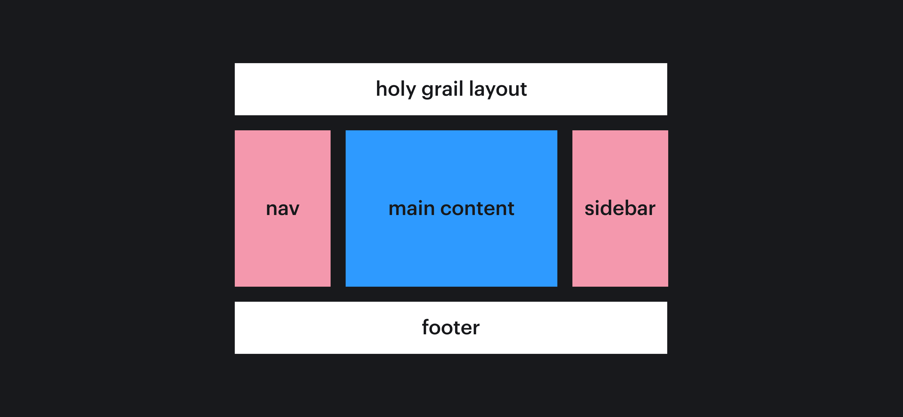

## Кратко

Тег `<aside>` размечает блок с дополнительным содержимым. Он может не иметь отношения к главному ([`<main>`](/html/main/)) контенту сайта. Часто используется для боковой колонки на сайте.

## Пример

Для примера возьмём дополнительный блок на сайте с личным блогом. Основным контентом будет считаться список статей или отдельная статья. Блок с последними комментариями прямого отношения к основному контенту не имеет — комментарии могут быть оставлены не под текущей статьёй.

```html
<aside>
  <h2>Последние комментарии</h2>
  <ul>
    <li>Комментарий 1</li>
    <li>Комментарий 2</li>
  </ul>
</aside>
```

## Как пишется

```html
<dl>
  <dt>Питер Квилл</dt>
  <dd>
    <blockquote>— Ты прямо как Мэри Поппинс *<a href="#1">1</a>.</blockquote>
  </dd>
  <dt>Йонду Удонта</dt>
  <dd>
    <blockquote>— А он крутой?</blockquote>
  </dd>
  <dt>Питер Квилл</dt>
  <dd>
    <blockquote>— Да, конечно.</blockquote>
  </dd>
  <dt>Йонду Удонта</dt>
  <dd>
    <blockquote>— Слышали? Я Мэри Поппинс, если что!</blockquote>
  </dd>
</dl>
<cite>Стражи галактики 2</cite>

<aside id="1">
  Йонду летит при помощи стрелы, подобно Мэри Поппинс, имеющей при себе зонтик.
</aside>
```

## Как понять

Тег `<aside>` относится к семантическим тегам, т. е. служит исключительно для разметки контента, никак не влияя на оформление или визуальное поведение содержимого.

В этот тег оборачивается контент, не обязательный для понимания основной информации на сайте: виджеты с оценкой, поиск по сайту, список тем и рубрик.

## Атрибуты

У `<aside>` нет никаких специфических атрибутов, он поддерживает все [глобальные атрибуты](/html/global-attrs/).

## Подсказки

💡 Нет никаких ограничений на положение тега `<aside>`, но самое место ему на одном _структурном уровне_ с `<main>` и [`<article>`](/html/article/).

💡 Визуально блок, обёрнутый в `<aside>`, необязательно должен располагаться сбоку. Он может быть в любом месте макета.

### Holy Grail Layout

Отличный пример классической вёрстки базовой разметки документа — когда в верхней и нижней части располагаются блоки «шапки» и «подвала» соответственно, а между ними — три колонки: с основным контентом посередине и дополнительным — по краям слева и справа. На заре развития веб-технологий такая вёрстка была достаточно нетривиальной: было сложно добиться равной (нефиксированной) высоты этих колонок независимо от количества контента, т. е., чтобы их высота подстраивалась под высоту колонки с максимальным содержимым. Верстальщики даже дали этой раскладке название «Святой Грааль».



Боковая колонка (с каким-то дополнительным содержимым) как раз отлично подходит под пример `<aside>`-блока.
