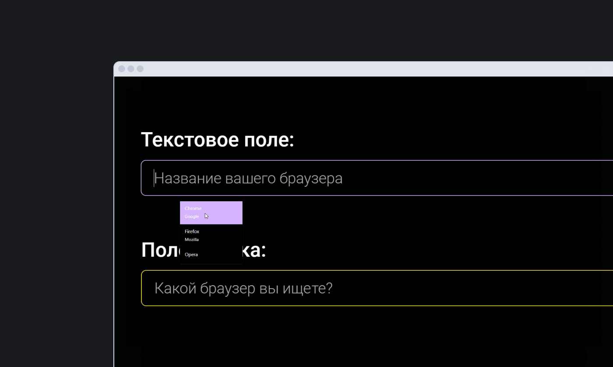
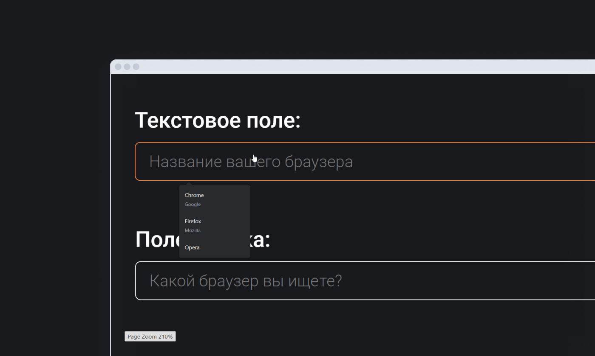

## Кратко

Элемент `<datalist>` — это _источник предложений_: готовые варианты, из которых пользователь выбирает значение. Предложения задают опции — элементы [`<option>`](/html/option/) внутри него.

У тега по умолчанию есть [роль `listbox`](/a11y/role-listbox/).

## Пример

```html
<form>
  <label for="my-browser">Выберите браузер из списка:</label>
  <input
    type="text" list="browsers"
    id="my-browser" name="my-browser"
  >
  <datalist id="browsers">
    <option value="Chrome">
    <option value="Firefox">
    <option value="Yandex Browser">
    <option value="Opera">
    <option value="Safari">
    <option value="Microsoft Edge">
  </datalist>
</form>
```

<iframe title="Пример работы элемента <datalist>" src="demos/default/" height="320"></iframe>

## Как пишется

Перед использованием элемент `<datalist>` нужно связать с элементом [`<input>`](/html/input/) через атрибут `list`:

```html
<input list="fruits">
<datalist id="fruits">
  <option value="Банан">
  <option value="Арбуз">
  <option value="Киви">
</datalist>
```

Элемент `<datalist>` не сработает, если выше по коду есть другой элемент с тем же `id`. Браузер ищет список по `id` и берёт первый элемент с этим `id`. Если это не `<datalist>`, предложений не будет:

```html
<form>
  <label for="fruits">Выберите фрукт из неработающего списка:</label>
  <input list="fruitsList" id="fruits" name="fruits">
  <div id="fruitsList">
    <datalist id="fruitsList">
      <option value="Банан">
      <option value="Арбуз">
      <option value="Киви">
    </datalist>
  </div>
</form>
```

<iframe title="Неработающий элемент <datalist>" src="demos/datalist-not-work/" height="320"></iframe>

## Как понять

Сам `<datalist>` на странице не виден: его значение [`display`](/css/display/) по умолчанию `none`. Браузер показывает опции, только когда `<datalist>` связан с `<input>`. Вид опций зависит от атрибута `type` у `<input>`. У текстового поля это выпадающий список, у ползунка — деления.

Атрибут `list` работает не у всех типов `<input>`. С `<datalist>` не работают поля с такими значениями `type`:

- `hidden`;
- `password`;
- `checkbox`;
- `radio`;
- `file`;
- `submit`;
- `image`;
- `reset`;
- `button`.

У полей для дат, времени, цвета и у ползунка `range` Chrome проверяет каждую опцию. Опция появится, только если её значение подходит полю: типу и атрибутам `min`, `max` и [`step`](/html/step/). Например, у ползунка не будет деления для числа больше `max`. Другие браузеры могут проверять опции иначе.

## Поля, которые поддерживают `<datalist>`

### `text`, `search`

В текстовых полях `<datalist>` работает как автодополнение. Пользователь набирает текст, а браузер показывает подходящие опции из списка.

У опции может быть метка — атрибут `label`. Браузеры показывают её в списке и учитывают при поиске совпадений, но каждый по-своему.

Пример с метками у опций:

```html
<form>
  <label for="my-browser">Текстовое поле:</label>
  <input
    type="text" list="browsers"
    id="my-browser" name="my-browser"
  >
  <datalist id="browsers">
    <option value="Chrome" label="Google">
    <option value="Firefox" label="Mozilla">
    <option value="Opera" label="Opera">
  </datalist>
</form>
```

У последней опции значения атрибутов `value` и `label` совпадают, поэтому в выпадающем списке метка не будет отображаться.

<iframe title="Пример работы <datalist> с полями text, search" src="demos/datalist-text-search/" height="320"></iframe>

<aside>

⚠️ Браузеры по-разному работают с атрибутом `label`:

- Chrome и Safari показывают метку дополнительным текстом рядом со значением. Chrome ищет совпадения и по `label`, и по `value`.
- Firefox показывает в списке только метку. Если метка есть, Firefox ищет совпадения только по ней. Значение `value` попадает в поле, когда пользователь выберет опцию.

</aside>

### `tel`

Поле для номера телефона. _Предложения_ `<datalist>` выглядят так же, как у типа `text`.

### `url`

Поле для абсолютного URL. _Предложения_ `<datalist>` выглядят так же, как у типа `text`.

### `email`

Поле для адреса почты. _Предложения_ `<datalist>` выглядят так же, как у типа `text`.

С атрибутом [`multiple`](/html/multiple/) в поле можно ввести несколько адресов через запятую. Автодополнение работает и после запятой.

<iframe title="Пример работы <datalist> с полем email" src="demos/datalist-email/" height="320"></iframe>

### `date`, `month`, `week`, `time`

Поля для выбора даты, месяца, недели и времени.

Предложения появятся, только если значение `<option>` записано в формате поля. Год пишите четырьмя цифрами. Месяц, число, неделю, часы, минуты и секунды пишите двумя цифрами, с нулём впереди:

- `date` — год-месяц-число: `2022-10-10`;
- `month` — год-месяц: `2022-10`;
- `week` — год и номер недели после символа `W`: `2022-W12`;
- `time` — час:минута: `18:00`. Секунды можно добавить, в том числе дробные: `08:00:20` или `08:00:20.5`.

Несуществующая дата вроде `2022-02-30` не подойдёт.

Пример со всеми четырьмя полями:

```html
<!-- Date -->
<form>
  <label for="dateInput">Укажите дату:</label>
  <input type="date" list="dateList" id="dateInput">
  <datalist id="dateList">
    <option value="2022-10-10" label="Сегодня">
    <option value="2022-10-03" label="Неделю назад">
    <option value="2022-10-17" label="Неделю спустя">
  </datalist>
</form>

<!-- Month -->
<form>
  <label for="monthInput">Укажите месяц:</label>
  <input type="month" list="monthList" id="monthInput">
  <datalist id="monthList">
    <option value="2022-10" label="Осень">
    <option value="2022-12" label="Зима">
    <option value="2022-03" label="Весна">
  </datalist>
</form>

<!-- Week -->
<form>
  <label for="weekInput">Укажите неделю:</label>
  <input type="week" list="weekList" id="weekInput">
  <datalist id="weekList">
    <option value="2022-W12" label="Двенадцатая неделя">
    <option value="2022-W52" label="Последняя неделя">
    <option value="2022-W01" label="Первая неделя">
  </datalist>
</form>

<!-- Time -->
<form>
  <label for="timeInput">Укажите время:</label>
  <input type="time" list="timeList" id="timeInput" step="any">
  <datalist id="timeList">
    <option value="08:00:20" label="Утром">
    <option value="12:00" label="Днём">
    <option value="18:00" label="Вечером">
  </datalist>
</form>
```

<iframe title="Пример работы <datalist> с полями date, month, week, time" src="demos/datalist-date-month-week-time/" height="620"></iframe>

В Firefox и Safari для компьютера нет полей `month` и `week`. Вместо них браузеры рисуют обычное текстовое поле.

<aside>

⚠️ Шаг по умолчанию у `time` и `datetime-local` — 60 секунд. Время с секундами вроде `08:00:20` не попадает в этот шаг, и Chrome не покажет такую опцию. Если в выпадающем списке нужно время с точностью до секунды, задайте `<input>` атрибут `step="any"` или `step="1"`.

</aside>

### `datetime-local`

Поле для местной даты и времени, без часового пояса.

Значение — дата и время через пробел или символ `T`: `2022-10-10 12:00` или `2022-10-03T08:00`. Секунды можно добавить: `2022-10-10 12:00:30`.

```html
<form>
  <label for="datetimeInput">Укажите дату:</label>
  <input type="datetime-local" list="dateList" id="datetimeInput">
  <datalist id="dateList">
    <option value="2022-10-10 12:00" label="Сегодня днём">
    <option value="2022-10-03T08:00" label="Неделю назад утром">
    <option value="2022-10-17 17:00" label="Через неделю вечером">
  </datalist>
</form>
```

<iframe title="Пример работы <datalist> с полем datetime-local" src="demos/datalist-datetime-local/" height="320"></iframe>

### `number`

Поле для числа. _Предложения_ `<datalist>` выглядят так же, как у типа `text`.

### `range`

Поле для числа, как `number`, но в виде ползунка.

Значения опций для `range` должны быть числами. На местах этих чисел браузер нарисует деления на ползунке.

```html
<form>
  <label for="rangeInput">Укажите число:</label>
  <input type="range" list="rangeList" id="rangeInput">
  <datalist id="rangeList">
    <option value="0">
    <option value="25">
    <option value="50">
    <option value="75">
    <option value="100">
  </datalist>
</form>
```

<iframe title="Пример работы <datalist> с полем range" src="demos/datalist-range/" height="320"></iframe>

За отображение числового значения под ползунком в демке отвечает элемент [`<output>`](/html/output/).

### `color`

Поле для выбора цвета.

Чтобы _предложения_ правильно отображались в поле `color`, записывайте значения опций в шестнадцатеричном виде из семи символов, вместе с решёткой: `#000000`. Такие значения понимают все браузеры, а сокращённую запись `#000` и названия цветов — не все.

```html
<form>
  <label for="colorInput">Укажите цвет:</label>
  <input type="color" list="colorList" id="colorInput">
  <datalist id="colorList">
    <option value="#FF6347" label="Tomato">
    <option value="#F5DEB3" label="Wheat">
    <option value="#DDA0DD" label="Plum">
  </datalist>
</form>
```

<iframe title="Пример работы <datalist> с полем color" src="demos/datalist-color/" height="320"></iframe>

<aside>

⚠️ Firefox поддерживает `<datalist>` частично:

- предложения работают у типов `text`, `search`, `url`, `tel`, `email`, `number` и, с версии 110, `range`;
- у `date`, `time` и `datetime-local` предложений нет;
- у `color` предложения есть только на Windows и Linux;
- Firefox на Android выпадающий список не показывает.

Проверяйте работу `<datalist>` в Firefox.

</aside>

## Различия между `<select>` и `<datalist>`

Главное отличие [`<select>`](/html/select/) от `<datalist>` — свобода ввода. В `<select>` можно выбрать только вариант из списка. В поле с `<datalist>` можно выбрать вариант или ввести своё значение.

С атрибутом `multiple` у `<select>` появляется открытый список, и в нём можно выбрать несколько вариантов. У полей с `<datalist>` несколько значений принимает только тип `email`.

### Обратная совместимость

Раньше `<datalist>` дублировали элементом `<select>` для Internet Explorer 9 и Safari до версии 12.1. Сейчас `<datalist>` работает в Chrome, Safari и Firefox для компьютера, и такой приём не нужен. Но в Firefox на Android предложений нет, поэтому поле должно оставаться удобным и без них.

## Доступность

Хотя у `<datalist>` есть встроенная семантика, тег нельзя назвать полностью доступным. Например, не все скринридеры зачитывают содержимое выпадающего списка с вариантами для автодополнения.

Следующая проблема связана с CSS: выпадающий список и пункты в нём пока нельзя стилизовать.

В режиме высокой контрастности к списку не применяются системные цвета. Список выглядит так же, как в обычном режиме.



Наконец, пункты выпадающего списка не увеличиваются при масштабировании.


