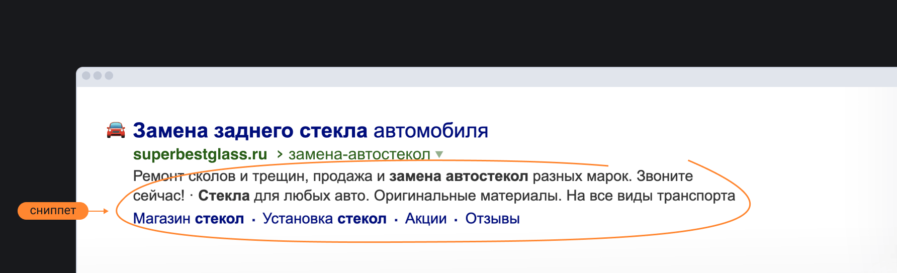
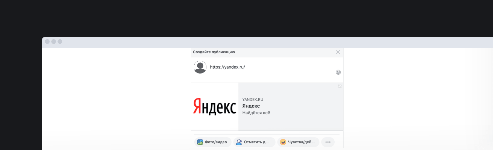

🛠 Сниппет — это текст под заголовком сайта в поисковой выдаче. Если не задать описание в `<meta name="description" content="...">`, поисковик составит сниппет из текста страницы.



Заполняйте `description`, чтобы влиять на то, что увидит пользователь в поиске. Полного контроля он не даёт: поисковик строит сниппет под конкретный запрос и может взять другой фрагмент страницы.

🛠 Есть отдельный набор метатегов — Open Graph (OG). Он нужен, чтобы при вставке ссылки на ваш сайт в соцсетях появлялась карточка с заголовком, описанием и картинкой.



Вместо `name` в Open Graph пишут атрибут `property`: соцсети читают именно его.

Обязательный набор метатегов — заголовок, тип, картинка и адрес. Описание стоит добавить тоже:

```html
<meta property="og:title" content="Лучший сайт в интернете">
<meta property="og:type" content="website">
<meta
  property="og:description"
  content="Посетите лучший сайт и познайте тщетность бытия"
>
<meta
  property="og:image"
  content="https://example.com/thumbnail.jpg"
>
<meta property="og:url" content="https://example.com/">
```
