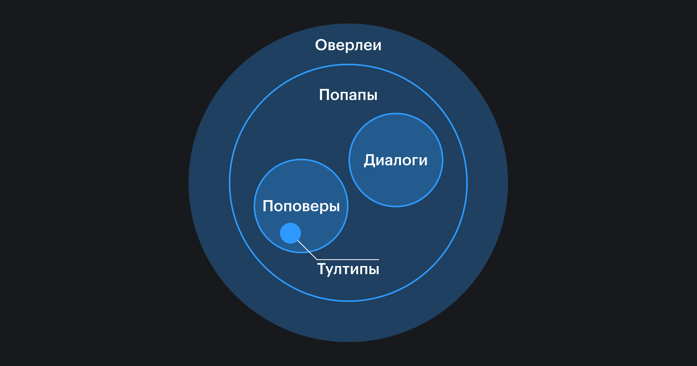

## Кратко

Удобный способ создавать всплывающие элементы. В нём есть встроенные возможности, например закрытие по клику на странице или по нажатию клавиши <kbd>Esc</kbd>.

Можно управлять как при помощи атрибутов HTML, так и через JavaScript.

## Пример

```html
<button
  popovertarget="my-popover"
  popovertargetaction="toggle"
>
  Всплываем!
</button>

<div id="my-popover" popover>
  <p>🛳️</p>
</div>
```

## Как понять

_Поповер_ — это любые всплывающие элементы в интерфейсе: всплывающие подсказки (тултипы), раскрывающиеся меню, превью товаров и другие.

Поповер — частный случай _оверлея (overlay)_. Так называют любой элемент поверх интерфейса.

Небольшие окна, которые появляются сами, называют _попапами (popups)_. К ним относятся поповеры и диалоговые окна (привет, [`<dialog>`](/html/dialog/)).



Раньше поповеры собирали вручную, и часто они были недоступными. Теперь удобный и доступный поповер создают несколько атрибутов.

Преимущества:

- **Верхний слой** — браузер выносит открытый поповер в отдельный слой поверх всей страницы, поэтому он отображается выше остальных элементов страницы. Больше не нужно возиться с [`z-index`](/css/z-index/).
- **Простое закрытие** — клик за пределами элемента или нажатие <kbd>Esc</kbd> закрывает поповер. Исключение — значение `manual`, о нём ниже.
- **Фокус** — если поповер открыт кнопкой, <kbd>Tab</kbd> переводит фокус на первый интерактивный элемент внутри. Если фокус был внутри поповера, после <kbd>Esc</kbd> он вернётся на прежний элемент. Клик снаружи фокус не возвращает.
- **Семантическая связь** — привязка поповера к элементу, который его вызывает.

## Как пишется

### Обязательные атрибуты

- `popover` — указывает, что элемент ведёт себя как поповер;
- `id` — уникальный идентификатор элемента, по нему кнопка находит поповер;
- `popovertarget` — связывает кнопку с поповером. Значение — `id` элемента, который нужно показать. Атрибут работает только у [`<button>`](/html/button/) и у [`<input>`](/html/input/) с типом `button`, `submit`, `reset` или `image`.

Внутри формы `popovertarget` работает только у кнопок с `type="button"`. Кнопка без `type` отправляет форму и поповер не открывает.

```html
<button popovertarget="my-popover">
  Показать поповер
</button>

<div id="my-popover" popover>
  <p>Я — простой, но крутой поповер 😎</p>
</div>
```

<iframe title="Обязательные атрибуты" src="demos/required/" height="320"></iframe>

### Кнопка закрытия

По умолчанию кнопка с `popovertarget` и открывает, и закрывает поповер. Атрибут `popovertargetaction` меняет это поведение:

- `toggle` — открывает и закрывает, значение по умолчанию;
- `show` — только открывает;
- `hide` — только закрывает.

В примере ниже кнопка «Показать поповер» только открывает поповер. Закрывает его своя кнопка внутри. Класс `visually-hidden` прячет текст «Закрыть» с экрана, но оставляет его для скринридеров.

```html
<button popovertarget="my-popover" popovertargetaction="show">
  Показать поповер
</button>

<div id="my-popover" popover>
  <button popovertarget="my-popover" popovertargetaction="hide">
    <span aria-hidden="true">❌</span>
    <span class="visually-hidden">Закрыть</span>
  </button>

  <p>Я — поповер, который нельзя закрыть той же кнопкой</p>
</div>
```

<iframe title="Кнопка закрытия" src="demos/targetaction/" height="350"></iframe>

### Значения `popover`

У атрибута `popover` есть три значения:

- `auto` — значение по умолчанию. Закрывается по клику снаружи и по <kbd>Esc</kbd>. Открытие нового `auto` закрывает другие открытые `auto`, а `manual` не трогает.
- `manual` — можно показать несколько одновременно. Поповер не закрывается ни по клику за его пределами, ни по <kbd>Esc</kbd>: его закрывают кнопкой или скриптом.
- `hint` — для всплывающих подсказок. Закрывается по клику снаружи и по <kbd>Esc</kbd>. Открытые поповеры `auto` не трогает. Новая подсказка закрывает предыдущую. Открытие поповера `auto` закрывает все подсказки.

Значение `hint` работает в Chrome, Edge и Firefox. Safari его пока не знает и считает поповер `manual`. Там подсказка не закроется ни по клику, ни по <kbd>Esc</kbd>, поэтому добавьте в неё кнопку закрытия.

В демке ниже по два поповера `auto` и `manual`. Покликайте по ним, посмотрите на разницу в их поведении.

```html
<button popovertarget="popover-auto">
  <code>popover="auto"</code>
</button>

<div id="popover-auto" popover="auto">
  <p>
    Закрываю другие всплывашки <code>auto</code>.
    Легко закрываюсь сам.
  </p>
</div>

<button popovertarget="popover-manual">
  <code>popover="manual"</code>
</button>

<div id="popover-manual" popover="manual">
  <p>Не закрываю другие. Без кнопки не закроюсь.</p>
</div>
```

<iframe title="Разница значений атрибута popover" src="demos/manual/" height="500"></iframe>

Вложенный поповер не закрывает родителя. Вложенным считается поповер, который лежит внутри другого или открыт кнопкой из другого поповера.

<aside>

🤓 Поповер можно открыть и с помощью пары атрибутов `commandfor` и `command`. С декабря 2025 года они работают во всех современных браузерах:

```html
<button commandfor="my-popover" command="toggle-popover">
  Показать поповер
</button>
```

У `command` для поповера есть значения `toggle-popover`, `show-popover` и `hide-popover`. Эти же атрибуты умеют открывать и закрывать `<dialog>`. Атрибут `popovertarget` остаётся в стандарте, его можно использовать дальше.

</aside>

## Стилизация

Стили поповера по умолчанию:

```css
[popover] {
  position: fixed;
  width: fit-content;
  height: fit-content;
  inset: 0px;
  margin: auto;
  border: solid;
  padding: 0.25em;
  overflow: auto;
  color: CanvasText;
  background-color: Canvas;
}

[popover]:not(:popover-open):not(dialog[open]) {
  display: none;
}
```

Переопределяйте их по необходимости. Своё значение `display` задавайте в селекторе `[popover]:popover-open`. Если написать `display: flex` для `[popover]`, поповер будет виден и в закрытом состоянии.

Можно стилизовать подложку открытого поповера при помощи псевдоэлемента [`::backdrop`](/css/backdrop/).

```css
[popover]::backdrop {
  background-color: rgb(255 255 255 / 0.5);
}
```

<iframe title="Стилизация подложки" src="demos/backdrop/" height="320"></iframe>

## Анимации

Можно анимировать открытие и закрытие поповера. Для этого потребуется описать несколько состояний.

Сначала прописываем стили для открытого элемента:

```css
[popover]:popover-open {
  opacity: 1;
  rotate: 0turn;
  transition:
    rotate .5s,
    opacity .5s,
    display .5s allow-discrete,
    overlay .5s allow-discrete;
}
```

Затем в директиве [`@starting-style`](/css/starting-style/) задаём стили, с которых начнётся анимация открытия.

```css
@starting-style {
  [popover]:popover-open {
    opacity: 0;
    rotate: 1turn;
  }
}
```

Ставьте этот блок после правила для открытого элемента. [Специфичность](/css/specificity/) у них одинаковая, и иначе стили открытого элемента перекроют стартовые.

И в конце пишем конечные стили при закрытии поповера:

```css
[popover]:not(:popover-open) {
  scale: 0;
  transition:
    scale .3s,
    display .3s allow-discrete,
    overlay .3s allow-discrete;
}
```

Обратите внимание на свойства [`display`](/css/display/) и `overlay` внутри [`transition`](/css/transition/). Без них браузер сразу спрячет поповер и уберёт его из верхнего слоя, и анимация закрытия не успеет проиграться.

Оба свойства меняются скачком, а не плавно. Ключевое слово `allow-discrete` разрешает их анимировать.

Свойство `overlay` есть только в Chrome и Edge. В Firefox и Safari поповер на время анимации закрытия уходит из верхнего слоя. Там он может оказаться под другими элементами.

<iframe title="Анимация всплывающей подсказки" src="demos/animation/" height="320"></iframe>

## Отличия от `<dialog>`

В чём отличие поповера от `<dialog>`? Кажется, что оба создают всплывающие окна.

У `<dialog>` есть роль `dialog`. Атрибут `popover` своей роли не даёт: `<div popover>` получает общую роль `group`. Кнопке браузер передаёт, раскрыт ли поповер, как атрибут [`aria-expanded`](/a11y/aria-expanded/).

Нужную роль добавляйте сами при помощи [ARIA-ролей](/a11y/aria-roles/). Например, подсказке нужна роль [`tooltip`](/a11y/role-tooltip/). Элементу, к которому она относится, нужен атрибут [`aria-describedby`](/a11y/aria-describedby/).

Поповер `auto` закрывается по клику за пределами элемента без дополнительных настроек. Диалогу для этого нужен атрибут `closedby="any"`. Он работает в Chrome, Edge и Firefox, а в Safari его пока нет.

Также диалог, открытый как модальное окно, блокирует остальную страницу под ним. Поповер так не поступает.

## Методы JavaScript

Для большинства сценариев работы с поповерами совсем не нужен JavaScript. Если всё же нужен скрипт, используйте следующие методы:

- `showPopover()` — открыть поповер;
- `hidePopover()` — закрыть поповер;
- `togglePopover()` — переключить состояние поповера между открытым и закрытым.

```js
document.getElementById('my-popover').showPopover()
```

Проверить, открыт ли поповер, можно методом `matches(':popover-open')`. Состояние приходит и в событии `toggle`. Подписаться на него можно через [`addEventListener()`](/js/element-addeventlistener/):

```js
const popover = document.getElementById('my-popover')

popover.addEventListener('toggle', (event) => {
  console.log(event.newState)
  // 'open' или 'closed'
})
```

В событии `beforetoggle` поповер ещё не переключился, и `newState` показывает, каким он станет.
