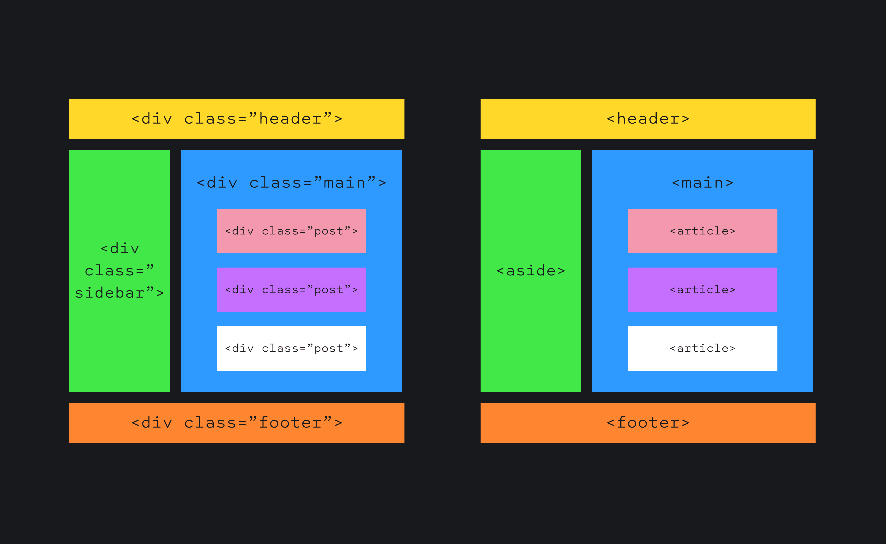
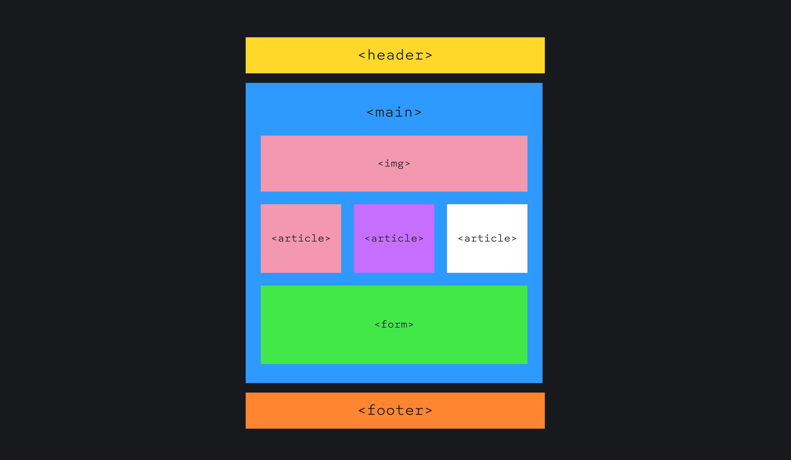
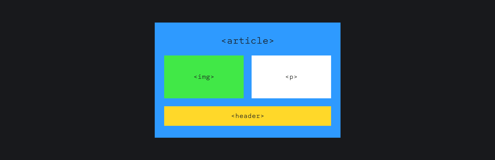

## Кратко

Одна из важных особенностей HTML — семантика, которая буквально переводится как «обозначающий». При помощи HTML мы описываем структуру страниц и их содержимого, то есть объясняем браузерам, вспомогательным и другим технологиям и программам _значение элементов_. Это может быть абзац текста, кнопка, часть страницы с основным содержимым или ничего не значащий контейнер.

На практике семантика HTML-элементов передаётся через их [роли](/a11y/aria-roles/), а ещё [состояния и свойства](/a11y/aria-attrs/). Роли описывают основной смысл элемента. Состояния и свойства добавляют детали: выбран ли чекбокс, доступно ли поле для ввода и так далее.

<aside>

Теги и их встроенные роли перечислены в [спецификации ARIA в HTML (ARIA in HTML)](https://www.w3.org/TR/html-aria/#docconformance).

</aside>

Каждый раз, когда пишете HTML-код, вы имеете дело с семантикой. Даже если используете только [`<div>`](/html/div/) и [`<span>`](/html/span/) 🤯

## Некоторые элементы и атрибуты

Все HTML-теги, которых больше 100, семантические. Для простоты разделим их на две группы: структурные и контентные. Полный список элементов найдёте в [HTML Living Standard](https://html.spec.whatwg.org/multipage/).

Структурные теги делят HTML-документ (страницу) на большие логические блоки или секции:

- [`<article>`](/html/article/) — самостоятельный блок с содержимым вроде превью поста в блоге, карточки товара или рекламного баннера. Такой контент не потеряет смысл, если его перенести на другую страницу или сайт.
- [`<nav>`](/html/nav/) — основная или дополнительная навигация со ссылками на другие страницы или отдельные разделы.
- [`<section>`](/html/section/) — блок, который объединяет содержимое по смыслу.
- [`<aside>`](/html/aside/) — дополнительное содержимое, которое связано с основным косвенно. Например, врезка или блок с похожими статьями.
- [`<main>`](/html/main/) — основное содержимое страницы.
- [`<header>`](/html/header/) — вводное содержимое или навигация. Не привязан к конкретному месту страницы и отдельной секции, но традиционно используется для создания основной навигации по сайту — шапки (хедера). Также можно использовать для оборачивания оглавления раздела, заголовка статьи с вводной информацией о ней и прочего.
- [`<footer>`](/html/footer/) — дополнительная информация о сайте или части одной страницы. Тоже не привязан к части страницы или отдельной секции. Например, подвал (футер) может быть у превью поста и содержать информацию о дате публикации и авторе.

Посмотрим на пример с карточкой. Браузер и скринридер по этому коду поймут, что карточка — независимый от контекста блок `<article>` с абзацем текста. У карточки есть вводное содержимое `<header>` с заголовком `<h2>` и текстом без особой роли `<span>`. В `<footer>` лежит дополнительная информация о содержимом: дата без времени [`<time>`](/html/time/).

```html
<article>
  <header>
    <h2>SEO для начинающих</h2>
    <span class="author">Иван Иванович</span>
  </header>

  <p>
    Благодаря этому курсу вы научитесь задавливать конкурентов
    с помощью ссылочной массы, а не качественного контента.
  </p>

  <footer>
    <time datetime="2023-02-13">
      13 февраля 2023
    </time>
  </footer>
</article>
```

Контентные теги описывают смысл частичек и типов содержимого — контента. Перечислим несколько тегов, на самом деле их гораздо больше:

- [`<h1>`–`<h6>`](/html/h1-h6/) для определения заголовков на странице. `<h1>` используют для основного заголовка документа или раздела. Остальные нужны для подзаголовков. Все заголовки описывают структуру и иерархию страниц.
- [`<button>`](/html/button/) для кнопок. Используют для отправки форм и выполнения других команд.
- [``](/html/img/) для картинок.
- [`<table>`](/html/tables/) для таблиц. Состоят из нескольких элементов для структурирования табличных данных: строк `<tr>`, заголовочных ячеек `<th>` и ячеек с данными `<td>`.
- [`<ul>`](/html/ul/) неупорядоченный маркированный список.
- [`<a>`](/html/a/) для ссылок, с помощью которых пользователи переходят от одной страницы к другой.
- [`<p>`](/html/p/) для абзацев текста. Это основные блоки текста в HTML; логически разграничивают части текста с общей мыслью или идеей.

И снова пример. Когда [скринридеры](/a11y/screenreaders/) столкнутся с таким HTML, они пропустят декоративную картинку ``, прочитают текст абзаца `<p>` и сообщат о ссылке `<a>`.

```html

<p>
  <a href="/seo-basics">Базовый курс по SEO</a> научит задавливать
  конкурентов с помощью ссылочной массы, а не качественного контента.
</p>
```

HTML-атрибуты раскрывают дополнительный смысл содержимого страниц. Например, [глобальный атрибут](/html/global-attrs/) `title` означает, что это дополнительные сведения о тексте или элементе. `lang` сообщает о языке слова, фразы или ссылки, а `dir` описывает направление письма.

Ещё один такой атрибут — `translate`. Он разрешает или запрещает переводить содержимое элемента, например, автоматическим переводчиком в браузере.

Конечно, не все теги подробно описывают типы содержимого. К примеру, `<section>` только намекает, что это что-то объединённое по смыслу. `<article>` уже больше рассказывает о содержимом: оно тесно связано, сгруппировано в одном месте и не зависит от другого на странице.

`<div>` и `<span>` тоже существуют не зря, хотя их часто называют _несемантическими_. Это не совсем так. Оба тега играют роль универсальных контейнеров с ролью [`generic`](/a11y/role-generic/). То есть они говорят браузерам и скринридерам, что у самого контейнера нет особого смысла. Скринридер не сообщит о таком контейнере, но прочитает текст внутри.

## Зачем нужна семантика

Кто-то может подумать, что раз даже `<div>` и `<span>` семантические, расставлять теги кнопок, ссылок и списков долго и бессмысленно. Всё прямо наоборот: у вёрстки, которая подробно описывает содержимое страниц, больше преимуществ, чем у «дивной».

### Поддержка и читаемость кода

Исходный код проекта с вниманием к семантике легче поддерживать. В нём проще ориентироваться, а любой член команды сразу видит логику отдельных элементов и общую структуру интерфейса. Польза семантики особенно заметна, когда проект постоянно развивается и обзаводится новыми компонентами. В такой код проще и быстрее вносить изменения.

Качественная вёрстка экономит время разработчиков и уменьшает количество строчек кода. Например, у `<button>` и [`<input>`](/html/input/) уже есть стили по умолчанию и встроенное поведение: фокус с клавиатуры и реакция на клики и клавиши. Их не нужно писать руками.

Чтобы повторить кнопку на `<div>`, нужно:

- добавить [`role="button"`](/a11y/role-button/) и [`tabindex="0"`](/html/tabindex/);
- слушать события [`keydown`](/js/element-keydown/) для <kbd>Enter</kbd> и [`keyup`](/js/element-keyup/) для <kbd>Space</kbd>;
- отменять прокрутку страницы при нажатии <kbd>Space</kbd>.

Размеры файлов со стилями и скриптами напрямую влияют на _производительность сайта (performance)_. Чем больше вес файлов, тем дольше грузится страница. Подробнее о производительности позже.

Отдельная статья расходов времени при переписывании кода (рефакторинге) — внедрение доступности. Плохой код приводит ко многим проблемам с доступностью. Если команда не подумала о семантической разметке с самого начала, время на внедрение доступности в проект заметно увеличивается.

### UX, юзабилити и доступность

Семантика — основа хорошего пользовательского опыта или UX (user experience). Хороший UX складывается из лёгкого и успешного взаимодействия с интерфейсами (юзабилити), полезного содержимого, доступности для пользователей с инвалидностью и общей удовлетворённости от всего процесса.

Поговорим подробнее про пользу семантики для доступности. Зрячим пользователям обычно легче ориентироваться на сайте, чем тем, кто его не видит. Люди со слепотой и слабовидящие используют скринридеры, экранные лупы и другие вспомогательные технологии для взаимодействия со страницами.

Логичная HTML-разметка улучшает опыт пользователей вспомогательных технологий и устраняет барьеры, из-за которых невозможно пользоваться сайтом. Например:

- Скринридер расскажет, что `<button>` — это кнопка. Пользователи голосового управления нажмут её, если назовут команду нажатия и текст на кнопке.
- У чекбокса есть состояние `checked`. Благодаря ему люди услышат, какой чекбокс выбран, а какой нет.
- У `<h1>`–`<h6>` есть встроенное свойство [`aria-level`](/a11y/aria-level/). Скринридеры зачитывают уровень вместе с ролью: «заголовок первого уровня». Так структуру страницы представят себе те, кто слушает интерфейсы.

Другой плюс продуманной HTML-разметки — навигация для скринридеров. Теги вроде `<header>` и `<footer>` — ориентиры. Это значит, что пользователи могут перемещаться по отдельным блокам страницы с помощью горячих клавиш.

<aside>

☝️ `<header>` и `<footer>` становятся ориентирами, только если не вложены в `<article>`, `<aside>`, `<main>`, `<nav>` или `<section>`. Например, `<header>` внутри [`<body>`](/html/body/) — ориентир, а внутри `<article>` — нет. А `<section>` становится ориентиром, только когда у него есть [доступное имя](/a11y/accessible-names-and-descs/), например, из атрибута [`aria-labelledby`](/a11y/aria-labelledby/).

</aside>

Пользователи скринридеров перемещаются и по заголовкам. Это распространённый [метод поиска информации по странице](https://webaim.org/projects/screenreadersurvey11/#finding).

Другая неочевидная польза семантики: меньше придётся стилизовать сайт отдельно под [режим принудительных цветов](/a11y/forced-colors/), например, контрастные темы в Windows. В этом режиме браузер заменяет цвета на небольшую системную палитру. Кнопка на `<button>` получит системные цвета кнопки. А кнопка на `<div>` получит цвета обычного текста и перестанет выглядеть кнопкой.

### Браузеры, расширения и другие технологии

Семантика приносит пользу и самим браузерам. К примеру, в большинство браузеров встроен _режим чтения (reading mode)_. В нём браузер убирает со страницы всё лишнее и оставляет самое важное: заголовки, текст, картинки и видео. Если страница, например, свёрстана без `<h1>`, `<h2>` и заголовков других уровней, пользователи получат большой кусок неструктурированного текста. Такие же проблемы будут и у сервисов для RSS (really simple syndication) и сервисов для отложенного чтения и закладок.

Часть пользователей устанавливает разные браузерные расширения. К примеру, чтобы изменять стили страниц, текста или бионического чтения. Расширения полагаются на разметку, как и браузеры в целом.

<aside>

🅰️ _Бионическое чтение_ — способ оформления текста, при котором первые буквы слов выделяют жирным. Его создатели обещают, что так читать быстрее, но исследования этого пока не подтверждают.

</aside>

Голосовые и ИИ-помощники тоже не остались в стороне от HTML-семантики. Они читают страницы вслух, пересказывают их и переходят по ссылкам по команде. Помощник надёжнее найдёт ссылку и поймёт, куда она ведёт, если она свёрстана на `<a>` с атрибутом `href`.

### Поисковая оптимизация

Поисковики стерпят всё и поймут вас в любом случае, даже если общаетесь с ними на языке дивов. Однако семантика упрощает им работу и позитивно влияет на поисковую оптимизацию сайтов — SEO (search engine optimization), а именно:

- улучшает точность индексации страниц;
- помогает сделать сайт быстрее;
- помогает привлечь органический трафик и клики;
- готовит сайт к поиску с ИИ.

**Более точная индексация**. Семантика сама по себе не фактор ранжирования, но раскрывает больше информации о структуре сайта, темах страниц и связях между разными видами контента. Поисковые роботы точнее определяют главную тему страницы по заголовку `<h1>` и тегу [`<title>`](/html/title/).

<aside>

📈 Микроразметка (structured data) напрямую на позиции в выдаче не влияет. Зато она помогает поисковику показать страницу в расширенном виде: с рейтингом, ценой или датой события. На ранжирование сильнее влияет качество содержимого. Чтобы понять, хорошо ли алгоритмы его находят, Google привлекает людей-асессоров. Они проверяют выдачу по [руководству для оценки качества](https://services.google.com/fh/files/misc/hsw-sqrg.pdf) и, среди прочего, смотрят на _E-E-A-T_: опыт (experience), экспертизу (expertise), авторитетность (authoritativeness) и надёжность (trustworthiness) содержимого. Сами их оценки на позиции конкретных страниц не влияют.

</aside>

**Лучшая производительность**. Google учитывает в ранжировании скорость загрузки, отзывчивость и стабильность вёрстки — метрики [Core Web Vitals](https://developers.google.com/search/docs/appearance/core-web-vitals), хотя и не как главный фактор. Семантическая разметка избавляет от лишнего JavaScript и CSS, как в примере с кнопкой на `<div>` выше.

**Рост органического трафика**. Органический трафик (organic traffic) — это количество пользователей, которые перешли на сайт из поисковой выдачи, а не по рекламным ссылкам и баннерам.

Один из источников такого трафика — [блоки с ответом (featured snippets)](https://developers.google.com/search/docs/appearance/featured-snippets) на первой странице выдачи поисковика. В такой блок обычно попадает короткий ответ: абзац, список шагов или таблица. Google выбирает его сам, но понятная структура страницы может помочь поисковику найти такой ответ.

Для сниппета, то есть короткого описания под ссылкой в выдаче, поисковик может взять текст из метатега [`description`](/html/meta/). Простое и ёмкое описание заранее говорит, чего ждать от страницы. Таким сайтам пользователи доверяют больше.

**Поиск с ИИ**. Всё течёт, всё меняется, и SEO тоже. Поисковики всё чаще отвечают на запрос сами: ИИ собирает ответ из нескольких страниц и ставит ссылки на источники. Так работают:

- чат-бот в [Bing](https://blogs.microsoft.com/blog/2023/02/07/reinventing-search-with-a-new-ai-powered-microsoft-bing-and-edge-your-copilot-for-the-web/) — с 2023 года;
- AI Overviews в Google — сводки над результатами поиска, с 2024 года;
- AI Mode в Google — поиск в формате диалога, с 2025 года;
- «Алиса AI» в поиске Яндекса.

Отдельных правил вёрстки для таких ответов нет. В [руководстве по ИИ-функциям поиска](https://developers.google.com/search/docs/appearance/ai-features) Google советует то же, что и для обычного поиска:

- полезное содержимое;
- важную информацию в виде текста, а не только картинок;
- микроразметку, которая совпадает с видимым текстом.

Семантическая разметка как раз помогает поисковику понять, где на странице главное.

## Как разметить страницу

**Первый шаг**. Смотрим на крупные логические блоки страницы и выбираем подходящие теги. Например, `<header>`, `<footer>`, `<main>`, `<nav>` или `<aside>`.

Можете использовать такое правило при выборе тега. Если задаёте дивам классы вроде `header`, `sidebar`, `content`, `post` и `footer`, подумайте, не подходят ли больше элементы `<header>`, `<aside>`, `<main>`, `<article>` и `<footer>`. Из любого правила есть исключение: контекст интерфейса и содержимого важнее.


Сравнение несемантической и семантической структуры сайта.

Предыдущая схема — один из многих вариантов раскладки. Обычно на страницах повторяются только `<header>`, `<footer>` и `<main>`. В этой схеме, к примеру, есть хедер, основная часть с картинкой ``, с несколькими превью `<article>` и формой `<form>`, а также футер.



Приблизим карточку с превью поста. В блоке `<article>` размещаются картинка, абзац текста `<p>` и хедер с заголовком и другой информацией о посте.



**Второй шаг**. Смотрим на содержимое всей страницы и отдельных, более мелких блоков на ней. Расставляем заголовки `<h1>`–`<h6>`. Хороший тон — использовать один `<h1>`. После в правильном порядке располагаем заголовки других уровней.

Представим, что на странице есть заголовок первого уровня и несколько подзаголовков второго и третьего уровней. После `<h1>` идёт `<h2>`, после — пара `<h3>`, которые находятся в том же блоке. Следующая секция опять начинается с `<h2>`.

```html
<main>
  <section>
    <h1></h1>
    <p></p>
  </section>

  <section>
    <h2></h2>
    <p></p>

    <h3></h3>
    <p></p>

    <h3></h3>
    <p></p>
  </section>

  <section>
    <h2></h2>
    <p></p>
  </section>
</main>
```

**Третий шаг**. Переходим к небольшим смысловым блокам. Это списки, таблицы, примеры кода, цитаты и похожие элементы.

**Четвёртый шаг**. Разбираемся с самыми мелкими частями содержимого: абзацами, кнопками, ссылками, временем, изображениями, видео и т. д.

## Примеры

### Вёрстка с `<div>` и `<span>`

Сверстаем страницу вымышленного сайта про SEO двумя способами: дивно и хорошо.

В дивном примере используем минимальное количество тегов.

<iframe title="Вёрстка на дивах и спанах" src="demos/bad-markup/" height="1130"></iframe>

Заглянем в HTML-код из демо:

```html
<div class="container">
  <div class="header">
    <div class="nav">
      <a href="#" class="nav__item">Главная</a>
      <a href="#" class="nav__item">Блог</a>
      <a href="#" class="nav__item">Контакты</a>
    </div>
  </div>
  <div class="main">
    <span class="heading">Курсы компании «Гарцующий пони»</span>
    <div class="wrapper">
      <div class="card">
        <div class="card__header">
          <span class="card__heading">SEO для начинающих</span>
          <span class="card__author">Иван Иванович</span>
        </div>
        <div class="card__content">
          
          <span class="card__description">
            Благодаря этому курсу вы научитесь задавливать конкурентов
            с помощью ссылочной массы, а не качественного контента.
          </span>
        </div>
        <div class="card__footer">
          <span>13 февраля 2023</span>
        </div>
      </div>

      <div class="card">
        <div class="card__header">
          <span class="card__heading">
            WordPress разработка
          </span>
          <span class="card__author">Ольга Ольгина</span>
        </div>
        <div class="card__content">
          
          <span class="card__description">
            WordPress — топ за свои деньги. Изучите его, чтобы стать
            востребованным фрилансером.
          </span>
        </div>
        <div class="card__footer">
          <span>23 октября 2023</span>
        </div>
      </div>

      <div class="card">
        <div class="card__header">
          <span class="card__heading">JavaScript для чайников</span>
          <span class="card__author">М. Михайловских</span>
        </div>
        <div class="card__content">
          
          <span class="card__description">
            Курс подойдёт для любых чайников: электрических,
            газовых и даже для кастрюлек, временно подменяющих
            сломанный чайник.
          </span>
        </div>
        <div class="card__footer">
          <span>30 ноября 2023</span>
        </div>
      </div>
    </div>
  </div>
  <div class="footer">
    <span class="copyright">
      2023. Разработано компанией
      <a class="copyright__link" href="#">«Гарцующий пони»</a>
    </span>
  </div>
</div>
```

В предыдущем примере героически избегали всего спектра HTML-элементов и рассчитывали почти только на `<div>` и `<span>`. Заменим ничего не значащие `<div>` и `<span>` на подходящие элементы. Хедер, футер, навигация, заголовки — всё обрело больше смысла.

<iframe title="Продуманная вёрстка" src="demos/good-markup/" height="1130"></iframe>

Посмотрим на улучшенный код:

```html
<header class="header">
  <nav class="nav">
    <a href="#" class="nav__item">Главная</a>
    <a href="#" class="nav__item">Блог</a>
    <a href="#" class="nav__item">Контакты</a>
  </nav>
</header>
<main class="main">
  <h1 class="heading">Курсы компании «Гарцующий пони»</h1>
  <div class="wrapper">
    <article class="card">
      <header class="card__header">
        <h2 class="card__heading">SEO для начинающих</h2>
        <p class="card__author">Иван Иванович</p>
      </header>
      <div class="card__content">
        
        <p class="card__description">
          Благодаря этому курсу вы научитесь задавливать конкурентов
          с помощью ссылочной массы, а не качественного контента.
        </p>
      </div>
      <footer class="card__footer">
        <time
          class="card__date"
          datetime="2023-02-13"
        >
          13 февраля 2023
        </time>
      </footer>
    </article>

    <article class="card">
      <header class="card__header">
        <h2 class="card__heading">WordPress разработка</h2>
        <p class="card__author">Ольга Ольгина</p>
      </header>
      <div class="card__content">
        
        <p class="card__description">
          WordPress — топ за свои деньги. Изучите его,
          чтобы стать востребованным фрилансером.
        </p>
      </div>
      <footer class="card__footer">
        <time
          class="card__date"
          datetime="2023-10-23"
        >
          23 октября 2023
        </time>
      </footer>
    </article>

    <article class="card">
      <header class="card__header">
        <h2 class="card__heading">JavaScript для чайников</h2>
        <p class="card__author">М. Михайловских</p>
      </header>
      <div class="card__content">
        
        <p class="card__description">
          Курс подойдёт для любых чайников: электрических, газовых
          и даже для кастрюлек, временно подменяющих сломанный чайник.
        </p>
      </div>
      <footer class="card__footer">
        <time
          class="card__date"
          datetime="2023-11-30"
        >
          30 ноября 2023
        </time>
      </footer>
    </article>
  </div>
</main>
<footer class="footer">
  <p class="copyright">
    2023. Разработано компанией
    <a class="copyright__link" href="#">«Гарцующий пони»</a>
  </p>
</footer>
```
