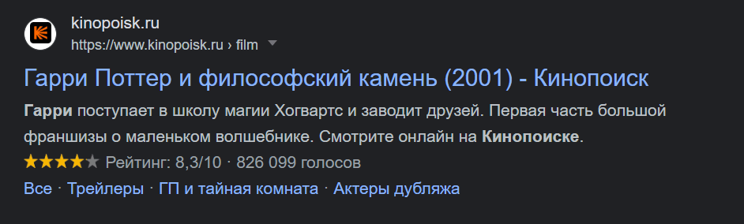
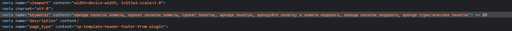
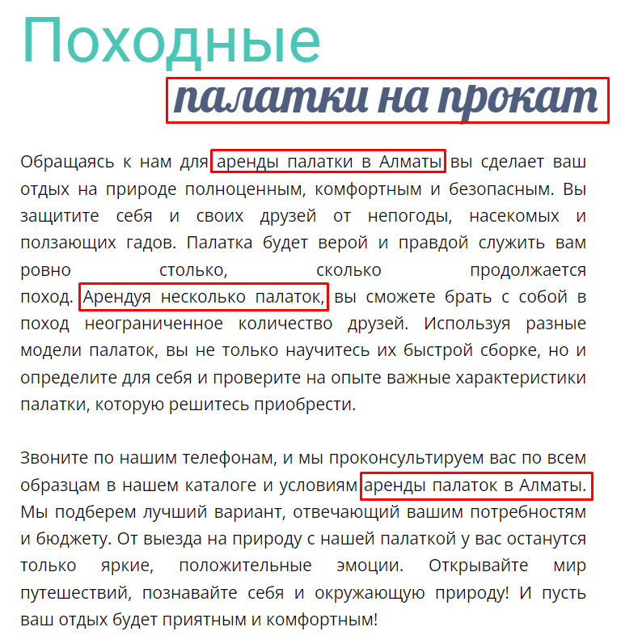

## Кратко

Поисковая оптимизация, SEO (Search Engine Optimization) — это комплекс работ по улучшению позиций сайта в поисковой выдаче. Поисковой выдачей называют результаты поиска по запросу, который пользователь вводит в поисковике.

Цель поисковой оптимизации — привести на сайт больше посетителей.

## Зачем нужна оптимизация?

Посетителей, которые пришли из поисковой выдачи, а не из рекламы, называют органическим трафиком. Его и стремится увеличить SEO.

Многие сайты размещают у себя рекламу, и их заработок зависит от количества посетителей сайта. Сайты услуг зарабатывают на заказах. Чем выше они находятся в поисковой выдаче, тем больше к ним приходит клиентов.

Но высокая позиция уже не гарантирует переход. Google и Яндекс всё чаще отвечают на запрос сами: над результатами появляется ответ, который ИИ собрал из нескольких страниц. Часть пользователей читает его и никуда не переходит.

В таком ответе есть ссылки на источники. Google пишет, что попасть туда помогают те же приёмы, что и для обычной выдачи.

## Издержки поисковой оптимизации

Главная проблема SEO — нет чёткого и стабильного результата.

Во-первых, поисковики часто перемешивают поисковую выдачу по одним и тем же ключевым словам.

Во-вторых, поисковых фраз, подходящих под контент вашего сайта, бесчисленное количество, и гарантировать точно позицию по каждой из них никто не может.

Можно найти много руководств от SEO-специалистов, но у вас никогда не будет чёткого списка того, по каким признакам Google и Яндекс сортируют сайты в выдаче. Поисковики не раскрывают, как устроены их алгоритмы. Во многом вам придётся действовать вслепую, постоянно внося различные правки на свой сайт.

## Что влияет на позицию в поиске?

Ранжирование — это сортировка сайтов в поисковой выдаче. Факторы, по которым поисковик ранжирует сайт, можно разделить на **внутренние** и **внешние**.

**Внутренние факторы** — это техническая реализация сайта, качество контента, адаптивность сайта под мобильные устройства и его [доступность](/a11y/chto-takoe-a11y/). Можно сказать, что к внутренним факторам относится всё то, с чем взаимодействует человек, когда пользуется вашим сайтом. То есть всё, на что можно влиять напрямую, когда меняете сайт.

**Внешние факторы** — это всё, что не может контролировать разработчик или SEO-специалист напрямую. Например, ссылки на ваш сайт с других сайтов и упоминания о нём.

### Внутренние факторы

Внутренних факторов много, вот самые важные из них. Не все они поднимают сайт в выдаче напрямую. Одни влияют на то, как сайт выглядит в поиске и соцсетях. Другие — на то, удобно ли им пользоваться.

- **Удобный UI и UX**. Интерфейс (_UI_, _user interface_) и пользовательский опыт (_UX_, _user experience_) решают, останется человек на сайте или сразу уйдёт. Сайт должен вести пользователя туда, куда ему нужно, а не быть набором разрозненной информации. Для продвижения это очень важно. Поисковики учитывают поведенческие факторы — то, как люди реагируют на сайт: переходят ли на него из выдачи, остаются или сразу возвращаются к поиску.
- **Скорость сайта**. Чем быстрее сайт загружается, тем быстрее пользователь получит нужную информацию. Google оценивает скорость и отзывчивость страниц по метрикам [Core Web Vitals](/tools/what-is-web-vitals/). [LCP](/tools/lcp/) показывает, как быстро появляется главный контент. [INP](/tools/inp/) — как быстро страница отвечает на действия. [CLS](/tools/cls/) — не сдвигается ли вёрстка неожиданно. Хорошими Google считает LCP до 2,5 секунды, INP до 200 миллисекунд и CLS до 0,1. На скорость влияют ответ сервера, размер картинок, количество CSS- и JavaScript-файлов и многое другое, вплоть до объёма HTML-разметки.
- **Индексация**. Индексация — это то, как поисковик добавляет страницы в свою базу, индекс. Перед этим поисковый робот обходит сайт: находит страницы и скачивает их. На правильную индексацию сайта влияют файлы _robots.txt_ и _sitemap.xml_. _robots.txt_ подсказывает поисковому роботу, какие разделы сайта не нужно обходить, например страницы поиска по сайту или фильтров. _sitemap.xml_ — это навигация по сайту для поисковых роботов, по сути список ссылок, которые вы хотите видеть в индексе. При этом _robots.txt_ не прячет страницы из выдачи: если на закрытый адрес ведут ссылки, он всё равно может попасть в индекс. Чтобы убрать страницу из поиска, используйте метатег `<meta name="robots" content="noindex">` или закройте её паролем. Такую страницу не закрывайте в _robots.txt_: иначе робот не скачает её и не увидит метатег. А путь к админке в _robots.txt_ лучше не писать вовсе: файл открыт всем.
- **Семантическая вёрстка**. [Семантические теги](/html/semantics/) помогают браузеру и [скринридерам](/a11y/screenreaders/) понять, какой контент за что отвечает. Сам Google почти не опирается на семантику тегов, так что это скорее вклад в доступность, чем в позиции.
- **Контент сайта**. Картинки, видео и текст — это то, за чем на ваш сайт зашёл пользователь. Если контент качественный, пользователю захочется сидеть на сайте дольше и возвращаться к нему. Если одинаковый текст есть на нескольких страницах, поисковик выбирает одну из них основной и показывает в выдаче только её. Для своих дублей, например страниц с фильтрами, основную страницу можно указать через [`rel="canonical"`](/html/rel/#canonical). А чужой текст лучше не копировать: копии чужого контента без своей ценности Google считает спамом и может понизить за них сайт.
- **Адаптив под разные устройства**. Больше половины просмотров страниц в мире приходится на мобильные устройства, по данным [StatCounter](https://gs.statcounter.com/platform-market-share/desktop-mobile-tablet). Google индексирует сайты по их мобильной версии: если на телефоне части контента нет, поисковик её не увидит. Проверить страницу можно в Lighthouse: его Google советует вместо Mobile-Friendly Test, который закрыл в декабре 2023 года. Как страница выглядит на телефоне, видно в режиме эмуляции устройств в Chrome DevTools.
- **Доступность (a11y)**. Чем больше людей может комфортно пользоваться вашим сайтом, тем лучше. Отдельным сигналом ранжирования Google доступность не называет, но удобным сайтом пользуются охотнее.
- **Метатеги**. Тег [`<title>`](/html/title/), метатег [`<meta name="description">`](/html/meta/) и другие метатеги помогают и пользователям, и поисковикам. Текст из `<title>` поисковики учитывают при ранжировании и обычно показывают как заголовок в выдаче. Описание из `description` Google при ранжировании не учитывает. Но поисковики могут взять его в сниппет — короткий текст под ссылкой.
- **Open Graph-разметка**. Open Graph — это разметка страницы для превью в социальных сетях: с картинкой, заголовком и описанием. На позицию в поиске она не влияет.

Open Graph-разметка в X (бывший Твиттер) на примере Доки.

- **Schema.org-разметка**. Она же микроразметка. С ней поисковик может показать в выдаче расширенную карточку сайта: с рейтингом, ценой или датой события. Но показывать такую карточку или нет, решает сам поисковик. Список поддерживаемых типов меняется: например, в 2025 году Google перестал показывать часть расширенных карточек. Поэтому сверяйтесь с документацией поисковика.

Рейтинг «звёздочками» с помощью Schema.org в выдаче Google.

### Внешние факторы

Повлиять на них напрямую нельзя. Есть площадки, где продают ссылки на сайты, но поисковики против покупки ссылок ради позиций.

Правила Google требуют помечать рекламные ссылки атрибутом `rel` со значением `sponsored` или `nofollow`. Такая ссылка приводит посетителей, но поисковик обычно не учитывает её, когда ранжирует сайт. Неотмеченная покупная ссылка — нарушение, за которое сайт могут понизить в выдаче.

Яндекс пишет, что платные SEO-ссылки [мешают ему оценивать сайты](https://yandex.ru/support/webmaster/ru/recommendations/links), и тоже советует помечать рекламные ссылки `sponsored`. С 2015 года он понижает сайты с покупными SEO-ссылками алгоритмом «Минусинск».

## Что уже не работает?

Поисковые системы постоянно меняют алгоритмы, чтобы поиск лучше находил нужное пользователю. Поэтому часть приёмов SEO со временем устаревает. Что же уже устарело?

- **Keywords**. Метатег [`<meta name="keywords" content="">`](/html/meta/#atributy) часто использовали для поискового продвижения сайтов. В него легко было вписать весь список ключевых слов, даже слабо связанных с контентом. Так метатег стал инструментом спама и почти перестал влиять на ранжирование. Сейчас это реликт SEO. Google не учитывает его с 2009 года. Яндекс пишет, что тег может влиять на соответствие страницы запросу, но не раскрывает, насколько сильно. Так что рассчитывать на него не стоит.

Наглядный пример спама в ключевых словах. Видимо, некоторые SEO-специалисты делают так до сих пор.

- **Количество текста**. Долгое время SEO-специалисты гнались за объёмом текстов, долей ключевых слов в тексте и уникальностью. Уникальный текст — тот, что не совпадает с текстами других сайтов. Сейчас такой текст на 30 000 символов, написанный только для поисковика, не поможет, а может и навредить. Поисковики больше смотрят на поведенческие факторы: если текст не отвечает на вопрос, человек возвращается к выдаче. А Яндекс с 2017 года понижает сайты с текстами, перегруженными ключевыми словами, алгоритмом «Баден-Баден». Поэтому качество текста стало важнее всех остальных его метрик.

Пример того, какие тексты раньше делали для SEO-продвижения. Только ключевых фраз в точной форме — 4, а уж столько тут слов «палатка»…

- **Временные ссылки**. Ссылки с других сайтов влияют на позиции и сейчас, но поисковики ценят естественные ссылки, а не купленные. Раньше же ссылки часто арендовали. Владелец платил каждый месяц за место в боковой колонке, подвале или другой статичной части чужого сайта, которая не меняется между страницами. Обычно рядом висели ещё несколько таких же ссылок на другие сайты. Многие сайты делали ради дохода «здесь и сейчас», и жили они максимум год. Для них временные ссылки выходили дешевле.

## «Чёрное» SEO

Чёрное SEO — запрещённые методы поисковой оптимизации. Иногда они дают результат, но ненадолго. Потом сайт попадает под санкции: поисковик понижает его в выдаче или вовсе исключает из неё. Что же входит в чёрное SEO?

- **Private Blog Network (PBN)** — закрытая сеть из нескольких десятков сайтов одной тематики. Они ссылаются на главный сайт и упоминают его, чтобы продвинуть его в выдаче. Сеть тщательно маскируют, чтобы поисковики «думали», что сайты принадлежат разным людям. Отсюда Private в названии.
- **Накрутка поведенческих факторов**. Поведенческие факторы влияют на ранжирование, поэтому придумали способы их накрутить. Для этого используют программы, которые имитируют заходы посетителей на сайт, или платят живым людям за переходы из выдачи. Но поисковики распознают такой трафик. Накрутка — прямое нарушение правил, и сайт за неё попадает под санкции.

## Про что SEO на самом деле?

SEO только на первый взгляд про продвижение сайта. На самом деле SEO — это про то, как сделать сайт удобным и хорошим. Все внутренние факторы ранжирования улучшают пользовательский опыт или упрощают работу поисковика. Чтобы продвинуться в выдаче, сделайте технически качественный сайт и наполните его качественным и уникальным контентом.

## Документация Google и Яндекса

- [Рекомендации по созданию сайтов](https://yandex.ru/support/webmaster/ru/recommendations/intro) от Яндекса.
- [Документация](https://developers.google.com/search/docs/essentials?hl=ru) по Google Поиску.
- [Google Search Console](https://search.google.com/search-console) и [Яндекс Вебмастер](https://webmaster.yandex.ru/) — сервисы, где видно, как поисковик индексирует ваш сайт и какие на нём ошибки. Там же приходят уведомления о санкциях. Search Console сообщает о ручных мерах — санкциях, которые назначил сотрудник Google. Вебмастер сообщает и о нарушениях, которые нашёл алгоритм.
