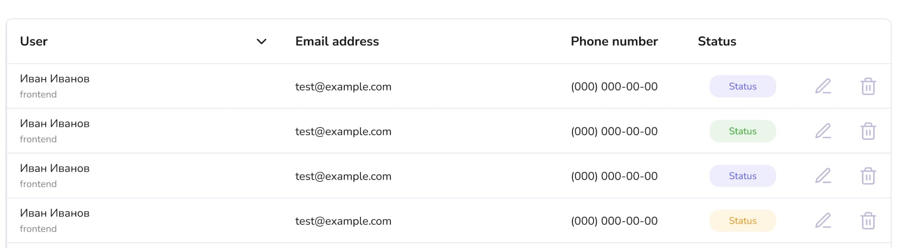

## Кратко

SVG-спрайт — это один файл, в котором собраны несколько [SVG-иконок](/html/svg/). Страница берёт иконки из него по идентификатору. Так одна и та же иконка не повторяется в разметке, HTML-код становится короче и читается легче, а браузер загружает один файл вместо нескольких.

## Что такое SVG-спрайт?

Спрайт — это способ собрать несколько картинок в один файл. Раньше так собирали растровые иконки, чтобы ускорить загрузку по [HTTP/1.1](/tools/http-protocol/). По одному соединению этот протокол отдаёт файлы строго по очереди, а соединений к домену браузер открывает не больше шести. Поэтому десятки иконок грузились долго. HTTP/2 и HTTP/3 передают много файлов одновременно по одному соединению, так что сейчас спрайт нужен для другого.

Из SVG часто собирают систему иконок для сайта. [Подключать SVG-иконки](/html/svg/#kak-podklyuchat) можно по-разному, но чаще всего их вставляют прямо в разметку: так их можно стилизовать через CSS. Но тогда одну и ту же иконку приходится вставлять много раз. Например, иконки удаления и редактирования повторяются в каждой строке таблицы.


Таблица пользователей с набором повторяющихся иконок

Спрайт убирает такие повторы. Иконка лежит в одном файле, а разметка только ссылается на неё. HTML становится легче, у браузера меньше запросов, а чтобы поправить иконку, достаточно изменить один файл.

Есть и минусы. Страница скачивает все иконки из спрайта, даже ненужные ей. А после правки одной иконки браузер заново загрузит весь файл.

## Как создать SVG-спрайт

Возьмём готовый набор SVG-иконок и создадим для спрайта отдельный файл с расширением `.svg`. Внутри него нужна обёртка: тег `<svg>` с атрибутом `xmlns`. Атрибут задаёт [пространство имён](/tools/xml/#konflikty-imenovaniya-tegov): по нему браузер понимает, что внутри теги SVG.

Затем поместите каждую иконку в тег [`<symbol>`](https://developer.mozilla.org/en-US/docs/Web/SVG/Element/symbol), который группирует элементы. Символы не видны на странице, пока на них не сошлётся тег [`<use>`](https://developer.mozilla.org/en-US/docs/Web/SVG/Element/use).

Код ниже сокращён для удобства чтения.

```xml
<svg xmlns="http://www.w3.org/2000/svg">
  ...
  <symbol id="social-facebook" viewBox="0 0 6 12">
    <path d="M1.09903 2.72854C1.09903 ..."/>
  </symbol>

  <symbol id="social-twitter" viewBox="0 0 16 11">
    <path d="M13.3758 4.62011C14.2231 ..."/>
  </symbol>
  ...
</svg>
```

У каждого `<symbol>` есть уникальный `id`. По нему HTML ссылается на иконку.

Чтобы показать иконку на странице, добавьте внутрь `<svg>` тег `<use>`. В его атрибуте `href` укажите адрес спрайта, а после `#` — `id` символа:

```html
<a class="social-link" href="https://vk.com/" aria-label="ВКонтакте">
  <svg
    class="social-icon"
    viewBox="0 0 24 24"
    width="24"
    height="24"
    aria-hidden="true"
  >
    <use href="sprite.svg#social-vk"></use>
  </svg>
</a>
```

У иконки нет текста, поэтому подпись для [скринридеров](/a11y/screenreaders/) мы задали ссылке атрибутом [`aria-label`](/a11y/aria-label/), а саму иконку скрыли от них атрибутом [`aria-hidden`](/a11y/aria-hidden/).

У каждого символа есть и свой атрибут [`viewBox`](/html/svg/#atributy). Он задаёт собственную систему координат иконки. `<use>` масштабирует её под размер своего `<svg>`. Поэтому в одном спрайте могут жить иконки разных размеров.

Цвет иконки задайте самому `<svg>`, а у фигур в спрайте не указывайте `fill`. Селекторы страницы не достают до фигур внутри `<use>`: там закрытая копия символа. Но свойства [`fill`](/css/fill/), [`stroke`](/css/stroke/), [`color`](/css/color/) и [кастомные свойства](/css/custom-properties/) наследуются внутрь неё. Вот пример с `fill`:

```css
.social-icon {
  fill: rgb(0 0 0);
  transition: fill 0.3s ease-in-out;
}

.social-link:hover .social-icon,
.social-link:focus-visible .social-icon {
  fill: rgb(76 117 163);
}
```

Другой вариант — поставить фигурам в спрайте `fill="currentColor"` и менять у `<svg>` свойство `color`.

Откройте демку в новой вкладке и проверьте, что иконки грузятся как спрайт в одном файле.

<iframe title="Простой SVG-спрайт" src="demos/sprite/" height="250"></iframe>

Преимущества этого способа:

- иконка в разметке занимает несколько строк с `<use>`, а не весь код SVG;
- браузер один раз кеширует файл спрайта для всех страниц;
- иконки можно стилизовать через CSS.

Недостатки:

- спрайт нельзя подключить как фоновое изображение;
- файл спрайта должен лежать на том же источнике, что и страница.

Источник (_origin_) — это схема, домен и порт адреса. Тег `<use>` не загружает SVG с другого источника, даже если сервер разрешил это заголовками [CORS](/tools/cors/). Так что спрайт на `cdn.example.com` для страницы на `example.com` не сработает.

На странице, открытой с диска через `file://`, Chrome тоже не покажет иконки: каждый такой файл для него — отдельный источник. Проверяйте спрайт через локальный сервер.

Если спрайт лежит на другом домене, например на CDN, вставьте его прямо в HTML. Скрытый `<svg>` с символами ставят в начало `<body>`, а в `<use>` пишут только идентификатор: `href="#social-vk"`. Ограничение источника на такой спрайт не действует. Но браузер не кеширует его отдельно: спрайт загружается заново с каждой страницей.

## SVG-спрайт для фона

Фоном браузер показывает спрайт как одну картинку. Чтобы на фоне была видна только одна иконка, их раскладывают в спрайте друг под другом или по сетке. Какую иконку видно, решает атрибут `viewBox`. Это прямоугольник на холсте SVG, который браузер вписывает в размеры картинки.

Тег [`<view>`](https://developer.mozilla.org/en-US/docs/Web/SVG/Element/view) даёт такому прямоугольнику имя. Если в адресе картинки после `#` стоит `id` тега `<view>`, браузер берёт его `viewBox` вместо `viewBox` корневого `<svg>`. Такую ссылку называют именованным фрагментом.

```xml
<svg
  viewBox="0 0 24 72"
  fill="none"
  xmlns="http://www.w3.org/2000/svg"
>
  <view id="icon-first-view" viewBox="0 0 24 24"/>
  <path d="M4 12V20C4 20.5304 ..."/>

  <view id="icon-second-view" viewBox="0 24 24 24"/>
  <path d="M4 36V44C4 44.5304 ..."/>

  <view id="icon-third-view" viewBox="0 48 24 24"/>
  <path d="M4 60V68C4 68.5304 ..."/>
</svg>
```

Атрибут `viewBox` здесь работает так же, как для `<svg>`. Первые два значения — координаты левого верхнего угла прямоугольника по осям _x_ и _y_, следующие два — его ширина и высота. Подробнее об атрибуте — в [англоязычной статье про `viewBox`](https://www.sarasoueidan.com/blog/svg-art-direction-using-viewbox/).

В нашем примере три иконки 24 на 24 пикселя стоят друг под другом. Каждую иконку рисуют в её ячейке: координата _y_ второй иконки больше на 24, третьей — на 48.

Не задавайте корневому `<svg>` атрибуты `width` и `height`. Если указать `width="24" height="72"`, `<view>` эти размеры не изменит. Тогда область 24 на 24 встанет по центру высокой картинки, и над нужной иконкой и под ней будут видны соседние.

Чтобы показать иконку, допишите к адресу файла `#` и `id` нужного `<view>`:

```css
.image {
  width: 24px;
  height: 24px;
  background-image: url('icons.svg#icon-first-view');
  background-size: 24px 24px;
}
```

Размер фона задайте явно через [`background-size`](/css/background-size/). Без него Safari берёт пропорции картинки у корневого `viewBox`, а не у `<view>`. Тогда рядом с нужной иконкой будут видны соседние.

Можно обойтись без `<view>` и указать прямоугольник прямо в адресе файла. Для этого после `#` напишите `svgView(viewBox(x, y, ширина, высота))`. Такие части адреса после `#` в [спецификации SVG](https://www.w3.org/TR/SVG/linking.html#SVGFragmentIdentifiers) называются идентификаторами фрагмента (_fragment identifiers_).

```css
.image {
  background-image: url('icons.svg#svgView(viewBox(0, 0, 24, 24))');
  background-size: 24px 24px;
}

.image:hover,
.image:focus-visible {
  background-image: url('icons.svg#svgView(viewBox(0, 24, 24, 24))');
}
```

Оба способа подключают спрайт как обычную картинку, поэтому стилизовать фигуры внутри иконки через CSS нельзя.

<iframe title="Именованные фрагменты" src="demos/fragments/" height="180"></iframe>

## SVG-спрайт как стек

В этом способе иконки в спрайте лежат не друг за другом, а одна поверх другой. Стиль внутри спрайта прячет все иконки через [`display: none`](/css/display/). Видной остаётся только та, чей `id` стоит в адресе после `#`. Её выбирает псевдокласс [`:target`](/css/target/).

```xml
<svg viewBox="0 0 24 24" xmlns="http://www.w3.org/2000/svg">
  <defs>
    <style>
      g {
        display: none;
      }
      g:target {
        display: inline;
      }
    </style>
  </defs>

  <g id="cat">
    <path d="M9 13.125C9 13.3475 ..." fill="black"/>
  </g>

  <g id="dog">
    <path d="M22.4728 11.7187L20.9334 ..." fill="black"/>
  </g>
</svg>
```

Иконку подключают так же: `id` после `#`.

```css
.image {
  background-image: url('stack.svg#cat');
}
```

<iframe title="Стек изображений" src="demos/stack/" height="180"></iframe>

Способов использовать SVG-спрайты несколько. Спрайт с `<use>` можно стилизовать через CSS, но нельзя поставить фоном. Спрайт с фрагментами или стеком работает как фон, но фигуры внутри него через CSS не стилизуются.

## Подсказки

💡 Чтобы иконка-фон меняла цвет при наведении, сделайте в спрайте её копию в нужном цвете и подменяйте одну иконку другой.

💡 Есть способ перекрасить иконку из спрайта без копии. Подключите её не фоном, а маской через свойство `mask-image`, а цвет задайте через [`background-color`](/css/background-color/). Маска оставит видимым только силуэт иконки, а цвет фона можно менять при наведении:

```css
.image {
  width: 24px;
  height: 24px;
  background-color: black;
  mask-image: url('icons.svg#icon-first-view');
  mask-size: 24px 24px;
}

.image:hover {
  background-color: #FF8630;
}
```

Свойство `mask-size` нужно по той же причине, что и `background-size` выше: без него Safari покажет соседние иконки.

Маску браузер загружает по правилам CORS. Поэтому спрайт с другого источника сработает, только если сервер отдаёт заголовок `Access-Control-Allow-Origin`.

В режиме принудительных цветов, например в высококонтрастной теме Windows, браузер подменяет `background-color` системным цветом фона. Иконка сольётся с фоном. Чтобы этого не случилось, верните ей цвет текста:

```css
@media (forced-colors: active) {
  .image {
    forced-color-adjust: none;
    background-color: CanvasText;
  }
}
```
