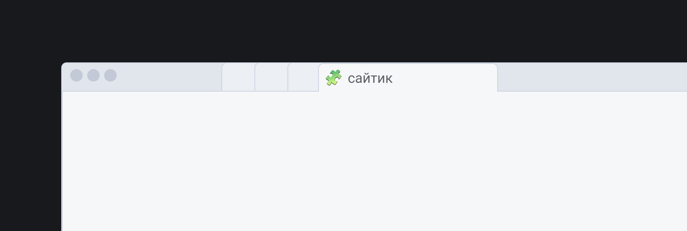

## Кратко

Чтобы дать документу название, используй элемент `<title>`. Название, или заголовок документа, будет видно только в строке заголовка браузера или на вкладке страницы.

Из названия страницы `<title>` пользователь узнаёт, что на ней находится. Если он захочет добавить страницу в избранное, то браузер предложит `<title>` в качестве названия закладки.

## Как пишется

Тег `<title>` прописывается в контейнере [`<head>`](/html/head/) и может содержать только текст. На странице может быть только один элемент `<title>`.

```html
<head>
  <title>Заголовок твоей страницы</title>
</head>
```

<details>
  <summary>🧩 На самом деле смайлики и служебные символы тоже можно 😉 Но осторожно!</summary>



</details>

Если добавите внутрь `<title>` другие теги, для браузера они будут частью текста.

###  Как написать хороший заголовок

- Текст должен быть кратким (не больше 60 символов), понятным, однозначным и хорошо описывать содержимое страницы.
- Не включайте в заголовки ключевые слова и не используйте их для привлечения внимания.
- Делайте заголовки уникальными для каждой страницы.
- Если на сайте много страниц, добавьте в заголовок название раздела или сайта. Уникальное описание страницы расположите на первом месте, а за ним уже всё остальное. Например, «Краски для потолка — Стройматериалы — Мир красок».

Ключевые слова в заголовке не помогут продвинуться выше в выдаче. Даже наоборот, Google понизит такой сайт в ней.

### Доступность

Текст из `<title>` — это первое, что слышат пользователи [скринридеров](/a11y/screenreaders/), когда попадают на вкладку. Так что тег важен с точки зрения доступности.

Пользователям, которые видят интерфейсы, тоже нужны заголовки страниц. Так им проще будет сориентироваться внутри сайта и между открытыми вкладками в браузере.

О важности `<title>` для доступности говорит и [WCAG](/a11y/wcag/) — Руководства по доступности веб-интерфейсов. В руководствах есть [отдельный критерий про заголовки страниц](https://www.w3.org/WAI/WCAG21/Understanding/page-titled).

## Подсказки

💡 Когда пользователь гуглит твой сайт, то `<title>` страницы отображается в результатах поиска. Поэтому лучше сделать заголовок ёмким, понятным и цепляющим.

💡 Не путай `<title>` с тегом [`<h1>`](/html/h1-h6/), который создаёт заголовок уже на странице.

💡 Если не закрыть тег `</title>`, то браузер не покажет остальное содержимое страницы.

💡 Если пользователь решит добавить твою страницу в закладки или сохранить её у себя на компьютере, то эти символы из вашего `<title>` — \, /, :, *, ?, ", <, >, | — будут заменены автоматически на допустимые для имени файла. Поэтому их лучше не использовать.
