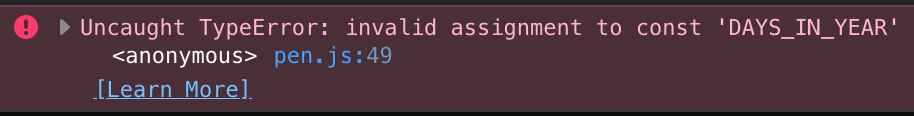

## Кратко

`const` — ключевое слово языка для объявления констант. Константа — переменная, значение которой нельзя переназначить.

## Пример

```js
const DAYS_IN_YEAR = 365
```

## Как понять

Константы — те же переменные. Единственная разница в том, что их нельзя переопределить.

Если попробовать это сделать, то код упадёт с ошибкой `TypeError: invalid assignment to const`:

```js
const DAYS_IN_YEAR = 365

console.log(DAYS_IN_YEAR)

DAYS_IN_YEAR = 600
// Ошибка, константы нельзя переопределять
```

В консоли: 

☝️ Если константа хранит [массив](/js/arrays/) или [объект](/js/object/), то сам массив/объект изменять можно! Нельзя заменить один объект на другой. Это происходит из-за того, что константа [хранит ссылку на сложное значение](/js/ref-type-vs-value-type/), а не само значение.

Например, мы можем добавить новый объект в массив, но при попытке записать в переменную `series` пустой массив произойдёт ошибка:

```js
const series = ['Доктор Хаус', 'Клиника', 'Чёрное зеркало']
series.push('Молодой папа')
series = []
// 🙅‍♂️ не можем _заменить_ один массив на другой
```

Та же история с объектами:

```js
const person = { name: 'X Æ A-12', lastName: 'Musk' }
person.age = 0
person = { name: 'Педро' }
// 🙅‍♀️ не можем заменить на новый объект
```

### Зачем нужны константы?

Константы защищают код от случайной перезаписи важных значений.

Применяют константы в двух случаях:

- мы хотим объявить переменную, которая хранит фундаментальное значение для программы. Например, количество дней в году, минимальную сумму заказа, форматы дат и так далее.
- мы объявляем переменную и устанавливаем ей значение всего один раз.

## Как пишется

Константы объявляются так же, как и [переменные](/js/var-let/):

```js
const name = value
```

__`name`__ Имя константы. Может использоваться любой допустимый идентификатор.

__`value`__ Значение константы. Любое допустимое выражение.
