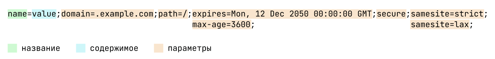

Cookie — один из способов хранить данные в браузере. Все способы сравнили в статье «[Хранение данных в браузере](/tools/browsers-storages/)».

## Кратко

При разработке сайтов часть информации (например, язык интерфейса или настройки пользователя) нужно хранить и читать как в браузере, так и на сервере. Для этого используют **Cookie** (произносится «куки»).

<aside>

💡 Браузер и сервер передают куки в [HTTP-заголовках](/tools/http-protocol/), поэтому кука должна быть небольшой. Браузер гарантированно хранит куку, у которой имя и значение вместе занимают до 4096 байт.

</aside>

## Как пользоваться

Куки хранит браузер, а свойство `document.cookie` даёт к ним доступ. При чтении оно возвращает [строку](/js/string/) в формате `имя=значение`, где пары разделяет знак `; `.

### Запись

Чтобы записать куку, присвойте её `document.cookie`. За один раз можно записать только одну куку.

Вот так можно записать куку с именем `counter` и значением `1`:

```js
document.cookie = 'counter=1'
console.log(document.cookie)
// 'counter=1'
```

Если записать куку с другим именем, в строке будут обе:

```js
document.cookie = 'sidebar=false'
console.log(document.cookie)
// 'counter=1; sidebar=false'
```

Если записать другое значение под тем же именем, браузер перезапишет куку. Это сработает, только если у куки тот же путь и домен, о них ниже.

```js
document.cookie = 'sidebar=true'
console.log(document.cookie)
// 'counter=1; sidebar=true'
```

Кроме имени и значения, в строку куки можно добавить параметры. Все они необязательные и разделяются точкой с запятой `;`. Вот кука, которая передаётся только по HTTPS, не отправляется при запросах с других сайтов и живёт один час:

```js
document.cookie = 'sidebar=true;secure;samesite=strict;max-age=3600'
```



Разберём параметры:

- `path` — определяет путь, по которому будет доступна кука. Он должен быть абсолютным, то есть начинаться с `/`. Если параметр не передан, кука будет доступна для «папки» текущего адреса и её подпутей: для страницы `/blog/post` это `/blog`. Чтобы кука была доступна на всём сайте, нужно явно указать: `path=/`.
- `domain` — определяет домен, на котором действует кука. Если параметр не указан, кука доступна только текущему домену, без поддоменов. Если домен указан явно, по умолчанию кука будет доступна и для поддоменов.
- `max-age` и `expires` — определяют время жизни куки. Если не указать ни один из них, кука проживёт до конца сессии, обычно до закрытия браузера. Слишком долгий срок браузеры урезают. Chrome, Edge и Firefox хранят куку не дольше 400 дней. Safari хранит куку, записанную из JavaScript, не дольше 7 дней.
  - `max-age` указывает, через сколько секунд кука станет недействительна.
  - `expires` указывает точное время, когда кука станет недействительна. Время можно отформатировать методом [даты](/js/date/) `toUTCString()`.
- `secure` — браузер отправляет куку только по защищённому протоколу HTTPS.
- `samesite` — определяет, отправлять ли куку, когда запрос приходит с другого сайта.
  - `strict` запрещает такую отправку совсем.
  - `lax` разрешает её, когда пользователь переходит на ваш сайт методом GET, например по ссылке. При отправке чужой формы методом POST и при запросах из скриптов, картинок и фреймов чужих страниц кука не уйдёт.
  - `none` снимает ограничение. Chrome, Edge и Firefox не примут такую куку без параметра `secure`. Сторонние куки (куки сайта, встроенного в чужую страницу) браузеры всё равно могут блокировать: Safari делает это по умолчанию.
  - Если параметр не указан, Chrome и Edge обращаются с кукой почти как с `lax`, а Firefox и Safari — как с `none`.

Два префикса в имени куки добавляют требования. В обоих случаях страница должна быть открыта по HTTPS.

- `__Secure-` — нужен параметр `secure`.
- `__Host-` — нужны параметры `path=/` и `secure`, а `domain` указывать нельзя. Так кука не попадёт на поддомены.

Точка с запятой `;` внутри значения обрежет его. Чтобы значение не обрезалось, кодируйте его функцией `encodeURIComponent()`: `encodeURIComponent('a;b')` вернёт `'a%3Bb'`. Кодирование увеличивает размер: каждая русская буква превращается в шесть символов.

### Чтение

Чтобы прочитать куки, выведите `document.cookie`:

```js
console.log(document.cookie)
// 'counter=1; sidebar=true'
```

В строку попадают только куки, которые подходят к адресу страницы по домену, пути и протоколу. Куки с параметром `HttpOnly` браузер не показывает JavaScript, поэтому их в строке нет.

Чтобы получить значение конкретной куки, нужно разобрать строку `document.cookie`. Например, так:

```js
function getCookies() {
  if (!document.cookie) {
    return {}
  }

  return document.cookie.split('; ').reduce((acc, item) => {
    const separatorIndex = item.indexOf('=')
    // Кука может быть записана без знака «=»
    const name = separatorIndex === -1
      ? ''
      : item.slice(0, separatorIndex)
    const value = item.slice(separatorIndex + 1)

    // Кука с более точным путём идёт первой
    if (Object.hasOwn(acc, name)) {
      return acc
    }

    try {
      acc[name] = decodeURIComponent(value)
    } catch {
      // Значение закодировано не через encodeURIComponent()
      acc[name] = value
    }
    return acc
  }, {})
}

const cookies = getCookies()

console.log(cookies.counter)
// '1'
console.log(cookies.sidebar)
// 'true'
```

### Удаление

Отдельного способа удалить куку у `document.cookie` нет. Чтобы удалить куку, её записывают заново с нулевым временем жизни `max-age=0` или с параметром `expires`, который указывает на дату в прошлом. Браузер сразу же считает такую куку устаревшей и удаляет её:

```js
document.cookie = 'sidebar=;max-age=0'

// Или так
document.cookie = `sidebar=;expires=${new Date(0).toUTCString()}`
```

Здесь `new Date(0)` — начало [эпохи Unix](https://ru.wikipedia.org/wiki/Unix-%D0%B2%D1%80%D0%B5%D0%BC%D1%8F), 1 января 1970 года.

Если куку записывали с параметрами `path` или `domain`, при удалении укажите те же значения, иначе старая кука останется. Куку с префиксом `__Secure-` или `__Host-` браузер без параметра `secure` не перезапишет, поэтому добавьте `secure` и в строку удаления.

### Cookie Store API

Кроме `document.cookie`, у браузеров есть асинхронный Cookie Store API. Он работает через объект `cookieStore`, возвращает [промисы](/js/promise/) и не требует разбирать строку вручную:

```js
await cookieStore.set({
  name: 'sidebar',
  value: 'true',
  expires: Date.now() + 60 * 60 * 1000,
})

const sidebar = await cookieStore.get('sidebar')
console.log(sidebar.value)
// 'true'

await cookieStore.delete('sidebar')
```

`cookieStore` доступен только в безопасном контексте: на странице по HTTPS или на `localhost`. Он работает и в сервис-воркерах — скриптах, которые выполняются в фоне отдельно от страницы.

Как и `document.cookie`, `cookieStore` не видит куки с параметром `HttpOnly`. Но у `cookieStore.set()` другие значения по умолчанию: `path=/` и `samesite=strict`, а параметр `secure` он добавляет всегда.

`cookieStore.get()` по спецификации возвращает только имя и значение куки. Chrome и Edge отдают ещё и её параметры, а Firefox и Safari — нет. Поэтому не рассчитывайте, что параметры будут в ответе.

Событие `change` сообщает об изменении кук. Методы `set()`, `get()`, `delete()` и это событие работают во всех основных браузерах с 2025 года: в Safari с версии 18.4, в Firefox с версии 140. Но поддержка пока неполная: в Safari сервис-воркер не может подписаться на изменения кук.
