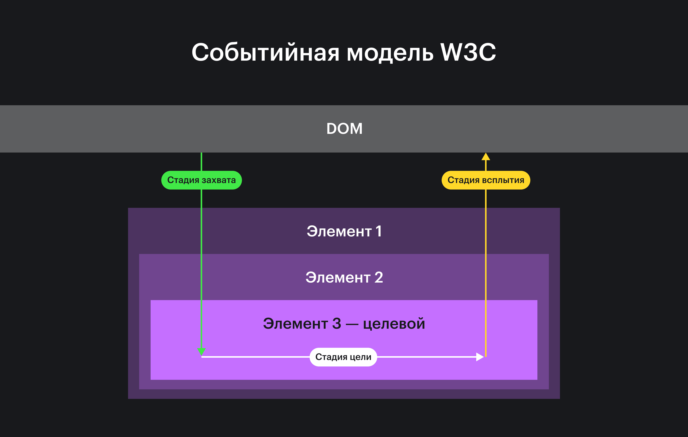

## Кратко

Чтобы приложение было интерактивным, нам нужно понимать, что пользователь совершил то или иное действие на странице. Браузер распознаёт действия пользователя и создаёт _событие_.

События — это сигналы, которые браузер посылает разработчику, а разработчик может на сигнал реагировать. По аналогии со светофором: видим зелёный свет, едем дальше 🚦

События бывают разных типов: клик, нажатие клавиши на клавиатуре, прокрутка страницы и так далее.

Происходящие события можно обрабатывать и выполнять код, когда нужное событие происходит. Например, при клике на кнопку показывать всплывающее окно.

## Как пишется

Обработать события можно двумя способами:

- с помощью `on`-свойств DOM-элементов;
- методом [`addEventListener()`](/js/element-addeventlistener/).

### `on`-свойства DOM-элементов

Большинство событий связаны с DOM-элементами. Если пользователь кликнул на кнопку, то событие `click` связано с конкретным DOM-элементом — кнопкой, на которой кликнул пользователь.

Каждый DOM-элемент имеет большой набор свойств, которые начинаются на `on`:

- `onclick`;
- `onscroll`;
- `onkeydown`;
- `onmouseenter`;
- и так далее.

Если в это свойство записать функцию, то браузер будет вызывать её при каждом событии, связанном с этим элементом. Такие функции называют функциями-обработчиками события.

```js
const buttonElement = document.getElementById('change')
const squareDiv = document.getElementById('square')

// Чтобы реагировать на нажатие кнопки,
// записываем функцию в свойство onclick.
// Эта функция будет вызываться при каждом нажатии на кнопку.
// Часто говорят, что эта функция обрабатывает событие
buttonElement.onclick = function() {
  squareDiv.style.backgroundColor = getColor()
}

function getColor() {
  const colors = [
    '#41E847', '#286C2D', '#2E9AFF', '#123E66', '#F498AD',
    '#623D45', '#FF8630', '#663613', '#FFD829', '#665610'
  ]
  return colors[Math.floor(Math.random() * colors.length)]
}
```

<iframe title="Свойство DOM-элемента onclick" src="demos/onclick/" height="310"></iframe>

Чтобы перестать обрабатывать событие, нужно записать в свойство значение [`null`](/js/null-primitive/).

### Метод `addEventListener()`

🤖 Если обрабатывать события с помощью `on`-свойств, то получится добавить только одну функцию-обработчик на каждое событие элемента. Часто одного обработчика недостаточно. Чтобы не создавать ограничение на пустом месте, используют альтернативный метод подписки на события — метод `addEventListener()`.

Метод вызывают у DOM-элемента. Аргументами нужно передать тип события строкой и функцию, которую нужно выполнить:

```js
const buttonElement = document.getElementById('change')
const squareDiv = document.getElementById('square')

// Чтобы реагировать на нажатие кнопки, подписываемся
// на событие click и передаём функцию-обработчик.
// Эта функция будет вызываться при каждом нажатии на кнопку
buttonElement.addEventListener('click', function() {
  squareDiv.style.backgroundColor = getColor()
})
```

<iframe title="Как работает метод" src="demos/click/" height="310"></iframe>

## Как понять

### Функция-обработчик

Функция-обработчик, или просто обработчик, — это функция, которую браузер вызывает при наступлении события.

При вызове браузер передаёт в обработчик [объект события](/js/event/) с помощью аргумента.

Объект события — это JavaScript-объект с информацией о событии. В объекте события есть как общие свойства (тип события, время события), так и свойства, которые зависят от типа события (например, на какую кнопку нажал пользователь).

Чтобы работать с объектом события, нужно добавить параметр в объявление обработчика. Обработаем нажатие на кнопки клавиатуры и получим из объекта события информацию о нажатой кнопке:

```js
window.addEventListener('keydown', function (event) {
  // Используем объект события,
  // чтобы получить информацию о нажатой клавише
  alert(`Вы нажали на кнопку: ${event.key}`)
})
```

Помимо объекта события, внутри функции можно использовать ключевое слово [`this`](/js/function-context/). Через него можно получить DOM-элемент, на котором сработал обработчик. Так один обработчик можно привязать к нескольким DOM-элементам.

Например, мы объявим обработчик в виде именованной функции и повесим её на нажатие нескольких кнопок. При клике на кнопку будем менять её цвет:

```js
function changeColor() {
  // Меняем цвет кнопки, на которой произошло событие.
  // Кнопка доступна с помощью ключевого слова this
  this.style.backgroundColor = getColor()
}

const buttons = document.getElementsByTagName('button')
for (let i = 0; i < buttons.length; ++i) {
  const button = buttons[i]
  // К каждой кнопке привязываем обработчик
  button.addEventListener('click', changeColor)
  // Обратите внимание, что мы не вызываем
  // функцию changeColor, а только пишем её имя
}
```

<iframe title="This в функции-обработчике" src="demos/this/" height="230"></iframe>

У [стрелочных функций](/js/arrow-function/) своего `this` нет. В них используйте `event.currentTarget`: это тот же элемент.

### Распространение событий

Важный аспект событийной модели — механизм _распространения событий (event propagation)_. Он определяет, как события взаимодействуют с узлами DOM при достижении целевого элемента.

Возникая, событие проходит через все родительские элементы (capturing phase), достигает целевого элемента (target phase) и затем вновь поднимается по иерархии родительских элементов (bubbling phase).



Обычно события обрабатывают на стадии достижения целевого элемента или всплытия.

### Всплытие событий

Рассмотрим пример. У нас есть [`<div>`](/html/div/), в него вложено видео. Мы подписались на событие `click` и на `<div>`, и на [`<video>`](/html/video/):

- клик по `<div>` меняет его цвет на случайный из списка;
- клик по `<video>` запускает видео.

Попробуйте кликнуть на коробку:

```js
const container = document.getElementById('container')
const video = document.getElementById('cat')

// Обрабатываем событие click на <div>
container.addEventListener('click', function() {
  const colors = [
    '#41E847', '#286C2D', '#2E9AFF', '#123E66', '#F498AD',
    '#623D45', '#FF8630', '#663613', '#FFD829', '#665610'
  ]
  const randomColorIndex = Math.floor(
    Math.random() * colors.length
  )
  container.style.backgroundColor = colors[randomColorIndex]
})

// Обрабатываем событие click на видео
video.addEventListener('click', function() {
  // Отматываем видео на начало
  this.currentTime = 0
  this.play()
})
```

<iframe title="Всплытие событий" src="demos/bubbling/" height="460"></iframe>

🤖 Обратите внимание, что событие срабатывает на обоих элементах — цвет фона меняется и запускается видео. Этому есть объяснение, оно называется _всплытие событий (event bubbling)_.

Когда событие произошло на самом вложенном элементе, оно передаётся родителю, потом его родителю и так далее: до [`<html>`](/html/html/), затем `document` и `window`.

В нашем примере самый вложенный элемент — `<video>`. Сначала сработал его обработчик. Затем событие перешло к родительскому `<div>`, и сработал обработчик на нём. Дальше событие всплывает через [`<body>`](/html/body/) до `window`.

Если кликнуть по блокам на демо, то можно увидеть, как событие всплывает вверх к родителям:

```js
let active
let counter = 0

// Обрабатываем событие click на всех <div>
const divs = Array.from(
  document.querySelectorAll('div')
).reverse()
for (let i = 0; i < divs.length; ++i) {
  const isLast = (i + 1 === divs.length)
  divs[i].addEventListener(
    'click',
    clickHandlerGenerator(isLast)
  )
}

function clickHandlerGenerator(isLast = false) {
  return function() {
    const me = this
    setTimeout(function() {
      if (active) {
        active.classList.remove('active')
      }
      me.classList.add('active')

      active = me

      if (isLast) {
        setTimeout(function() {
          active.classList.remove('active')
          active = undefined
          counter = 0
        }, 300)
      }
    }, counter * 300)
    ++counter
  }
}
```

<iframe title="Всплытие событий по цепочке вложенности" src="demos/bubbling-chain/" height="510"></iframe>

Всплывают не все события. Например, на элементе не всплывают [`focus`](/js/event-focus/), [`blur`](/js/event-blur/), `mouseenter`, `mouseleave`, [`load`](/js/event-load/) и `scroll`. Проверить это можно по свойству `event.bubbles`.

Чтобы поймать такое событие на общем родителе, используйте всплывающие аналоги:

- [`focusin`](/js/event-focusin/) и `focusout` вместо `focus` и `blur`;
- `mouseover` и `mouseout` вместо `mouseenter` и `mouseleave`.

Учтите, что `mouseover` и `mouseout` срабатывают и при переходе курсора между вложенными элементами. Чтобы отличить такой переход, проверяйте `event.relatedTarget`.

Вернёмся к котику в коробке. Чтобы клик по видео не менял цвет фона, остановите дальнейшее распространение события методом `stopPropagation()` у объекта события:

```js
video.addEventListener('click', function (event) {
  event.stopPropagation()
  this.currentTime = 0
  this.play()
})
```

Метод работает на любой стадии. Но у него есть ограничения:

- другие обработчики на этом же элементе с той же настройкой `capture` он не останавливает, для этого есть `stopImmediatePropagation()`;
- действие по умолчанию он не отменяет, для этого есть [`preventDefault()`](/js/event-prevent-default/).

Останавливайте распространение, только когда без этого не обойтись. Обработчики всплытия выше по дереву не узнают о событии. Например:

- меню, которое закрывается по клику снаружи, останется открытым;
- счётчик аналитики, который слушает клики на `document`, этот клик не посчитает.

Если клик нужно поймать в любом случае, слушайте его на стадии захвата. О ней — в следующем разделе.

### Захват событий

При всплытии очерёдность обработки события направлена от дочерних элементов к родительским. Это не позволяет элементу получить полный контроль над событиями дочерних элементов. Например, обработчик, привязанный к элементу, может «узнать» о произошедшем событии дочерних элементов, только если всплытие не было остановлено в одном из них.

Для решения некоторых задач требуется менять порядок обработки событий. Родительский элемент должен отреагировать на событие ещё до того, как оно получено и обработано дочерним элементом. Например, это нужно при создании элементов-«обёрток», не зависящих от реализации логики дочерних элементов.

Посмотрим на предыдущий пример с котиком в коробке. Допустим, нужно воспроизводить видео, только когда фон родительского элемента зелёный или голубой, при этом не меняя логику дочернего элемента. Для этого нужно слегка изменить обработчик клика по контейнеру:

```js
// Обрабатываем событие click на <div>
container.addEventListener('click', function(event) {
  const colors = [
    '#41E847', '#286C2D', '#2E9AFF', '#123E66', '#F498AD',
    '#623D45', '#FF8630', '#663613', '#FFD829', '#665610'
  ]
  const randomColorIndex = Math.floor(
    Math.random() * colors.length
  )
  container.style.backgroundColor = colors[randomColorIndex]

  // Если цвет не зелёный и не голубой,
  // останавливаем распространение события
  if (randomColorIndex !== 0 && randomColorIndex !== 2) {
    event.stopPropagation()
  }
}, true) // Событие обработается на стадии захвата
```

<iframe title="Захват событий" src="demos/capturing/" height="460"></iframe>

Чтобы обработать событие на стадии захвата, добавьте настройку `{ capture: true }` в вызов `addEventListener()`:

```js
element.addEventListener(
  'click', // Событие
  function (event) {
    // Код обработки
  },
  // Регистрация обработчика для срабатывания на стадии захвата
  { capture: true }
)
```

То же самое можно записать короче: передать третьим аргументом `true` вместо объекта:

```js
element.addEventListener(
  'click', // Событие
  function (event) {
    // Код обработки
  },
  // Регистрация обработчика для срабатывания на стадии захвата
  true // То же самое, что { capture: true }
)
```

Теперь сначала сработает обработчик на `<div>`, а затем, если событие не остановят, обработчик на `<video>`.

☝️ Если обработчик на `<div>` вызовет `stopPropagation()`, событие не дойдёт и до обработчиков всплытия на `document` и `window`. А обработчик на `window` с `{ capture: true }` его получит: стадия захвата начинается с `window`.

А вот демонстрация распространения события на стадии захвата. Если кликнуть по блокам из демо, увидите, как событие достигает целевого элемента:

<iframe title="Захват событий по цепочке вложенности" src="demos/capturing-chain/" height="510"></iframe>
