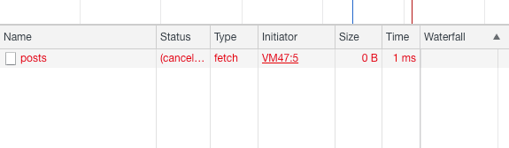

### Отмена запроса

Иногда бывает нужно прервать запрос, например, когда авторизация пользователя просрочена или пользователь передумал скачивать файл.

```js
let controller

function fetchData() {
  // Сигнал одноразовый, поэтому для каждого запроса
  // нужен новый AbortController
  controller = new AbortController()

  return fetch('https://jsonplaceholder.typicode.com/posts', {
    signal: controller.signal,
  })
    .then((response) => response.json())
    .catch((error) => {
      console.log(error)
    }
  )
}

fetchData()

// Прерываем запрос
controller.abort()
```

После вызова `abort()` у [`AbortController`](/js/abort-controller/) промис отклонится с ошибкой `AbortError`, а браузер перестанет ждать ответ. В инструментах разработчика у такого запроса будет отменённый статус:



Отмена не откатывает действие. Если запрос уже дошёл до сервера, сервер может успеть его обработать.

Для таймаута контроллер не нужен: передайте `signal: AbortSignal.timeout(5000)`, и через 5 секунд браузер сам прервёт запрос с ошибкой `TimeoutError`.

### Загрузка файла на сервер

С помощью `fetch()` можно загружать файлы на сервер, например, когда пользователь хочет загрузить свой аватар в профиль. Отправляют файлы через объект [`FormData`](/js/form-data/). Покажем на примере обработчика отправки формы:

```html
<form id="form">
  <label for="avatar">Аватар</label>
  <input type="file" id="avatar">
  <button type="submit">Загрузить</button>
</form>
```

```js
// Находим элемент с файлом
const fileInput = document.getElementById('avatar')
const form = document.getElementById('form')

function handleSubmit(event) {
  event.preventDefault()

  const formData = new FormData()

  // Добавляем файлы из инпута к данным
  for (let i = 0; i < fileInput.files.length; i++) {
    const file = fileInput.files[i]
    formData.append('avatar', file, file.name)
  }

  // Отправляем файлы на сервер
  fetch('https://api.example.com/upload', {
    method: 'POST',
    body: formData,
  })
}

form.addEventListener('submit', handleSubmit)
```

Прогресс отправки `fetch()` не показывает. В браузерах на Chromium тело запроса можно передать потоком `ReadableStream` с опцией `duplex: 'half'` и считать отданные байты. Это работает только по HTTP/2 и новее, то есть только по HTTPS. Firefox и Safari так пока не умеют. И счётчик покажет, сколько данных забрал браузер, а не сколько дошло до сервера.

### Скачивание с прогрессом

Чтобы получать текущий прогресс скачивания файла или любых других данных, используйте свойство `body` объекта `Response`, в который резолвится промис `fetch()`. Свойство `body` — поток для чтения (`ReadableStream`). Через него данные приходят по частям, не дожидаясь конца загрузки.

Попробуем таким образом скачать видео со своего сервера, например ролик о том, как белый котик дружит с огромным псом.

```js
fetch('/media/cat-and-dog.mp4').then(async (response) => {
  let receivedLength = 0
  // Сюда складываем части файла
  const chunks = []

  // Получаем поток в переменную
  const reader = response.body.getReader()

  // Считываем общую длину данных
  const contentLength = parseInt(
    response.headers.get('Content-Length'),
    10
  )

  while (true) {
    // Метод read() возвращает объект, в котором
    // done — boolean-значение о том, закончился ли поток,
    // value — массив байт Uint8Array, которые пришли в этот раз
    const { done, value } = await reader.read()

    if (done) {
      console.log('Получено 100%')
      break
    }

    chunks.push(value)

    receivedLength += value.length

    const result = Math.floor(
      (receivedLength / contentLength) * 100
    )

    if (result < 100) {
      console.log(`Получено ${result}%`)
    }
  }

  // Собираем видео из частей
  const video = new Blob(chunks, { type: 'video/mp4' })
})
```

Процент получится, только если сервер прислал заголовок `Content-Length`. Без него `contentLength` будет `NaN`. Если ответ сжат, например gzip, заголовок содержит размер сжатых данных. А поток отдаёт уже распакованные байты, поэтому процент уйдёт за 100.
