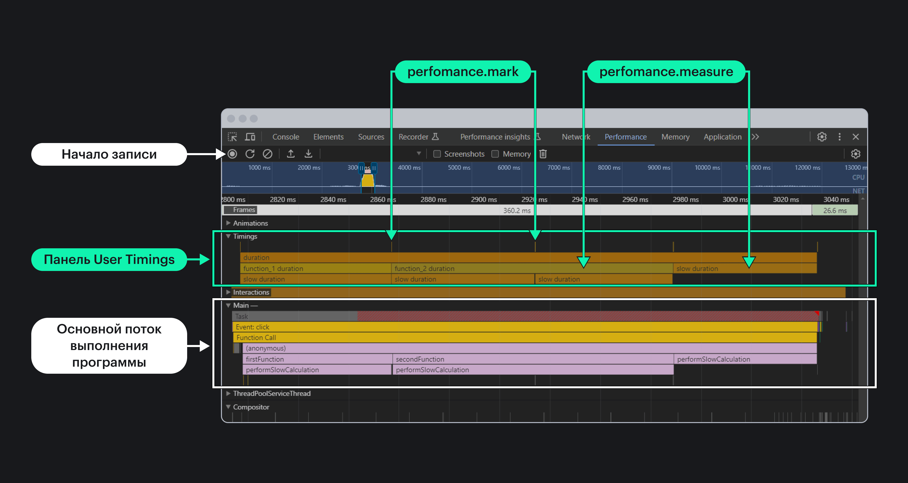
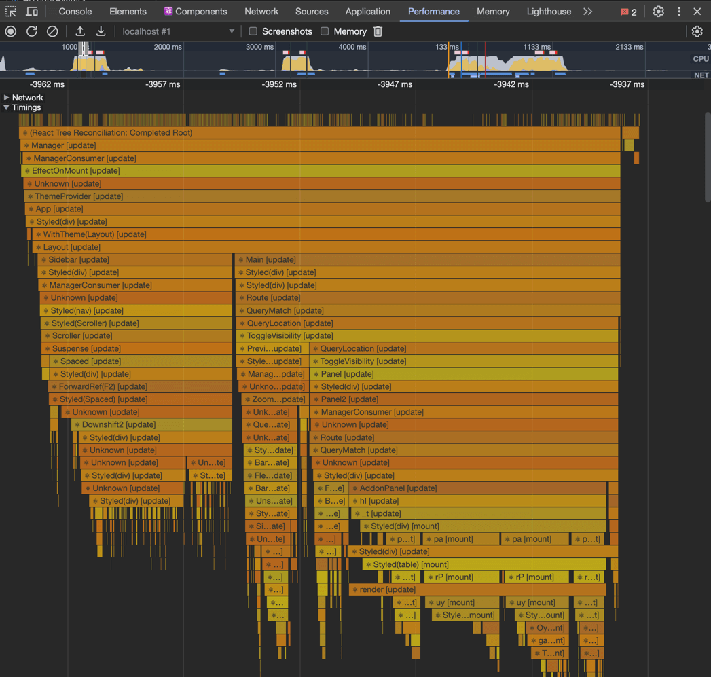

🛠 Удобно анализировать производительность при помощи вкладки «Производительность» (Performance) в инструментах разработчика. Вызовы `performance.mark()` и `performance.measure()` отобразятся в разделе Timings после записи профиля.



<iframe title="Анализ производительности приложения" src="../demos/functions-measure-devtools/" height="460"></iframe>

🛠 Может появиться желание написать функцию-обёртку для `performance.mark()` и `performance.measure()` и обернуть в неё всё приложение. Например, так:

```js
const withPerformanceMeasure = (markName, functionToAudit) => {
  performance.mark(`${markName}-before`)
  functionToAudit()
  performance.mark(`${markName}-after`)
  performance.measure(
    markName,
    `${markName}-before`,
    `${markName}-after`
  )
}

// Тело скрипта

withPerformanceMeasure('app', myApp)
```

Этого не стоит делать. Такая обёртка сделает один замер всего приложения, и по нему не понять, какая часть тормозит. Ставьте метки вокруг конкретных участков кода, которые хотите проверить.

Если `myApp` [асинхронная](/js/async-in-js/), обёртка ещё и ошибётся: вторая метка встанет сразу после запуска, а не после завершения работы.

Метки на отдельных участках ставил React 16 в режиме разработки: на каждый компонент, это видно на скриншоте. В React 17 эти метки убрали. С версии 19.2 React снова показывает компоненты во вкладке Performance, но на отдельных строках, а не через `performance.mark()`.


