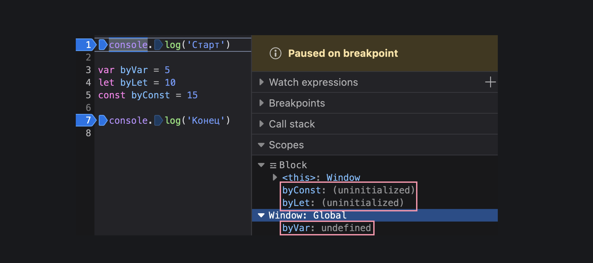
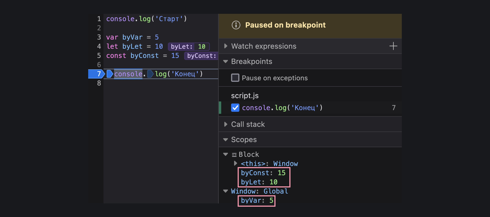
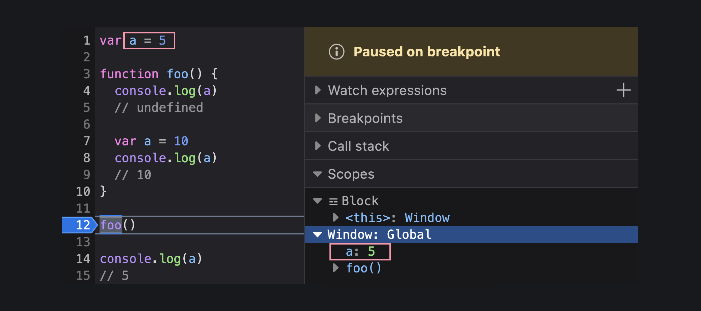
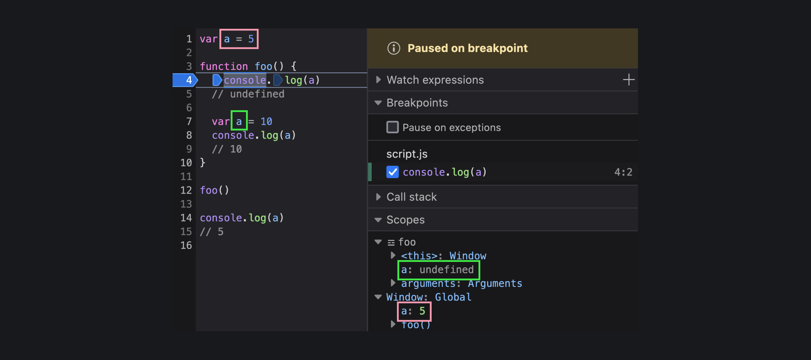
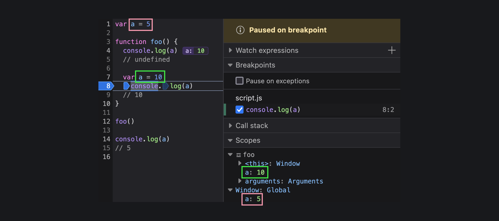
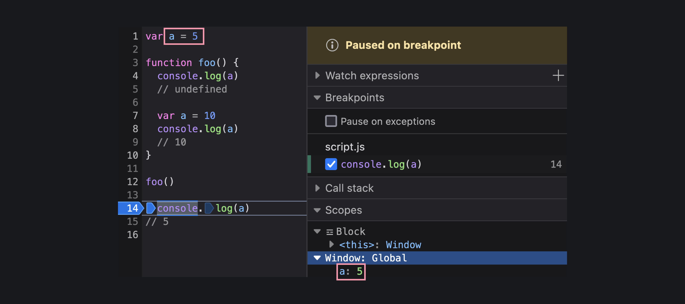

## Кратко

Переменные в JavaScript хранят значения, с которыми работает код. Создают их ключевыми словами `var`, `let` и `const`.

<aside>

🤖 `let` и `const` работают во всех современных браузерах и надёжнее `var`. Их нельзя объявить повторно и нельзя использовать, пока не выполнилось объявление. А на верхнем уровне скрипта они не становятся свойствами `window`.

</aside>

## Что такое переменные

Переменные — это именованные контейнеры для хранения данных.

Переменную создают ключевым словом `let`, `const` или `var`. Сразу за ключевым словом идёт имя переменной или список переменных через запятую. Создание переменной также называют _объявлением переменной_. Например:

```js
var singleVariable

let firstVariable, secondVariable, thirdVariable
```

Чаще всего при объявлении переменной ей устанавливают начальное значение при помощи оператора присваивания `=`. Тип значения может быть абсолютно любым: [строка](/js/string/), [число](/js/number/), [объект](/js/object/), [массив](/js/arrays/) и так далее.

```js
// Объявление переменной и присваивание
let string = 'foo'
const array = ['foo', 'bar', 'baz']
var number = 10

// Множественное объявление и присваивание
let firstNumber = 5,
  secondNumber = 10
```

Затем переменную можно использовать как заменитель значения в коде:

```js
let name = 'Уолтер'
let surname = 'Вайт'
let fullName = name + ' ' + surname

console.log(fullName)
// Уолтер Вайт
```

## Правила именования переменных

Для имени переменной можно использовать следующие символы:

- буквы: обычно латиница, но подойдут и другие алфавиты;
- цифры;
- символы `$` и `_`.

Первый символ не должен быть цифрой:

```js
let letters, $dollarsign, _underscore

let 1number
// SyntaxError: Invalid or unexpected token
```

Нельзя называть переменные зарезервированными словами:

- всегда: `class`, `super`, `throw`, `var`, `const` и так далее;
- в [строгом режиме](/js/use-strict/): ещё `let`, `yield`, `static` и несколько других слов;
- в [модулях](/js/modules/): всё то же, что в строгом режиме (он там включён всегда), и ещё `await`.

Полный список — в [спецификации ECMAScript](https://tc39.es/ecma262/#sec-keywords-and-reserved-words).

## Создание переменных

Перед выполнением скрипта JavaScript находит код создания переменных и заранее создаёт их. Получается, что в начале выполнения скрипта переменные, описанные в текущей области видимости, уже объявлены. Такое поведение называется _hoisting_ — «всплытие».

Значения у таких переменных разные:

- переменные `var` сразу равны [`undefined`](/js/undefined/);
- переменные `let` и `const` не инициализированы, пока не выполнится их объявление. Читать их или присваивать им значение до этого нельзя, будет ошибка.

Это поведение одинаково во всех браузерах. В дебаггере Firefox переменные `let` и `const` до объявления помечены как `uninitialized`:

```js
console.log('Старт')

var byVar = 5
let byLet = 10
const byConst = 15

console.log('Конец')
```


Код ещё не начал выполняться, а переменные уже объявлены.

В конце скрипта, после присваивания начальных значений, переменные равны `5`, `10` и `15`:


JavaScript выполнил код объявления переменных и установил значения.

Получается, что некоторое время переменная `var` содержит значение `undefined` и доступна для чтения. Код, который прочитает её раньше времени, получит `undefined` вместо ошибки и молча сработает неправильно.

## Переменные `let` и `const`

Переменные `let` и `const` появились в версии [ECMAScript 2015 года](/js/language-versions/) (ES6) и сейчас их используют намного чаще, чем `var`.

### Объявление

Используя ключевое слово `let`, можно объявить переменную без присваивания ей начального значения. В таком случае она будет равна `undefined`:

```js
let a
console.log(a)
// undefined

a = 5
console.log(a)
// 5
```

При помощи `const` нельзя объявлять переменные без значения:

```js
const a
// SyntaxError: Missing initializer in const declaration

// Правильно
const b = 5
```

К переменным `let` и `const` нельзя обращаться, пока не выполнилось их объявление:

```js
console.log(a)
// ReferenceError: Cannot access 'a' before initialization

let a = 5
```

С `const` будет то же самое:

```js
console.log(b)
// ReferenceError: Cannot access 'b' before initialization

const b = 5
```

<details>
  <summary>Почему так?</summary>

У `let` и `const` есть временная мёртвая зона (_temporal dead zone_, TDZ) — время от входа в область видимости до выполнения объявления переменной. Переменную можно использовать и выше объявления, если этот код выполнится после инициализации:

```js
function foo() {
  console.log('from foo', a)
}

Promise.resolve()
  .then(() => console.log('from promise', a))

setTimeout(() => console.log('from timer', a))

let a = 10

foo()

// from foo 10
// from promise 10
// from timer 10
```

TDZ есть и у классов:

```js
console.log(Foo)

class Foo {
  constructor(bar) {
    this.bar = bar
  }
}
// ReferenceError: Cannot access 'Foo' before initialization
```

А у [функций](/js/function/), объявленных через `function` (_Function Declaration_), TDZ нет:

```js
console.log(Foo)

function Foo(bar) {
  this.bar = bar
}
// ƒ Foo(bar) { this.bar = bar }
```

</details>

Переменные `let` и `const` имеют блочную [область видимости](/js/closures/). Она не даёт получить значение переменной вне блока, где переменная была объявлена.

Если объявить переменные внутри блока [`if`](/js/if-else/), то обращение к ним вне блока будет выбрасывать ошибку:

```js
if (true) {
  let a = 5
  const b = 10

  console.log(a)
  // 5
  console.log(b)
  // 10
}

console.log(a)
// ReferenceError: a is not defined

console.log(b)
// ReferenceError: b is not defined
```

### Одинаковые имена переменных

Объявление переменной с именем, которое уже используется в текущей области видимости, приведёт к ошибке:

```js
let a = 5

let a = 10
// SyntaxError: Identifier 'a' has already been declared
```

То же будет с `const` и с разными ключевыми словами для одного имени:

```js
const a = 5
const a = 10
// SyntaxError: Identifier 'a' has already been declared

var b = 5
const b = 10
// SyntaxError: Identifier 'b' has already been declared
```

В то же время можно объявлять переменные с одинаковым именем в разных областях видимости. В этом случае значение будет зависеть от той области видимости, где происходит чтение:

```js
let name = 'Ольга'

if (true) {
  let name = 'Елена'
  console.log(name)
  // Елена
}

console.log(name)
// Ольга
```

### Смена значения в `let` и `const`

Значение в переменной, созданной через `let`, можно изменять:

```js
let a = 5
console.log(a)
// 5

a = 10
console.log(a)
// 10
```

Начальное значение `const` изменить нельзя, будь то примитивное значение:

```js
const a = 5
a = 10
// TypeError: Assignment to constant variable.
```

Или ссылка на объект:

```js
const obj = {
  a: 5,
}

obj = {
  a: 10,
}
// TypeError: Assignment to constant variable.
```

Однако у объекта в `const` можно менять свойства. [Объекты хранятся по ссылке](/js/ref-type-vs-value-type/#ssylochnye-tipy-dannyh): если изменить объект, ссылка на него останется прежней:

```js
const obj = {
  a: 5,
}

obj.a = 10

console.log(obj)
// { a: 10 }
```

## Переменные `var`

Ключевое слово `var` было в JavaScript с первых версий. В новом коде его не используют, но разбираться в нём полезно. `var` встречается в библиотеках и старых проектах, а ещё о нём любят спрашивать на собеседованиях.

### Объявление

Переменные `var` можно объявлять без присваивания им значения, в таком случае они будут равны `undefined`:

```js
var a
console.log(a)
// undefined

var b = 5
console.log(b)
// 5
```

Переменные, объявленные через `var`, имеют функциональную область видимости. Они доступны только в пределах текущей функции или глобальной области видимости, если функции нет:

```js
if (true) {
  var a = 5
}

function foo() {
  var b = 10
}

console.log(a)
// 5
console.log(b)
// ReferenceError: b is not defined
```

Объявление переменных вне функций делает их глобальными переменными. Они доступны как свойства глобального объекта (`window` в браузере, `global` в Node.js, `globalThis` в любой среде):

```js
var varVariable = 5

console.log(window.varVariable)
// 5
```

Так `var` работает только в обычных скриптах. В модулях (ES-модулях и CommonJS-модулях Node.js с `require()`) у каждого файла своя область видимости, и `var` на верхнем уровне не попадает в глобальный объект. Переменные `let` и `const` не попадают в него даже в обычных скриптах.

Если имя совпадёт со встроенным свойством `window`, `var` не создаст новую переменную, а присвоит значение этому свойству. Итог зависит от свойства. Например, `window.name` хранит только строки, поэтому число превратится в строку:

```js
var name = 42

console.log(typeof name)
// string
```

После `let name = 42` в переменной останется число, а `window.name` не изменится.

К переменным `var` можно обращаться до объявления. В отличие от `let` и `const`, ошибки не будет: из-за всплытия переменная уже есть и равна `undefined`:

```js
console.log(a)
// undefined

var a = 5

console.log(a)
// 5
```

Разберём, как работает функциональная область видимости:

```js
var a = 5

function foo() {
  console.log(a)
  // undefined

  var a = 10
  console.log(a)
  // 10
}

foo()

console.log(a)
// 5
```

Перед выполнением функции в глобальной области видимости есть переменная `a`, равная `5`:


Перед выполнением функции переменная уже инициализирована в глобальной области видимости.

Во время выполнения функции появляется новая функциональная область видимости. В ней тоже есть переменная `a`. Она объявлена через `var` внутри функции и при запуске функции всплыла со значением `undefined`. В строке 4 код читает именно эту переменную, а не внешнюю.


В начале выполнения функции локальная переменная всплыла: JavaScript заранее объявил её, но ещё не установил значение.

В строке 8 значение переменной `a` уже равно `10`.


В конце выполнения функции локальной переменной установлено значение, и чтение происходит из неё.

После выполнения функции локальная область видимости больше недоступна. В консоли выводится глобальная переменная `a`.


На последнем шаге локальная переменная уже недоступна, так как выполняется код из глобальной области видимости.

### Смена значения в `var`

Значение, хранящееся в переменной `var`, можно изменить двумя способами:

- обратиться к имени переменной и присвоить новое значение:

```js
var a = 5
console.log(a)
// 5

a = 10
console.log(a)
// 10
```

- объявить переменную ещё раз через `var`:

```js
var a = 5
console.log(a)
// 5

var a = 10
console.log(a)
// 10
```

Повторный `var` не создаёт новую переменную: JavaScript пропускает объявление, а `= 10` выполняет как обычное присваивание. Поэтому повторное объявление со значением молча перезаписывает старое, и ошибку легко не заметить. С `let` и `const` такой код вызовет `SyntaxError`.
