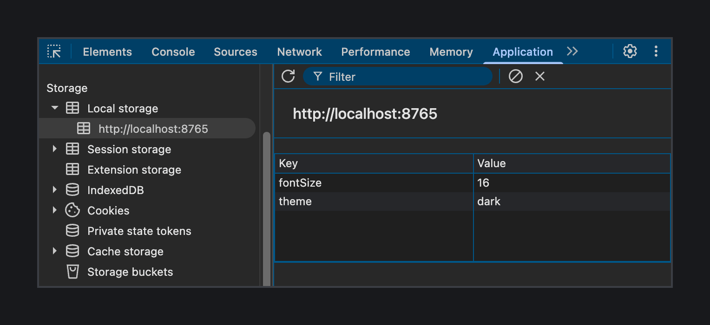

Сайтам часто нужно хранить данные на клиенте. Для этого в браузере есть несколько способов. Они появились в разное время и отличаются объёмом, сроком хранения и удобством API.

Всё, что сайт сохранил, видно в инструментах разработчика. Откройте их в Chrome клавишей <kbd>F12</kbd> или сочетанием <kbd>Cmd Option I</kbd> на macOS. На вкладке Application слева список хранилищ, справа их содержимое.



## Cookie

Первый способ — хранить данные в [куках](/js/cookie/). Это не просто хранилище в браузере. Куки передаются на сервер в HTTP-заголовке `Cookie`, и сервер может их изменить. Куки — часть [протокола HTTP](/tools/http-protocol/), их поддерживают все браузеры.

У хранения данных в куках много ограничений:

- куки уходят на сервер с каждым запросом;
- размер куки ограничен 4096 байтами;
- содержимое нужно закодировать, чтобы не сломать запрос.

Куки — не постоянное хранилище. По умолчанию они живут до конца сессии. Чтобы продлить срок, задают атрибуты `Expires` или `Max-Age`. Но и с ними браузеры не хранят куки вечно: Chrome, например, ограничивает срок 400 днями.

У `document.cookie` не самый удобный интерфейс чтения и записи, поэтому многие разработчики используют [сторонние библиотеки](/js/cookie/#na-praktike).

С 2025 года во всех браузерах есть и [асинхронный](/js/async-in-js/) Cookie Store API (`cookieStore`) на [промисах](/js/promise/).

Здесь и дальше примеры с [`await`](/js/async-await/) написаны вне функции. Запускайте их в модуле (`<script type="module">`) или в консоли браузера.

```js
await cookieStore.set('theme', 'dark')
const cookie = await cookieStore.get('theme')
console.log(cookie.value) // 'dark'
```

Он работает только по HTTPS или на `localhost`. Поддержка пока неполная: например, в Firefox и Safari метод `get()` возвращает только имя и значение куки.

Обычно в куках хранят данные для авторизации или то, что нужно серверу. Куку с токеном авторизации ставьте с атрибутом `HttpOnly`: без него её прочитает любой скрипт на странице. Ещё добавьте `Secure` и `SameSite`. С `Secure` кука уходит только по HTTPS. `SameSite` ограничивает отправку куки в запросах с чужих сайтов.

Ещё куками отслеживают поведение пользователя на сайтах. Для этого обычно используют сторонние куки. Это куки чужого сайта, который встроен в страницу, например рекламной сети. Их домен не совпадает с адресом сайта в адресной строке. Браузеры обращаются с ними по-разному:

- Safari по умолчанию их блокирует;
- Firefox их разделяет: у каждого сайта свой набор, поэтому следить за пользователем между сайтами через такие куки не получится;
- Chrome по умолчанию их разрешает.

## Web Storage

Web Storage — это API для хранения данных в браузере. В нём два хранилища: localStorage и sessionStorage. У обоих одинаковые методы и ограничения, а отличаются они временем хранения данных и тем, какие вкладки их видят.

[sessionStorage](/js/session-storage/) похож на сессионные куки: данные в нём живут, только пока открыта вкладка, и другие вкладки их не видят.

[localStorage](/js/local-storage/) общий для всех вкладок сайта. В теории он хранит данные бессрочно, но браузеры всё равно вводят свои ограничения. О них — в разделе «[Сколько места доступно](#skolko-mesta-dostupno)».

Интерфейс у Web Storage простой. Данные хранятся в виде пар «ключ — значение», а методы названы понятно.

```js
// Запись по ключу
localStorage.setItem('name', 'value')
sessionStorage.setItem('name', 'value')

// Чтение по ключу
const nameFromLocalStorage = localStorage.getItem('name')
const nameFromSessionStorage = sessionStorage.getItem('name')

// Удаление по ключу
localStorage.removeItem('name')
sessionStorage.removeItem('name')

// Очистка хранилища
localStorage.clear()
sessionStorage.clear()
```

Web Storage хранит только строки. Поэтому сложную структуру сначала превратите в строку формата [JSON](/tools/json/), а при чтении разберите обратно:

```js
const settings = { theme: 'dark' }
localStorage.setItem('settings', JSON.stringify(settings))

const saved = JSON.parse(localStorage.getItem('settings'))
```

Обычно браузеры дают localStorage и sessionStorage по 5 МБ на один источник (origin). У каждого поддомена свой лимит. При переполнении метод `setItem()` бросает ошибку `QuotaExceededError`: новые данные не запишутся, но уже сохранённые останутся на месте.

<aside>

💡 Запись может упасть и по другим причинам: иногда браузер запрещает её совсем. Оборачивайте вызовы Web Storage API в [`try...catch`](/js/try-catch/). Подробнее — в [практике к статье о localStorage](/js/local-storage/#na-praktike).

</aside>

Любой скрипт, загруженный на странице, может читать её Web Storage. Поэтому не храните там приватную информацию или токены авторизации: их может украсть сторонний скрипт или код, который злоумышленник внедрил через [XSS-уязвимость](/tools/web-security/#cross-site-scripting-xss).

Методы Web Storage синхронные. Пока метод работает, JavaScript на странице ждёт. Обычно это быстро. Но при первом обращении браузер загружает в память всё хранилище. А большие значения долго читаются и записываются. Поэтому не храните в Web Storage большие объёмы данных.

## IndexedDB

Это база данных прямо в браузере. Она хранит не только строки, но и объекты, массивы, файлы. В отличие от `document.cookie` и Web Storage, её API асинхронный. Но он достаточно сложный.

Вот как открыть базу и записать в неё заметку:

```js
let db
const connection = indexedDB.open('myDatabase', 1)

connection.onupgradeneeded = function(event) {
  db = event.target.result
  db.createObjectStore('notes', { autoIncrement: true })
}

connection.onsuccess = function(event) {
  db = event.target.result
  addNote(db, 'Прочитать статью «Хранение данных в браузере»')
}

connection.onerror = function(event) {
  const { error } = event.target
  console.log(`Ошибка при открытии базы: ${error}`)
}

function addNote(db, text) {
  const tx = db.transaction(['notes'], 'readwrite')
  const store = tx.objectStore('notes')
  const note = { text, timestamp: Date.now() }

  tx.oncomplete = () => {
    console.log('Заметка сохранена')
  }
  tx.onerror = (event) => {
    const { error } = event.target
    console.log(`Ошибка при записи заметки: ${error}`)
  }

  store.add(note)
}
```

Даже одна запись требует много кода вокруг запросов и событий. Поэтому часто используют библиотеки-обёртки, например [`idb`](https://github.com/jakearchibald/idb) или [Dexie](https://dexie.org).

## Cache API

Хранилище для пар «запрос — ответ». Чаще всего его используют вместе с сервис-воркерами — скриптами, которые перехватывают запросы страницы. Так сайт может открываться без сети. Но работать с кешем можно и из обычного скрипта на странице.

API асинхронный и построен на промисах. Он доступен только по HTTPS или на `localhost`.

```js
const cache = await caches.open('v1')

// Скачиваем файл и сохраняем ответ сервера в кеш
await cache.add('/styles.css')

// Достаём сохранённый ответ
const response = await cache.match('/styles.css')
```

## Origin Private File System

Самый новый способ — _приватная файловая система сайта (Origin Private File System, коротко OPFS)_. Сайт работает с ней как с обычными папками и файлами, но пользователь этих файлов не видит. OPFS подходит для больших объёмов данных. Например, на ней работают браузерные версии базы данных SQLite.

Как и Cache API, OPFS доступна только по HTTPS или на `localhost`.

```js
const root = await navigator.storage.getDirectory()
const fileHandle = await root.getFileHandle('notes.txt', {
  create: true,
})

// Записываем текст в файл
const writable = await fileHandle.createWritable()
await writable.write('Прочитать статью')
await writable.close()

// Читаем содержимое файла
const file = await fileHandle.getFile()
const text = await file.text()
```

В Safari метод `createWritable()` есть только с версии 26. В старых версиях записать файл можно только из [веб-воркера](/js/web-workers/) методом `createSyncAccessHandle()`. Нужен обычный воркер, общий (Shared Worker) не подойдёт.

У `createSyncAccessHandle()` есть и плюс. Метод возвращает объект, который читает и пишет файл синхронно, и обычно это заметно быстрее. Поэтому его используют для больших объёмов данных, например для базы SQLite в браузере.

## Сколько места доступно

Для IndexedDB, Cache API и OPFS у браузеров общая квота. Её считают от размера всего диска:

- Chrome и Safari разрешают одному источнику занять до 60% диска;
- Firefox по умолчанию даёт 10% диска, но не больше 10 ГБ на все источники одного сайта.

Если квота кончилась, запись падает с ошибкой `QuotaExceededError`.

Узнать, сколько места занято и сколько доступно, можно методом `navigator.storage.estimate()`:

```js
const { usage, quota } = await navigator.storage.estimate()
console.log(`Занято ${usage} из ${quota} байт`)
```

Попросить браузер не удалять данные сайта, когда место заканчивается, можно методом `navigator.storage.persist()`. Браузер сам решает, выполнить ли просьбу. Safari, например, учитывает, добавлен ли сайт на экран «Домой».

Safari удаляет данные сайта, если пользователь 7 дней пользовался браузером, но ни разу не кликнул по сайту и не коснулся его. Правило касается localStorage, IndexedDB, Cache API и других данных, которые записал скрипт. Куки, которые поставил сервер, оно не трогает. Для сайта на экране «Домой» Safari считает дни отдельно: только те, когда его открывали.

## Универсальные решения

Раньше популярным универсальным решением была библиотека [localForage](https://localforage.github.io/localForage/). Она записывает данные в IndexedDB, а если её нет — в другое доступное хранилище, например в localStorage. API у неё почти как у Web Storage, только все методы асинхронные.

С 2021 года localForage не развивается. Сейчас IndexedDB есть во всех браузерах, поэтому для простого хранения «ключ — значение» хватит маленькой обёртки над ней, например [`idb-keyval`](https://github.com/jakearchibald/idb-keyval).

## Что выбрать

Пройдите по схеме сверху вниз. Первое «да» подскажет хранилище.


