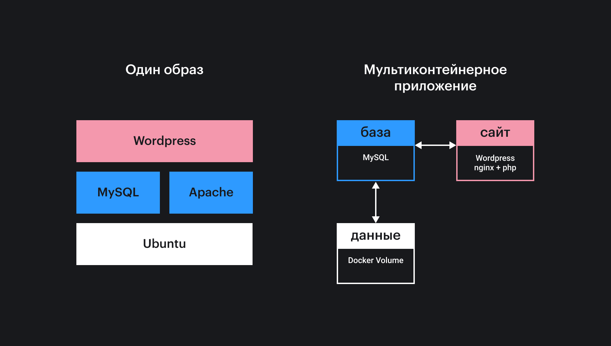

<aside>

📚 В этой статье мы говорим про инструменты Docker. Если вам не очень понятно, зачем он нужен и как работает, прочитайте статью «[Что такое Docker](/tools/docker/)».

</aside>

## Кратко

Docker Compose — это инструмент для запуска мультиконтейнерного приложения, которое не зависит от платформы и содержит все необходимые для работы технологии и библиотеки. Конфигурацию такого приложения записывают в один текстовый файл в формате YAML. Запускают приложение одной командой в терминале.

## Как начать

На Mac и Windows Docker Compose входит в Docker Desktop. Ставить его отдельно не нужно.

На Linux сначала установите Docker Engine (подробнее в статье «[Что такое Docker?](/tools/docker/#kak-nachat)»). Потом поставьте плагин `docker-compose-plugin` из репозитория пакетов Docker. Процесс установки описан в [официальной документации Docker](https://docs.docker.com/compose/install/).

Раньше Docker Compose был отдельной программой `docker-compose`, и команды писали через дефис. Compose давно стал частью Docker CLI, а старую версию с 2023 года не поддерживают. Теперь команды пишут через пробел: `docker compose`.

## Как понять

Рассмотрим мультиконтейнерное приложение на примере WordPress.

Можно создать один образ с установленной базой данных, веб-сервером, интерпретатором PHP и движком WordPress на борту. А можно сделать иначе.



Веб-приложение обычно состоит из нескольких частей. Эти части называют сервисами. Команда Docker советует: один сервис — один контейнер. Так проще искать ошибки и обновлять сервисы по одному.

Приложение из нескольких таких контейнеров называют мультиконтейнерным.

Что нужно для запуска сайта на WordPress? В самом простом случае это два сервиса:

- веб-сервер с WordPress;
- база данных.

Оба контейнера должны работать вместе. Можно написать [`Dockerfile`](/tools/dockerfile/) для каждого и вручную связать их сетью. Compose делает это за вас: запускает оба контейнера по одному файлу и сам их связывает.

Docker Compose поддерживает файлы конфигурации в формате [YAML](/tools/yaml/). Имя файла конфигурации по умолчанию — _compose.yaml_. Базой данных возьмём MySQL. Для нашего примера такой файл может выглядеть так:

```yaml
services:
  db:
    image: mysql:8.4
    volumes:
      - db_data:/var/lib/mysql
    restart: always
    environment:
      MYSQL_ROOT_PASSWORD: goodpassword
      MYSQL_DATABASE: wordpress
      MYSQL_USER: wordpress
      MYSQL_PASSWORD: wordpress

  wordpress:
    depends_on:
      - db
    image: wordpress:latest
    ports:
      - "8000:80"
    restart: always
    volumes:
      - wordpress_data:/var/www/html
    environment:
      WORDPRESS_DB_HOST: db:3306
      WORDPRESS_DB_USER: wordpress
      WORDPRESS_DB_PASSWORD: wordpress
      WORDPRESS_DB_NAME: wordpress
volumes:
  db_data: {}
  wordpress_data: {}
```

В элементе `services` описаны все контейнеры, которые нужно запустить.

В поле `image` укажите имя образа. Образ должен лежать на компьютере или в реестре образов, например на Docker Hub. Ещё у сервиса есть другие поля, например:

- `environment` — переменные окружения;
- `ports` — порты для подключения к сервису, например из браузера;
- `volumes` — пути для монтирования томов.

Данные базы и файлы сайта лучше хранить отдельно от контейнера. Для этого используют _тома_ (Docker Volumes). Том — это папка, которой управляет Docker. На Linux она лежит в _/var/lib/docker/volumes/_. Приложение в контейнере видит том как примонтированную папку.

В примере два тома: _db_data_ для базы MySQL и _wordpress_data_ для файлов WordPress — загрузок, тем и плагинов.

Пароли в примере записаны прямо в файле для наглядности. В реальном проекте файл конфигурации попадёт в репозиторий вместе с паролями. Поэтому храните пароли в [`secrets`](https://docs.docker.com/compose/how-tos/use-secrets/).

Образы MySQL и WordPress читают такие пароли из файлов. Для этого у них есть переменные с окончанием `_FILE`, например `MYSQL_PASSWORD_FILE`.

Запись `"8000:80"` открывает порт 8000 для всех, кто может достучаться до вашего компьютера: для локальной сети, а на сервере и для интернета. Чтобы сайт открывался только на вашем компьютере, пишите `"127.0.0.1:8000:80"`.

Файл конфигурации готов, и можно «поднять» все контейнеры всего одной командой:

```bash
docker compose up
```

Когда Docker скачает образы и создаст тома, сайт откроется по адресу [`http://localhost:8000`](http://localhost:8000).

Настройка `restart: always` просит Docker перезапускать контейнер, если он упадёт. Ещё Docker поднимет контейнер после своего перезапуска. Данные останутся в томах, и вы продолжите с того же места.

Выключить оба контейнера так же просто, как и включить:

```bash
docker compose down
```

Данные в томах переживают не только перезапуск, но и удаление контейнеров этой командой. Чтобы удалить тома вместе с контейнерами, запустите `docker compose down -v`.

Чтобы обновить MySQL, поменяйте тег образа (часть имени после двоеточия, например `8.4` в `mysql:8.4`). Потом выполните:

```bash
docker compose pull
docker compose up -d
```

Флаг `-d` запускает контейнеры в фоне.

Обновлять MySQL можно только по шагам. Например, том с данными версии 5.7 сначала переведите на 8.0 и только потом на 8.4.

WordPress так не обновится. Его файлы уже лежат в томе _wordpress_data_, поэтому ядро обновляют из админки WordPress.

Все команды Docker Compose CLI описаны в [официальной документации](https://docs.docker.com/reference/cli/docker/compose/).

## Как пишется

Docker Compose настраивает объекты Docker нескольких типов: образы, контейнеры, тома. Их настройки удобно записать деревом. Поэтому файл конфигурации пишут в формате YAML.

В YAML вложенность задают отступами, как в Python. Такое дерево читать легче, чем [JSON](/tools/json/).

Файл _compose.yaml_ кладут в корневую папку проекта. В ней могут лежать и подпапки с сервисами мультиконтейнерного приложения. Ради обратной совместимости Compose понимает и старые имена _docker-compose.yaml_ и _docker-compose.yml_.

В файле _compose.yaml_ могут быть следующие элементы верхнего уровня:

- [version](https://github.com/compose-spec/compose-spec/blob/master/spec.md#version-top-level-element-obsolete) (устарел: Compose его игнорирует и выводит предупреждение `the attribute version is obsolete`): информация о версии формата файла конфигурации;
- [name](https://github.com/compose-spec/compose-spec/blob/master/spec.md#name-top-level-element): имя проекта. Если его нет, Compose берёт имя папки с файлом конфигурации;
- [services](https://github.com/compose-spec/compose-spec/blob/master/spec.md#services-top-level-element) (обязательный): список всех контейнеров, которые нужно будет запустить;
- [networks](https://github.com/compose-spec/compose-spec/blob/master/spec.md#networks-top-level-element): список сетей Docker Network, которые объединяют группы контейнеров в виртуальную локальную сеть;
- [volumes](https://github.com/compose-spec/compose-spec/blob/master/spec.md#volumes-top-level-element): список томов, которые подключают к контейнерам;
- [configs](https://github.com/compose-spec/compose-spec/blob/master/spec.md#configs-top-level-element): список параметров, которые позволяют запускать контейнеры в разных режимах, не собирая их заново;
- [secrets](https://github.com/compose-spec/compose-spec/blob/master/spec.md#secrets-top-level-element): список чувствительных с точки зрения безопасности параметров (то же, что и `configs`, но специального назначения).

### Services

Каждый сервис обычно отвечает за одну функцию. Например, веб-сервер отдаёт браузеру статический сайт (HTML, CSS и JS), а [API](/tools/api/) служит для обмена данными.

Когда пользователей станет много, одного веб-сервера может не хватить. Тогда запускают несколько экземпляров сервиса. Сам Compose их число не меняет: он запускает столько экземпляров, сколько указано в файле.

Например, мы запускаем два сервиса, _frontend_ и _backend_:

```yaml
services:
  frontend:
    image: awesome/webapp
    build: ./webapp
    deploy:
      mode: replicated
      replicas: 6
  backend:
    image: awesome/database
    build:
      context: backend
      dockerfile: ../backend.Dockerfile
    deploy:
      resources:
        limits:
          cpus: '0.50'
          memory: 50M
        reservations:
          cpus: '0.25'
          memory: 20M
```

Шесть экземпляров _frontend_ задают настройки `mode` и `replicas` в элементе `deploy`.

Compose не ставит перед экземплярами балансировщик нагрузки (прокси, который раздаёт запросы между ними). Другие контейнеры обращаются к ним по имени _frontend_. Встроенный DNS Docker возвращает адреса всех экземпляров.

У экземпляров два ограничения:

- Им нельзя открыть один порт компьютера через `ports`. Порт займёт один экземпляр, остальные не запустятся, и `docker compose up` завершится с ошибкой `port is already allocated`.
- Все экземпляры делят процессор и память одного компьютера.

Сборку _frontend_ описывают отдельно от развёртывания. Docker собирает образ из папки _./webapp_ по файлу с именем по умолчанию _Dockerfile_. Поле `image` задаёт имя, под которым Compose сохранит собранный образ.

Для _backend_ настройки сборки другие. `context` задаёт относительный путь к папке сервиса. `dockerfile` указывает файл сборки, у нас это _backend.Dockerfile_. Путь к нему отсчитывается от папки _backend_, поэтому `../backend.Dockerfile` — это файл в корне проекта.

Ещё у _backend_ есть требования к ресурсам:

- `limits` — жёсткий потолок: контейнер получит не больше половины одного ядра процессора и не больше 50 МБ памяти;
- `reservations` — запрос на ресурсы. Без Swarm (режима Docker для кластера из нескольких машин) Compose отбрасывает `cpus` и учитывает память. 20 МБ становятся мягким лимитом: когда на компьютере не хватает памяти, система забирает у контейнера память сверх этого объёма.

Подробнее читайте в спецификации [настроек сборки](https://github.com/compose-spec/compose-spec/blob/master/build.md) и [настроек развёртывания](https://github.com/compose-spec/compose-spec/blob/master/deploy.md).

### Networks

Элемент `networks` настраивает виртуальную сеть Docker Network между контейнерами. Например, разделим приложение на две сети:

- _front-tier_ — через неё _frontend_ выходит во внешний мир;
- _back-tier_ — через неё _frontend_ общается с _backend_.

В файле конфигурации это можно записать так:

```yaml
services:
  frontend:
    image: awesome/webapp

    networks:
      - front-tier
      - back-tier

  backend:
    image: awesome/database

    networks:
      - back-tier

networks:
  front-tier: {}
  back-tier:
    internal: true
```

_backend_ подключён только к сети _back-tier_, поэтому к нему может обратиться только _frontend_. А `internal: true` отрезает эту сеть от внешнего мира: _backend_ сам не выйдет в интернет.

Чтобы _frontend_ принимал запросы снаружи, ему ещё нужно открыть порт в `ports`.

### Volumes

Том объявляют в элементе `volumes` верхнего уровня и подключают к сервису по имени. Например, база данных в _backend_ хранит данные в томе _db-data_:

```yaml
services:

  backend:
    image: awesome/database

    volumes:
      - db-data:/etc/data

volumes:
  db-data:
```

Все элементы разбирает [спецификация Compose](https://github.com/compose-spec/compose-spec/blob/master/spec.md).
