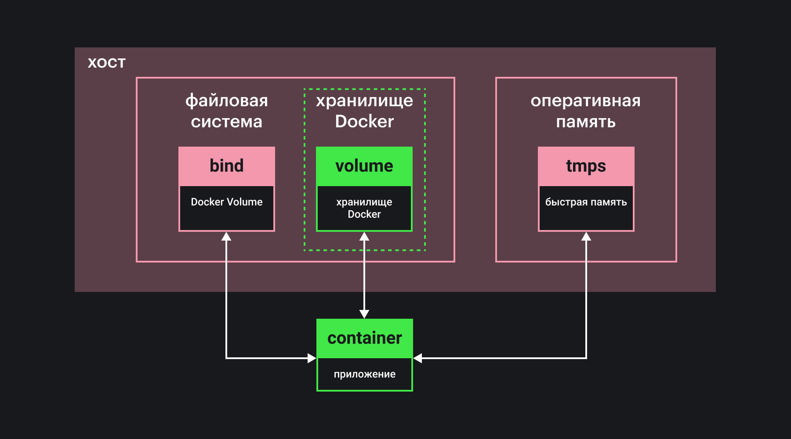

По умолчанию все данные приложения хранятся в контейнере Docker и после удаления контейнера теряются. Но это не единственный способ работать с данными. Можно использовать оперативную память и файловую систему компьютера, на котором установлен Docker Engine (хоста). Есть несколько типов хранилищ данных:

- связанные папки, примонтированные к контейнеру как внешние диски (_bind mounts_);
- тома (_volumes_);
- часть оперативной памяти хоста для работы с данными (_tmpfs mounts_).

Ещё есть монтирование содержимого образа (_image mounts_) и именованные каналы Windows (_named pipes_, _npipe_), но они нужны в специальных задачах. Именованный канал — не хранилище, а способ связи хоста и контейнера: например, через него контейнер обращается к Docker Engine API.

Какой бы тип вы ни выбрали, приложение видит данные как обычную папку внутри контейнера.

Наглядная схема типов управления данными в Docker:



Если вы ещё не знакомы с Docker, начните со статьи «[Что такое Docker](/tools/docker/)». Ещё почитайте о [мультиконтейнерных приложениях и Docker Compose](/tools/docker-compose/) и о том, [как устроен Dockerfile](/tools/dockerfile/).

Рассмотрим каждый тип хранилища по отдельности.

## Связанные папки (bind mounts)

Связанная папка соединяет папку на хосте (компьютере, где установлен Docker Engine) с папкой в контейнере. Менять файлы можно с обеих сторон, и изменения сразу видны и там, и там. Это удобный инструмент, но у него есть ограничения.

Когда создаёте связанную папку, укажите путь к ней на хосте и путь внутри контейнера. Если папки на хосте нет, флаг `-v` создаст её сам, а флаг `--mount` по умолчанию выдаст ошибку. В новых версиях Docker Engine `--mount` тоже создаст папку, если добавить ключ `bind-create-src`.

Связанные папки используются:

**Когда контейнеру нужны конфигурационные файлы с хоста.** Так сам Docker подключает к каждому контейнеру файл с настройками DNS.

**Когда работаем с исходным кодом и результатами сборки.** Можно использовать системы сборки для исходного кода внутри контейнера. Вы меняете код, [бандлер](/tools/bundlers/), который находится внутри контейнера, это видит, и код попадает в новую сборку. Другой вариант использования — работа с уже собранными бандлами, например, для тестирования или отладки приложений.

**Когда нужна одна и та же структура папок на разных компьютерах.** Команда с флагом `-v` создаст недостающие папки, и у всех она получится одинаковой.

### Как пользоваться

Чтобы связать папку на хосте с папкой внутри контейнера, используйте флаг `-v` или `--mount`. `$(pwd)` в командах ниже — это текущая папка на хосте.

Примеры со связанными папками и томами запускают контейнер с именем `devtest`. Перед следующим примером удалите предыдущий контейнер командой `docker rm -f devtest`, иначе Docker сообщит, что имя занято.

Пример с флагом `-v`:

```bash
docker run -d \
  -it \
  --name devtest \
  -v "$(pwd)"/target:/app \
  node:lts
```

Пример с флагом `--mount`:

```bash
docker run -d \
  -it \
  --name devtest \
  --mount type=bind,source="$(pwd)"/target,target=/app \
  node:lts
```

Для флага `-v` можно задать опции: `rprivate`, `private`, `rshared`, `shared`, `rslave`, `slave`, `ro`, `z` и `Z`.

Первые шесть опций управляют распространением точек монтирования (_mount propagation_). Они решают, попадёт ли новая точка монтирования внутри связанной папки в её копии. Сами файлы видны во всех точках монтирования при любом значении. По умолчанию стоит `rprivate`: вложенные монтирования никуда не распространяются. Как это работает, показано в блоке «Ключ `bind-propagation`» ниже.

Опция `ro` включает режим только для чтения: контейнер не сможет изменить папку на хосте. У флага `--mount` для этого есть ключ `readonly` или `ro`.

Опции `z` и `Z` управляют метками [SELinux](https://ru.wikipedia.org/wiki/SELinux) и работают только с флагом `-v`:

— `z` — папку на хосте могут использовать несколько контейнеров;
— `Z` — папку использует только один контейнер.

Не указывайте `Z` для системных папок, например _/usr_ или _/home_. Иначе операционная система на хосте перестанет работать.

<details>
  <summary>Ключ <code>bind-propagation</code></summary>

  Для флага `--mount` есть ключ `bind-propagation`, который работает только на Linux (операционные системы контейнера и хоста должны поддерживать этот режим работы). В Docker Desktop он не работает.

  Представьте: `/mnt1` — исходная точка монтирования, а `/mnt2` — её копия с той же папкой. В `/mnt1/sub` примонтировали что-то ещё. Появится ли это в `/mnt2/sub`? Зависит от значения:

  — `shared`: монтирование `/mnt1/sub` появится и в `/mnt2/sub`, и наоборот;
  — `slave`: то же, но в одну сторону: монтирование `/mnt1/sub` появится в `/mnt2/sub`, а обратно нет;
  — `private`: монтирования не распространяются ни в одну сторону;
  — `rshared`: то же, что `shared`, но рекурсивно: поведение действует и на точки монтирования внутри исходной;
  — `rslave`: то же, что `slave`, но рекурсивно;
  — `rprivate` (значение по умолчанию): то же, что `private`, но рекурсивно.

  Пример ниже монтирует папку _app/src_. Флаг `--mount` сам её не создаст, поэтому сначала выполните `mkdir -p app/src`.

  ```bash
  docker run -d \
    -it \
    --name devtest \
    --mount type=bind,source="$(pwd)"/app/src,target=/app \
    --mount type=bind,source="$(pwd)"/app/src,target=/app2,\
readonly,bind-propagation=rslave \
    node:lts
  ```

  Файлы в _/app_ и _/app2_ одни и те же. У второй точки монтирования есть дополнительные настройки:

  — контейнер может только читать файлы из _/app2_;
  — если на хосте примонтировать что-то внутрь _app/src_, это монтирование появится и в _/app2_. Из контейнера на хост монтирования не попадут.

  Для `rslave` папка на хосте должна лежать на точке монтирования в режиме `shared` или `slave`. Иначе Docker не запустит контейнер и выдаст ошибку.

  Ключ `bind-propagation` нужен для тонкой настройки хранилищ. Подробнее об этом механизме — в [официальной документации Linux](https://docs.kernel.org/filesystems/sharedsubtree.html).

</details>

Проверьте, что папка подключилась. Запустите контейнер из первого примера и выполните команду:

```bash
docker inspect devtest
```

Найдите секцию `Mounts`. Например, если вы запустили контейнер из папки _/tmp/source_, она будет выглядеть так:

```json
"Mounts": [
  {
    "Type": "bind",
    "Source": "/tmp/source/target",
    "Destination": "/app",
    "Mode": "",
    "RW": true,
    "Propagation": "rprivate"
  }
],
```

Чтобы разорвать связь между папками на хосте и в контейнере, остановите и удалите контейнер:

```bash
docker container stop devtest
docker container rm devtest
```

<aside>

☝️ Помните:

1. Связанными папками нельзя управлять из Docker CLI.
1. Пути, файловая система и структура папок на разных компьютерах и платформах могут отличаться.
1. Если папка в контейнере не пустая, связанная папка с хоста скроет её содержимое на всё время работы контейнера.
1. Связанная папка открывает контейнеру доступ к файлам хоста. Приложение может добраться до системных папок или удалить важные файлы. Конфигурационные файлы монтируйте только для чтения.

</aside>

## Тома (volumes)

Том — это папка на хосте, которой управляет Docker. Менять её напрямую не стоит: данные в томе должны изменять только объекты и службы Docker. Без прав администратора до этой папки на хосте не добраться.

Том существует отдельно от контейнеров. К нему можно подключить один или несколько контейнеров сразу, а после удаления контейнера том остаётся.

Тома создаются при запуске контейнера (их описывают инструкцией `VOLUME` в Dockerfile или ключом `volumes` в файле Docker Compose) или вручную с помощью Docker CLI. У тома может быть имя от пользователя (именованный том, _named volume_). Если имени нет, Docker задаст его сам (анонимный том, _anonymous volume_).

С помощью драйверов том можно хранить не на хосте, а на сервере или в облаке. Приложение в контейнере работает с таким томом как обычно. Подробнее — в разделе «Использование драйверов».

Тома используются:

**Когда нужен доступ к данным из разных контейнеров.** Несколько контейнеров подключают один том одновременно или по очереди. Именованный том удаляют вручную, а анонимный можно удалить вместе с контейнером, об этом — ниже.

**Когда путь до папки на разных компьютерах может отличаться.** Контейнер обращается к тому по имени, а не по пути на хосте.

**Когда данные нужно хранить на сервере или в облаке.** Для этого есть драйверы томов.

**Когда нужно создать резервную копию или перенести том на другой компьютер.** Временный контейнер упакует содержимое тома в архив. На новом хосте второй контейнер его распакует. Как это сделать, читайте в разделе «Резервные копии».

**Когда на Mac и Windows важна скорость чтения и записи.** Docker Desktop запускает контейнеры в виртуальной машине Linux, и тома хранятся там же. Поэтому нет лишних расходов на доступ к файловой системе хоста.

**Когда файловая система должна вести себя как на Linux.** Например, база данных должна контролировать кэширование на диске, чтобы транзакции гарантированно выполнились. Файловые системы на Mac и Windows работают не так, как на Linux, и некоторые приложения из-за этого ошибаются.

Ещё тома работают и с Linux-, и с Windows-контейнерами, ими управляют через Docker CLI и Docker API, и они не увеличивают размер контейнера.

### Как пользоваться

Подключите том `my-vol` при запуске контейнера флагом `--mount` или `-v`. Если такого тома нет, Docker создаст его сам.

С флагом `--mount`:

```bash
docker run -d \
  --name devtest \
  --mount source=my-vol,target=/app \
  node:lts
```

С флагом `-v`:

```bash
docker run -d \
  --name devtest \
  -v my-vol:/app \
  node:lts
```

Для флага `-v` можно указать опцию `ro`: том подключится только для чтения. Ключ `bind-propagation` для томов не настраивается: у них всегда `rprivate`.

Проверьте, что том подключился: в выводе команды найдите секцию `Mounts` с `"Type": "volume"`.

```bash
docker inspect devtest
```

Чтобы удалить том, нужно остановить связанный с ним контейнер и удалить сам контейнер:

```bash
docker container stop devtest
docker container rm devtest
docker volume rm my-vol
```

Ещё томами управляют через Docker CLI, Dockerfile и Docker Compose.

Чтобы создать новый том **с помощью Docker CLI**, используйте команду:

```bash
docker volume create my-vol
```

Получите список томов на хосте:

```bash
docker volume ls
```

Посмотрите информацию о томе:

```bash
docker volume inspect my-vol
```

Удалите том командой:

```bash
docker volume rm my-vol
```

Анонимный том можно удалить вместе с контейнером. Для этого запустите контейнер с флагом `--rm`:

```bash
docker run --rm -v /foo -v awesome:/bar busybox top
```

Когда контейнер остановится и удалится, анонимный том удалится вместе с ним, а именованный `awesome` останется.

Чтобы удалить все неиспользуемые анонимные тома, используйте команду:

```bash
docker volume prune
```

Именованные тома эта команда с Docker Engine 23 не трогает. Чтобы удалить и их, добавьте флаг `--all`.

Чтобы подключить том **с помощью Dockerfile**, используйте инструкцию `VOLUME`:

```dockerfile
FROM node:lts
RUN useradd user
RUN mkdir /data && touch /data/x
RUN chown -R user:user /data
VOLUME /data
```

Готовьте данные в папке до инструкции `VOLUME`, как в примере выше. Так образ соберётся одинаково любым сборщиком. Старый сборщик терял изменения после `VOLUME`, и такой _Dockerfile_ работал неправильно:

```dockerfile
FROM node:lts
RUN useradd user
VOLUME /data
RUN touch /data/x
RUN chown -R user:user /data
```

BuildKit, сборщик по умолчанию с Docker Engine 23, такие изменения сохраняет.

Подключить том к контейнеру **с Docker Compose** можно так:

```yaml
services:
  frontend:
    image: node:lts
    volumes:
      - myapp:/home/node/app
volumes:
  myapp:
```

Команда `docker compose up` не только поднимет контейнер `frontend`, но и создаст том `myapp`. Если том создан заранее, вне Compose, например командой `docker volume create`, укажите это элементом `external`. Тогда Compose не будет создавать том, а подключит существующий:

```yaml
services:
  frontend:
    image: node:lts
    volumes:
      - myapp:/home/node/app
volumes:
  myapp:
    external: true
```

Подробнее о формате конфигурации — в статье о Docker Compose.

### Использование драйверов

Когда приложение масштабируют, несколько сервисов должны работать с одним хранилищем данных. Для этого у Docker есть драйверы томов: где лежат данные, решает драйвер. Ещё драйвер может, например, шифровать и расшифровывать данные в томе.

Например, контейнеры работают на одном компьютере, а данные лежат на файловом сервере. Драйвер [rclone](https://rclone.org/docker/) подключается к серверу по SFTP, то есть через SSH. Контейнер видит эти данные как обычный том Docker и про сервер не знает.

Драйвер rclone ставится как плагин Docker Engine. Плагину нужны на хосте пакет `fuse3` с поддержкой FUSE (файловых систем в пространстве пользователя) и две папки для настроек и кэша. Создайте папки до установки плагина:

```bash
sudo mkdir -p /var/lib/docker-plugins/rclone/config
sudo mkdir -p /var/lib/docker-plugins/rclone/cache
```

Затем установите плагин для Docker Engine:

```bash
docker plugin install rclone/docker-volume-rclone \
  --alias rclone \
  --grant-all-permissions
```

Флаг `--grant-all-permissions` без вопросов выдаёт плагину все права, которые он просит: например, доступ к _/dev/fuse_ и права администратора системы. Чтобы сначала увидеть список прав, запустите установку без этого флага.

Без тега Docker поставит версию для процессоров amd64. На ARM, например на Raspberry Pi или сервере с процессором ARM, укажите тег: `rclone/docker-volume-rclone:arm64` или `rclone/docker-volume-rclone:arm-v7` для 32-битных систем.

rclone принимает пароль только в замаскированном виде. Установите на хост утилиту [rclone](https://rclone.org/install/) и получите такой пароль командой `rclone obscure`. Исходный пароль введите без отображения на экране, чтобы он не попал в историю терминала:

```bash
IFS= read -rs SFTP_PASS
touch sftp-pass.txt
chmod 600 sftp-pass.txt
printf '%s' "$SFTP_PASS" | rclone obscure - > sftp-pass.txt
unset SFTP_PASS
```

Замаскированный пароль — не шифрование: любой, кто прочитает файл, восстановит из него пароль командой `rclone reveal`. Поэтому команда `chmod 600` закрывает файл от других пользователей ещё до того, как в него попадёт пароль.

Теперь создайте том и передайте ему адрес сервера и учётные данные:

```bash
docker volume create rclonevolume \
  -d rclone \
  -o type=sftp \
  -o path=remote \
  -o sftp-host=192.0.2.50 \
  -o sftp-user=user \
  -o "sftp-pass=$(cat sftp-pass.txt)" \
  -o allow-other=true
```

Флаг `-o` передаёт опции драйверу. Набор опций у каждого драйвера свой. Опция `allow-other=true` открывает том не только пользователю `root`, но и остальным пользователям контейнера.

Опции тома, вместе с паролем, видны в выводе `docker volume inspect`. Поэтому по возможности настройте вход по SSH-ключу. Положите ключ в папку _/var/lib/docker-plugins/rclone/config_. Плагин видит её по пути _/data/config_, поэтому замените опцию `sftp-pass` на `-o sftp-key-file=/data/config/имя-ключа`.

Подключите том к контейнеру:

```bash
docker run -d \
  --name rclone-container \
  --mount type=volume,src=rclonevolume,target=/app \
  nginx:latest
```

Здесь подойдёт и флаг `-v`: опции уже переданы при создании тома. Но если вы создаёте том прямо в `docker run` и передаёте драйверу опции, используйте флаг `--mount` с ключами `volume-driver` и `volume-opt`. Ключ `volume-opt` передаёт драйверу одну опцию в виде `ключ=значение`, и его можно повторять.

### Резервные копии

Резервную копию тома делает временный контейнер. Например, у вас есть контейнер `dbstore` на базе Ubuntu. Его данные лежат в анонимном томе, примонтированном к папке _/dbdata_:

```bash
docker run -v /dbdata --name dbstore ubuntu /bin/bash
```

Как создать резервную копию данных в томе? Нужно:

— запустить новый контейнер и примонтировать том, который используется в контейнере `dbstore`;
— примонтировать папку на хосте, чтобы потом в неё положить резервную копию;
— внутри контейнера зайти в том, заархивировать данные и положить их в связанную папку.

Выполните команду:

```bash
docker run --rm \
  --volumes-from dbstore \
  -v "$(pwd)":/backup \
  ubuntu tar cvf /backup/backup.tar /dbdata
```

Когда архив будет готов, контейнер остановится и удалится, а резервная копия останется у вас в папке, из которой вы запускали команду.

Чтобы восстановить данные из копии в новом контейнере `dbstore2`, сначала запустите его:

```bash
docker run -v /dbdata --name dbstore2 ubuntu /bin/bash
```

Затем разархивируйте данные в том:

```bash
docker run --rm \
  --volumes-from dbstore2 \
  -v "$(pwd)":/backup \
  ubuntu bash -c \
  "cd /dbdata && tar xvf /backup/backup.tar --strip 1"
```

## Хранение в оперативной памяти

Для хранения данных в оперативной памяти в Docker есть _tmpfs mounts_. Docker монтирует к контейнеру папку, данные которой лежат в оперативной памяти хоста, а не в файловой системе контейнера. Это быстрое хранилище, но оно работает, только пока запущен контейнер. Поэтому не храните в нём настройки и результаты работы приложения.

Используем оперативную память:

**Когда нужно хранить временные чувствительные данные:** ключи шифрования, пароли, сертификаты доступа. Учтите, что при нехватке памяти данные могут попасть в файл подкачки и так сохраниться на диске.

### Как пользоваться

У _tmpfs_ в Docker два ограничения:

— операционной системой хоста может быть только Linux;
— данные в _tmpfs_ доступны лишь из одного контейнера.

Чтобы запустить контейнер с _tmpfs_, используйте команду:

```bash
docker run -d \
  -it \
  --name tmptest \
  --mount type=tmpfs,destination=/app \
  node:lts
```

У флага `--mount type=tmpfs` есть два ключа:

— `tmpfs-size` — максимальный размер хранилища в байтах, без него хранилище может занять до 50% оперативной памяти хоста;
— `tmpfs-mode` — права доступа в восьмеричном формате, как у [_tmpfs_ в Unix-подобных операционных системах](https://man.archlinux.org/man/tmpfs). Значение по умолчанию `1777` разрешает всем пользователям контейнера читать и писать в папку. Первая цифра `1` — бит закрепления (_sticky bit_): он не даёт удалять чужие файлы.

Данные в _tmpfs_ считаются в лимите памяти контейнера. Если задан флаг `--memory`, заполненное хранилище может исчерпать этот лимит.

Есть и более короткая команда:

```bash
docker run -d \
  -it \
  --name tmptest2 \
  --tmpfs /app \
  node:lts
```

Проверьте, что хранилище создано:

```bash
docker container inspect tmptest2
```

Для контейнера с флагом `--tmpfs` информация о примонтированной папке будет в секции `Tmpfs` внутри `HostConfig`:

```json
"Tmpfs": {
  "/app": ""
},
```

У контейнера с `--mount type=tmpfs` эта информация будет в секции `Mounts` с `"Type": "tmpfs"`.

Чтобы освободить память, остановите и удалите контейнеры:

```bash
docker container stop tmptest tmptest2
docker container rm tmptest tmptest2
```
