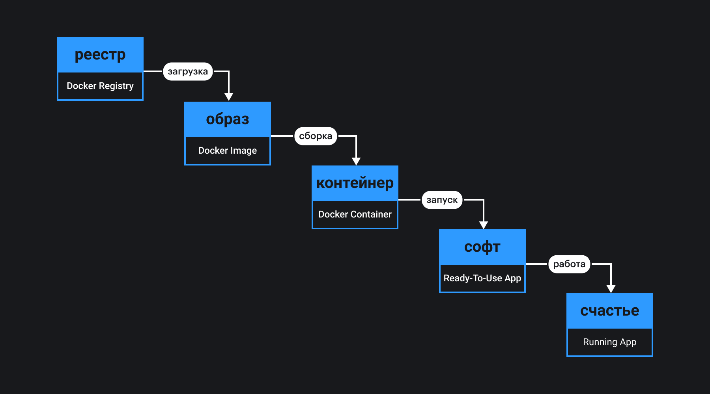

## Кратко

Docker — это технология, которая позволяет создавать и использовать приложения в «родном» окружении. В основе Docker лежит идея: если приложение работает у вас, то оно должно работать где угодно. Способ этого добиться очень простой: нужно упаковать настройки окружения вместе с приложением.

Docker чаще всего используют для развёртывания серверных приложений. Во фронтенде он пригодится для:

- сборки [бандлов](/tools/bundlers/);
- [статического анализа кода](/tools/static-analysis/);
- [тестирования приложений](/tools/how-to-test-and-why/);
- подготовки ресурсов (картинок, шрифтов, иконок и других);
- воспроизводимых экспериментов с новыми технологиями и демок;
- настройки инфраструктуры разработчика (редактора кода, [Node.js](/tools/nodejs/), [пакетных менеджеров](/tools/package-managers/), линтеров и прочего).

## Как начать

Установите Docker:

- Windows — [Docker Desktop for Windows](https://docs.docker.com/desktop/setup/install/windows-install/);
- macOS — [Docker Desktop for Mac](https://docs.docker.com/desktop/setup/install/mac-install/);
- Linux — в зависимости от дистрибутива: [Debian](https://docs.docker.com/engine/install/debian/), [Fedora](https://docs.docker.com/engine/install/fedora/), [RHEL](https://docs.docker.com/engine/install/rhel/), [Ubuntu](https://docs.docker.com/engine/install/ubuntu/) и [другие](https://docs.docker.com/engine/install/).

На Linux можно поставить и Docker Desktop.

Запустите Docker и проверьте, что он работает: откройте [Dashboard](https://docs.docker.com/desktop/use-desktop/) или выполните в терминале команду (для всех операционных систем):

```bash
docker version
```

Если в ответе есть блок `Server`, движок Docker запущен и работает.

У создателей Docker есть готовая демка, которую можно запустить командой:

```bash
docker run -d -p 8080:80 docker/welcome-to-docker
```

Ключ `-d` запускает контейнер в фоне. Ключ `-p 8080:80` связывает порт 8080 вашего компьютера с портом 80 внутри контейнера.

Теперь можно открыть в браузере приветственную страницу Docker по адресу [http://localhost:8080](http://localhost:8080).

## Как понять

Запуск готового веб-приложения — самый частый способ работы с Docker. Демка Docker — самое простое, что можно сделать «из коробки». Вам не пришлось ставить веб-сервер и Node.js. Не пришлось разбираться с настройками.

Теперь представьте, что вы передали проект другому разработчику. У него проект просто запускается. Вам не приходится говорить: «А у меня всё работало 😞».

Без Docker вы, скорее всего, действовали бы так:

1. узнали операционную систему на компьютере разработчика;
1. написали скрипт или инструкцию, как настроить окружение;
1. протестировали, как развёртывается ваше приложение;
1. передали приложение разработчику и ждали результаты.

Ситуация будет ещё сложнее, если вы и другой разработчик используете разные операционные системы. С Docker всё намного проще! Вы создаёте конфигурацию, и если она работает у вас, то заработает и у других 😇

Разберёмся, что произошло, когда вы выполнили команду `docker run`:

1. Docker нашёл образ `docker/welcome-to-docker` в реестре образов Docker Hub и загрузил его. _Образ_ (Docker Image) — это приложение, заботливо упакованное вместе с окружением. Окружение — всё, что нужно для запуска: обычно файлы Linux, утилиты, службы и зависимости проекта.
1. Docker создал _контейнер_ (Docker Container) на основе образа. Контейнер — это конкретный экземпляр образа на вашем компьютере. Отношение «образ — контейнер» примерно такое же, как у пары «класс — объект класса» в [ООП](/tools/oop/).
1. Docker запустил контейнер с веб-сервером Nginx внутри, и приветственная страница Docker заработала. Для вашей операционной системы запустить контейнер — это всё равно что запустить любое приложение или сервис.



Перед тем, как мы научимся готовить образ сами, нужно разобраться с терминами. Лучше сделать это на берегу 😎

### Из чего состоит Docker

**Движок Docker Engine** — приложение для управления объектами Docker. В него входят три компонента:

1. сервер (Docker Daemon);
1. программный интерфейс (Docker API);
1. консольный клиент (Docker CLI).

Ваш компьютер называется _Docker Host_. Команды из графического интерфейса или [консоли](https://docs.docker.com/reference/cli/docker/) сервер выполняет через [API движка](https://docs.docker.com/reference/api/engine/).

**Docker Desktop** — пакет приложений с графическим интерфейсом. В него входят:

- специальная виртуальная машина для работы с движком;
- визуальный интерфейс (Dashboard);
- консольный клиент;
- инструменты для работы с реестром Docker Hub и другое.

Ядра операционной системы в образе нет: контейнеры используют ядро Linux того компьютера, на котором запущены. Поэтому на Mac и Windows Docker Engine напрямую не работает: ему нужна виртуальная машина с Linux. Docker Desktop запускает её сам, а на Windows обычно использует для этого подсистему Windows для Linux (WSL 2). Из-за виртуальной машины у Docker Desktop есть ограничения, например в работе с сетью и файлами компьютера.

### Объекты Docker

**Образ (Docker Image)** — прототип будущего контейнера. В нём лежат файлы операционной системы, приложение или проект для сборки приложения.

Образ состоит из слоёв. Нижний слой — _базовый образ_, например образ операционной системы. Каждый следующий слой — надстройка над предыдущим. Вместе слои образуют новый образ.

Слои образа описывают в файле конфигурации, обычно это Dockerfile. Он начинается с директивы `FROM` и имени базового образа. Дальше идут надстройки — новые слои:

- `WORKDIR` задаёт рабочую папку проекта;
- `RUN` выполняет команды в терминале;
- `COPY` копирует файлы в рабочую папку.

Пример конфигурации:

```dockerfile
FROM ubuntu:24.04
WORKDIR /app
RUN apt-get update && apt-get install -y curl
COPY . .
```

Чтобы `COPY . .` не положил в образ лишнее, например файл `.env` с паролями, перечислите это в файле `.dockerignore`. Подробнее о директивах — в статье «[Как устроен Dockerfile](/tools/dockerfile/)».

Учтите: по умолчанию образ собирают под процессор вашего компьютера. Образ, собранный на Mac с Apple Silicon, не запустится на сервере с процессором x86-64. Для такого сервера соберите образ с ключом `--platform linux/amd64` или сделайте [сборку под несколько платформ](https://docs.docker.com/build/building/multi-platform/).

**Контейнер (Docker Container)** — приложение в изолированном окружении, которое Docker собирает послойно по образу. Контейнер может быть запущен или остановлен.

Файловая система контейнера тоже стековая ([Union File Systems](https://www.terriblecode.com/blog/how-docker-images-work-union-file-systems-for-dummies/)). Папки и файлы слоёв образа накладываются друг на друга и образуют единое целое.

**Том (Docker Volume)** — хранилище для файлов, которое можно подключить (говорят _«примонтировать»_) к контейнерам. Файлы внутри контейнера пропадают, когда контейнер удаляют, а файлы в томе остаются. Поэтому в томах хранят базы данных и всё, что нельзя потерять после окончания работы приложения.

Томами управляет Docker и хранит их в своей папке, а в Docker Desktop — внутри виртуальной машины. Один том можно подключить к нескольким контейнерам. Похожим способом к контейнеру можно подключить и обычную папку с вашего компьютера.

**Сеть (Docker Network)** — виртуальная локальная сеть. Через неё контейнеры общаются друг с другом и с вашим компьютером. Чаще всего вам понадобятся три режима сети:

1. `bridge` — сеть, в которой контейнеры общаются между собой, например веб-сервер и база данных. В стандартной сети `bridge` они видят друг друга только по IP-адресу. По имени — только в пользовательской сети, её создаёт команда `docker network create` или Docker Compose.
1. `host` — контейнер использует сеть вашего компьютера напрямую. В Docker Desktop такая сеть есть с версии 4.34, но её нужно включить в настройках.
1. `none` — сеть для контейнеров полностью отключена.

### Инструменты

**Docker Hub** — официальный [реестр образов](https://hub.docker.com/), там хранят опубликованные образы. Есть и другие публичные реестры:

- [GitHub Container Registry](https://docs.github.com/en/packages/working-with-a-github-packages-registry/working-with-the-container-registry);
- [Google Artifact Registry](https://cloud.google.com/artifact-registry);
- [Azure Container Registry](https://azure.microsoft.com/products/container-registry);
- [IBM Cloud Container Registry](https://www.ibm.com/products/container-registry);
- [Yandex Container Registry](https://yandex.cloud/ru/services/container-registry).

Предпочитайте официальные образы (Docker Official Images). Docker их проверяет, а обновляют авторы проектов вместе с командой Docker. Такие образы относительно безопасны. Для фронтенд-разработчика могут быть интересны:

- [Node](https://hub.docker.com/_/node);
- [MongoDB](https://hub.docker.com/_/mongo);
- [Drupal](https://hub.docker.com/_/drupal);
- [Python](https://hub.docker.com/_/python);
- [PHP](https://hub.docker.com/_/php);
- [Ruby](https://hub.docker.com/_/ruby).

**Docker CLI** — консольный клиент Docker. Основные команды:

- [`docker ps`](https://docs.docker.com/reference/cli/docker/container/ls/);
- [`docker run`](https://docs.docker.com/reference/cli/docker/container/run/);
- [`docker image`](https://docs.docker.com/reference/cli/docker/image/);
- [`docker container`](https://docs.docker.com/reference/cli/docker/container/);
- [`docker volume`](https://docs.docker.com/reference/cli/docker/volume/).

## Как пользоваться

У всех объектов похожие подкоманды:

- `ls` выводит список объектов;
- `rm` удаляет конкретные объекты;
- `prune` удаляет неиспользуемые объекты.

У контейнеров, образов и сетей есть уникальный ID.

### Список контейнеров

- `docker ps` выводит запущенные контейнеры;
- `docker ps -a` — ключ `-a` выводит и запущенные, и остановленные контейнеры;
- `docker ps -s` — ключ `-s` показывает, сколько места на диске занимает каждый контейнер;
- `docker ps -f name=hello` — ключ `-f` фильтрует список контейнеров по имени, например `hello`.

Все ключи `docker ps` — [в документации](https://docs.docker.com/reference/cli/docker/container/ls/).

### Запуск контейнеров

Чтобы создать и запустить контейнер из образа, который есть у вас локально или на Docker Hub, выполните команду:

```bash
docker run --name test -i -t ubuntu
```

Ключ `--name` задаёт имя контейнера. Если вы не назовёте контейнер сами, Docker придумает ему случайное имя вида `elegant_turing`. Имя должно быть уникальным: два контейнера с одним именем создать нельзя.

Ключ `-i` оставляет открытым [стандартный поток ввода](https://ru.wikipedia.org/wiki/Стандартные_потоки), а `-t` подключает [терминал TTY](https://ru.wikipedia.org/wiki/TTY-абстракция).

Чтобы при запуске подключить к контейнеру текущую папку вашего компьютера, а потом получить доступ к контейнеру через терминал, выполните команду:

```bash
docker run -i -t \
  --mount type=bind,src="$(pwd)",dst=/app ubuntu bash
```

Все ключи `docker run` — [в документации](https://docs.docker.com/reference/cli/docker/container/run/).

### Управление образами

Список локальных образов выводит команда:

```bash
docker image ls
```

Команда `rm` удаляет конкретные образы, а `prune` — образы без тега, то есть без имени вроде `ubuntu:24.04`. Ещё несколько команд для образов:

- `docker image pull ubuntu` загружает образ `ubuntu` из реестра;
- `docker image push my-name/my-app` отправляет ваш образ в реестр;
- `docker image inspect ubuntu` выводит полную информацию об образе `ubuntu`;
- `docker image build .` собирает образ из текущей папки по Dockerfile.

Все подкоманды `docker image` — [в документации](https://docs.docker.com/reference/cli/docker/image/).

### Управление контейнерами

Чаще всего вы будете запускать и останавливать контейнеры. В примерах ниже — контейнер `test`, который мы создали выше.

Команда для запуска остановленного контейнера:

```bash
docker container start test
```

Команда для перезапуска контейнера:

```bash
docker container restart test
```

Команда для постановки контейнера на паузу:

```bash
docker container pause test
```

Команда для снятия с паузы:

```bash
docker container unpause test
```

Команда для остановки контейнера:

```bash
docker container stop test
```

Все подкоманды `docker container` — [в документации](https://docs.docker.com/reference/cli/docker/container/).

### Управление томами

- `docker volume ls` выводит все тома;
- `docker volume ls -f name=hello` выводит тома, отфильтрованные по имени, например `hello`;
- `docker volume create hello` создаёт новый том, например `hello`;
- `docker volume inspect hello` выводит всю информацию о томе.

Все подкоманды `docker volume` — [в документации](https://docs.docker.com/reference/cli/docker/volume/).
