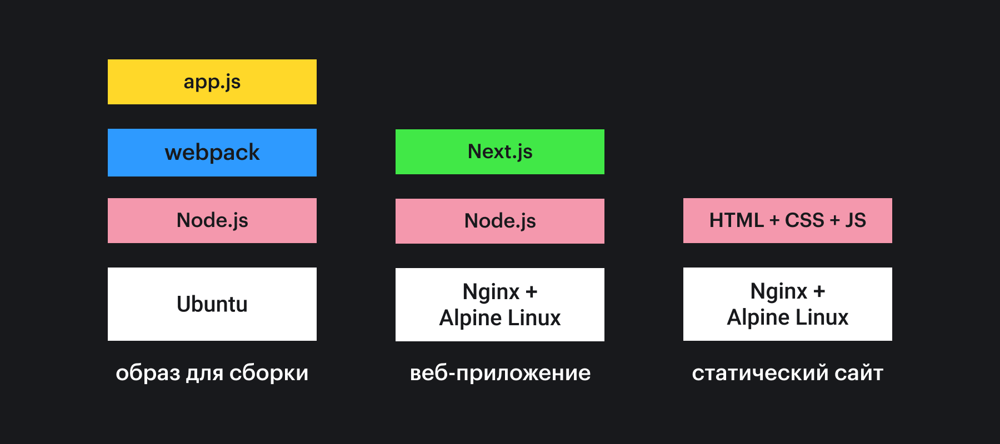
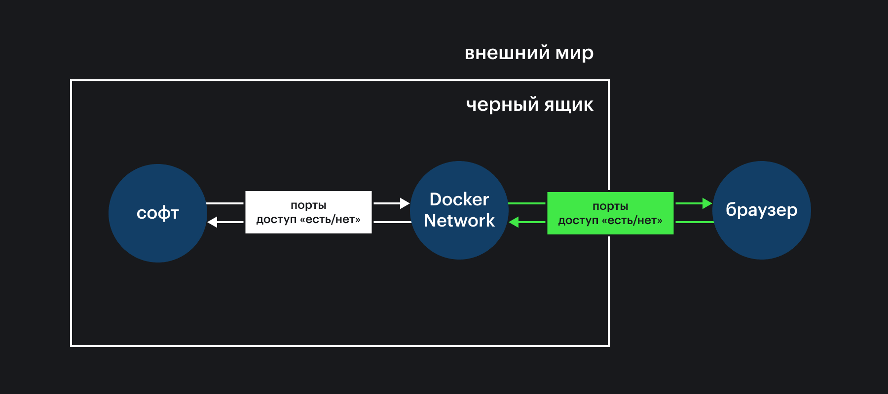

## Кратко

`Dockerfile` — это текстовый файл, в котором описан рецепт создания образа Docker. Рецепт состоит из инструкций, которые выполняются последовательно. Они содержат информацию об операционной системе, выбранной платформе, фреймворках, библиотеках, инструментах, которые нужно установить.

`Dockerfile` позволяет создавать одинаковое окружение для работы программы на любой машине, где запускают образ. Прочитайте [обзорную статью о Docker](/tools/docker/), чтобы лучше разобраться, зачем это нужно.

## Как понять

Под капотом веб-приложения — набор программ, которые работают вместе. Если одна из них сломается, пользователь не сможет заказать еду или посмотреть видео. Поэтому приложение должно вести себя одинаково на любой машине.

Docker создаёт одинаковые условия для приложения на компьютере разработчика и на сервере. Приложение работает в контейнере. Контейнер запускают из образа. Образ описывают в `Dockerfile` набором инструкций.

Каждая инструкция занимает одну строку. Сначала идёт имя инструкции, затем её аргументы:

```dockerfile
# Комментарий
INSTRUCTION arguments
```

Образ Docker легче всего представить в виде слоёного пирога или бургера: каждая инструкция `RUN`, `COPY` или `ADD` — новый слой. Образы для типичного веб-приложения собирают примерно так:



Эти инструкции меняют файловую систему. Остальные в основном меняют настройки образа.

Слои хранятся отдельно и только для чтения. При запуске контейнера Docker накладывает их друг на друга и сверху добавляет слой для записи. Для этого он использует механизм [Union File Systems](https://www.terriblecode.com/blog/how-docker-images-work-union-file-systems-for-dummies/).

Концепция слоёв помогает Docker экономно хранить данные на диске. Docker загружает только те слои, которых не было на компьютере прежде. При этом слой из одного образа может подойти и к другому.

После того как слои образа описаны в `Dockerfile`, нужно собрать образ командой:

```bash
docker build .
```

## Как пишется

Работу с `Dockerfile` можно разбить на два этапа: описание инструкций и сборка образа. Набор инструкций — последовательность действий, чтобы собрать образ.

### Описание инструкций `Dockerfile`

#### `FROM`. Установка базового образа

`Dockerfile` обычно начинается с инструкции `FROM`. Эта инструкция задаёт базовый образ.

Базовым образом может быть образ с чистой операционной системой, образ с уже установленной и настроенной платформой или любой другой образ. Вот так можно установить Ubuntu 24.04 как базовый образ:

```dockerfile
FROM ubuntu:24.04
```

Для веб-приложения на [Node.js](/tools/nodejs/) обычно используют [официальный образ от команды Docker](https://hub.docker.com/_/node):

```dockerfile
FROM node:lts
```

Тег `lts` выбирает последнюю версию Node.js с долгой поддержкой. Без тега Docker возьмёт `latest`, а это может быть версия без долгой поддержки.

#### `RUN`. Запуск команд терминала

Инструкция `RUN` позволяет запускать команды терминала при сборке. Это самая частая инструкция: ей можно создать папку, установить недостающие пакеты или запустить shell-скрипт.

Например, установим платформу Node.js поверх образа с чистой Ubuntu:

```dockerfile
FROM ubuntu:24.04
RUN apt-get update \
  && DEBIAN_FRONTEND=noninteractive \
  apt-get install -y nodejs npm
```

При сборке в образ установится Node.js из репозитория Ubuntu. В Ubuntu 24.04 это Node.js 18, его поддержка закончилась в 2025 году. Поэтому для приложений на Node.js удобнее взять официальный образ `node`. Флаг `-y` автоматически отвечает «да» на вопросы `apt-get`, а `DEBIAN_FRONTEND=noninteractive` отключает остальные вопросы, например о часовом поясе: при сборке ответить на них некому.

#### `COPY` и `ADD`. Копирование файлов проекта

Инструкции `COPY` и `ADD` позволяют перенести файлы с компьютера, который запускает сборку, внутрь образа.

Например, перенесём всё содержимое папки, где лежит `Dockerfile`, в папку `/app` внутри образа:

```dockerfile
FROM ubuntu:24.04
RUN apt-get update \
  && DEBIAN_FRONTEND=noninteractive \
  apt-get install -y nodejs npm
COPY . /app
```

<aside>

☝️ Для файлов проекта используйте `COPY`: она только копирует файлы и папки. Инструкция `ADD` умеет больше: скачивает файлы по ссылке и распаковывает локальные архивы. Берите её, когда это и нужно, например чтобы скачать файл при сборке.

</aside>

#### `ENTRYPOINT` и `CMD`. Запуск приложения

После того как образ готов, нужно запустить приложение, которое в нём содержится. Для этого используют одну из двух инструкций: `ENTRYPOINT` и `CMD`.

Инструкция `ENTRYPOINT` запускает приложение при старте контейнера:

```dockerfile
FROM ubuntu:24.04
RUN apt-get update \
  && DEBIAN_FRONTEND=noninteractive \
  apt-get install -y nodejs npm
COPY . /app
ENTRYPOINT ["node", "/app/app.js"]
```

`RUN` выполняется при сборке образа, а `ENTRYPOINT` — при каждом запуске контейнера. Параметры, которые вы допишете в команду запуска контейнера, Docker передаст команде из `ENTRYPOINT`.

Так в образ удобно упаковать утилиту и запускать её для файлов со своего компьютера. Например, утилиту для проверки орфографии [yaspeller](https://github.com/hcodes/yaspeller/blob/master/README.ru.md). В примере ниже она проверяет слова на русском и английском языках в файлах `*.md` и `*.txt`. Текст она отправляет в сервис Яндекс.Спеллер, поэтому контейнеру нужен интернет:

```dockerfile
FROM node:lts
RUN npm install yaspeller -g
ENTRYPOINT ["yaspeller", "--file-extensions", ".md,.txt"]
```

Затем соберите образ, указав явно имя образа для удобства:

```bash
docker build -t yaspeller .
```

Контейнер не видит файлы компьютера, поэтому текущую папку нужно подключить к контейнеру. Теперь проверить орфографию в файлах `*.md` и `*.txt` текущей папки можно командой:

```bash
docker run --rm -v "$(pwd)":/data -w /data yaspeller .
```

Вместо `.` можно писать название файла или папки. Флаг `-v` подключает текущую папку к `/data` внутри контейнера, а `-w` делает её рабочей. Флаг `--rm` удаляет контейнер после завершения работы, чтобы остановленные контейнеры не копились в системе.

Инструкция `CMD` тоже задаёт команду запуска:

```dockerfile
FROM ubuntu:24.04
RUN apt-get update \
  && DEBIAN_FRONTEND=noninteractive \
  apt-get install -y nodejs npm
COPY . /app
CMD ["node", "/app/app.js"]
```

Разница в том, насколько легко заменить команду. `CMD` — команда по умолчанию. Если при запуске контейнера указать свою команду, Docker выполнит её вместо `CMD`. Например, если образ называется `my-app`, эта команда вместо приложения покажет файлы папки `/app`:

```bash
docker run my-app ls /app
```

`ENTRYPOINT` так просто не заменить: для этого нужен флаг `--entrypoint`.

`ENTRYPOINT` и `CMD` можно записать в двух режимах:

- Массивом строк, это exec-режим: `["node", "app.js"]`. Docker запускает команду напрямую, и приложение получает [сигналы Linux](https://ru.wikipedia.org/wiki/Сигнал_(Unix)), например на остановку.
- Строкой, это shell-режим: `node app.js`. Docker запускает команду через `/bin/sh -c`, и сигналы до приложения не доходят.

Пишите в exec-режиме. Но даже в нём Node.js работает в контейнере как главный процесс и без обработчика не завершается по сигналу остановки. Добавьте в код обработчик сигнала или запускайте контейнер с флагом `--init`.

Если в `Dockerfile` есть `ENTRYPOINT`, строки массива `CMD` станут для него аргументами по умолчанию. Так работает только exec-режим: `ENTRYPOINT` в shell-режиме игнорирует `CMD`.

Например:

```dockerfile
ENTRYPOINT ["yaspeller", "--file-extensions", ".md,.txt"]
CMD ["."]
```

Теперь `.` в конце команды запуска можно не писать. Если после имени образа нет аргументов, Docker подставит `.` из `CMD`, и yaspeller проверит рабочую папку `/data`. Имя файла или папки после имени образа заменит `.`.

<aside>

☝️ Основную команду образа пишите в `ENTRYPOINT`. Команду или параметры, которые пользователь может поменять, пишите в `CMD`.

</aside>

#### `ENV`. Переменные окружения

Переменные окружения задаёт инструкция `ENV`.

Через переменные окружения передают режим работы, адреса сервисов и другие настройки. Например, режим работы приложения Node.js для конечного пользователя задают так:

```dockerfile
FROM ubuntu:24.04
RUN apt-get update \
  && DEBIAN_FRONTEND=noninteractive \
  apt-get install -y nodejs npm
COPY . /app
ENV NODE_ENV=production
CMD ["node", "/app/app.js"]
```

Пароли и ключи доступа через `ENV` передавать нельзя: они останутся в образе и будут видны в `docker inspect`.

#### `WORKDIR`. Рабочая папка проекта

Инструкция `WORKDIR` задаёт рабочую папку приложения. Все инструкции после неё будут выполняться относительно этой папки.

Устанавливать рабочую папку — хороший тон. Так сразу видно, где лежит приложение и откуда выполняются команды. Добавим её в `Dockerfile`:

```dockerfile
FROM ubuntu:24.04
RUN apt-get update \
  && DEBIAN_FRONTEND=noninteractive \
  apt-get install -y nodejs npm
WORKDIR /app
COPY . .
ENV NODE_ENV=production
CMD ["node", "app.js"]
```

#### `USER`. Запуск от имени пользователя

По умолчанию процесс в контейнере работает от имени `root`. Если приложению не нужны особые права, запускайте его от обычного пользователя инструкцией `USER`. Например, если вы хотите запускать приложение от имени пользователя `node_user`, то `Dockerfile` будет выглядеть так:

```dockerfile
FROM ubuntu:24.04
RUN apt-get update \
  && DEBIAN_FRONTEND=noninteractive \
  apt-get install -y nodejs npm
RUN useradd --create-home node_user
WORKDIR /app
COPY . .
ENV NODE_ENV=production
USER node_user
CMD ["node", "app.js"]
```

#### `EXPOSE`. Порт приложения

У контейнера своя сеть, отдельная от компьютера. Чтобы открыть приложение из контейнера в браузере, запросы нужно «пробросить» внутрь контейнера, а ответы — наружу. Для этого Docker перенаправляет запросы и ответы через виртуальную сеть (Docker Network):



Инструкция `EXPOSE` сообщает, на каком порту приложение в контейнере ждёт запросы:

```dockerfile
FROM ubuntu:24.04
RUN apt-get update \
  && DEBIAN_FRONTEND=noninteractive \
  apt-get install -y nodejs npm
RUN useradd --create-home node_user
WORKDIR /app
COPY . .
ENV NODE_ENV=production
USER node_user
EXPOSE 8080
CMD ["node", "app.js"]
```

Сама по себе запись `EXPOSE 8080` порт не открывает: это документация для тех, кто запускает образ. Чтобы веб-приложение стало доступно по адресу `http://localhost:8080`, порт пробрасывают флагом `-p` при запуске контейнера. Здесь `my-app` — имя образа, которое задают при сборке флагом `-t`:

```bash
docker run -p 8080:8080 my-app
```

Приложение внутри контейнера должно слушать адрес `0.0.0.0`, а не `localhost`. Иначе запросы снаружи до него не дойдут.

#### `ARG`. Аргументы сборки

Некоторые параметры меняются от сборки к сборке. Их передают в `docker build` флагом `--build-arg`, а в `Dockerfile` объявляют инструкцией `ARG`. Например, передадим в сборку имя пользователя:

```bash
docker build -t my-app --build-arg user=node_user .
```

В `Dockerfile` объявим аргумент инструкцией `ARG`:

```dockerfile
FROM ubuntu:24.04
RUN apt-get update \
  && DEBIAN_FRONTEND=noninteractive \
  apt-get install -y nodejs npm
# Значение по умолчанию 'deploy' (можно не указывать)
ARG user=deploy
RUN useradd --create-home $user
WORKDIR /app
COPY . .
ENV NODE_ENV=production
USER $user
EXPOSE 8080
CMD ["node", "app.js"]
```

Так нельзя передавать секреты. Их видно в истории образа:

```bash
docker history my-app
```

Секреты для сборки передают отдельным механизмом: флагом `--secret` команды `docker build` и инструкцией `RUN --mount=type=secret`. Подробнее — в [документации Docker](https://docs.docker.com/build/building/secrets/).

#### Многоэтапная сборка образа

Чтобы образ получился меньше, его можно собирать в несколько этапов. Например, собрать веб-приложение в Node.js на первом этапе, а на втором — запустить готовый бандл на веб-сервере. Во второй образ попадёт только то, что скопировали из первого. Сам Node.js и зависимости для сборки останутся в промежуточном образе, а итоговый образ будет занимать мало места:

```dockerfile
# Сборка проекта на платформе Node.js
FROM node:lts-alpine AS build-stage
WORKDIR /app
COPY package*.json ./
RUN npm install
COPY . .
RUN npm run build

# Запуск приложения на сервере
FROM nginx:stable-alpine AS production-stage
COPY --from=build-stage /app/dist /usr/share/nginx/html
EXPOSE 80
CMD ["nginx", "-g", "daemon off;"]
```

По имени `build-stage` второй этап забирает файлы из первого: `COPY --from=build-stage`. Папка _dist_ зависит от сборщика проекта: у вашего она может называться иначе.

### Рекомендации

Чтобы использовать образы эффективнее, следуйте рекомендациям команды Docker:

1. Создавайте образы так, чтобы контейнер можно было в любой момент остановить, удалить и запустить заново. Образ не должен хранить внутреннее состояние. Настройки передавайте при запуске контейнера через переменные окружения, а данные храните в томах Docker.
2. Выбирайте базовый образ из надёжного источника, например официальный. Чем меньше базовый образ, тем меньше итоговый.
3. Регулярно собирайте образ заново с флагом `--pull`: так Docker скачает свежую версию базового образа с исправлениями безопасности.
4. Используйте файл `.dockerignore`, чтобы Docker не передавал в сборку лишние файлы и папки.
5. Собирайте приложение в несколько этапов: так образ станет заметно меньше.
6. Не устанавливайте то, что не будете использовать в образе.
7. Запускайте в одном контейнере одно приложение. Например, базу данных и веб-сервер держите в разных контейнерах.
8. Объединяйте связанные команды в одну инструкцию `RUN`: например, `apt-get update` и `apt-get install`. Так `apt-get install` не возьмёт из кеша сборки устаревший слой с `apt-get update`. Чтобы образ стал меньше, в той же инструкции удаляйте списки пакетов: `rm -rf /var/lib/apt/lists/*`.
9. Если аргументы инструкции занимают несколько строк (перенос — символ `\`), выстраивайте их по алфавиту. Так проще заметить повторы и обновлять список.
10. Пользуйтесь кешем сборки: ставьте инструкции, которые меняются редко, выше тех, что меняются часто. Если нужно собрать образ совсем без кеша, добавьте флаг `--no-cache` в команду `docker build`.

### Сборка образа

Образ Docker можно собрать тремя способами:

- указав путь к папке `PATH`;
- указав путь к репозиторию `URL`;
- используя стандартный поток ввода `-`.

Чаще всего указывают путь к папке. Самая простая команда для сборки образа:

```bash
docker build .
```

Точка в конце — путь к контексту сборки. Контекст — это файлы и папки, которые Docker передаёт в сборку. Без флага `--from` инструкция `COPY` берёт файлы только из контекста. По умолчанию Docker ищет `Dockerfile` в корне контекста.

#### Использование нескольких `Dockerfile`

Иногда в одном проекте нужно несколько вариантов сборки, и для каждого пишут свой файл с инструкциями. Другое имя файла или путь к нему внутри `PATH` передают флагом `-f`:

```bash
docker build -f containers/dockerfile-mode-1 .
```

Точно так же можно указать относительный путь для проекта или репозитория по `URL`. Например, Docker может скачать не только репозиторий [Git](/tools/version-control/), но и произвольный архив с проектом, распаковать его и собрать образ:

```bash
docker build -f ctx/Dockerfile https://example.com/ctx.tar.gz
```

Архив должен быть в формате tar: без сжатия или сжатый bzip2, gzip, xz.

А можно собрать образ совсем без контекста, из стандартного потока ввода:

```bash
docker build - < Dockerfile
```

#### Исключение файлов из сборки `.dockerignore`

Если вам не нужно передавать в сборку какие-то папки или файлы из контекста, добавьте в папку файл исключений `.dockerignore`. В нём на отдельных строках пишут пути или маски путей, которые не должны попасть в контекст, а значит, и в образ. Пример файла:

```bash
# Комментарий
node_modules
.git
.env
*/temp*
*/*/temp*
temp?
```

- `node_modules`, `.git` и `.env` исключают зависимости, историю Git и файл с секретами. Зависимости ставят внутри образа, а секретам в нём не место.
- `*/temp*` исключает файлы и папки, имена которых начинаются на `temp`, в любой папке первого уровня. Например, `/somedir/temporary.txt` или `/somedir/temp`.
- `*/*/temp*` делает то же, но для папок второго уровня.
- `temp?` исключает файлы и папки в корне контекста с именем из пяти символов: `temp` и ещё один любой символ. Например, `temp1` или `tempA`.
