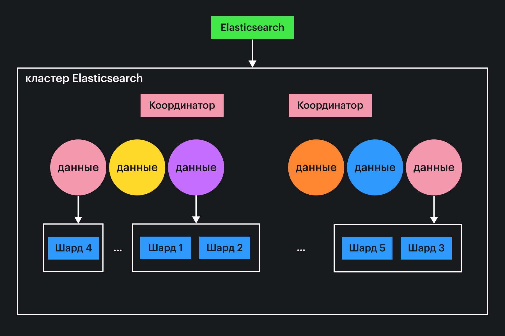

## Кратко

[Elasticsearch](https://www.elastic.co/elasticsearch/) (далее _ES_) — масштабируемая поисковая система. Её также можно отнести к нереляционным (NoSQL) базам данных.

В основном ES используют для полнотекстового поиска по документам: с учётом релевантности, форм слова («ноутбук», «ноутбука», «ноутбуки»), дат, диапазонов и так далее. Документ здесь — это просто набор полей. Ещё ES подходит для анализа логов и векторного поиска (поиска по смыслу, а не по словам).

ES написан на Java. С данными он работает через [JSON](/tools/json/) [REST API](/tools/api/), а для полнотекстового поиска использует [Lucene](https://lucene.apache.org/).

## Как понять

ES ищет по документам почти в реальном времени (_near real-time_) и горизонтально масштабируется: чтобы выдержать больше данных и запросов, в него добавляют новые серверы. Но главное в нём — работа с текстом.

В основе работы с текстом лежит анализатор — цепочка обработчиков. Сначала отданный в ES текст проходит **символьные фильтры**, которые обрабатывают отдельные символы. Например, можно заменить одни символы другими или удалить HTML-теги.

Затем текст попадает к **токенизатору**: он убирает спецсимволы и знаки препинания и по заданным правилам делит текст на отдельные слова-токены.

Затем токены проходят через один или несколько **фильтров токенов**, которые могут изменять токены. Например, можно привести слова к нижнему регистру или добавить фильтр стоп-слов, который удаляет предлоги, союзы и другие частые слова. На выходе из анализатора получается набор токенов. ES добавляет его в поисковый индекс.

Архитектура ES в двух словах:

- Данные лежат в поисковых индексах.
- Индекс делится на части — шарды.
- Каждый запущенный процесс ES — узел. На узле может быть несколько шардов, ES распределяет их сам.
- Узлы вместе образуют кластер.
- У шардов есть копии — реплики. ES раскладывает их по разным узлам кластера.

Поэтому при сбое одного узла кластер не теряет данные и продолжает работать. На одном узле реплику разместить негде, и такой защиты нет.



На схеме: запросы приходят в кластер на узлы-координаторы. Координатор передаёт запрос узлам с данными и собирает их ответы в один. Отдельные узлы-координаторы ставить необязательно: эту роль может выполнять любой узел кластера.

## Как начать

Инструкция по установке ES [есть на сайте разработчика](https://www.elastic.co/downloads/elasticsearch). Отдельно ставить Java не нужно: начиная с версии 7.0 в дистрибутив ES встроена своя Java (JDK).

С версии 8.0 безопасность в ES включена по умолчанию. При первом запуске ES создаёт пользователя `elastic` и печатает его пароль в терминале. Пароль ES покажет один раз. Потеряли его — сбросьте командой `bin/elasticsearch-reset-password -u elastic`.

Ещё ES включает HTTPS. Для этого он создаёт свой удостоверяющий центр и подписывает им [сертификат](/tools/ssl-certificates/) сервера. Удостоверяющий центр подтверждает, что сертификат настоящий. Сертификат удостоверяющего центра лежит в файле _http_ca.crt_.

Проверять, что ES работает, нужно по HTTPS, с сертификатом и паролем. Где лежит файл _http_ca.crt_:

- если ES установлен из архива — в папке _config/certs_ внутри папки ES;
- если из пакета deb или rpm — в папке _/etc/elasticsearch/certs_.

Укажите путь к нему в параметре `--cacert`:

```bash
curl --cacert http_ca.crt -u elastic https://localhost:9200
```

Утилита `curl` спросит пароль пользователя `elastic`. В ответ ES пришлёт информацию о себе. Вот её часть. Номер версии и другие значения у вас будут свои:

```json
{
  "name" : "YOUR_PC_NAME",
  "cluster_name" : "elasticsearch",
  "version" : {
    "number" : "9.x.x"
  },
  "tagline" : "You Know, for Search"
}
```

Альтернативный способ — запустить ES в контейнере [Docker](/tools/docker/). Инструкция по запуску есть в [документации по ES](https://www.elastic.co/docs/deploy-manage/deploy/self-managed/install-elasticsearch-with-docker). Официальный образ лежит в реестре Elastic, копия — на [Docker Hub](https://hub.docker.com/_/elasticsearch).

Файл _http_ca.crt_ в этом случае лежит внутри контейнера. Скопируйте его к себе командой:

```bash
docker cp \
  es01:/usr/share/elasticsearch/config/certs/http_ca.crt .
```

Здесь `es01` — имя контейнера, подставьте своё.

Скрипт быстрого локального запуска из документации (`start-local`) запускает ES без HTTPS, по адресу `http://localhost:9200`. Пароль пользователя `elastic` скрипт сохраняет в файл _.env_ в папке _elastic-start-local_. В этом случае проверяйте ES командой `curl` без `--cacert`, а в примерах ниже уберите из настроек клиента блок `tls` и пишите адрес с `http`.

## Как использовать

Создадим и настроим индекс, сохраним в него документы и найдём их. Используем [Node.js](/tools/nodejs/).

Создадим проект _elastic-js_ в текущей папке, включим в нём [JavaScript-модули](/js/modules/) и установим клиент ES:

```bash
mkdir elastic-js && cd elastic-js

npm init -y
npm pkg set type=module
npm install @elastic/elasticsearch
```

Мажорная версия клиента должна совпадать с версией ES, а минорная — быть не выше неё. Команда выше поставит последнюю версию клиента. Если ваш ES более ранней версии, укажите версию клиента явно, с мажорной и минорной частью. Например, для ES 8.15 ставьте `@elastic/elasticsearch@8.15`.

Понадобятся два файла: _functions.js_ и _index.js_. В первом опишем функции для работы с ES, во втором вызовем их. Запускать код будем командой `node index.js`.

### Подключение к ES

Для начала подключимся к ES. Скопируйте файл _http_ca.crt_ в папку проекта, а в файле _functions.js_ напишите следующий код:

```javascript
import { readFileSync } from 'node:fs'
import { Client } from '@elastic/elasticsearch'

const client = new Client({
  node: 'https://localhost:9200',
  auth: {
    username: 'elastic',
    password: process.env.ELASTIC_PASSWORD
  },
  tls: {
    ca: readFileSync('./http_ca.crt')
  }
})
```

Что здесь что:

- `node` — адрес для подключения к ES;
- `auth` — логин и пароль, которые ES напечатал при первом запуске;
- `tls.ca` — удостоверяющий центр, которому клиент будет доверять.

Пароль не храните в коде. Клиент берёт его из переменной окружения `ELASTIC_PASSWORD`. Задайте её в терминале перед запуском: `export ELASTIC_PASSWORD='ваш-пароль'`.

Пользователь `elastic` — суперпользователь, ему можно всё. Для учебного проекта это нормально. Настоящее приложение лучше подключать через API-ключ с узкими правами. Как это сделать — в [документации клиента](https://www.elastic.co/docs/reference/elasticsearch/clients/javascript/connecting).

### Создание и настройка индекса

Далее создадим поисковый индекс, в котором будут храниться документы. Напишем для этого функцию:

```javascript
export async function createIndex() {
  return await client.indices.create({
    index: 'search_index'
  })
}
```

Заодно напишем функцию для удаления индекса:

```javascript
export async function deleteIndex() {
  return await client.indices.delete({
    index: 'search_index'
  })
}
```

Теперь добавим в индекс маппинг (_mapping_) — список полей документа и их типов. По типу поля ES понимает, как его индексировать. Не будем усложнять: сохраним товары с полями `id`, `name` и `description`. Перепишем функцию `createIndex()`:

```javascript
export async function createIndex() {
  return await client.indices.create({
    index: 'search_index',
    mappings: {
      properties: {
        id: { type: 'keyword' },
        name: { type: 'text' },
        description: { type: 'text' }
      }
    }
  })
}
```

Поле типа `keyword` ES индексирует целиком, как есть, а поле `text` прогоняет через анализатор. Остальные типы данных описаны в [документации](https://www.elastic.co/docs/reference/elasticsearch/mapping-reference/field-data-types).

Теперь подключим анализатор, о котором шла речь в начале: с ним поиск станет точнее. Добавим в функцию `createIndex()` новые настройки:

```javascript
export async function createIndex() {
  return await client.indices.create({
    index: 'search_index',
    mappings: {
      properties: {
        id: { type: 'keyword' },
        name: {
          type: 'text',
          analyzer: 'ru_analyzer'
        },
        description: {
          type: 'text',
          analyzer: 'ru_analyzer'
        }
      }
    },
    settings: {
      analysis: {
        char_filter: {
          yo_char_filter: {
            type: 'mapping',
            mappings: [
              'Ё => Е',
              'ё => е'
            ]
          }
        },
        analyzer: {
          ru_analyzer: {
            type: 'custom',
            char_filter: ['yo_char_filter'],
            tokenizer: 'standard',
            filter: [
              'lowercase',
              'russian_stop',
              'russian_stemmer'
            ]
          }
        },
        filter: {
          russian_stop: {
            type: 'stop',
            stopwords: '_russian_'
          },
          russian_stemmer: {
            type: 'stemmer',
            language: 'russian'
          }
        }
      }
    }
  })
}
```

Разберём блок `analysis`:

- `char_filter` — символьный фильтр. Он заменяет «ё» на «е», чтобы слово находилось при любом написании.
- `analyzer` — сам анализатор. Он собирает цепочку из символьного фильтра, стандартного токенизатора и фильтров токенов из блока `filter`.
- `filter` — наши фильтры токенов `russian_stop` и `russian_stemmer`.
- `lowercase` — встроенный фильтр, приводит слова к нижнему регистру.
- `russian_stop` удаляет русские стоп-слова. Без `stopwords: '_russian_'` он удалял бы английские.
- `russian_stemmer` отвечает за стемминг: отрезает окончания и суффиксы и оставляет основу слова.

Имя анализатора указано в полях `name` и `description`. ES прогонит через него эти поля у новых документов и поисковый запрос.

Создадим индекс с этими настройками. Содержимое файла _index.js_:

```javascript
import { createIndex } from './functions.js'

const run = async () => {
  const result = await createIndex()
  console.log(result)
}

run()
```

Запустим `node index.js`. ES ответит, что индекс создан:

```javascript
{
  acknowledged: true,
  shards_acknowledged: true,
  index: 'search_index'
}
```

Если запустить код ещё раз, ES ответит ошибкой `resource_already_exists_exception`: индекс с таким именем уже есть. Чтобы пересоздать индекс, сначала вызовите `deleteIndex()`.

### Индексация документов

Индексация — это сохранение документов в индекс, чтобы потом по ним искать. Сам документ ES хранит без изменений в поле `_source`.

Добавим в индекс пару товаров. Для этого создадим функцию в _functions.js_:

```javascript
export async function indexDocument(data) {
  return await client.index({
    index: 'search_index',
    document: data
  })
}
```

Обновим файл _index.js_:

```javascript
import { indexDocument } from './functions.js'

const run = async () => {
  let result = await indexDocument({
    id: 1,
    name: 'Apple iPhone 12 256GB (PRODUCT)RED',
    description: 'iPhone 12. Во-первых, это быстро.'
  })
  console.log(result)

  result = await indexDocument({
    id: 2,
    name: 'Lenovo Legion 5',
    description: 'Мощный игровой ноутбук'
  })
  console.log(result)
}

run()
```

Запустим `node index.js`. ES ответит примерно так, детали у вас будут свои:

```javascript
{
  _index: 'search_index',
  _id: 'ZWgomoEBOs_ZEts5qraF',
  _version: 1,
  result: 'created',
  _shards: { total: 2, successful: 1, failed: 0 },
  _seq_no: 0,
  _primary_term: 1
}
{
  _index: 'search_index',
  _id: 'ZmgomoEBOs_ZEts5qrbI',
  _version: 1,
  result: 'created',
  _shards: { total: 2, successful: 1, failed: 0 },
  _seq_no: 1,
  _primary_term: 1
}
```

Значение `_id` ES придумал сам: поле `id` из документа он для этого не использует. Если запустить код ещё раз, в индексе появятся дубли. Чтобы задать `_id` самостоятельно, передайте в `client.index()` параметр `id`.

Новые документы попадают в поиск не сразу: по умолчанию ES обновляет индекс раз в секунду. Это и есть «почти в реальном времени» из начала статьи. Чтобы дождаться, пока документ станет виден в поиске, передайте в `client.index()` параметр `refresh: 'wait_for'`. Если по индексу не искали дольше 30 секунд, ES обновит его только при следующем поисковом запросе.

Чтобы сохранить много документов одним запросом, в ES есть [Bulk API](https://www.elastic.co/docs/api/elasticsearch/operation/operation-bulk). В этой статье его пропустим.

### Поиск документов

Теперь найдём наши документы. Добавим в _functions.js_:

```javascript
export async function search(query) {
  return await client.search({
    index: 'search_index',
    query
  })
}
```

Код файла _index.js_:

```javascript
import { search } from './functions.js'

const run = async () => {
  const query = {
    match: {
      name: 'iphone'
    }
  }

  const result = await search(query)
  console.log(result)

  const products = result.hits.hits
  console.log(products)
}

run()
```

После запуска получим ответ от ES:

```javascript
{
  took: 4,
  timed_out: false,
  _shards: { total: 1, successful: 1, skipped: 0, failed: 0 },
  hits: {
    total: { value: 1, relation: 'eq' },
    max_score: 0.8713851,
    hits: [ [Object] ]
  }
}
[
  {
    _index: 'search_index',
    _id: 'ZWgomoEBOs_ZEts5qraF',
    _score: 0.8713851,
    _source: {
      id: 1,
      name: 'Apple iPhone 12 256GB (PRODUCT)RED',
      description: 'iPhone 12. Во-первых, это быстро.'
    }
  }
]
```

Регистр в запросе не важен: фильтр `lowercase` приводит к нижнему регистру и документы, и запрос. Найденные документы лежат в поле `result.hits.hits`: так устроен ответ ES.

Теперь рассмотрим запрос посложнее:

```javascript
const query = {
  bool: {
    should: [
      {
        match_phrase: {
          name: {
            query: 'iPhone 12',
            slop: 3,
            boost: 100
          }
        }
      },
      {
        match_phrase: {
          description: {
            query: 'iPhone 12',
            slop: 3,
            boost: 1
          }
        }
      }
    ]
  }
}
```

Разберём запрос:

- `bool` с `should` — логический запрос: нас устроит первое условие ИЛИ второе.
- `match_phrase` ищет поисковую фразу целиком.
- `slop` — на сколько позиций слова фразы могут сдвинуться относительно друг друга. Со `slop: 3` запрос «iPhone 12» найдёт и «iPhone Pro 12».
- `boost` — вес условия. Совпадение в названии поднимет товар выше, чем совпадение в описании.

В ответе снова будет iPhone: фраза есть и в названии, и в описании.

Если простых весов не хватает, в ES можно описывать функции для расчёта релевантности документов. За это отвечает запрос [`function_score`](https://www.elastic.co/docs/reference/query-languages/query-dsl/query-dsl-function-score-query). Например, с ним можно поднять в выдаче свежие или популярные товары.

Запросы в ES можно вкладывать друг в друга и сочетать. Язык запросов ES (_Query DSL_) непростой, поэтому вам точно понадобится [описание возможных запросов](https://www.elastic.co/docs/explore-analyze/query-filter/languages/querydsl).
