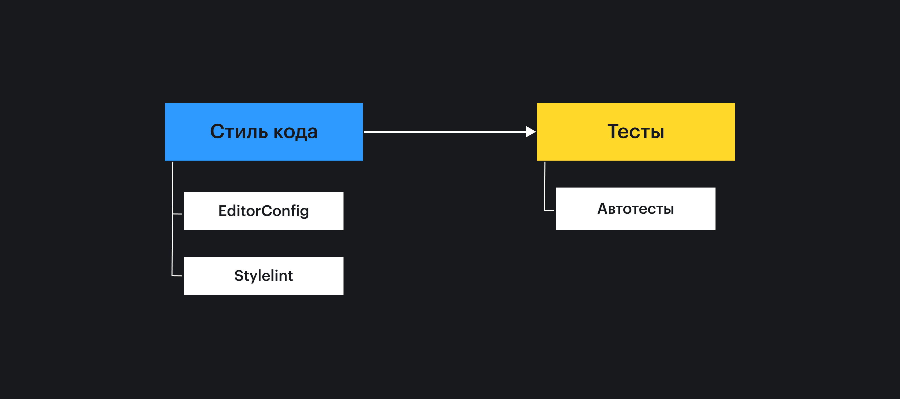

<aside>

📚 В этой статье мы говорим про инструменты CI/CD (Continuous Integration и Continuous Delivery). Так называют итерационный процесс сопровождения кода: тестирование и отладка кода, автоматизация рутинных действий, сборка приложений, размещение приложений в магазинах приложений и так далее. Подробно об этом — в статье «[Что такое CI/CD](/tools/ci-cd/)».

</aside>

## О GitLab

[GitLab](https://gitlab.com) — популярный веб-сервис для совместной разработки и поддержки программного обеспечения. В нём можно работать с [Git-репозиториями](/tools/version-control/), управлять задачами, обсуждать правки с командой и писать wiki-документацию. А ещё — оценивать качество, выпускать релизы и даже мониторить работающие программы. И всё это в одном месте.

## Кратко

GitLab CI/CD — встроенный в GitLab инструмент, который автоматизирует рутинные задачи разработки. Задачи отличаются от проекта к проекту, но чаще всего это [тестирование](/tools/how-to-test-and-why/), [статический анализ](/tools/static-analysis/), [проверка стиля написания кода](/tools/code-style/) и деплой (выпуск) приложения. GitLab CI/CD — конкурент другого популярного инструмента, [GitHub Actions](/tools/github-actions/).

## Пример

Допустим, мы договорились в команде об особых правилах оформления кода при помощи [EditorConfig](https://editorconfig.org/). Мы установили пакет для проверки этих правил как зависимость для разработки (_devDependencies_), и проверку запускает команда `npm run editorconfig`. Можно запускать проверку каждый раз перед коммитом, но кто-нибудь обязательно забудет, и неправильно оформленный код попадёт в репозиторий. Здесь поможет GitLab CI/CD: достаточно создать в корне проекта файл _.gitlab-ci.yml_:

```yaml
EditorConfig:
  image: node:lts
  script:
    - npm ci
    - npm run editorconfig
```

И теперь каждый раз, когда в репозиторий попадает новый код, GitLab проверит его по правилам и покажет ошибки в интерфейсе.

## Как пользоваться

### Основные понятия

Основная сущность GitLab CI/CD — **пайплайн** (pipeline), конвейер, который может состоять из:

- **джобов** (jobs), описывающих _что_ нужно выполнить;
- **этапов** (stages), указывающих _когда или в какой последовательности_ нужно выполнить джобы.

Джобы в одном этапе обычно выполняются параллельно. Если все джобы завершились успешно, выполнение переходит к следующему этапу и так далее. Если любой из джобов завершился ошибкой, джобы следующих этапов не запускаются, а весь пайплайн по умолчанию считается проваленным.

Результаты сборки (бинарные файлы, логи, конфигурации) передают между джобами через **артефакты**. Артефакты — файлы, которые GitLab сохраняет после джоба и отдаёт джобам следующих этапов.

### Создаём `.gitlab-ci.yml`

Пайплайн описывают в файле _.gitlab-ci.yml_ в корне проекта. Это файл в формате [YAML](/tools/yaml/).

Джобы часто имеют одинаковые параметры, например образ среды, в которой выполняются действия, или предварительные команды. Чтобы не повторять их каждый раз, объявите их в `default`. Если какому-то джобу нужны другие параметры, укажите их внутри этого джоба, и они перезапишут параметры из `default`.

В первую очередь нужно указать Docker-образ, в котором будут выполняться джобы. Подробнее — в статье «[Что такое Docker](/tools/docker/)».

В большинстве случаев нам подойдёт официальный образ Node.js `node:lts`. С ним команды выполняются в Linux с установленными Node.js и npm. Про буквы _lts_ можно почитать в разделе про [версионирование Node.js](/tools/nodejs/#osobennosti-versionirovaniya).

```yaml
default:
  image: node:lts
```

### Задаём подготовительные команды

При работе с CI/CD во фронтенд-проектах перед основным действием обычно нужно установить зависимости. Команды для этого укажем в `before_script`: GitLab выполнит их в начале каждого джоба.

```yaml
default:
  image: node:lts
  before_script:
    - npm -v
    - npm ci
```

### Указываем этапы

Предположим, мы хотим сначала проверить код с помощью EditorConfig и Stylelint, а потом, если обе проверки пройдут успешно, запустить тесты. В этом примере можно выделить два этапа: стиль кода и тесты. Определить этапы можно при помощи ключевого слова `stages`:

```yaml
stages:
  - Стиль кода
  - Тесты
```

### Описываем джобы и задаём команду

Теперь укажем все три джоба. Для каждого джоба зададим название, этап в `stage` и список команд в `script`. В нашем примере каждый джоб будет запускать по одному npm-скрипту.

```yaml
default:
  image: node:lts
  before_script:
    - npm -v
    - npm ci

stages:
  - Стиль кода
  - Тесты

EditorConfig:
  stage: Стиль кода
  script:
    - npm run editorconfig

Stylelint:
  stage: Стиль кода
  script:
    - npm run stylelint

Автотесты:
  stage: Тесты
  script:
    - npm run test
```

А вот схема этой конфигурации:


Конфигурация сначала проверяет стиль кода и, если он верный, запускает тесты.

<aside>

ℹ️ Имена джобов должны быть уникальными. Если указать два джоба с одинаковым именем, в пайплайн попадёт только один из них, и заранее не угадать, какой.

</aside>

## Продвинутое использование

### Запуск вручную

Чтобы запускать джоб вручную, добавьте в него `when: manual`:

```yaml
job:
  script: npm run deploy
  when: manual
```

### Продолжение при провале

Обычно провал джоба останавливает пайплайн. Иногда это не нужно. Например, мы добавили джоб с тестами в только что появившейся версии Node.js и хотим видеть проблемы, которые придётся исправить в будущем. Для этого добавьте в джоб `allow_failure: true`. Пайплайн пройдёт дальше, а упавший джоб GitLab отметит предупреждением:

```yaml
job:
  image: node:latest
  script: npm run test
  allow_failure: true
```

### Выполнение джобов по условию

GitLab даёт доступ ко многим переменным окружения с полезной информацией. Например, `$CI_COMMIT_BRANCH` содержит текущую ветку, `$CI_COMMIT_SHORT_SHA` — короткий хеш коммита, `$CI_PIPELINE_SOURCE` — что запустило пайплайн: пуш, расписание, мёрж-реквест и так далее.

По этим переменным можно запускать джоб только при нужных условиях. Для этого добавьте в джоб ключевое слово `rules` со списком условий. GitLab проверяет их по порядку, пока одно не совпадёт.

Вот такой джоб будет выполняться только в пайплайнах ветки `main`:

```yaml
job:
  script: npm run deploy-to-production
  rules:
    - if: '$CI_COMMIT_BRANCH == "main"'
```

### Запуск по расписанию

В отличие от GitHub Actions, в GitLab CI/CD расписание задают не в файле конфигурации, а в веб-интерфейсе или через API. Чтобы добавить расписание в интерфейсе:

1. Откройте страницу репозитория и выберите «Сборка» (Build) → «Расписания пайплайнов» (Pipeline schedules).
1. Нажмите «Новое расписание» (New schedule).
1. Укажите название расписания.
1. Выберите интервал из списка или задайте свой в синтаксисе [Cron](https://ru.wikipedia.org/wiki/Cron).
1. Выберите ветку или тег.

Когда расписание сработает, пайплайн запустится так, как будто в эту ветку пришёл новый код. Отличие в том, что в переменной `$CI_PIPELINE_SOURCE` будет значение `schedule`. По ней можно запускать джоб только по расписанию:

```yaml
nightly:
  script: npm run test:e2e
  rules:
    - if: $CI_PIPELINE_SOURCE == "schedule"
```

### Серия джобов

Ещё одна типичная задача — прогнать тесты в разных версиях Node.js. Можно описать отдельный джоб для каждой версии, а можно указать список значений переменной:

```yaml
Unit Tests:
  script: node -v
  image: ${NODE_VERSION}
  parallel:
    matrix:
      - NODE_VERSION: ["node:22", "node:24", "node:26"]
```

GitLab создаст по джобу на каждое значение `NODE_VERSION`: «Unit Tests: [node:22]», «Unit Tests: [node:24]» и «Unit Tests: [node:26]». В каждом джобе переменная `NODE_VERSION` получит своё значение. Поэтому `image` в каждом джобе будет разный.

### Работа с подмодулями Git

Если в вашем репозитории есть подмодули — другие Git-репозитории, подключённые внутрь него, — GitLab по умолчанию их не клонирует. Этим управляет переменная `GIT_SUBMODULE_STRATEGY`:

- `none` — не клонировать подмодули, значение по умолчанию;
- `normal` — клонировать только «верхний» уровень подмодулей;
- `recursive` — клонировать все вложенные подмодули.

```yaml
variables:
  GIT_SUBMODULE_STRATEGY: recursive
```

<aside>

ℹ️ Чтобы клонировать подмодули с неполной историей, используйте переменную `GIT_SUBMODULE_DEPTH`: она задаёт глубину истории коммитов.

</aside>

### Подмодули на своём GitLab-сервере

Если используете GitLab, установленный на вашем сервере, а подмодули находятся в его приватных репозиториях, нужно настроить доступ к ним.

Пример: вы создаёте файл _.gitlab-ci.yml_ в репозитории на своём сервере GitLab. Пусть адрес репозитория будет `https://my_git.ru/user/my_cool_repo`. В этом репозитории файл _.gitmodules_ выглядит так:

```ini
[submodule "module"]
  path = module
  url = https://my_git.ru/group/module.git
```

Джоб клонирует подмодули с токеном джоба — временным ключом доступа, который GitLab выдаёт каждому джобу (`CI_JOB_TOKEN`). Разрешим этому токену доступ к репозиторию `group/module`:

1. Перейдите на страницу репозитория `group/module`.
1. Зайдите в раздел «Настройки» (Settings) → «CI/CD».
1. Раскройте раздел «Разрешения токена задания CI/CD» (Job token permissions).
1. Нажмите «Добавить» (Add) и введите путь до основного репозитория: `user/my_cool_repo` (без части `https://my_git.ru`).

В этом разделе можно указывать целые группы репозиториев. Можно и вовсе разрешить доступ всем группам и репозиториям (All groups and projects). Но это небезопасно: к вашему репозиторию получат доступ джобы любого репозитория на сервере. Лучше добавлять в список конкретные репозитории и группы.

Права токена не шире прав пользователя, который запустил пайплайн. Поэтому у этого пользователя должна быть роль не ниже Reporter (она даёт право читать код) в репозитории подмодуля.

Если в _.gitmodules_ указана ссылка для скачивания по [SSH](/tools/ssh/), например:

```ini
url = git@my_git.ru:group/module.git
```

то можно заставить GitLab клонировать по HTTPS. Для этого установите переменную в вашем _.gitlab-ci.yml_:

```yaml
variables:
  GIT_SUBMODULE_FORCE_HTTPS: "true"
```

Теперь ссылка при клонировании на лету поменяется на HTTPS, а файл _.gitmodules_ не изменится. GitLab клонирует подмодули с токеном джоба, поэтому ключи SSH не понадобятся.

### Артефакты

Чтобы сохранить файл как артефакт, перечислите его в `artifacts:paths`:

```yaml
build:
  stage: build
  script: npm run build
  artifacts:
    name: "build-artifacts"
    paths:
      - ${CI_PROJECT_DIR}/build/my_app
```

Можно использовать шаблоны поиска (wildcard):

```yaml
artifacts:
  paths:
    - ${CI_PROJECT_DIR}/build-*/*.log
```

Все артефакты можно посмотреть в разделе «Сборка» (Build) → «Артефакты» (Artifacts).

По умолчанию артефакты хранятся 30 дней. На своём сервере администратор может изменить этот срок. Для долговременного хранения сборок артефакты не подходят, лучше используйте реестр пакетов.

### Публикация в реестре пакетов

В реестре пакетов GitLab хранит готовые сборки приложений, в том числе пакеты npm, PyPI, NuGet и других форматов. Раздел находится в меню «Развёртывание» (Deploy) → «Реестр пакетов» (Package registry).

Простой джоб, который загружает файл в реестр пакетов:

```yaml
variables:
  PACKAGE_VERSION: "1.2.3"
  PROJECT_API: "${CI_API_V4_URL}/projects/${CI_PROJECT_ID}"
  PACKAGES: "${PROJECT_API}/packages/generic/my_package"
  PACKAGE_URL: "${PACKAGES}/${PACKAGE_VERSION}"

upload:
  stage: upload
  image: curlimages/curl:latest
  script:
    - FILENAME=MyApp
    - |
      curl --header "JOB-TOKEN: ${CI_JOB_TOKEN}" \
        --upload-file build/my_app \
        "${PACKAGE_URL}/${FILENAME}"
```

### Публикация релиза

Релиз приложения можно создать в разделе «Релизы» (Releases) при помощи GitLab CI/CD. Для этого есть ключевое слово `release`.

Релиз создаёт консольная утилита GitLab `glab`, поэтому джоб запускают в её Docker-образе. Раньше для этого был отдельный образ с `release-cli`, но с GitLab 18.0 он устарел.

Ключевое слово `script` в таком джобе обязательно, даже если всю работу делает `release`. Хватит одной команды `echo`.

Пример джоба:

```yaml
stages:
  - build
  - upload
  - release

variables:
  PACKAGE_VERSION: "${CI_COMMIT_TAG}"
  PROJECT_API: "${CI_API_V4_URL}/projects/${CI_PROJECT_ID}"
  PACKAGES: "${PROJECT_API}/packages/generic/my_package"
  PACKAGE_URL: "${PACKAGES}/${PACKAGE_VERSION}"
  RELEASE_NAME: "MyApp"

release:
  stage: release
  image: registry.gitlab.com/gitlab-org/cli:latest
  rules:
    - if: $CI_COMMIT_TAG
  script:
    - echo "Release ${RELEASE_NAME}"
  release:
    name: "Release $CI_COMMIT_TAG"
    description: "Description release $CI_COMMIT_TAG"
    tag_name: "$CI_COMMIT_TAG"
    ref: "$CI_COMMIT_SHA"
    assets:
      links:
        - name: "${RELEASE_NAME}_${PACKAGE_VERSION}"
          # Путь до файла должен существовать в реестре пакетов
          url: "${PACKAGE_URL}/${RELEASE_NAME}"
```

Этот джоб работает в связке с джобом сборки из раздела «Артефакты» и джобом `upload` из раздела выше:

- этап `upload` объявлен раньше `release`, иначе ссылка в релизе поведёт на файл, которого ещё нет;
- правило `if: $CI_COMMIT_TAG` запускает джоб только в пайплайне для тега: в пайплайне ветки переменная `CI_COMMIT_TAG` пустая, а релиз без тега создать нельзя;
- версию пакета берём из тега, поэтому джобу `upload` тоже добавьте правило `if: $CI_COMMIT_TAG`.

### Использование самоподписанного сертификата

На своём сервере GitLab можно использовать самоподписанный [сертификат](/tools/ssl-certificates/). Его выпускают сами, а не удостоверяющий центр, поэтому программы ему по умолчанию не доверяют. Джоб с ключевым словом `release` узнаёт о нём из переменной `ADDITIONAL_CA_CERT_BUNDLE`. Её значение — текст сертификата или путь к файлу с ним:

```yaml
variables:
  ADDITIONAL_CA_CERT_BUNDLE: |
    -----BEGIN CERTIFICATE-----
    MIIGqTCCBJGgAwIBAgIQI7AVxxVwg2kch4d56XNdDjANBgkqhkiG9w0BAQsF
    ...
    jWgmPqF3vUbZE0EyScetPJquRFRKIesyJuBFMAs=
    -----END CERTIFICATE-----
```

Сертификат не обязательно хранить в _.gitlab-ci.yml_: переменную можно задать в настройках репозитория, в разделе «Настройки» (Settings) → «CI/CD» → «Переменные» (Variables).

Эту же переменную читают джобы из встроенных шаблонов GitLab, например анализаторы безопасности. Остальные программы её не читают.

Джобы выполняет отдельная программа — раннер (GitLab Runner). Сертификат раннер берёт из своих настроек: параметра `tls-ca-file` в файле _config.toml_. С ним раннер доверяет серверу GitLab, клонирует репозиторий и загружает артефакты без ошибок.

В контейнер с вашим джобом этот сертификат сам не попадает. Зато путь к файлу лежит в переменной `CI_SERVER_TLS_CA_FILE`, и его можно передать нужной команде:

```yaml
job:
  script:
    - curl --cacert "$CI_SERVER_TLS_CA_FILE" https://my_git.ru
```

Подробнее — в [документации GitLab Runner](https://docs.gitlab.com/runner/configuration/tls-self-signed/).
