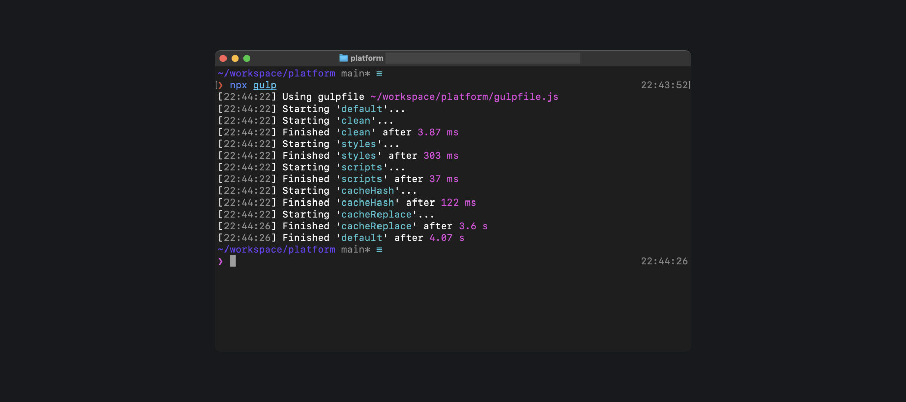
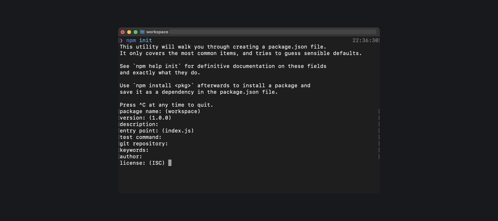

## Кратко

[Gulp](https://gulpjs.com/) (англ. «глоток», читается «<!-- yaspeller ignore:start -->галп<!-- yaspeller ignore:end -->») — менеджер задач для фронтенд-проекта. Он работает на [Node.js](/tools/nodejs/).

Gulp может выполнять разные задачи: формировать файлы стилей, объединять и минифицировать файлы, оптимизировать картинки, переводить новый синтаксис JavaScript в старый и т. д. Gulp читает исходные файлы, пропускает их через цепочку модулей и записывает результат на диск.

## Как понять

Gulp сам ничего не собирает. Вы описываете задачи, а Gulp выполняет их в нужном порядке. Работу внутри задач делают модули: один компилирует Sass, другой расставляет префиксы.

Вместо Gulp часто берут [сборщики](/tools/bundlers/), например [Webpack](/tools/webpack/) или [Vite](https://vite.dev/). Сборщик идёт по импортам в коде и собирает из них итоговые файлы для сайта. Gulp об импортах ничего не знает: он прогоняет файлы через ваши задачи.

## Модули и задачи

В веб-проекте разработчик раз за разом повторяет одни и те же действия:

- проверять HTML-разметку и CSS-правила;
- преобразовывать синтаксис [CSS-препроцессоров](/tools/preprocessors/) в обычный CSS;
- проверять JS-код на ошибки и единый стиль;
- объединять несколько файлов (CSS или JS) в один;
- минифицировать большие файлы;
- проверять в браузере результат, желательно по принципу «live-reload» («живая перезагрузка»);
- формировать итоговую сборку проекта.

Для этих операций есть npm-модули. Их ставят через [пакетный менеджер](/tools/package-managers/).

Gulp читает инструкции из файла _gulpfile.js_. Сначала подключим функции Gulp:

```javascript
const { src, dest, parallel, series, watch } = require('gulp')
```

- `src()` читает исходные файлы;
- `dest()` записывает итоговые файлы.

`parallel()`, `series()` и `watch()` разберём ниже, в задачах, где они нужны.

Потом так же подключим нужные npm-модули, например:

```javascript
const sass = require('gulp-sass')(require('sass'))
const browserSync = require('browser-sync').create()
const postcss = require('gulp-postcss')
const autoprefixer = require('autoprefixer')
```

Задача устроена так:

- берёт исходные файлы;
- пропускает их через цепочку методов `pipe()`;
- сохраняет результат в папку.

Задаче дают имя: под ним Gulp показывает её в терминале, когда запускает.

### Задача — function

Напишем задачу для стилей на Sass. Она выполняет такие шаги:

- обратиться к исходному файлу в папке `/src/styles/`;
- преобразовать синтаксис Sass в обычный CSS;
- вывести в терминале ошибки в исходном файле;
- сохранить итоговый файл в папку `/public/styles/`;
- применить с помощью модуля `browser-sync` новые стили для открытой в браузере страницы.

Начиная с четвёртой версии Gulp, задачи пишут обычными функциями:

```javascript
function styles() {
  return src('./src/styles/style.scss')
  .pipe(sass().on('error', sass.logError))
  .pipe(dest('./public/styles/'))
  .pipe(browserSync.stream())
}
```

Такая функция — задача для _внутреннего использования_. Её можно использовать внутри _gulpfile.js_, но нельзя запустить из терминала. Чтобы функция запускалась командой `gulp`, экспортируйте её в общедоступную задачу:

```javascript
exports.styles = styles
```

После этого задачу можно запустить командой `gulp styles`.

### Задача — task

В старых проектах задачи создают функцией `gulp.task()`. До четвёртой версии Gulp другого способа не было. Функция работает и в Gulp 5, но документация её больше не рекомендует:

```javascript
const gulp = require('gulp')

gulp.task('styles', function() {
  return gulp.src('./src/styles/style.scss')
  .pipe(sass().on('error', sass.logError))
  .pipe(gulp.dest('./public/styles/'))
  .pipe(browserSync.stream())
})
```

`gulp.task()` сразу регистрирует общедоступную задачу `styles`. Её тоже запускают командой `gulp styles`.

### Отслеживание изменений в проекте

Чтобы видеть результат правок, в Gulp есть функция `watch()`. Она следит за файлами и при сохранении запускает нужную задачу. Здесь при сохранении _style.scss_ запускается задача `styles`:

```javascript
function watchDev() {
  watch('./src/styles/style.scss', styles)
}
```

Новые стили в браузер передаёт сама задача `styles` через `browserSync.stream()`. Модуль `browser-sync` получает уже готовые файлы. CSS он подменяет без перезагрузки, а после изменений в HTML и JS перезагружает страницу.

Не добавляйте к `watch()` обработчик `on('change', browserSync.reload)`. Он передаёт в `browser-sync` путь к исходному файлу, например к файлу `.scss`. Такой файл нельзя подменить на лету, поэтому `browser-sync` перезагружает всю страницу. Данные в формах пропадут.

### Работа с проектом и его сборка

Сводная задача объединяет несколько задач: `parallel()` запускает их одновременно, `series()` — по очереди. Проект в режиме разработки запускают сводной задачей `default`:

```javascript
exports.default = parallel(
  styles,
  scripts,
  pages,
  watchDev
)
```

Задачи `scripts` и `pages` устроены так же, как `styles`. Их код разберём в разделе «Использование».

Имя `default` зарезервировано в Gulp: такую задачу запускают просто командой `gulp`.


Запуск задачи `default` на платформе Доки

Для сборки проекта обычно создают отдельную задачу. Имя можно выбрать любое, а действия она выполняет по очереди:

```javascript
exports.build = series(
  styles,
  scripts,
  pages
)
```

После этого итоговую версию проекта собирают командой `gulp build` в терминале.

## Использование

Соберём _gulpfile.js_ для небольшого сайта.

Каждому блоку страницы отведём свою папку: в ней лежат его стили, разметка и скрипты. Картинки и шрифты лежат в отдельных папках.

Исходные файлы лежат в папке _src_, результат Gulp запишет в папку _public_:

```
.
├─ /public
│   ├─ /css
│   ├─ /fonts
│   ├─ /images
│   ├─ /js
│   ├─ index.html
│   └─ order.html
├─ /src
│   ├─ /components
│   │   ├─ /header
│   │   │   ├─ header.html
│   │   │   └─ header.scss
│   │   ├─ /offer
│   │   │   ├─ offer.html
│   │   │   ├─ offer.js
│   │   │   └─ offer.scss
│   │   ├─ /order
│   │   │   ├─ order.html
│   │   │   ├─ order.js
│   │   │   └─ order.scss
│   │   └─ /footer
│   │       ├─ footer.html
│   │       ├─ footer.js
│   │       └─ footer.scss
│   ├─ /fonts
│   ├─ /images
│   ├─ /js
│   │   └─ script.js
│   ├─ /pages
│   │   ├─ index.html
│   │   └─ order.html
│   └─ /styles
│       └─ style.scss
├─ gulpfile.js
└─ package.json
```

Сначала в папке проекта инициализируйте проект командой `npm init`. npm попросит указать его данные:



npm создаст файл манифеста _package.json_. В нём npm запоминает установленные модули.

Примеры ниже написаны для Gulp 5. Понадобятся такие npm-модули:

- `sass` и `gulp-sass` переводят Sass в CSS;
- `gulp-postcss` и `autoprefixer` добавляют [вендорные префиксы CSS](/css/vendor-prefixes/);
- `gulp-include` подключает отдельные файлы компонентов в итоговые файлы HTML и JS;
- `browser-sync` создаёт и запускает локальный [веб-сервер](/tools/web-server/).

Установим их одной командой:

```bash
npm install --save-dev gulp sass gulp-sass \
  gulp-postcss autoprefixer gulp-include browser-sync
```

Gulp установлен в проект, а не глобально. Поэтому команды из статьи запускайте через `npx`: `npx gulp`, `npx gulp build`. `npx` запускает команду из пакета, установленного в проект. Чтобы писать просто `gulp`, установите глобально `gulp-cli` командой `npm install --global gulp-cli`.

В _gulpfile.js_ сначала подключим функции Gulp и модули:

```javascript
const { src, dest, parallel, series, watch } = require('gulp')
const { rm } = require('node:fs/promises')
const sass = require('gulp-sass')(require('sass'))
const postcss = require('gulp-postcss')
const autoprefixer = require('autoprefixer')
const includeFiles = require('gulp-include')
const browserSync = require('browser-sync').create()
```

Напишем задачу, которая запускает веб-сервер `browser-sync`. Её настройки описаны в [API модуля](https://browsersync.io/docs/api):

- инициализируем веб-сервер;
- указываем папку, которую раздаёт сервер;
- открываем страницы по адресу без расширения `.html`;
- назначаем номер порта для взаимодействия с веб-сервером;
- назначаем номер порта для пользовательского интерфейса веб-сервера;
- открываем в браузере главную страницу сайта;
- сообщаем Gulp, что сервер запущен.

```javascript
function serve(done) {
  browserSync.init({
    server: {
      baseDir: './public/',
      serveStaticOptions: {
        extensions: ['html'],
      },
    },
    port: 8080,
    ui: { port: 8081 },
    open: true,
  }, done)
}
```

Задача для стилей:

- обращается к исходному файлу `style.scss`;
- переводит синтаксис Sass в обычный CSS;
- показывает в терминале ошибки в исходном файле;
- с помощью [Autoprefixer](https://github.com/postcss/autoprefixer) добавляет вендорные префиксы CSS;
- сохраняет итоговый файл в папку `/public/css/`;
- с помощью модуля `browser-sync` применяет новые стили для открытой в браузере страницы.

```javascript
function styles() {
  return src('./src/styles/style.scss')
  .pipe(sass().on('error', sass.logError))
  .pipe(postcss([autoprefixer()]))
  .pipe(dest('./public/css/'))
  .pipe(browserSync.stream())
}
```

Для каких браузеров нужны префиксы, Autoprefixer узнаёт из списка [Browserslist](https://browsersl.ist/) проекта. Список задают полем `browserslist` в _package.json_ или отдельным файлом в корне проекта.

SCSS-файлы компонентов подключает сам Sass. Перечислите их в _style.scss_ через `@use`:

```scss
@use '../components/header/header';
@use '../components/offer/offer';
```

<aside>

⚠️ Не добавляйте в новые проекты модуль `gulp-group-css-media-queries` из старых сборок. Он переносит все [медиавыражения](/css/media/) в конец файла. Из-за этого стиль из медиавыражения перебивает правило, которое в исходном файле шло после него. Ещё модуль больше не поддерживается и падает с ошибкой на [`@container`](/css/container/).

</aside>

Задача для скриптов:

- берёт исходный файл _script.js_;
- подставляет в него JS-файлы компонентов;
- обновляет открытую в браузере страницу.

```javascript
function scripts() {
  return src('./src/js/script.js')
  .pipe(
    includeFiles({
      includePaths: './src/components/**/',
    })
  )
  .pipe(dest('./public/js/'))
  .pipe(browserSync.stream())
}
```

С параметром `includePaths` модуль `gulp-include` подключает в _script.js_ файлы компонентов без полного пути к ним. Шаблон `**` в пути означает все вложенные папки:

```javascript
//=include offer.js
//=include order.js
```

Задача `pages`:

- читает исходный файл страницы;
- подставляет в него HTML-файлы компонентов;
- перезагружает открытую в браузере страницу.

```javascript
function pages() {
  return src('./src/pages/*.html')
  .pipe(
    includeFiles({
      includePaths: './src/components/**/',
    })
  )
  .pipe(dest('./public/'))
  .pipe(browserSync.stream())
}
```

Благодаря тому же `includePaths` компоненты подключаются в HTML без полного пути:

```html
<!--=include header.html -->
<!--=include offer.html -->
<!--=include order.html -->
<!--=include footer.html -->
```

Шрифты и картинки нужно просто скопировать из _src_ в _public_. Создадим для этого две задачи и запустим их параллельно.

С версии 5 Gulp по умолчанию читает файлы как текст в кодировке UTF-8. Шрифты и картинки — двоичные файлы, и такое чтение их испортит. Поэтому отключаем кодировку параметром `encoding: false`:

```javascript
function copyFonts() {
  return src('./src/fonts/**/*', { encoding: false })
  .pipe(dest('./public/fonts/'))
}

function copyImages() {
  return src('./src/images/**/*', { encoding: false })
  .pipe(dest('./public/images/'))
}

const copyResources = parallel(copyFonts, copyImages)
```

Перед запуском проекта в режиме разработки, а также перед его сборкой, желательно удалить папку _public_ с предыдущими версиями файлов, поэтому добавим задачу очистки. Отдельный модуль для этого не нужен: хватит встроенной в Node.js функции `rm()`:

```javascript
function clean() {
  return rm('./public/', { recursive: true, force: true })
}
```

Проверьте путь перед запуском: `rm()` удаляет папку сразу, без корзины.

Последняя задача следит за изменениями. Она:

- следит за файлами в указанных папках;
- запускает задачу, которая обрабатывает изменённый файл;
- копирует новые шрифты и картинки в _public_.

```javascript
function watchDev() {
  watch(
    ['./src/js/script.js', './src/components/**/*.js'],
    scripts
  )
  watch(
    ['./src/styles/style.scss', './src/components/**/*.scss'],
    styles
  )
  watch(
    ['./src/pages/*.html', './src/components/**/*.html'],
    pages
  )
  watch(
    ['./src/fonts/**/*', './src/images/**/*'],
    copyResources
  )
}
```

В конце _gulpfile.js_ экспортируем функции в общедоступные задачи. Затем создадим две сводные задачи: `default` для разработки и `build` для сборки.

Очистка должна закончиться до того, как другие задачи начнут писать файлы. Поэтому `clean` стоит первой в `series()`:

```javascript
exports.serve = serve
exports.clean = clean
exports.scripts = scripts
exports.styles = styles
exports.pages = pages
exports.copyResources = copyResources

exports.default = series(
  clean,
  parallel(styles, scripts, copyResources, pages),
  parallel(serve, watchDev)
)

exports.build = series(
  clean,
  styles,
  scripts,
  copyResources,
  pages
)
```

## Заключение

Gulp — ваш бро, не сомневайтесь, если ваш веб-проект:

- не основан на современных [JS-фреймворках](/tools/react-and-alternatives/);
- не _SPA_ ([одностраничное приложение](/tools/web-app-types/#single-page-applications-spa)).

Для новых проектов чаще берут сборщики вроде Vite, но Gulp удобен там, где нужна цепочка простых задач над файлами.
