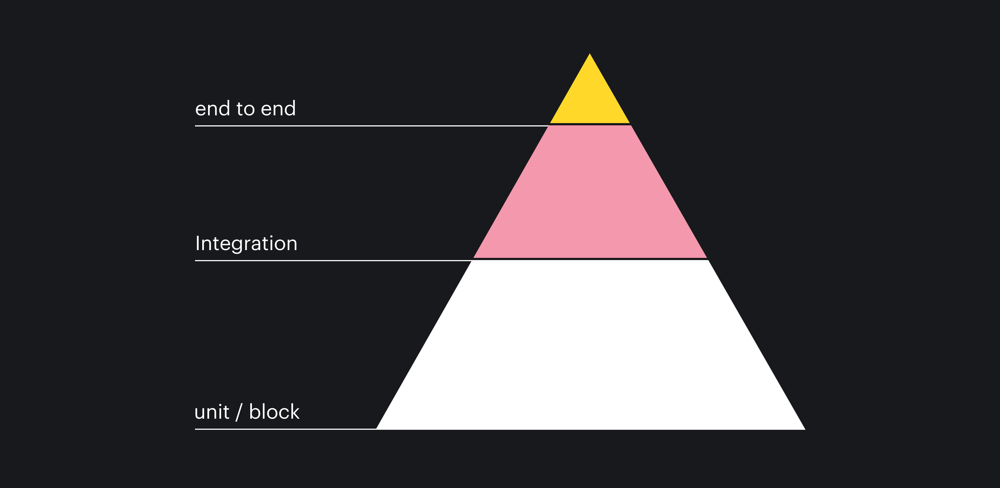

## Кратко

«Тесты — это лишняя работа», «тесты писать необязательно» — такие мнения часто можно услышать в разговорах о тестировании. В этой статье мы постараемся развеять этот миф и рассмотрим плюсы тестирования и минусы его отсутствия.

Тесты делают код более прочным и живучим. Одновременно с этим тесты — это отличная документация, которая не врёт и не устаревает. Также тесты можно использовать как инструмент разработки программы.

Для тестов нужно закладывать больше времени на разработку, это правда. Но время, потраченное в начале работы над проектом, окупится в дальнейшем.

## Что такое тест

**Тест** — это код, который проверяет предположения о работе другого кода.

Представим, что у нас есть функция `add()`, которая складывает одно число с другим:

```javascript
function add(a, b) {
  return a + b
}
```

Мы предполагаем, что функция прибавляет аргумент `b` к аргументу `a` и возвращает результат. Мы можем проверить это, вызвав её:

```javascript
const result = add(10, 5)
// result === 15
```

Но что будет, если мы передадим не два числа, а одно? А если передадим не числа? Или функция за время жизни проекта изменится? Чтобы проверить такие предположения, мы пишем тесты.

### Примитивное тестирование

Самый простой тест, который мы можем написать, — ручной. Сравним руками результат работы функции и ожидаемое значение:

```javascript
function testAdd() {
  const result = add(10, 5)
  const expected = 15

  console.assert(
    result === expected,
    `Expected ${expected}, but got ${result}.`
  )
}
```

Если запустить `testAdd()`, она проверит, что вернёт функция `add()`. Если результат не будет соответствовать ожиданию, консоль покажет ошибку.

Конечно, такой тест никуда не годится 😃

- Ему сильно не хватает описания — как понять, что именно мы проверяем?
- Не хватает выразительности и лаконичности — сравнивать значения и писать сообщения об ошибках руками не круто.
- Провал никто не заметит. `console.assert()` только пишет сообщение в консоль, программа завершается успешно, и автоматическая проверка в [CI](/tools/ci-cd/) тоже пройдёт.
- Не хватает интерактивности — чтобы перезапустить тест, нужно запустить функцию заново.

В идеале хотелось бы, чтобы при изменении теста он перезапускался сам. Чтобы было место для описания того, что мы тестируем. Специально для этого придумали инструменты для тестирования.

### Инструменты для тестирования во фронтенде

Инструментов для тестирования много. Чтобы подобрать подходящий, нам надо определиться, какие тесты мы хотим писать. Подробнее о видах тестирования мы поговорим в конце статьи, а пока что посмотрим на один из самых популярных инструментов — [Jest](https://jestjs.io). Как начать с ним работать, рассказываем в статье «[Пишем первые тесты](/tools/testing-with-jest/)».

<aside>

☝️ Чтобы использовать Jest, его нужно установить в свой проект через [`npm`](/tools/package-managers/). Подробнее об установке — в [документации Jest](https://jestjs.io/docs/getting-started).

</aside>

Попробуем, используя его, переписать тест нашей функции `add()`:

```javascript
describe('When given 2 numbers', () => {
  it('returns the sum of those 2 numbers', () => {
    const result = add(10, 5)
    const expected = 15

    expect(result).toEqual(expected)
  })
})
```

Разберём по строкам:

1. На первой строке мы указываем описание теста — в каких условиях мы собираемся тестировать функцию.
1. На второй строке указываем само предположение о результате — что функция должна вернуть.
1. На строках 3–6 выполняем сам тест.

Функция [`expect()`](https://jestjs.io/docs/expect#expectvalue) принимает полученное значение и возвращает объект с методами для сравнения, например `toEqual()`. Такой метод сравнивает значение с ожидаемым и сам сообщает об ошибке, если они не совпали. Тогда тест проваливается.

Функции `describe()` и `it()` помогают описать тест в виде самого настоящего **текстового предположения**, которое код теста проверит.

Похожий тест можно написать и в других инструментах:

- в [Vitest](https://vitest.dev) синтаксис почти такой же, только `describe()`, `it()` и `expect()` по умолчанию импортируют из пакета `vitest`;
- в Node.js есть встроенный инструмент для запуска тестов [`node:test`](https://nodejs.org/api/test.html), проверки в нём пишут через модуль `node:assert`.

Теперь разберём, собственно, код теста.

## Анатомия теста

Наш тест состоит из трёх строк:

```javascript
const result = add(10, 5)
const expected = 15
expect(result).toEqual(expected)
```

Его можно разделить на три стадии, которые можно запомнить по мнемоникам:

- ПВП: _Подготовка_, _Выполнение_, _Проверка_;
- или по-английски AAA: _Arrange_, _Act_ и _Assert_.

### Подготовка (Arrange)

На стадии подготовки мы готовим исходные данные для функции и ожидаемый результат. В более сложных тестах на этой стадии мы бы готовили зависимости для функции и фиктивные объекты.

В нашем случае подготовкой можно назвать выбор аргументов `10` и `5`, а также обозначение ожидаемого значения `const expected = 15`.

### Выполнение (Act)

На второй стадии мы запускаем функцию, чтобы получить результат. В этот момент мы отрабатываем тестируемый сценарий и получаем значение, которое потом будем проверять.

В нашем случае это строчка с вызовом функции: `const result = add(10, 5)`.

### Проверка (Assert)

На стадии проверки мы сверяем полученный результат с ожидаемым. Хотя проверка может состоять из нескольких утверждений, хорошей практикой считается **внутри одного теста проверять только одно предположение**.

В нашем случае проверка — это сравнение результатов на последней строке: `expect(result).toEqual(expected)`.

### Идеальный тест

Идеальный тест _состоит из всех трёх стадий ПВП_. Часто такой тест даже состоит из трёх строчек.

Кроме этого, идеальный тест проверяет только **одно предположение**. Для проверки разных предположений лучше написать отдельные тесты.

Идеальный тест не зависит от других тестов. Если тесты зависят друг от друга, они могут влиять и на результаты проверки друг друга. Правильно написанный тест можно запустить где и как угодно, и его результат не изменится.

## Плюсы тестов

Может показаться, что тестирование — это пустая трата времени, и лучше выделить это время на другие задачи. И правда, на начальных этапах жизни проекта тесты отнимают время. Но в будущем написанные тесты сэкономят больше времени, потому что будут играть роль и документации, и инструмента разработки, и проверки ранее написанного кода.

Рассмотрим основные плюсы тестирования.

### Заставляют думать над крайними случаями

Когда мы пишем программу, мы чаще думаем об основном сценарии работы ([happy path](https://en.wikipedia.org/wiki/Happy_path)), часто забывая о крайних случаях.

Тесты смещают фокус с основного сценария на «что может пойти не так». Когда мы пишем тесты, мы больше склонны искать ошибки и неадекватную работу функции. Чем больше крайних случаев мы обработаем, тем надёжнее будет код.

### Уменьшают количество регрессий

**Регрессия** — это ошибка, которая возникает в уже работающей части системы после изменений в коде. Например, когда в старый код добавляют новую функциональность или дорабатывают общие функции.

В нашей голове может уместиться лишь небольшой кусочек системы, которую мы программируем. Большая часть системы всегда находится вне поля нашего зрения. Это значит, что при добавлении функциональности мы можем не учесть особенности работы уже существующего кода.

Тесты ловят такие ошибки. Если изменение ломает сценарий, который описан в тесте, тест падает и не пускает ошибку в продакшен.

### Дают больше уверенности при рефакторинге

Когда мы рефакторим код, мы изменяем его структуру. Ошибки при рефакторинге появляются по той же причине — мы не можем держать всё в голове.

Даже если мы уверены, что полностью знаем кусок, который рефакторим, мы не застрахованы от более простых ошибок:

```javascript
// 1.
let a = 15
if (a === 20) {}

// 2.
let b = 15
if (b = 20) {}
```

Второй случай в примере выше всегда будет истинным, потому что в условии вместо сравнения — присваивание. Такую ошибку поймает и [линтер](/tools/static-analysis/), программа для проверки кода. Но линтер проверяет, как код написан, а не что он делает. Если при рефакторинге мы перепутаем `>` и `>=`, линтер промолчит, а тест упадёт.

### Ловят поломки при обновлении зависимостей

Это частный случай регрессий. Обновление зависимостей не только исправляет баги и несёт новые фичи, но иногда и ломает логику работы. Если код, который зависит от библиотеки, покрыт тестами, то такие ломающие обновления мы заметим сразу.

### Автоматическая документация

Тесты не врут 😃
Они действительно показывают, как работает система.

Дополнительная документация может устареть, особенно часто это случается с комментариями. Если документация устарела, у нас появляется два источника правды: документация и код. Это плохо, потому что непонятно, чему верить и как программа должна работать. Тесты же точно говорят, как программа работать должна и работает ли.

Кроме этого, хорошо написанные тесты читаются как текст на английском языке. Из их описаний при желании можно автоматически сгенерировать и текстовую документацию.

## Издержки тестирования

Тестирование не бесплатное, за надёжность кода приходится платить.

### Нужно больше времени на начальных этапах

На старте проекта издержки ощущаются больнее всего. Чем моложе проект, тем субъективно большую долю времени будут занимать тесты. В этот момент желание плюнуть и не писать тесты сильнее всего, потому что время как будто уходит на бесполезную работу.

Это, конечно, не так. Чем проект старше, тем больше мы получаем выгоды от написанных тестов.

Избавиться от ощущения ненужности тестов можно, если заранее закладывать время на них в план, а также считать их базовой гигиеной при работе. Часть команд и проектов сейчас не работают без тестов вовсе. Такие команды — это хорошая среда для того, чтобы привить себе привычку к тестированию на уровне автоматизма.

### Нужно продумать структуру для тестов и тестовых данных

При работе с тестами приходится использовать фиктивные объекты и данные. Например, для проверки аутентификации мы не запускаем настоящий сервер, а используем заглушку для него, которая отвечает нужными нам в конкретном тесте данными.

<aside>

💡 Такие заглушки — это стабы. Мы подробно рассказываем о них, о моках и других фиктивных объектах в статье «[Фиктивные объекты и данные, моки, стабы](/tools/testing-and-fake-objects/)».

</aside>

Чтобы не запутаться во всех фиктивных объектах и данных, для них нужно организовать структуру. Чем удобнее структура, тем проще писать тесты.

Грамотно организовать систему с фиктивными объектами сложно. Это требует навыков проектирования, знаний о хорошей архитектуре и опыта.

### Нужно настроить CI

Тесты в проекте существуют обычно вместе с автоматическими задачами, которые их запускают. Они, например, могут отменять релиз, если при обновлении кода тесты не проходят.

Настройка таких задач — это тоже дополнительная работа.

## Виды тестов

Хорошо, вот мы взвесили все преимущества и недостатки тестирования. Если мы хотим внедрить тестирование в своём проекте, то какие тесты нам писать?

Тесты бывают разных видов и проверяют они тоже разные вещи. Разложим основные виды тестов по пирамиде и поговорим о каждом.



Пирамида тестирования: в основании юнит-тесты, чуть выше интеграционные, на вершине — E2E-тесты.

### Юнит-тесты

В основании пирамиды лежат _юнит-тесты_. Их ещё называют модульными тестами или блочными тестами.

Такие тесты проверяют работу конкретного модуля, функции или части программы. Когда мы писали тест для функции `add()` выше, мы писали именно юнит-тест.

Особенность таких тестов в том, что они затрагивают лишь одну часть программы, никак не проверяя остальные. Если тестируемый модуль ссылается на другие модули, то вместо них мы будем использовать фиктивные объекты. Поведение таких объектов мы смоделируем таким, как нам требуется в каждом конкретном тесте.

Обычно большая часть тестов в проекте — это юнит-тесты. Их проще писать, для них не требуется **слишком сложной** структуры. Они быстро выполняются, и их можно запускать параллельно, потому что они не зависят друг от друга.

<aside>

💡 Юнит-тесты — основной инструмент разработки через тестирование, TDD. Мы рассмотрели работу по TDD в статье «[Разработка через тестирование (TDD)](/tools/tdd/)».

</aside>

### Интеграционные тесты

**Интеграционные** тесты проверяют, как между собой взаимодействуют две и более части программы, которые работают над одной задачей.

Например, интеграционный тест может проверить сценарий регистрации на бэкенде: запрос к серверу, его обработку и запись в базу данных.

Важно, что в таком тестировании мы проверяем **не порядок вызова** частей программы, а именно **результат** их совместной работы.

Для интеграционных тестов нужна структура чуть сложнее, чем для юнит-тестов. Тест запускает вместе несколько частей программы, но отдельно от остального приложения.

Пишут такие тесты обычно в том же инструменте, что и юнит-тесты, например в Jest.

### E2E-тесты

E2E-тесты (от английского end-to-end, «от начала до конца») проверяют работу программы в целом. Это один из видов системного тестирования, подробнее — в статье «[Интеграционное и системное тестирование](/tools/integration-and-system-testing/)».

Такие тесты играют роль пользователей, которые ходят по приложению и выполняют разные задачи. Для этих тестов нужен фреймворк, который умеет манипулировать приложением, как это делают люди.

Например, мы захотели проверить регистрацию целиком, через интерфейс сайта. Интеграционный тест проверял только серверную часть. А здесь мы пишем сценарий для «робота», который сам ходит по сайту, заполняет формы и проверяет, как прошла регистрация.

<aside>

❤️ Самые популярные фреймворки для E2E-тестирования сейчас — [Playwright](https://playwright.dev) и [Cypress](https://www.cypress.io), по данным [State of JS 2025](https://2025.stateofjs.com/en-US/libraries/testing/). Пример тестирования с Cypress — [тестирование приложения для учёта расходов](https://bespoyasov.ru/blog/coin-e2e-with-cypress/).

</aside>

### Приёмочные тесты

Приёмочные тесты — это проверка программы перед сдачей клиенту или релизом. Они включают сложные сценарии из спецификаций или технического задания. Часто такие тесты выполняют вручную, но их можно и автоматизировать.

Во фронтенд-разработке они встречаются реже всех остальных, но их часто используют при разработке десктопных программ или приложений для телефонов. У таких приложений более долгий цикл доставки до пользователя, поэтому приёмочные тесты обычно проходят перед релизом. В вебе цикл доставки короткий, и тесты стараются максимально полно автоматизировать.

## Писать или не писать

У тестирования есть издержки, но в долгосрочной перспективе оно экономит силы, время и деньги. Отказаться от тестирования можно, если:

- мы разрабатываем прототип, который не пойдёт в продакшен — скорость важнее;
- или проект точно не будет жить долго — предсказать такое сложно, но если мы уверены, что тесты не успеют окупиться, ими можно пренебречь.

В остальных случаях тесты лучше писать с самого начала.
