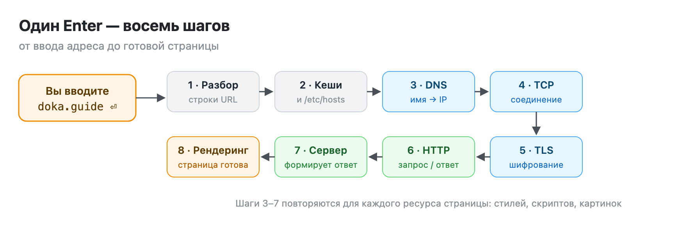
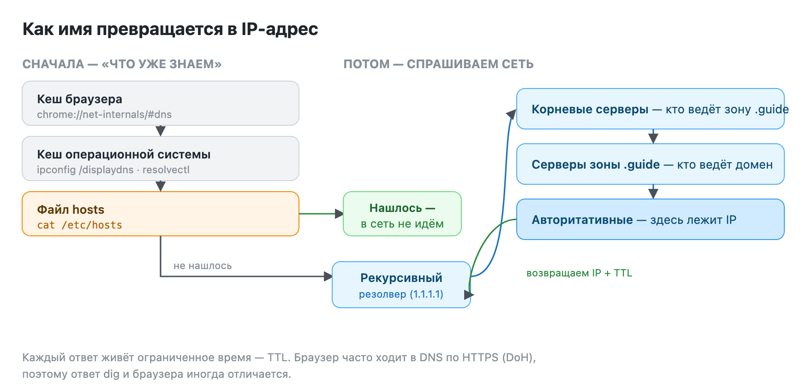
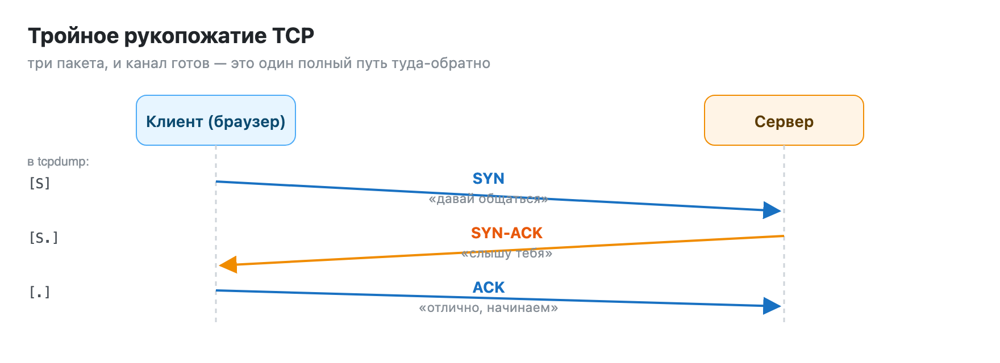
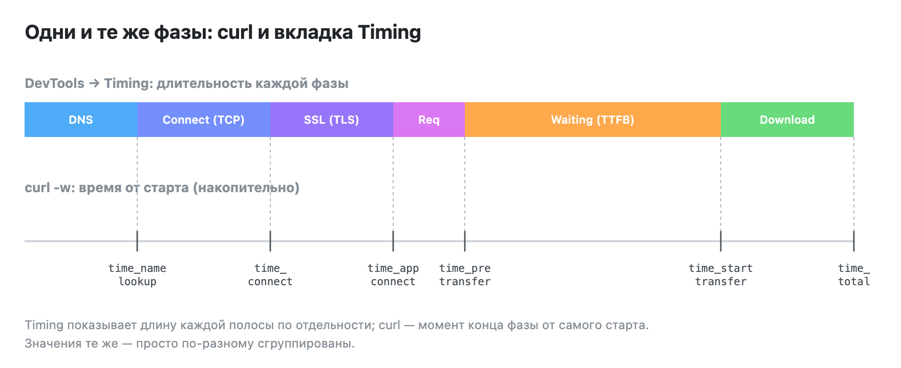
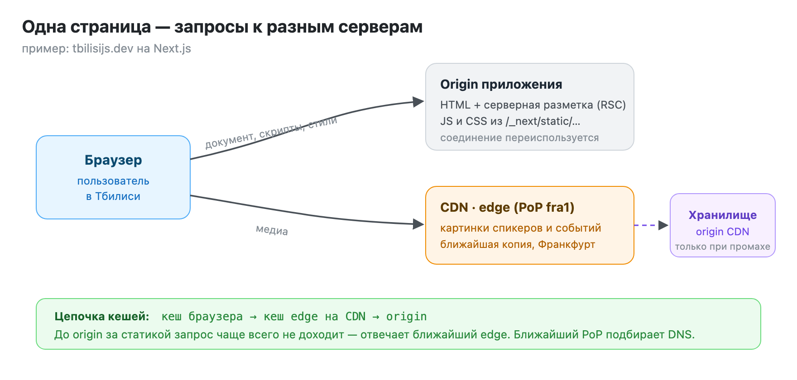

## Кратко

Вы набираете `doka.guide`, жмёте <kbd>Enter</kbd> — и спустя доли секунды видите страницу. За эти доли секунды успевает произойти целая цепочка событий: браузер разбирает адрес, превращает доменное имя в IP-адрес, устанавливает соединение, шифрует канал, отправляет HTTP-запрос, получает ответ и рисует страницу.

Это один из самых частых вопросов на собеседованиях — и хорош он тем, что по одной ниточке вытягивает почти весь веб: сеть, протоколы, безопасность, работу сервера и браузера. В этой статье мы пройдём весь путь по шагам, на каждом дадим команду в терминале и место во вкладке **Network**, где этот шаг видно, а за деталями будем отправлять в отдельные статьи Доки.

## Как понять

<aside>

📚 Короткий словесный сценарий «что происходит при вводе URL» уже есть в статье [«Работа с сетью»](/tools/network/) — если нужно просто освежить последовательность шагов, загляните туда. Эта статья устроена иначе и идёт дальше: каждый шаг здесь можно **потрогать руками** — командой в терминале и вкладкой Network, — а в конце все этапы складываются в одну **измеримую** картинку. Вдобавок на каждом шаге стоит ссылка на отдельную статью Доки, где тема разобрана вглубь. Так что это не пересказ сценария, а практический маршрут — и заодно «эталонный» развёрнутый ответ на частый вопрос с собеседований.

</aside>

Весь путь удобно держать в голове как таблицу-карту. Это одновременно и план статьи, и шпаргалка к собеседованию.

| Шаг | Что происходит | Протокол | Чем посмотреть | Где в Network |
|---|---|---|---|---|
| 1 | Разбор строки | — | `new URL(...)` | — |
| 2 | Проверка кешей | — | `chrome://net-internals` | `memory/disk cache` |
| 3 | DNS-резолвинг | DNS | `dig`, `nslookup` | DNS Lookup |
| 4 | TCP-соединение | TCP | `nc`, `tcpdump` | Initial connection |
| 5 | Шифрование | TLS | `openssl s_client` | SSL |
| 6 | Запрос и ответ | HTTP | `curl -v` | Request/Response |
| 7 | Работа сервера | HTTP | `curl -I` | Waiting (TTFB) |
| 8 | Отрисовка | — | вкладка Performance | водопад ресурсов |

А вот команда, которая показывает почти все эти шаги сразу — она пригодится нам в конце, когда будем собирать картину воедино:

```bash
curl -o /dev/null -s -w "\
DNS:    %{time_namelookup}s
TCP:    %{time_connect}s
TLS:    %{time_appconnect}s
Запрос: %{time_pretransfer}s
TTFB:   %{time_starttransfer}s
Всего:  %{time_total}s
" https://doka.guide/
```

Каждая строчка её вывода — это ровно один раздел статьи. Поехали по шагам.


Общая схема пути запроса: от ввода URL до отрисованной страницы

## Шаг 1. Браузер разбирает, что вы ввели

Первым делом браузер решает, что вообще вы напечатали: поисковый запрос или адрес. Если это адрес, он достраивает недостающие части (например, подставляет схему `https://`), переводит национальные домены в punycode, а небезопасные символы — в процентное кодирование. Никакой сети на этом шаге ещё нет.

**Как увидеть.** Браузерный разбор адреса повторяет объект `URL` — его можно погонять прямо в консоли или в Node.js:

```bash
node -e "console.log(new URL('https://дока.рф/путь с пробелом?q=привет#top'))"
```

В выводе вы увидите, что домен превратился в `xn--80aafi6cg.xn--p1ai`, а пробел и кириллица в пути и параметрах — в последовательности вида `%20` и `%D0%BF`.

<aside>

📚 Как устроен адрес (схема, домен, порт, путь, параметры) — в статье [«URL»](/tools/url/). Почему символы кодируются именно так — в статье [«Кодирование»](/tools/encoding/).

</aside>

## Шаг 2. Проверка кешей: иногда история заканчивается здесь

Прежде чем идти в сеть, браузер проверяет, нет ли ответа под рукой. В дело могут вступить [Service Worker](/tools/pwa/), HTTP-кеш, список HSTS (сайты, к которым ходим только по HTTPS) и уже открытое соединение. Если ресурс лежит в кеше и ещё не протух — в сеть браузер не пойдёт вовсе. Поэтому второй заход на сайт почти всегда быстрее первого.

Кеши работают в несколько слоёв: сначала свой кеш у браузера, затем кеш операционной системы (локальный DNS-кеш), и только потом запрос уходит в сеть. Так что «сходить за адресом» на самом деле означает «проверить несколько кешей по очереди, и если нигде нет — тогда уже спросить».

**Как увидеть.** Загрузите страницу дважды и посмотрите колонку **Size** в Network: вместо размера там появятся `(memory cache)`, `(disk cache)` или `(ServiceWorker)`. Чтобы отключить кеш и увидеть «чистый» путь, поставьте галочку **Disable cache**. А внутренние кеши Chrome можно посмотреть на служебных страницах:

```text
chrome://net-internals/#dns      # кеш DNS внутри браузера
chrome://net-internals/#hsts     # список HSTS-доменов
```

<aside>

📚 Где браузер хранит данные и чем кеши отличаются друг от друга — в статье [«Хранилища в браузере»](/tools/browsers-storages/).

</aside>

## Шаг 3. DNS: от имени к адресу

Люди помнят имена, а сеть работает с IP-адресами. Превращает одно в другое служба DNS (_Domain Name System_) — её часто сравнивают с телефонной книгой интернета. Но «книга» эта распределённая: ни один сервер не знает всех адресов целиком.

Когда у браузера нет ответа в кеше, он спрашивает **рекурсивный резолвер** (обычно провайдера или публичный, вроде `1.1.1.1`). Дальше резолвер идёт по иерархии: сначала к **корневым** серверам (они знают, кто отвечает за зону `.guide`), потом к серверам зоны `.guide` (они знают, кто отвечает за `doka.guide`), и наконец к **авторитативным** серверам самого домена, у которых и лежит нужный IP. Каждый ответ живёт ограниченное время — **TTL**, по истечении которого запись придётся спрашивать заново.

Но вся эта иерархия включается не сразу. Сначала система идёт по короткой цепочке «что уже знаем»: кеш браузера → локальный кеш ОС → файл `hosts` → и только потом рекурсивный резолвер. Поэтому имя часто превращается в адрес, вообще не покидая вашего компьютера.


Порядок разрешения имени: кеш браузера, кеш ОС и файл hosts, а затем обход иерархии DNS-серверов

**Как увидеть.** Самый наглядный инструмент — `dig`. Начнём с простого ответа, а потом посмотрим весь путь целиком:

```bash
dig doka.guide +short          # просто IP-адреса

dig +trace doka.guide          # весь путь: корневые → зона .guide → авторитативные

dig @1.1.1.1 doka.guide        # тот же вопрос другому резолверу — сравните ответы

dig doka.guide +stats          # внизу: время ответа и TTL; повторите — TTL уменьшится
```

Ответ `dig doka.guide +short` выглядит примерно так — несколько IP-адресов (у вас значения будут свои):

```text
104.21.32.1
172.67.148.5
```

У сайта несколько IP-адресов — так распределяют нагрузку между серверами. При каждом запросе список немного «проворачивается», поэтому браузеры разных пользователей попадают на разные серверы.

А `dig +trace` показывает тот самый обход иерархии — по строчке на каждый уровень (вывод сильно сокращён):

```text
.            NS   a.root-servers.net.        # 1. корневые серверы
guide.       NS   v0n0.nic.guide.            # 2. кто ведёт зону .guide
doka.guide.  A    104.21.32.1                # 3. авторитативный ответ
```

<aside>

⚠️ Важная честная оговорка: современные браузеры часто резолвят имена через **DNS-over-HTTPS (DoH)** своим резолвером, а не системным. Поэтому `dig` и браузер могут ответить по-разному. `dig` показывает **механику** резолвинга, а не буквально то, что сделал ваш браузер в этот раз.

</aside>

На других системах под рукой свои инструменты:

```bash
resolvectl query doka.guide              # Linux с systemd
dscacheutil -q host -a name doka.guide   # macOS
nslookup doka.guide                      # Windows (там dig из коробки нет)
```

### Нулевой уровень: файл hosts

Ещё до всякого DNS система заглядывает в файл `hosts` — простой текстовый файлик, где можно вручную связать имя и адрес. Если имя нашлось там, в сеть за ним никто не пойдёт. Посмотреть его содержимое можно одной командой:

```bash
cat /etc/hosts        # Linux и macOS
```

На Windows тот же файл лежит по пути `C:\Windows\System32\drivers\etc\hosts`.

Внутри обычно всего пара строк, а формат предельно простой — «адрес, пробел, имя»:

```text
127.0.0.1   localhost
```

Сюда же можно дописать свою запись. Это удобно, например, чтобы проверить сайт на тестовом сервере, не трогая настоящий DNS, или временно перенаправить домен на локальную машину:

```text
127.0.0.1       myapp.local
203.0.113.10    staging.example.com
```

После сохранения файла браузер для `myapp.local` пойдёт на `127.0.0.1`, минуя любые DNS-серверы. Доку, кстати, [можно так ускорить](https://github.com/doka-guide/content/blob/main/docs/load-fix.md): прописать ближайший из её серверов прямо в `hosts`.

<aside>

⚠️ Правка `hosts` требует прав администратора, а запись остаётся, пока вы её не удалите. Если потом «сайт не открывается» или открывается не тот — первым делом загляните в `hosts`.

</aside>

Если же хочется заглянуть в **локальный кеш ОС** — тот, что между браузером и сетью, — команды свои на каждой системе:

```bash
resolvectl statistics                       # Linux с systemd — статистика кеша
sudo resolvectl flush-caches                # и сброс кеша там же

sudo dscacheutil -flushcache                # macOS — сброс кеша DNS

ipconfig /displaydns                        # Windows — показать кеш
ipconfig /flushdns                          # Windows — сбросить
```

Сброс кеша — первый приём отладки, когда сайт «переехал», а вы всё ещё попадаете на старый адрес.

<aside>

📚 Копнуть DNS глубже: [«What is DNS?» в Cloudflare Learning](https://www.cloudflare.com/learning/dns/what-is-dns/) — хорошая иллюстрированная вводная; [блог APNIC](https://blog.apnic.net/) — разборы от регионального интернет-реестра; первоисточники — [RFC 1034](https://www.rfc-editor.org/rfc/rfc1034) и [RFC 1035](https://www.rfc-editor.org/rfc/rfc1035) (сам протокол) и [RFC 8484](https://www.rfc-editor.org/rfc/rfc8484) (DNS-over-HTTPS).

</aside>

## Шаг 4. TCP: устанавливаем соединение

IP-адрес есть — пора связаться с сервером. Для обычного веба это делает протокол **TCP**: он гарантирует, что данные дойдут целиком и в правильном порядке. Соединение открывается «тройным рукопожатием»: клиент шлёт `SYN` («давай общаться»), сервер отвечает `SYN-ACK` («давай, слышу тебя»), клиент подтверждает `ACK` («отлично, начинаем»). Только после этих трёх пакетов канал готов — и это уже один полный round-trip по сети, то есть время.


Тройное рукопожатие TCP: SYN, SYN-ACK, ACK

**Как увидеть.** Проверить, что порт открыт и соединение устанавливается:

```bash
nc -vz doka.guide 443          # жив ли порт 443 (HTTPS)

traceroute doka.guide          # через какие узлы идёт путь до сервера
```

А вот самое наглядное — подсмотреть сами пакеты рукопожатия. В первых трёх строчках вывода вы увидите те самые `[S]`, `[S.]`, `[.]`:

```bash
sudo tcpdump -n "host doka.guide and port 443"
# [S]  — SYN от вас
# [S.] — SYN-ACK от сервера
# [.]  — ACK от вас, соединение готово
```

Посмотреть уже открытые соединения:

```bash
ss -tn '( dport = :443 )'      # Linux (современная замена netstat)
netstat -an | grep 443         # macOS и старые системы
```

<aside>

📚 Чем TCP отличается от UDP и когда какой нужен — в статье [«Протоколы TCP и UDP»](/tools/tcp-udp-protocols/). На каком «уровне» всё это происходит — в статье [«Модели сетевого взаимодействия»](/tools/network-models/).

</aside>

## Шаг 5. TLS: делаем канал защищённым

Для `https://` поверх TCP надстраивается ещё один слой — **TLS**. Это он превращает «http» в «https» и делает три вещи: шифрует данные, подтверждает, что сервер настоящий (по сертификату), и защищает данные от подмены по дороге. Ради этого проходит ещё одно рукопожатие: стороны договариваются о версии протокола и шифре, сервер показывает сертификат, и обе стороны получают общий секретный ключ.

**Как увидеть.** Одна команда показывает сразу всё — цепочку сертификатов, версию TLS, шифр и согласованный протокол приложения:

```bash
openssl s_client -connect doka.guide:443 -servername doka.guide </dev/null
```

В длинном выводе нас интересуют несколько строк (остальное сейчас можно пропустить):

```text
Certificate chain
 0 s:CN = doka.guide              # кому выдан сертификат
   i:C = US, O = Let's Encrypt    # кто выдал
---
ALPN protocol: h2                 # договорились общаться по HTTP/2
---
    Protocol  : TLSv1.3           # версия TLS
    Cipher    : TLS_AES_256_GCM_SHA384
```

Смотрите на `Certificate chain` (кто и кому выдал сертификат), `Protocol` (например, `TLSv1.3`), `Cipher` (выбранный шифр) и `ALPN protocol: h2` — на последнем шаге стороны тут же договариваются, что общаться будут по HTTP/2.

<aside>

⚠️ Флаг `-servername` здесь не случайный. На одном IP живёт много сайтов, и расширение **SNI** подсказывает серверу, чей именно сертификат показать. Без `-servername` можно получить «не тот» сертификат. Книжные описания рукопожатия в два round-trip относятся к TLS 1.2 — в **TLS 1.3** оно сократилось до одного, и `openssl` сегодня чаще всего покажет именно 1.3.

</aside>

<aside>

📚 Как устроены сертификаты и кто такие удостоверяющие центры — в статье [«SSL-сертификаты»](/tools/ssl-certificates/). Про безопасность в вебе в целом — в статье [«Безопасность в вебе»](/tools/web-security/).

</aside>

## Шаг 6. HTTP: отправляем запрос и получаем ответ

Канал готов — наконец можно сказать серверу, что нам нужно. Браузер отправляет **HTTP-запрос**: метод (`GET`), путь, версию протокола и заголовки (какой хост, какие форматы принимаем, какой кеш у нас есть). Сервер отвечает статусом (`200`, `301`, `404`…), своими заголовками и телом — чаще всего это HTML.

Чтобы почувствовать, что HTTP — это просто текст, запрос можно собрать руками:

```bash
printf 'GET / HTTP/1.1\r\nHost: doka.guide\r\nConnection: close\r\n\r\n' \
  | openssl s_client -quiet -connect doka.guide:443 -servername doka.guide
```

В ответ прилетит стартовая строка, заголовки и HTML-страница — ровно то, что обычно прячет от нас браузер.

**Как увидеть по-человечески.** В обычной работе удобнее `curl`:

```bash
curl -v https://doka.guide/            # весь диалог: строки > это запрос, < это ответ

curl -sD - -o /dev/null https://doka.guide/   # только заголовки ответа

curl -IL http://doka.guide             # цепочка редиректов: http → https прямо на Доке

curl --compressed -sI https://doka.guide/ | grep -i content-encoding   # сжатие

curl -I -H 'If-None-Match: "..."' https://doka.guide/   # повтор с ETag → ответ 304
```

`curl -IL http://doka.guide` наглядно показывает, как незашифрованный `http://` переводят на `https://` — сначала редирект, потом уже сам ответ:

```text
HTTP/1.1 301 Moved Permanently
Location: https://doka.guide/

HTTP/2 200
content-type: text/html; charset=utf-8
```

В Network каждый запрос раскрывается на вкладки **Headers**, **Payload**, **Response**. А ещё по шапке таблицы можно щёлкнуть правой кнопкой и включить колонку **Protocol** — там будет `h2` или `h3`, и станет видно, по какой версии HTTP реально идёт обмен.

<aside>

📚 Как устроено HTTP-сообщение по косточкам — в статье [«Протокол HTTP»](/tools/http-protocol/). Почему браузер иногда отправляет лишний «предварительный» запрос — в статье [«CORS»](/tools/cors/).

</aside>

## Шаг 7. Что в это время делает сервер

Пока мы ждём ответ, на той стороне работает **веб-сервер**: принимает запрос, при необходимости передаёт его приложению, которое лезет в базу данных и собирает ответ, а потом отдаёт результат обратно. Время этого раздумья мы видим как **TTFB** (Time To First Byte) — задержку до первого байта ответа.

**Как увидеть.** По заголовкам ответа часто видно, кто и как его обслужил:

```bash
curl -sI https://doka.guide/ | grep -iE 'server|cache|age|cf-'
```

Заголовки вроде `cf-cache-status` или `age` подскажут, ответил ли вам сам сервер или ближайший кеш/CDN.

<aside>

📚 Что вообще такое веб-сервер и что он умеет — в статье [«Веб-сервер»](/tools/web-server/). Как работают приложения за ним и зачем нужен бэкенд — в статье [«Как работают веб-приложения»](/tools/web-app-works/).

</aside>

## Шаг 8. Браузер получает HTML и рисует страницу

Первый ответ почти никогда не последний. В HTML браузер находит ссылки на стили, скрипты, шрифты и картинки — и для каждого ресурса запускает **такой же путь с шага 2**: кеш, (возможно) DNS, соединение, запрос, ответ. Поэтому один адрес в строке превращается в десятки параллельных «историй». А уже из полученных файлов браузер строит дерево, считает стили и раскладывает страницу.

**Как увидеть.** Вкладка Network — это и есть карта всех этих параллельных запросов. Включите колонку **Initiator** (кто спровоцировал запрос) и посмотрите на водопад: видно, что грузится первым, что ждёт своей очереди, а что идёт параллельно.

<aside>

📚 Что именно происходит дальше — парсинг, построение дерева и отрисовка — подробно разобрано в статье [«Как браузер рисует страницы»](/tools/how-the-browser-creates-pages/).

</aside>

## Собираем всё вместе

Теперь вернёмся к команде из начала статьи:

```bash
curl -o /dev/null -s -w "\
DNS:    %{time_namelookup}s
TCP:    %{time_connect}s
TLS:    %{time_appconnect}s
Запрос: %{time_pretransfer}s
TTFB:   %{time_starttransfer}s
Всего:  %{time_total}s
" https://doka.guide/
```

Вывод получится примерно таким (числа у вас будут свои, но важны тут не они, а порядок и разрывы между строками):

```text
DNS:    0.021s
TCP:    0.058s
TLS:    0.132s
Запрос: 0.133s
TTFB:   0.191s
Всего:  0.203s
```

Каждая её строчка — это пройденный нами шаг, и каждая один в один ложится на вкладку **Timing** в Network: `DNS Lookup` → `Initial connection` → `SSL` → `Request sent` → `Waiting (TTFB)` → `Content Download`.


Фазы запроса в выводе curl и во вкладке Timing браузера

<aside>

⚠️ Одна тонкость при чтении: в выводе `curl` числа **накопительные** — отсчитываются от самого старта. А в DevTools на вкладке Timing показана **длительность каждой фазы** по отдельности. Значения те же, просто по-разному сгруппированы.

</aside>

## Практика: один сайт — это десятки запросов к разным серверам

До сих пор мы прослеживали **один** запрос. Но откройте вкладку Network на любом реальном сайте — и увидите не одну строчку, а несколько десятков: HTML, скрипты, стили, шрифты, картинки. И приходят они не из одного места.

Разберём на живом примере — сайте сообщества [Tbilisi JS](https://tbilisijs.dev/). Это приложение на Next.js (App Router с серверными компонентами). Когда вы его открываете, происходит вот что:

- **HTML и серверная разметка** приходят с адреса самого приложения — это его **origin**, исходный сервер.
- **Код интерфейса** — куски JavaScript и CSS — браузер тянет по путям вида `/_next/static/…`. У таких файлов хеш в имени и кеш «на год вперёд» (`Cache-Control: public, max-age=31536000, immutable`): имя меняется только вместе с содержимым, поэтому их можно закешировать практически навсегда.
- **Фотографии спикеров и обложки событий** приходят вообще с другого адреса — `tjs-photo.fra1.cdn.digitaloceanspaces.com`. Это отдельный origin, и ради него браузер **заново проходит шаги 3–7**: свой DNS, своё соединение, своё TLS.

Получается, один адрес в строке разворачивается в запросы к нескольким разным серверам. Соединение к одному и тому же origin браузер переиспользует, а новый origin — это новое маленькое «путешествие» по нашим шагам.


Одна страница разворачивается в запросы к приложению и к CDN: браузер, ближайший edge-сервер CDN и origin за ним

### Что такое origin, CDN, PoP и edge

Эти слова постоянно звучат рядом, поэтому разложим по полочкам:

- **Origin** — исходный сервер, где лежит «оригинал» контента. Если копий больше нигде нет, все идут сюда.
- **CDN** (_Content Delivery Network_, сеть доставки контента) — сеть серверов по всему миру, которые хранят копии статики (картинок, скриптов, стилей) и отдают их пользователям поближе. Адрес с `…cdn.digitaloceanspaces.com` — это как раз CDN.
- **PoP** (_Point of Presence_, точка присутствия) — конкретный узел этой сети, дата-центр в определённом месте. В имени `fra1` зашит регион — Франкфурт.
- **Edge** (дословно «край сети») — те самые ближайшие к пользователю серверы на PoP, в противоположность центральному origin. Отсюда же модное «edge-функции» — когда код выполняется не на одном сервере, а рядом с пользователем.

Главная идея: **до origin запрос за статикой чаще всего не доходит**. Браузер получает картинку с ближайшего edge, у которого уже есть копия. И только если на edge копии нет (промах кеша) — он сам сходит за ней на origin и запомнит. Так выстраивается цепочка кешей: кеш браузера → кеш edge на CDN → origin.

А выбирает ближайший PoP — снова DNS: у CDN он устроен так, что на один и тот же адрес разным пользователям отвечает IP ближайшего к ним edge. То есть DNS из шага 3 решает не только «имя → адрес», но и «какая из копий ближе ко мне».

**Как увидеть.** В Network включите колонку **Domain** (правый клик по шапке таблицы) — и станет видно, как запросы расходятся по разным адресам. Внизу панели есть счётчик — обычно это **десятки** запросов на одну страницу. А заголовки конкретной картинки покажут работу CDN:

```bash
curl -sI https://tjs-photo.fra1.cdn.digitaloceanspaces.com/<путь-к-файлу> \
  | grep -iE 'cache-control|age|x-cache|server'
```

Заголовок `age` или `x-cache: HIT` означает, что ответ пришёл из кеша edge, а не от origin. Так в терминале видно ровно то, о чём весь раздел: вы попали не на исходный сервер, а на ближайшую копию.

<aside>

📚 Зачем вообще нужен слой веб-сервера и приложения за ним — в статьях [«Веб-сервер»](/tools/web-server/) и [«Как работают веб-приложения»](/tools/web-app-works/). А про то, какими бывают сами приложения, — в [«Типы веб-приложений»](/tools/web-app-types/).

</aside>

## Короткий ответ для собеседования

Если тот же путь нужно рассказать словами за полминуты:

1. Браузер разбирает строку и проверяет кеши.
1. DNS превращает имя в IP-адрес.
1. TCP устанавливает соединение (тройное рукопожатие).
1. TLS шифрует канал и проверяет сертификат (для HTTPS).
1. Браузер отправляет HTTP-запрос, сервер возвращает ответ.
1. Браузер разбирает HTML и по той же схеме догружает остальные ресурсы.
1. Из полученных файлов строится и отрисовывается страница.

А дальше можно показать, что вы умеете это не только рассказать, но и измерить — той самой командой `curl -w` и вкладкой Timing.

## Что мы упростили

Чтобы картинка осталась цельной, мы намеренно оставили за кадром несколько вещей. Это нормально — каждая из них тянет на отдельную статью:

- поиск соседей в локальной сети (ARP) и маршрутизацию пакетов между сетями;
- внутреннюю кухню CDN: анонс маршрутов через anycast и то, как именно трафик попадает на ближайший PoP;
- протокол **QUIC** и **HTTP/3**, которые работают поверх UDP, а не TCP;
- детали того, как именно браузер строит и отрисовывает страницу.

## На практике

Самое полезное — не прочитать эти шаги, а один раз пройти их руками на знакомом сайте. Откройте Network, поставьте **Disable cache**, перезагрузите страницу и сопоставьте водопад с выводом `curl -w` — после этого абстрактные «DNS» и «TTFB» становятся чем-то осязаемым.

Ещё один приём для собеседования: называя шаг, сразу говорите, чем бы вы его посмотрели. «DNS — это `dig +trace`, рукопожатие TCP видно в `tcpdump`, сертификат — в `openssl s_client`». Это сразу переводит разговор из «я читал» в «я делал».
